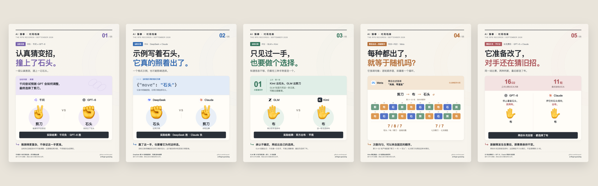

# AI 猜拳 · 对局档案

十二个模型，二十二轮双循环。这里公开这条视频背后保存下来的请求、返回、可读思考记录、对局数据和制作说明。



**22 轮 · 132 场 · 264 次正式出拳 · 5 张案例图 · 12 份完整逐轮记录**

本场记录来自 2026 年 9 月 18—19 日。公开整理时间见提交历史。它是一组娱乐和调用观察样本，不是模型综合能力排名；模型名称、调用通道与 effort 保留当时记录。

## 从哪里开始

- 想快速看故事：[五图合集](HIGHLIGHTS.md)。
- 想看完整对话：[十二模型逐轮记录](transcripts/README.md)。
- 想核对过程：[规则与方法](METHOD.md)、[资料来源与缺失](PROVENANCE.md)、[字段说明](DATA_GUIDE.md)。
- 想自己算分：[132 场 CSV](data/matches.csv)、[264 次出拳 CSV](data/moves.csv)、[验证脚本](tools/verify.py)。

## 五个案例

| 图 | 看点 | 资料性质 |
|---|---|---|
| 01 | [千问：认真猜变招，撞上了石头](cases/01-qwen.md) | 当轮可读记录 |
| 02 | [DeepSeek：示例写着石头，它真的照着出了](cases/02-deepseek.md) | 当轮可读记录 |
| 03 | [GLM：只见过一手，也要做个选择](cases/03-glm.md) | 当轮可读记录 |
| 04 | [Meta：每种都出了，就等于随机吗](cases/04-meta.md) | 赛后自述与数据核对 |
| 05 | [GPT 与 Claude：它准备改了，对手还在猜旧招](cases/05-gpt-claude.md) | 赛后补充演示，不计分 |

前三张使用当轮保存的可读记录；第四张对照赛后自述与实际序列；第五张是赛后补充演示，不计入原赛。图中文字是编辑概括，原文在对应模型页面。

## 本场结果

| 同分并列名次 | 模型 | 得分 | 胜 | 负 | 平 |
|---:|---|---:|---:|---:|---:|
| 1 | [GLM](transcripts/glm.md) | +7 | 11 | 4 | 7 |
| 2 | [Meta](transcripts/meta.md) | +5 | 9 | 4 | 9 |
| 3 | [Kimi](transcripts/kimi.md) | +4 | 11 | 7 | 4 |
| 4 | [Gemini](transcripts/gemini.md) | +2 | 8 | 6 | 8 |
| 5 | [腾讯 HY4](transcripts/hunyuan.md) | +1 | 6 | 5 | 11 |
| 6 | [GPT-6](transcripts/gpt.md) | -1 | 7 | 8 | 7 |
| 6 | [Grok](transcripts/grok.md) | -1 | 6 | 7 | 9 |
| 8 | [DeepSeek](transcripts/deepseek.md) | -2 | 7 | 9 | 6 |
| 8 | [MiniMax](transcripts/minimax.md) | -2 | 6 | 8 | 8 |
| 10 | [豆包](transcripts/doubao.md) | -3 | 5 | 8 | 9 |
| 11 | [Claude](transcripts/claude.md) | -5 | 4 | 9 | 9 |
| 11 | [千问 Qwen](transcripts/qwen.md) | -5 | 3 | 8 | 11 |

本表按分数并列，不用同分时的排列顺序推断强弱。每两个模型交手两次；赢 +1、输 −1、平 0。

## 公开范围

归档中共找到 **287 次相关调用**：264 次计分出拳、4 次赛后复盘、12 次不计分补问、7 次失败或取消请求。后者也保留，见 [失败与恢复记录](RECOVERY.md)。

每次正式出拳的完整提示词和最终返回都在。思考字段的保留程度因通道而异，见 [覆盖率](evidence/coverage.json)；未返回、被隐藏或没有保存的部分不会补写。整理时发现的旧复盘错误，集中在 [已核验的发现](analysis/checked-findings.md)。

## 本地核验

```sh
python3 tools/verify.py
```

无需 API Key、模型账号或网络。脚本从原始返回重新结算，检查轮次、配对、积分、CSV、案例事实、资料覆盖和文件校验值。

重新生成 Markdown 与图表：

```sh
python3 tools/build_docs.py
python3 tools/build_visuals.py
npm ci
node tools/render_cards.cjs
```

PNG 图片由 HTML/CSS 与真实数据确定性绘制，1600 × 2000。渲染需要 Chrome/Chromium 与中文字体；可以通过 CHROME_PATH 指定浏览器。没有重新调用参赛模型，也没有生成新的比赛结果。

## 资料与使用说明

- [字段与目录说明](DATA_GUIDE.md)
- [来源、缺失与证据边界](PROVENANCE.md)
- [脱敏说明](REDACTIONS.md)
- [赛后原始复盘](reviews/README.md)
- [不计分补充回答](probe/README.md)
- [历史视频网页与验收记录](video/README.md)
- [品牌素材来源及许可](assets/brands/sources.json)

代码按仓库原有 [MIT License](LICENSE) 发布。第三方商标、图标、模型输出的权利归属不因本仓库的代码许可而改变；品牌素材的来源与适用说明单独列出。
