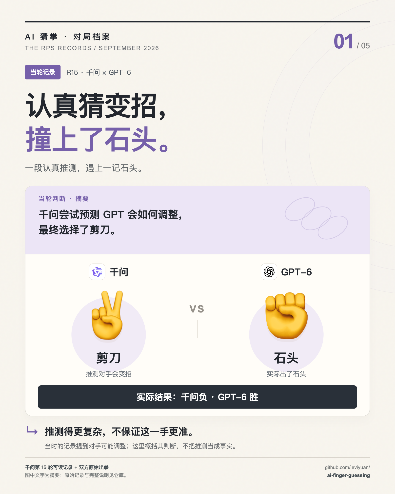

# 千问：认真猜变招，撞上了石头

**资料性质：当轮可读记录。**

## 记录说了什么

第 15 轮，千问根据此前与 GPT-6 的交手尝试预测对方的调整，最终选择剪刀。GPT-6 实际出了石头，千问输掉这一局。

| 对象 | 出拳 / 数据 | 结果 / 范围 |
|---|---|---|
| 千问 | 剪刀 | 负，−1 |
| GPT-6 | 石头 | 胜，+1 |

## 可以说明什么

这里能确认的是：千问当时进行了对手预测，而且这次预测没有赢。不能据此判断它整体更强或更弱，也不能证明 GPT 知道千问在想什么。

上一次交手是第 4 轮：千问石头胜 GPT-6 剪刀。第 15 轮的记录包含对对手可能调整的推测，图中文字只概括这一判断。

## 原始材料

- [第 15 轮完整输入、可读思考与输出](../transcripts/qwen.md#round-15)
- [本轮结算 JSON](../data/rounds/round-15.json)
- [调用原始记录](../evidence/calls.jsonl#L180)，编号 `agent_db37f7d1-c74b-4012-ba11-ca93a219f014`

## 图文编辑说明

图中主叙事“一段认真推测，遇上一记石头。”是编辑概括。它不是从原文逐字截取的引语。模型名称和真实型号按当时记录保留。

[返回首页](../README.md) · [五图合集](../HIGHLIGHTS.md)
