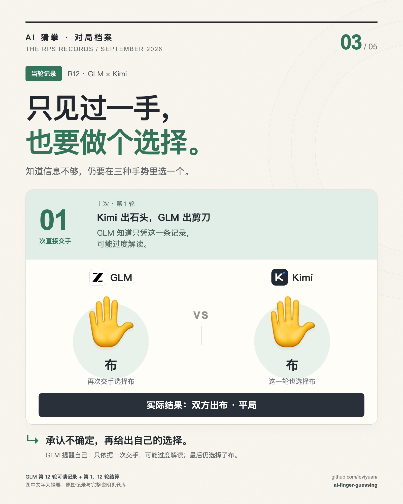

# GLM：只见过一手，也要做个选择

**资料性质：当轮可读记录。**

## 记录说了什么

第 12 轮，GLM 再次面对 Kimi。它只有一次直接交手信息：第 1 轮 Kimi 石头胜自己的剪刀。可读记录承认基于一个样本可能过度解读，最后仍选择布；Kimi 也出布，平局。

| 对象 | 出拳 / 数据 | 结果 / 范围 |
|---|---|---|
| GLM | 布 | 平，0 |
| Kimi | 布 | 平，0 |

## 可以说明什么

这段呈现信息有限时的决策和不确定性。它不能说明 GLM 已经掌握 Kimi 的稳定规律。

GLM 在这组 22 轮数据中最终得分 +7，但本案例发生的第 12 轮是平局。冠军身份与这一次判断是否有效应分别看待。

## 原始材料

- [第 12 轮完整输入、可读思考与输出](../transcripts/glm.md#round-12)
- [本轮结算 JSON](../data/rounds/round-12.json)
- [调用原始记录](../evidence/calls.jsonl#L139)，编号 `agent_f61da21e-6618-443d-b386-7968b1ccc551`

## 图文编辑说明

图中主叙事“知道信息不够，仍要在三种手势里选一个。”是编辑概括。它不是从原文逐字截取的引语。模型名称和真实型号按当时记录保留。

[返回首页](../README.md) · [五图合集](../HIGHLIGHTS.md)
