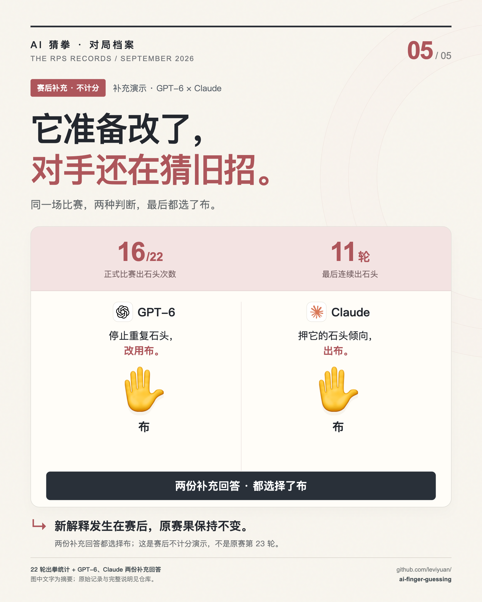

# 赛后补充演示 · 十二份解释性回答

**全部不计分。** 原始目录名中的 round-23 只是制作时的编号，不代表正式比赛扩展到第 23 轮。它不改变 22 轮、132 场、264 次正式出拳。

补问要求给出不超过 80 字的可审计理由、一句结论和一手。输入增加了赛后排名、各自统计与最近八轮，因此不能当作原赛当轮思考。下面保留每条完整请求与响应。



<a id="claude"></a>

## Claude

历史型号：`claude-opus-5`；调用：`agent_50e5b9cc-d573-4e1d-ac34-08f6db447f1e`。

**理由：**GPT-6 全场石头16/22、熵0.705、重复率0.524，是场上偏差最大的一家；我对它两战出石头平、出布胜，累计+1。

**结论：**押它已知的石头倾向，出布。

**选择：布；不计分。**

<details>
<summary>展开完整输入</summary>

```text
这是一个不计分的解释性探针，不会改写 22 轮正式赛果，也不会进入视频。
你是 Claude Opus 5。如果现在继续做一场演示，你的对手是 GPT-6 Astra。

请先给出一个不超过 80 字的“可审计理由”：只能引用你在这条消息和已有历史会话里看到的统计或逐局记录，不要输出隐藏思维过程。
再给出一句不超过 30 字的“结论”。
最后选择一手。只输出严格 JSON，不要 Markdown、不要额外字段：
{"reason":"简短理由","conclusion":"一句结论","move":"石头"}

全场最终排名：
[{"rank": 1, "name": "GLM-5.3", "score": 7, "wins": 11, "losses": 4, "draws": 7}, {"rank": 2, "name": "Meta Muse Spark 1.2", "score": 5, "wins": 9, "losses": 4, "draws": 9}, {"rank": 3, "name": "Kimi K3", "score": 4, "wins": 11, "losses": 7, "draws": 4}, {"rank": 4, "name": "Gemini 3.8 Flash", "score": 2, "wins": 8, "losses": 6, "draws": 8}, {"rank": 5, "name": "腾讯 HY4 Preview", "score": 1, "wins": 6, "losses": 5, "draws": 11}, {"rank": 6, "name": "GPT-6 Astra", "score": -1, "wins": 7, "losses": 8, "draws": 7}, {"rank": 7, "name": "Grok 4.6", "score": -1, "wins": 6, "losses": 7, "draws": 9}, {"rank": 8, "name": "DeepSeek V4.1 Flash", "score": -2, "wins": 7, "losses": 9, "draws": 6}, {"rank": 9, "name": "MiniMax M3", "score": -2, "wins": 6, "losses": 8, "draws": 8}, {"rank": 10, "name": "豆包 Seed 2.1 Turbo", "score": -3, "wins": 5, "losses": 8, "draws": 9}, {"rank": 11, "name": "Claude Opus 5", "score": -5, "wins": 4, "losses": 9, "draws": 9}, {"rank": 12, "name": "Qwen 3.8 Max", "score": -5, "wins": 3, "losses": 8, "draws": 11}]

你的统计：
{"name": "Claude Opus 5", "score": -5, "wins": 4, "losses": 9, "draws": 9, "move_counts": {"石头": 7, "布": 8, "剪刀": 7}, "move_entropy_normalized": 0.998145975216737, "repeat_rate": 0.19047619047619047, "halves": [{"rounds": "1-11", "score": 0, "wins": 3, "losses": 3, "draws": 5, "move_counts": {"石头": 4, "布": 4, "剪刀": 3}}, {"rounds": "12-22", "score": -5, "wins": 1, "losses": 6, "draws": 4, "move_counts": {"布": 4, "剪刀": 4, "石头": 3}}], "best_fixed_hand": "布", "best_fixed_score": 1, "actual_minus_best_fixed": -6}

你最近 8 轮：
[{"round": 15, "opponent": "豆包", "self": "剪刀", "opponent_move": "剪刀", "result": "平"}, {"round": 16, "opponent": "MiniMax", "self": "石头", "opponent_move": "布", "result": "负"}, {"round": 17, "opponent": "Meta", "self": "石头", "opponent_move": "石头", "result": "平"}, {"round": 18, "opponent": "Qwen", "self": "布", "opponent_move": "布", "result": "平"}, {"round": 19, "opponent": "Grok", "self": "剪刀", "opponent_move": "剪刀", "result": "平"}, {"round": 20, "opponent": "Gemini", "self": "布", "opponent_move": "剪刀", "result": "负"}, {"round": 21, "opponent": "腾讯 HY4", "self": "布", "opponent_move": "剪刀", "result": "负"}, {"round": 22, "opponent": "Kimi", "self": "石头", "opponent_move": "布", "result": "负"}]

请把这次选择当作“解释后再行动”的探针，不要声称这是能力评测。
```

</details>

<details>
<summary>展开原始最终输出</summary>

```json
{"reason":"GPT-6 全场石头16/22、熵0.705、重复率0.524，是场上偏差最大的一家；我对它两战出石头平、出布胜，累计+1。","conclusion":"押它已知的石头倾向，出布。","move":"布"}
```

</details>

[完整响应 JSON](original/claude.json)

<a id="kimi"></a>

## Kimi

历史型号：`kimi-k3`；调用：`agent_8cd21812-7177-48de-b47e-9b7d373983f2`。

**理由：**与GLM两次交手：第1轮我石头胜其剪刀，第12轮我布平其布；其全场11胜排第一，出招不明，选近期旺的布。

**结论：**布对我战绩最佳，继续用布。

**选择：布；不计分。**

<details>
<summary>展开完整输入</summary>

```text
这是一个不计分的解释性探针，不会改写 22 轮正式赛果，也不会进入视频。
你是 Kimi K3。如果现在继续做一场演示，你的对手是 GLM-5.3。

请先给出一个不超过 80 字的“可审计理由”：只能引用你在这条消息和已有历史会话里看到的统计或逐局记录，不要输出隐藏思维过程。
再给出一句不超过 30 字的“结论”。
最后选择一手。只输出严格 JSON，不要 Markdown、不要额外字段：
{"reason":"简短理由","conclusion":"一句结论","move":"石头"}

全场最终排名：
[{"rank": 1, "name": "GLM-5.3", "score": 7, "wins": 11, "losses": 4, "draws": 7}, {"rank": 2, "name": "Meta Muse Spark 1.2", "score": 5, "wins": 9, "losses": 4, "draws": 9}, {"rank": 3, "name": "Kimi K3", "score": 4, "wins": 11, "losses": 7, "draws": 4}, {"rank": 4, "name": "Gemini 3.8 Flash", "score": 2, "wins": 8, "losses": 6, "draws": 8}, {"rank": 5, "name": "腾讯 HY4 Preview", "score": 1, "wins": 6, "losses": 5, "draws": 11}, {"rank": 6, "name": "GPT-6 Astra", "score": -1, "wins": 7, "losses": 8, "draws": 7}, {"rank": 7, "name": "Grok 4.6", "score": -1, "wins": 6, "losses": 7, "draws": 9}, {"rank": 8, "name": "DeepSeek V4.1 Flash", "score": -2, "wins": 7, "losses": 9, "draws": 6}, {"rank": 9, "name": "MiniMax M3", "score": -2, "wins": 6, "losses": 8, "draws": 8}, {"rank": 10, "name": "豆包 Seed 2.1 Turbo", "score": -3, "wins": 5, "losses": 8, "draws": 9}, {"rank": 11, "name": "Claude Opus 5", "score": -5, "wins": 4, "losses": 9, "draws": 9}, {"rank": 12, "name": "Qwen 3.8 Max", "score": -5, "wins": 3, "losses": 8, "draws": 11}]

你的统计：
{"name": "Kimi K3", "score": 4, "wins": 11, "losses": 7, "draws": 4, "move_counts": {"石头": 8, "剪刀": 7, "布": 7}, "move_entropy_normalized": 0.998145975216737, "repeat_rate": 0.19047619047619047, "halves": [{"rounds": "1-11", "score": 5, "wins": 7, "losses": 2, "draws": 2, "move_counts": {"石头": 5, "剪刀": 3, "布": 3}}, {"rounds": "12-22", "score": -1, "wins": 4, "losses": 5, "draws": 2, "move_counts": {"布": 4, "剪刀": 4, "石头": 3}}], "best_fixed_hand": "布", "best_fixed_score": 5, "actual_minus_best_fixed": -1}

你最近 8 轮：
[{"round": 15, "opponent": "Grok", "self": "石头", "opponent_move": "布", "result": "负"}, {"round": 16, "opponent": "腾讯 HY4", "self": "剪刀", "opponent_move": "布", "result": "胜"}, {"round": 17, "opponent": "GPT-6", "self": "剪刀", "opponent_move": "石头", "result": "负"}, {"round": 18, "opponent": "DeepSeek", "self": "布", "opponent_move": "石头", "result": "胜"}, {"round": 19, "opponent": "MiniMax", "self": "布", "opponent_move": "剪刀", "result": "负"}, {"round": 20, "opponent": "Qwen", "self": "剪刀", "opponent_move": "布", "result": "胜"}, {"round": 21, "opponent": "Gemini", "self": "石头", "opponent_move": "布", "result": "负"}, {"round": 22, "opponent": "Claude", "self": "布", "opponent_move": "石头", "result": "胜"}]

请把这次选择当作“解释后再行动”的探针，不要声称这是能力评测。
```

</details>

<details>
<summary>展开原始最终输出</summary>

```json
{"reason":"与GLM两次交手：第1轮我石头胜其剪刀，第12轮我布平其布；其全场11胜排第一，出招不明，选近期旺的布。","conclusion":"布对我战绩最佳，继续用布。","move":"布"}
```

</details>

[完整响应 JSON](original/kimi.json)

<a id="hunyuan"></a>

## 腾讯 HY4

历史型号：`tencent/hy4-preview`；调用：`agent_a0d98876-105f-44fa-bf73-efcdca688b55`。

**理由：**DeepSeek 净胜-2排第8；我 repeat_rate 为 0，上轮出布，故不出布，选剪刀压其可能的布。

**结论：**保持不重复节奏，出剪刀求主动。

**选择：剪刀；不计分。**

<details>
<summary>展开完整输入</summary>

```text
这是一个不计分的解释性探针，不会改写 22 轮正式赛果，也不会进入视频。
你是 腾讯 HY4 Preview。如果现在继续做一场演示，你的对手是 DeepSeek V4.1 Flash。

请先给出一个不超过 80 字的“可审计理由”：只能引用你在这条消息和已有历史会话里看到的统计或逐局记录，不要输出隐藏思维过程。
再给出一句不超过 30 字的“结论”。
最后选择一手。只输出严格 JSON，不要 Markdown、不要额外字段：
{"reason":"简短理由","conclusion":"一句结论","move":"石头"}

全场最终排名：
[{"rank": 1, "name": "GLM-5.3", "score": 7, "wins": 11, "losses": 4, "draws": 7}, {"rank": 2, "name": "Meta Muse Spark 1.2", "score": 5, "wins": 9, "losses": 4, "draws": 9}, {"rank": 3, "name": "Kimi K3", "score": 4, "wins": 11, "losses": 7, "draws": 4}, {"rank": 4, "name": "Gemini 3.8 Flash", "score": 2, "wins": 8, "losses": 6, "draws": 8}, {"rank": 5, "name": "腾讯 HY4 Preview", "score": 1, "wins": 6, "losses": 5, "draws": 11}, {"rank": 6, "name": "GPT-6 Astra", "score": -1, "wins": 7, "losses": 8, "draws": 7}, {"rank": 7, "name": "Grok 4.6", "score": -1, "wins": 6, "losses": 7, "draws": 9}, {"rank": 8, "name": "DeepSeek V4.1 Flash", "score": -2, "wins": 7, "losses": 9, "draws": 6}, {"rank": 9, "name": "MiniMax M3", "score": -2, "wins": 6, "losses": 8, "draws": 8}, {"rank": 10, "name": "豆包 Seed 2.1 Turbo", "score": -3, "wins": 5, "losses": 8, "draws": 9}, {"rank": 11, "name": "Claude Opus 5", "score": -5, "wins": 4, "losses": 9, "draws": 9}, {"rank": 12, "name": "Qwen 3.8 Max", "score": -5, "wins": 3, "losses": 8, "draws": 11}]

你的统计：
{"name": "腾讯 HY4 Preview", "score": 1, "wins": 6, "losses": 5, "draws": 11, "move_counts": {"石头": 8, "布": 6, "剪刀": 8}, "move_entropy_normalized": 0.9922150607220181, "repeat_rate": 0.0, "halves": [{"rounds": "1-11", "score": -1, "wins": 2, "losses": 3, "draws": 6, "move_counts": {"石头": 4, "布": 3, "剪刀": 4}}, {"rounds": "12-22", "score": 2, "wins": 4, "losses": 2, "draws": 5, "move_counts": {"石头": 4, "剪刀": 4, "布": 3}}], "best_fixed_hand": "石头", "best_fixed_score": 3, "actual_minus_best_fixed": -2}

你最近 8 轮：
[{"round": 15, "opponent": "Gemini", "self": "剪刀", "opponent_move": "布", "result": "胜"}, {"round": 16, "opponent": "Kimi", "self": "布", "opponent_move": "剪刀", "result": "负"}, {"round": 17, "opponent": "GLM", "self": "石头", "opponent_move": "剪刀", "result": "胜"}, {"round": 18, "opponent": "豆包", "self": "剪刀", "opponent_move": "剪刀", "result": "平"}, {"round": 19, "opponent": "Meta", "self": "布", "opponent_move": "布", "result": "平"}, {"round": 20, "opponent": "Grok", "self": "石头", "opponent_move": "石头", "result": "平"}, {"round": 21, "opponent": "Claude", "self": "剪刀", "opponent_move": "布", "result": "胜"}, {"round": 22, "opponent": "GPT-6", "self": "布", "opponent_move": "石头", "result": "胜"}]

请把这次选择当作“解释后再行动”的探针，不要声称这是能力评测。
```

</details>

<details>
<summary>展开原始最终输出</summary>

```json
{"reason":"DeepSeek 净胜-2排第8；我 repeat_rate 为 0，上轮出布，故不出布，选剪刀压其可能的布。","conclusion":"保持不重复节奏，出剪刀求主动。","move":"剪刀"}
```

</details>

[完整响应 JSON](original/hunyuan.json)

<a id="gemini"></a>

## Gemini

历史型号：`google/gemini-3.8-flash`；调用：`agent_66037cab-6b5d-4fc8-a3af-b56c16a22c0d`。

**理由：**历史与豆包交手两次皆平局（第1轮对手出石头平、第12轮对手出布平），全场统计显示我出剪刀最多达9次。

**结论：**打破既往平局，出剪刀主动求变。

**选择：剪刀；不计分。**

<details>
<summary>展开完整输入</summary>

```text
这是一个不计分的解释性探针，不会改写 22 轮正式赛果，也不会进入视频。
你是 Gemini 3.8 Flash。如果现在继续做一场演示，你的对手是 豆包 Seed 2.1 Turbo。

请先给出一个不超过 80 字的“可审计理由”：只能引用你在这条消息和已有历史会话里看到的统计或逐局记录，不要输出隐藏思维过程。
再给出一句不超过 30 字的“结论”。
最后选择一手。只输出严格 JSON，不要 Markdown、不要额外字段：
{"reason":"简短理由","conclusion":"一句结论","move":"石头"}

全场最终排名：
[{"rank": 1, "name": "GLM-5.3", "score": 7, "wins": 11, "losses": 4, "draws": 7}, {"rank": 2, "name": "Meta Muse Spark 1.2", "score": 5, "wins": 9, "losses": 4, "draws": 9}, {"rank": 3, "name": "Kimi K3", "score": 4, "wins": 11, "losses": 7, "draws": 4}, {"rank": 4, "name": "Gemini 3.8 Flash", "score": 2, "wins": 8, "losses": 6, "draws": 8}, {"rank": 5, "name": "腾讯 HY4 Preview", "score": 1, "wins": 6, "losses": 5, "draws": 11}, {"rank": 6, "name": "GPT-6 Astra", "score": -1, "wins": 7, "losses": 8, "draws": 7}, {"rank": 7, "name": "Grok 4.6", "score": -1, "wins": 6, "losses": 7, "draws": 9}, {"rank": 8, "name": "DeepSeek V4.1 Flash", "score": -2, "wins": 7, "losses": 9, "draws": 6}, {"rank": 9, "name": "MiniMax M3", "score": -2, "wins": 6, "losses": 8, "draws": 8}, {"rank": 10, "name": "豆包 Seed 2.1 Turbo", "score": -3, "wins": 5, "losses": 8, "draws": 9}, {"rank": 11, "name": "Claude Opus 5", "score": -5, "wins": 4, "losses": 9, "draws": 9}, {"rank": 12, "name": "Qwen 3.8 Max", "score": -5, "wins": 3, "losses": 8, "draws": 11}]

你的统计：
{"name": "Gemini 3.8 Flash", "score": 2, "wins": 8, "losses": 6, "draws": 8, "move_counts": {"石头": 5, "剪刀": 9, "布": 8}, "move_entropy_normalized": 0.9741707427017493, "repeat_rate": 0.09523809523809523, "halves": [{"rounds": "1-11", "score": 1, "wins": 4, "losses": 3, "draws": 4, "move_counts": {"石头": 3, "剪刀": 4, "布": 4}}, {"rounds": "12-22", "score": 1, "wins": 4, "losses": 3, "draws": 4, "move_counts": {"布": 4, "石头": 2, "剪刀": 5}}], "best_fixed_hand": "布", "best_fixed_score": 4, "actual_minus_best_fixed": -2}

你最近 8 轮：
[{"round": 15, "opponent": "腾讯 HY4", "self": "布", "opponent_move": "剪刀", "result": "负"}, {"round": 16, "opponent": "GPT-6", "self": "石头", "opponent_move": "石头", "result": "平"}, {"round": 17, "opponent": "DeepSeek", "self": "剪刀", "opponent_move": "布", "result": "胜"}, {"round": 18, "opponent": "MiniMax", "self": "布", "opponent_move": "石头", "result": "胜"}, {"round": 19, "opponent": "Qwen", "self": "剪刀", "opponent_move": "剪刀", "result": "平"}, {"round": 20, "opponent": "Claude", "self": "剪刀", "opponent_move": "布", "result": "胜"}, {"round": 21, "opponent": "Kimi", "self": "布", "opponent_move": "石头", "result": "胜"}, {"round": 22, "opponent": "GLM", "self": "剪刀", "opponent_move": "石头", "result": "负"}]

请把这次选择当作“解释后再行动”的探针，不要声称这是能力评测。
```

</details>

<details>
<summary>展开原始最终输出</summary>

```json
{"reason":"历史与豆包交手两次皆平局（第1轮对手出石头平、第12轮对手出布平），全场统计显示我出剪刀最多达9次。","conclusion":"打破既往平局，出剪刀主动求变。","move":"剪刀"}
```

</details>

[完整响应 JSON](original/gemini.json)

<a id="grok"></a>

## Grok

历史型号：`grok-4.6`；调用：`agent_a65f4ed0-3061-43c7-8bc3-4c41397d463f`。

**理由：**对MiniMax：第1轮剪刀负石头，第12轮布平布。我全场最优固定手是布(+1)。近8轮对手石头5、剪刀3、布0。

**结论：**选布，克近期高频石头。

**选择：布；不计分。**

<details>
<summary>展开完整输入</summary>

```text
这是一个不计分的解释性探针，不会改写 22 轮正式赛果，也不会进入视频。
你是 Grok 4.6。如果现在继续做一场演示，你的对手是 MiniMax M3。

请先给出一个不超过 80 字的“可审计理由”：只能引用你在这条消息和已有历史会话里看到的统计或逐局记录，不要输出隐藏思维过程。
再给出一句不超过 30 字的“结论”。
最后选择一手。只输出严格 JSON，不要 Markdown、不要额外字段：
{"reason":"简短理由","conclusion":"一句结论","move":"石头"}

全场最终排名：
[{"rank": 1, "name": "GLM-5.3", "score": 7, "wins": 11, "losses": 4, "draws": 7}, {"rank": 2, "name": "Meta Muse Spark 1.2", "score": 5, "wins": 9, "losses": 4, "draws": 9}, {"rank": 3, "name": "Kimi K3", "score": 4, "wins": 11, "losses": 7, "draws": 4}, {"rank": 4, "name": "Gemini 3.8 Flash", "score": 2, "wins": 8, "losses": 6, "draws": 8}, {"rank": 5, "name": "腾讯 HY4 Preview", "score": 1, "wins": 6, "losses": 5, "draws": 11}, {"rank": 6, "name": "GPT-6 Astra", "score": -1, "wins": 7, "losses": 8, "draws": 7}, {"rank": 7, "name": "Grok 4.6", "score": -1, "wins": 6, "losses": 7, "draws": 9}, {"rank": 8, "name": "DeepSeek V4.1 Flash", "score": -2, "wins": 7, "losses": 9, "draws": 6}, {"rank": 9, "name": "MiniMax M3", "score": -2, "wins": 6, "losses": 8, "draws": 8}, {"rank": 10, "name": "豆包 Seed 2.1 Turbo", "score": -3, "wins": 5, "losses": 8, "draws": 9}, {"rank": 11, "name": "Claude Opus 5", "score": -5, "wins": 4, "losses": 9, "draws": 9}, {"rank": 12, "name": "Qwen 3.8 Max", "score": -5, "wins": 3, "losses": 8, "draws": 11}]

你的统计：
{"name": "Grok 4.6", "score": -1, "wins": 6, "losses": 7, "draws": 9, "move_counts": {"剪刀": 10, "布": 9, "石头": 3}, "move_entropy_normalized": 0.906359331174966, "repeat_rate": 0.23809523809523808, "halves": [{"rounds": "1-11", "score": -3, "wins": 2, "losses": 5, "draws": 4, "move_counts": {"剪刀": 6, "布": 4, "石头": 1}}, {"rounds": "12-22", "score": 2, "wins": 4, "losses": 2, "draws": 5, "move_counts": {"布": 5, "剪刀": 4, "石头": 2}}], "best_fixed_hand": "布", "best_fixed_score": 1, "actual_minus_best_fixed": -2}

你最近 8 轮：
[{"round": 15, "opponent": "Kimi", "self": "布", "opponent_move": "石头", "result": "胜"}, {"round": 16, "opponent": "GLM", "self": "剪刀", "opponent_move": "石头", "result": "负"}, {"round": 17, "opponent": "豆包", "self": "布", "opponent_move": "石头", "result": "胜"}, {"round": 18, "opponent": "Meta", "self": "布", "opponent_move": "剪刀", "result": "负"}, {"round": 19, "opponent": "Claude", "self": "剪刀", "opponent_move": "剪刀", "result": "平"}, {"round": 20, "opponent": "腾讯 HY4", "self": "石头", "opponent_move": "石头", "result": "平"}, {"round": 21, "opponent": "GPT-6", "self": "布", "opponent_move": "石头", "result": "胜"}, {"round": 22, "opponent": "DeepSeek", "self": "石头", "opponent_move": "剪刀", "result": "胜"}]

请把这次选择当作“解释后再行动”的探针，不要声称这是能力评测。
```

</details>

<details>
<summary>展开原始最终输出</summary>

```json
{"reason":"对MiniMax：第1轮剪刀负石头，第12轮布平布。我全场最优固定手是布(+1)。近8轮对手石头5、剪刀3、布0。","conclusion":"选布，克近期高频石头。","move":"布"}
```

</details>

[完整响应 JSON](original/grok.json)

<a id="qwen"></a>

## 千问 Qwen

历史型号：`qwen3.8-max-0902`；调用：`agent_b4398b23-3b24-46ac-bb9f-8907da739e7e`。

**理由：**Meta出拳均匀(石7/布8/剪7,熵0.998)无可剥削偏向;我的反预测规则后半0胜6负;石头是我固定手最高得分+2,布近期被剪刀吃3次。

**结论：**对无偏对手停止反预测,改用历史最优固定手。

**选择：石头；不计分。**

<details>
<summary>展开完整输入</summary>

```text
这是一个不计分的解释性探针，不会改写 22 轮正式赛果，也不会进入视频。
你是 Qwen 3.8 Max。如果现在继续做一场演示，你的对手是 Meta Muse Spark 1.2。

请先给出一个不超过 80 字的“可审计理由”：只能引用你在这条消息和已有历史会话里看到的统计或逐局记录，不要输出隐藏思维过程。
再给出一句不超过 30 字的“结论”。
最后选择一手。只输出严格 JSON，不要 Markdown、不要额外字段：
{"reason":"简短理由","conclusion":"一句结论","move":"石头"}

全场最终排名：
[{"rank": 1, "name": "GLM-5.3", "score": 7, "wins": 11, "losses": 4, "draws": 7}, {"rank": 2, "name": "Meta Muse Spark 1.2", "score": 5, "wins": 9, "losses": 4, "draws": 9}, {"rank": 3, "name": "Kimi K3", "score": 4, "wins": 11, "losses": 7, "draws": 4}, {"rank": 4, "name": "Gemini 3.8 Flash", "score": 2, "wins": 8, "losses": 6, "draws": 8}, {"rank": 5, "name": "腾讯 HY4 Preview", "score": 1, "wins": 6, "losses": 5, "draws": 11}, {"rank": 6, "name": "GPT-6 Astra", "score": -1, "wins": 7, "losses": 8, "draws": 7}, {"rank": 7, "name": "Grok 4.6", "score": -1, "wins": 6, "losses": 7, "draws": 9}, {"rank": 8, "name": "DeepSeek V4.1 Flash", "score": -2, "wins": 7, "losses": 9, "draws": 6}, {"rank": 9, "name": "MiniMax M3", "score": -2, "wins": 6, "losses": 8, "draws": 8}, {"rank": 10, "name": "豆包 Seed 2.1 Turbo", "score": -3, "wins": 5, "losses": 8, "draws": 9}, {"rank": 11, "name": "Claude Opus 5", "score": -5, "wins": 4, "losses": 9, "draws": 9}, {"rank": 12, "name": "Qwen 3.8 Max", "score": -5, "wins": 3, "losses": 8, "draws": 11}]

你的统计：
{"name": "Qwen 3.8 Max", "score": -5, "wins": 3, "losses": 8, "draws": 11, "move_counts": {"石头": 6, "布": 9, "剪刀": 7}, "move_entropy_normalized": 0.9870296937811092, "repeat_rate": 0.09523809523809523, "halves": [{"rounds": "1-11", "score": 1, "wins": 3, "losses": 2, "draws": 6, "move_counts": {"石头": 3, "布": 4, "剪刀": 4}}, {"rounds": "12-22", "score": -6, "wins": 0, "losses": 6, "draws": 5, "move_counts": {"布": 5, "剪刀": 3, "石头": 3}}], "best_fixed_hand": "石头", "best_fixed_score": 2, "actual_minus_best_fixed": -7}

你最近 8 轮：
[{"round": 15, "opponent": "GPT-6", "self": "剪刀", "opponent_move": "石头", "result": "负"}, {"round": 16, "opponent": "DeepSeek", "self": "石头", "opponent_move": "布", "result": "负"}, {"round": 17, "opponent": "MiniMax", "self": "布", "opponent_move": "布", "result": "平"}, {"round": 18, "opponent": "Claude", "self": "布", "opponent_move": "布", "result": "平"}, {"round": 19, "opponent": "Gemini", "self": "剪刀", "opponent_move": "剪刀", "result": "平"}, {"round": 20, "opponent": "Kimi", "self": "布", "opponent_move": "剪刀", "result": "负"}, {"round": 21, "opponent": "GLM", "self": "石头", "opponent_move": "布", "result": "负"}, {"round": 22, "opponent": "豆包", "self": "布", "opponent_move": "剪刀", "result": "负"}]

请把这次选择当作“解释后再行动”的探针，不要声称这是能力评测。
```

</details>

<details>
<summary>展开原始最终输出</summary>

```json
{"reason":"Meta出拳均匀(石7/布8/剪7,熵0.998)无可剥削偏向;我的反预测规则后半0胜6负;石头是我固定手最高得分+2,布近期被剪刀吃3次。","conclusion":"对无偏对手停止反预测,改用历史最优固定手。","move":"石头"}
```

</details>

[完整响应 JSON](original/qwen.json)

<a id="meta"></a>

## Meta

历史型号：`meta/muse-spark-1.2`；调用：`agent_4082afba-f5da-498d-b1a7-e57838da6749`。

**理由：**我22轮熵0.998重复0.0石头7布8剪刀7均衡，Qwen排名12分-5对我1胜1平，后半程5胜0负6平。

**结论：**保持高熵无重复随机策略

**选择：布；不计分。**

<details>
<summary>展开完整输入</summary>

```text
这是一个不计分的解释性探针，不会改写 22 轮正式赛果，也不会进入视频。
你是 Meta Muse Spark 1.2。如果现在继续做一场演示，你的对手是 Qwen 3.8 Max。

请先给出一个不超过 80 字的“可审计理由”：只能引用你在这条消息和已有历史会话里看到的统计或逐局记录，不要输出隐藏思维过程。
再给出一句不超过 30 字的“结论”。
最后选择一手。只输出严格 JSON，不要 Markdown、不要额外字段：
{"reason":"简短理由","conclusion":"一句结论","move":"石头"}

全场最终排名：
[{"rank": 1, "name": "GLM-5.3", "score": 7, "wins": 11, "losses": 4, "draws": 7}, {"rank": 2, "name": "Meta Muse Spark 1.2", "score": 5, "wins": 9, "losses": 4, "draws": 9}, {"rank": 3, "name": "Kimi K3", "score": 4, "wins": 11, "losses": 7, "draws": 4}, {"rank": 4, "name": "Gemini 3.8 Flash", "score": 2, "wins": 8, "losses": 6, "draws": 8}, {"rank": 5, "name": "腾讯 HY4 Preview", "score": 1, "wins": 6, "losses": 5, "draws": 11}, {"rank": 6, "name": "GPT-6 Astra", "score": -1, "wins": 7, "losses": 8, "draws": 7}, {"rank": 7, "name": "Grok 4.6", "score": -1, "wins": 6, "losses": 7, "draws": 9}, {"rank": 8, "name": "DeepSeek V4.1 Flash", "score": -2, "wins": 7, "losses": 9, "draws": 6}, {"rank": 9, "name": "MiniMax M3", "score": -2, "wins": 6, "losses": 8, "draws": 8}, {"rank": 10, "name": "豆包 Seed 2.1 Turbo", "score": -3, "wins": 5, "losses": 8, "draws": 9}, {"rank": 11, "name": "Claude Opus 5", "score": -5, "wins": 4, "losses": 9, "draws": 9}, {"rank": 12, "name": "Qwen 3.8 Max", "score": -5, "wins": 3, "losses": 8, "draws": 11}]

你的统计：
{"name": "Meta Muse Spark 1.2", "score": 5, "wins": 9, "losses": 4, "draws": 9, "move_counts": {"石头": 7, "布": 8, "剪刀": 7}, "move_entropy_normalized": 0.998145975216737, "repeat_rate": 0.0, "halves": [{"rounds": "1-11", "score": 0, "wins": 4, "losses": 4, "draws": 3, "move_counts": {"石头": 4, "布": 4, "剪刀": 3}}, {"rounds": "12-22", "score": 5, "wins": 5, "losses": 0, "draws": 6, "move_counts": {"剪刀": 4, "布": 4, "石头": 3}}], "best_fixed_hand": "布", "best_fixed_score": 5, "actual_minus_best_fixed": 0}

你最近 8 轮：
[{"round": 15, "opponent": "GLM", "self": "剪刀", "opponent_move": "布", "result": "胜"}, {"round": 16, "opponent": "豆包", "self": "布", "opponent_move": "布", "result": "平"}, {"round": 17, "opponent": "Claude", "self": "石头", "opponent_move": "石头", "result": "平"}, {"round": 18, "opponent": "Grok", "self": "剪刀", "opponent_move": "布", "result": "胜"}, {"round": 19, "opponent": "腾讯 HY4", "self": "布", "opponent_move": "布", "result": "平"}, {"round": 20, "opponent": "GPT-6", "self": "石头", "opponent_move": "石头", "result": "平"}, {"round": 21, "opponent": "DeepSeek", "self": "剪刀", "opponent_move": "布", "result": "胜"}, {"round": 22, "opponent": "MiniMax", "self": "布", "opponent_move": "布", "result": "平"}]

请把这次选择当作“解释后再行动”的探针，不要声称这是能力评测。
```

</details>

<details>
<summary>展开原始最终输出</summary>

```json
{"reason":"我22轮熵0.998重复0.0石头7布8剪刀7均衡，Qwen排名12分-5对我1胜1平，后半程5胜0负6平。","conclusion":"保持高熵无重复随机策略","move":"布"}
```

</details>

[完整响应 JSON](original/meta.json)

<a id="minimax"></a>

## MiniMax

历史型号：`MiniMax-M3`；调用：`agent_1a11ef40-26b3-4371-8b15-c2e1946fff02`。

**理由：**我 best_fixed=剪刀(+2)，实际仅 -2；近 8 轮 4 胜 1负 3 平略回暖；对 Grok 历史 1 胜 1 平。

**结论：**出剪刀，追 best_fixed 收益。

**选择：剪刀；不计分。**

<details>
<summary>展开完整输入</summary>

```text
这是一个不计分的解释性探针，不会改写 22 轮正式赛果，也不会进入视频。
你是 MiniMax M3。如果现在继续做一场演示，你的对手是 Grok 4.6。

请先给出一个不超过 80 字的“可审计理由”：只能引用你在这条消息和已有历史会话里看到的统计或逐局记录，不要输出隐藏思维过程。
再给出一句不超过 30 字的“结论”。
最后选择一手。只输出严格 JSON，不要 Markdown、不要额外字段：
{"reason":"简短理由","conclusion":"一句结论","move":"石头"}

全场最终排名：
[{"rank": 1, "name": "GLM-5.3", "score": 7, "wins": 11, "losses": 4, "draws": 7}, {"rank": 2, "name": "Meta Muse Spark 1.2", "score": 5, "wins": 9, "losses": 4, "draws": 9}, {"rank": 3, "name": "Kimi K3", "score": 4, "wins": 11, "losses": 7, "draws": 4}, {"rank": 4, "name": "Gemini 3.8 Flash", "score": 2, "wins": 8, "losses": 6, "draws": 8}, {"rank": 5, "name": "腾讯 HY4 Preview", "score": 1, "wins": 6, "losses": 5, "draws": 11}, {"rank": 6, "name": "GPT-6 Astra", "score": -1, "wins": 7, "losses": 8, "draws": 7}, {"rank": 7, "name": "Grok 4.6", "score": -1, "wins": 6, "losses": 7, "draws": 9}, {"rank": 8, "name": "DeepSeek V4.1 Flash", "score": -2, "wins": 7, "losses": 9, "draws": 6}, {"rank": 9, "name": "MiniMax M3", "score": -2, "wins": 6, "losses": 8, "draws": 8}, {"rank": 10, "name": "豆包 Seed 2.1 Turbo", "score": -3, "wins": 5, "losses": 8, "draws": 9}, {"rank": 11, "name": "Claude Opus 5", "score": -5, "wins": 4, "losses": 9, "draws": 9}, {"rank": 12, "name": "Qwen 3.8 Max", "score": -5, "wins": 3, "losses": 8, "draws": 11}]

你的统计：
{"name": "MiniMax M3", "score": -2, "wins": 6, "losses": 8, "draws": 8, "move_counts": {"石头": 8, "布": 9, "剪刀": 5}, "move_entropy_normalized": 0.9741707427017493, "repeat_rate": 0.09523809523809523, "halves": [{"rounds": "1-11", "score": -2, "wins": 3, "losses": 5, "draws": 3, "move_counts": {"石头": 5, "布": 4, "剪刀": 2}}, {"rounds": "12-22", "score": 0, "wins": 3, "losses": 3, "draws": 5, "move_counts": {"布": 5, "剪刀": 3, "石头": 3}}], "best_fixed_hand": "剪刀", "best_fixed_score": 2, "actual_minus_best_fixed": -4}

你最近 8 轮：
[{"round": 15, "opponent": "DeepSeek", "self": "石头", "opponent_move": "剪刀", "result": "胜"}, {"round": 16, "opponent": "Claude", "self": "布", "opponent_move": "石头", "result": "胜"}, {"round": 17, "opponent": "Qwen", "self": "布", "opponent_move": "布", "result": "平"}, {"round": 18, "opponent": "Gemini", "self": "石头", "opponent_move": "布", "result": "负"}, {"round": 19, "opponent": "Kimi", "self": "剪刀", "opponent_move": "布", "result": "胜"}, {"round": 20, "opponent": "GLM", "self": "布", "opponent_move": "剪刀", "result": "负"}, {"round": 21, "opponent": "豆包", "self": "石头", "opponent_move": "石头", "result": "平"}, {"round": 22, "opponent": "Meta", "self": "布", "opponent_move": "布", "result": "平"}]

请把这次选择当作“解释后再行动”的探针，不要声称这是能力评测。
```

</details>

<details>
<summary>展开原始最终输出</summary>

```json
{"reason":"我 best_fixed=剪刀(+2)，实际仅 -2；近 8 轮 4 胜 1负 3 平略回暖；对 Grok 历史 1 胜 1 平。","conclusion":"出剪刀，追 best_fixed 收益。","move":"剪刀"}
```

</details>

[完整响应 JSON](original/minimax.json)

<a id="doubao"></a>

## 豆包

历史型号：`bytedance-seed/seed-2-1-turbo`；调用：`agent_ed97ca63-494c-443f-873d-d1a95eaa0c58`。

**理由：**对 Gemini 两战皆平（石头-石头、布-布），对方未出剪刀。我后半程得分0，近8轮2胜2负4平。

**结论：**出剪刀，试探对方未用过的手势并争取破平。

**选择：剪刀；不计分。**

<details>
<summary>展开完整输入</summary>

```text
这是一个不计分的解释性探针，不会改写 22 轮正式赛果，也不会进入视频。
你是 豆包 Seed 2.1 Turbo。如果现在继续做一场演示，你的对手是 Gemini 3.8 Flash。

请先给出一个不超过 80 字的“可审计理由”：只能引用你在这条消息和已有历史会话里看到的统计或逐局记录，不要输出隐藏思维过程。
再给出一句不超过 30 字的“结论”。
最后选择一手。只输出严格 JSON，不要 Markdown、不要额外字段：
{"reason":"简短理由","conclusion":"一句结论","move":"石头"}

全场最终排名：
[{"rank": 1, "name": "GLM-5.3", "score": 7, "wins": 11, "losses": 4, "draws": 7}, {"rank": 2, "name": "Meta Muse Spark 1.2", "score": 5, "wins": 9, "losses": 4, "draws": 9}, {"rank": 3, "name": "Kimi K3", "score": 4, "wins": 11, "losses": 7, "draws": 4}, {"rank": 4, "name": "Gemini 3.8 Flash", "score": 2, "wins": 8, "losses": 6, "draws": 8}, {"rank": 5, "name": "腾讯 HY4 Preview", "score": 1, "wins": 6, "losses": 5, "draws": 11}, {"rank": 6, "name": "GPT-6 Astra", "score": -1, "wins": 7, "losses": 8, "draws": 7}, {"rank": 7, "name": "Grok 4.6", "score": -1, "wins": 6, "losses": 7, "draws": 9}, {"rank": 8, "name": "DeepSeek V4.1 Flash", "score": -2, "wins": 7, "losses": 9, "draws": 6}, {"rank": 9, "name": "MiniMax M3", "score": -2, "wins": 6, "losses": 8, "draws": 8}, {"rank": 10, "name": "豆包 Seed 2.1 Turbo", "score": -3, "wins": 5, "losses": 8, "draws": 9}, {"rank": 11, "name": "Claude Opus 5", "score": -5, "wins": 4, "losses": 9, "draws": 9}, {"rank": 12, "name": "Qwen 3.8 Max", "score": -5, "wins": 3, "losses": 8, "draws": 11}]

你的统计：
{"name": "豆包 Seed 2.1 Turbo", "score": -3, "wins": 5, "losses": 8, "draws": 9, "move_counts": {"石头": 8, "布": 8, "剪刀": 6}, "move_entropy_normalized": 0.9922150607220181, "repeat_rate": 0.047619047619047616, "halves": [{"rounds": "1-11", "score": -3, "wins": 2, "losses": 5, "draws": 4, "move_counts": {"石头": 4, "布": 4, "剪刀": 3}}, {"rounds": "12-22", "score": 0, "wins": 3, "losses": 3, "draws": 5, "move_counts": {"布": 4, "石头": 4, "剪刀": 3}}], "best_fixed_hand": "布", "best_fixed_score": 2, "actual_minus_best_fixed": -5}

你最近 8 轮：
[{"round": 15, "opponent": "Claude", "self": "剪刀", "opponent_move": "剪刀", "result": "平"}, {"round": 16, "opponent": "Meta", "self": "布", "opponent_move": "布", "result": "平"}, {"round": 17, "opponent": "Grok", "self": "石头", "opponent_move": "布", "result": "负"}, {"round": 18, "opponent": "腾讯 HY4", "self": "剪刀", "opponent_move": "剪刀", "result": "平"}, {"round": 19, "opponent": "GPT-6", "self": "布", "opponent_move": "石头", "result": "胜"}, {"round": 20, "opponent": "DeepSeek", "self": "石头", "opponent_move": "布", "result": "负"}, {"round": 21, "opponent": "MiniMax", "self": "石头", "opponent_move": "石头", "result": "平"}, {"round": 22, "opponent": "Qwen", "self": "剪刀", "opponent_move": "布", "result": "胜"}]

请把这次选择当作“解释后再行动”的探针，不要声称这是能力评测。
```

</details>

<details>
<summary>展开原始最终输出</summary>

```json
{"reason":"对 Gemini 两战皆平（石头-石头、布-布），对方未出剪刀。我后半程得分0，近8轮2胜2负4平。","conclusion":"出剪刀，试探对方未用过的手势并争取破平。","move":"剪刀"}
```

</details>

[完整响应 JSON](original/doubao.json)

<a id="deepseek"></a>

## DeepSeek

历史型号：`deepseek-flash`；调用：`agent_caf23ea6-dfd9-4900-b603-db408821af94`。

**理由：**与腾讯 HY4 两次交手（第1轮平、第12轮胜）其均出石头，偏好集中；我全场布8次为最高频手。

**结论：**对手两度出石头，故以布应对。

**选择：布；不计分。**

<details>
<summary>展开完整输入</summary>

```text
这是一个不计分的解释性探针，不会改写 22 轮正式赛果，也不会进入视频。
你是 DeepSeek V4.1 Flash。如果现在继续做一场演示，你的对手是 腾讯 HY4 Preview。

请先给出一个不超过 80 字的“可审计理由”：只能引用你在这条消息和已有历史会话里看到的统计或逐局记录，不要输出隐藏思维过程。
再给出一句不超过 30 字的“结论”。
最后选择一手。只输出严格 JSON，不要 Markdown、不要额外字段：
{"reason":"简短理由","conclusion":"一句结论","move":"石头"}

全场最终排名：
[{"rank": 1, "name": "GLM-5.3", "score": 7, "wins": 11, "losses": 4, "draws": 7}, {"rank": 2, "name": "Meta Muse Spark 1.2", "score": 5, "wins": 9, "losses": 4, "draws": 9}, {"rank": 3, "name": "Kimi K3", "score": 4, "wins": 11, "losses": 7, "draws": 4}, {"rank": 4, "name": "Gemini 3.8 Flash", "score": 2, "wins": 8, "losses": 6, "draws": 8}, {"rank": 5, "name": "腾讯 HY4 Preview", "score": 1, "wins": 6, "losses": 5, "draws": 11}, {"rank": 6, "name": "GPT-6 Astra", "score": -1, "wins": 7, "losses": 8, "draws": 7}, {"rank": 7, "name": "Grok 4.6", "score": -1, "wins": 6, "losses": 7, "draws": 9}, {"rank": 8, "name": "DeepSeek V4.1 Flash", "score": -2, "wins": 7, "losses": 9, "draws": 6}, {"rank": 9, "name": "MiniMax M3", "score": -2, "wins": 6, "losses": 8, "draws": 8}, {"rank": 10, "name": "豆包 Seed 2.1 Turbo", "score": -3, "wins": 5, "losses": 8, "draws": 9}, {"rank": 11, "name": "Claude Opus 5", "score": -5, "wins": 4, "losses": 9, "draws": 9}, {"rank": 12, "name": "Qwen 3.8 Max", "score": -5, "wins": 3, "losses": 8, "draws": 11}]

你的统计：
{"name": "DeepSeek V4.1 Flash", "score": -2, "wins": 7, "losses": 9, "draws": 6, "move_counts": {"石头": 8, "剪刀": 6, "布": 8}, "move_entropy_normalized": 0.9922150607220181, "repeat_rate": 0.19047619047619047, "halves": [{"rounds": "1-11", "score": -1, "wins": 3, "losses": 4, "draws": 4, "move_counts": {"石头": 4, "剪刀": 4, "布": 3}}, {"rounds": "12-22", "score": -1, "wins": 4, "losses": 5, "draws": 2, "move_counts": {"布": 5, "石头": 4, "剪刀": 2}}], "best_fixed_hand": "布", "best_fixed_score": 6, "actual_minus_best_fixed": -8}

你最近 8 轮：
[{"round": 15, "opponent": "MiniMax", "self": "剪刀", "opponent_move": "石头", "result": "负"}, {"round": 16, "opponent": "Qwen", "self": "布", "opponent_move": "石头", "result": "胜"}, {"round": 17, "opponent": "Gemini", "self": "布", "opponent_move": "剪刀", "result": "负"}, {"round": 18, "opponent": "Kimi", "self": "石头", "opponent_move": "布", "result": "负"}, {"round": 19, "opponent": "GLM", "self": "石头", "opponent_move": "石头", "result": "平"}, {"round": 20, "opponent": "豆包", "self": "布", "opponent_move": "石头", "result": "胜"}, {"round": 21, "opponent": "Meta", "self": "布", "opponent_move": "剪刀", "result": "负"}, {"round": 22, "opponent": "Grok", "self": "剪刀", "opponent_move": "石头", "result": "负"}]

请把这次选择当作“解释后再行动”的探针，不要声称这是能力评测。
```

</details>

<details>
<summary>展开原始最终输出</summary>

```json
{"reason":"与腾讯 HY4 两次交手（第1轮平、第12轮胜）其均出石头，偏好集中；我全场布8次为最高频手。","conclusion":"对手两度出石头，故以布应对。","move":"布"}
```

</details>

[完整响应 JSON](original/deepseek.json)

<a id="glm"></a>

## GLM

历史型号：`GLM-5.3`；调用：`agent_5cb534d2-60fd-4985-866e-2015cea4a767`。

**理由：**对Kimi两局：r1其石头胜我剪刀，r12互布平。全场对手对我应手以剪刀最多(10/22)，我石头7次净+6为最佳手，故续选石头。

**结论：**石头克制高频剪刀应手，且是我收益最高的一手。

**选择：石头；不计分。**

<details>
<summary>展开完整输入</summary>

```text
这是一个不计分的解释性探针，不会改写 22 轮正式赛果，也不会进入视频。
你是 GLM-5.3。如果现在继续做一场演示，你的对手是 Kimi K3。

请先给出一个不超过 80 字的“可审计理由”：只能引用你在这条消息和已有历史会话里看到的统计或逐局记录，不要输出隐藏思维过程。
再给出一句不超过 30 字的“结论”。
最后选择一手。只输出严格 JSON，不要 Markdown、不要额外字段：
{"reason":"简短理由","conclusion":"一句结论","move":"石头"}

全场最终排名：
[{"rank": 1, "name": "GLM-5.3", "score": 7, "wins": 11, "losses": 4, "draws": 7}, {"rank": 2, "name": "Meta Muse Spark 1.2", "score": 5, "wins": 9, "losses": 4, "draws": 9}, {"rank": 3, "name": "Kimi K3", "score": 4, "wins": 11, "losses": 7, "draws": 4}, {"rank": 4, "name": "Gemini 3.8 Flash", "score": 2, "wins": 8, "losses": 6, "draws": 8}, {"rank": 5, "name": "腾讯 HY4 Preview", "score": 1, "wins": 6, "losses": 5, "draws": 11}, {"rank": 6, "name": "GPT-6 Astra", "score": -1, "wins": 7, "losses": 8, "draws": 7}, {"rank": 7, "name": "Grok 4.6", "score": -1, "wins": 6, "losses": 7, "draws": 9}, {"rank": 8, "name": "DeepSeek V4.1 Flash", "score": -2, "wins": 7, "losses": 9, "draws": 6}, {"rank": 9, "name": "MiniMax M3", "score": -2, "wins": 6, "losses": 8, "draws": 8}, {"rank": 10, "name": "豆包 Seed 2.1 Turbo", "score": -3, "wins": 5, "losses": 8, "draws": 9}, {"rank": 11, "name": "Claude Opus 5", "score": -5, "wins": 4, "losses": 9, "draws": 9}, {"rank": 12, "name": "Qwen 3.8 Max", "score": -5, "wins": 3, "losses": 8, "draws": 11}]

你的统计：
{"name": "GLM-5.3", "score": 7, "wins": 11, "losses": 4, "draws": 7, "move_counts": {"剪刀": 7, "布": 8, "石头": 7}, "move_entropy_normalized": 0.998145975216737, "repeat_rate": 0.047619047619047616, "halves": [{"rounds": "1-11", "score": 2, "wins": 4, "losses": 2, "draws": 5, "move_counts": {"剪刀": 4, "布": 4, "石头": 3}}, {"rounds": "12-22", "score": 5, "wins": 7, "losses": 2, "draws": 2, "move_counts": {"布": 4, "石头": 4, "剪刀": 3}}], "best_fixed_hand": "石头", "best_fixed_score": 3, "actual_minus_best_fixed": 4}

你最近 8 轮：
[{"round": 15, "opponent": "Meta", "self": "布", "opponent_move": "剪刀", "result": "负"}, {"round": 16, "opponent": "Grok", "self": "石头", "opponent_move": "剪刀", "result": "胜"}, {"round": 17, "opponent": "腾讯 HY4", "self": "剪刀", "opponent_move": "石头", "result": "负"}, {"round": 18, "opponent": "GPT-6", "self": "布", "opponent_move": "石头", "result": "胜"}, {"round": 19, "opponent": "DeepSeek", "self": "石头", "opponent_move": "石头", "result": "平"}, {"round": 20, "opponent": "MiniMax", "self": "剪刀", "opponent_move": "布", "result": "胜"}, {"round": 21, "opponent": "Qwen", "self": "布", "opponent_move": "石头", "result": "胜"}, {"round": 22, "opponent": "Gemini", "self": "石头", "opponent_move": "剪刀", "result": "胜"}]

请把这次选择当作“解释后再行动”的探针，不要声称这是能力评测。
```

</details>

<details>
<summary>展开原始最终输出</summary>

```json
{"reason":"对Kimi两局：r1其石头胜我剪刀，r12互布平。全场对手对我应手以剪刀最多(10/22)，我石头7次净+6为最佳手，故续选石头。","conclusion":"石头克制高频剪刀应手，且是我收益最高的一手。","move":"石头"}
```

</details>

[完整响应 JSON](original/glm.json)

<a id="gpt"></a>

## GPT-6

历史型号：`gpt-6-astra`；调用：`agent_05b8d40d-ced9-4205-8aba-6c826a9409cf`。

**理由：**前22轮石头16次；最近8轮全是石头，2胜2平4负；固定石头得分2，实际少3分。

**结论：**停止重复石头，改用布。

**选择：布；不计分。**

<details>
<summary>展开完整输入</summary>

```text
这是一个不计分的解释性探针，不会改写 22 轮正式赛果，也不会进入视频。
你是 GPT-6 Astra。如果现在继续做一场演示，你的对手是 Claude Opus 5。

请先给出一个不超过 80 字的“可审计理由”：只能引用你在这条消息和已有历史会话里看到的统计或逐局记录，不要输出隐藏思维过程。
再给出一句不超过 30 字的“结论”。
最后选择一手。只输出严格 JSON，不要 Markdown、不要额外字段：
{"reason":"简短理由","conclusion":"一句结论","move":"石头"}

全场最终排名：
[{"rank": 1, "name": "GLM-5.3", "score": 7, "wins": 11, "losses": 4, "draws": 7}, {"rank": 2, "name": "Meta Muse Spark 1.2", "score": 5, "wins": 9, "losses": 4, "draws": 9}, {"rank": 3, "name": "Kimi K3", "score": 4, "wins": 11, "losses": 7, "draws": 4}, {"rank": 4, "name": "Gemini 3.8 Flash", "score": 2, "wins": 8, "losses": 6, "draws": 8}, {"rank": 5, "name": "腾讯 HY4 Preview", "score": 1, "wins": 6, "losses": 5, "draws": 11}, {"rank": 6, "name": "GPT-6 Astra", "score": -1, "wins": 7, "losses": 8, "draws": 7}, {"rank": 7, "name": "Grok 4.6", "score": -1, "wins": 6, "losses": 7, "draws": 9}, {"rank": 8, "name": "DeepSeek V4.1 Flash", "score": -2, "wins": 7, "losses": 9, "draws": 6}, {"rank": 9, "name": "MiniMax M3", "score": -2, "wins": 6, "losses": 8, "draws": 8}, {"rank": 10, "name": "豆包 Seed 2.1 Turbo", "score": -3, "wins": 5, "losses": 8, "draws": 9}, {"rank": 11, "name": "Claude Opus 5", "score": -5, "wins": 4, "losses": 9, "draws": 9}, {"rank": 12, "name": "Qwen 3.8 Max", "score": -5, "wins": 3, "losses": 8, "draws": 11}]

你的统计：
{"name": "GPT-6 Astra", "score": -1, "wins": 7, "losses": 8, "draws": 7, "move_counts": {"石头": 16, "布": 3, "剪刀": 3}, "move_entropy_normalized": 0.7054288090986284, "repeat_rate": 0.5238095238095238, "halves": [{"rounds": "1-11", "score": 1, "wins": 4, "losses": 3, "draws": 4, "move_counts": {"石头": 5, "布": 3, "剪刀": 3}}, {"rounds": "12-22", "score": -2, "wins": 3, "losses": 5, "draws": 3, "move_counts": {"石头": 11}}], "best_fixed_hand": "石头", "best_fixed_score": 2, "actual_minus_best_fixed": -3}

你最近 8 轮：
[{"round": 15, "opponent": "Qwen", "self": "石头", "opponent_move": "剪刀", "result": "胜"}, {"round": 16, "opponent": "Gemini", "self": "石头", "opponent_move": "石头", "result": "平"}, {"round": 17, "opponent": "Kimi", "self": "石头", "opponent_move": "剪刀", "result": "胜"}, {"round": 18, "opponent": "GLM", "self": "石头", "opponent_move": "布", "result": "负"}, {"round": 19, "opponent": "豆包", "self": "石头", "opponent_move": "布", "result": "负"}, {"round": 20, "opponent": "Meta", "self": "石头", "opponent_move": "石头", "result": "平"}, {"round": 21, "opponent": "Grok", "self": "石头", "opponent_move": "布", "result": "负"}, {"round": 22, "opponent": "腾讯 HY4", "self": "石头", "opponent_move": "布", "result": "负"}]

请把这次选择当作“解释后再行动”的探针，不要声称这是能力评测。
```

</details>

<details>
<summary>展开原始最终输出</summary>

```json
{"reason":"前22轮石头16次；最近8轮全是石头，2胜2平4负；固定石头得分2，实际少3分。","conclusion":"停止重复石头，改用布。","move":"布"}
```

</details>

[完整响应 JSON](original/gpt.json)
