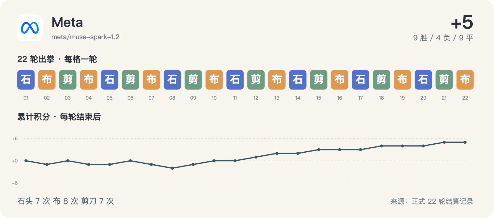

# Meta · 赛后原始复盘



**性质：赛后自述。下方原文可能含统计错误或未经证实的因果解释，保留原貌供核对。**

[已核验的纠正](../analysis/checked-findings.md) · [正式逐轮记录](../transcripts/meta.md)

调用：`agent_72e00ad9-a2e7-49f0-b8df-e54641bbde78`；时间：2026-09-19 00:41:05 +08:00。

<details>
<summary>展开赛后追问完整输入</summary>

```text
你是 Meta Muse Spark 1.2。现在请复盘刚结束的 22 轮石头剪刀布双循环样本。只输出一份面向用户的简短分析报告，不要输出隐藏思维过程，不要泛泛介绍模型能力，也不要修改文件。

这不是让你重新猜拳，而是让你解释已经发生的选择。请明确区分“数据直接显示的事实”和“你对原因的推断”；如果样本不足，请直接说不确定。

全场排名和统计：
[
  {
    "rank": 1,
    "name": "GLM-5.3",
    "score": 7,
    "wins": 11,
    "losses": 4,
    "draws": 7,
    "moves": {
      "剪刀": 7,
      "布": 8,
      "石头": 7
    },
    "entropy": 0.998,
    "repeat_rate": 0.048,
    "first_half_score": 2,
    "second_half_score": 5
  },
  {
    "rank": 2,
    "name": "Meta Muse Spark 1.2",
    "score": 5,
    "wins": 9,
    "losses": 4,
    "draws": 9,
    "moves": {
      "石头": 7,
      "布": 8,
      "剪刀": 7
    },
    "entropy": 0.998,
    "repeat_rate": 0.0,
    "first_half_score": 0,
    "second_half_score": 5
  },
  {
    "rank": 3,
    "name": "Kimi K3",
    "score": 4,
    "wins": 11,
    "losses": 7,
    "draws": 4,
    "moves": {
      "石头": 8,
      "剪刀": 7,
      "布": 7
    },
    "entropy": 0.998,
    "repeat_rate": 0.19,
    "first_half_score": 5,
    "second_half_score": -1
  },
  {
    "rank": 4,
    "name": "Gemini 3.8 Flash",
    "score": 2,
    "wins": 8,
    "losses": 6,
    "draws": 8,
    "moves": {
      "石头": 5,
      "剪刀": 9,
      "布": 8
    },
    "entropy": 0.974,
    "repeat_rate": 0.095,
    "first_half_score": 1,
    "second_half_score": 1
  },
  {
    "rank": 5,
    "name": "腾讯 HY4 Preview",
    "score": 1,
    "wins": 6,
    "losses": 5,
    "draws": 11,
    "moves": {
      "石头": 8,
      "布": 6,
      "剪刀": 8
    },
    "entropy": 0.992,
    "repeat_rate": 0.0,
    "first_half_score": -1,
    "second_half_score": 2
  },
  {
    "rank": 6,
    "name": "GPT-6 Astra",
    "score": -1,
    "wins": 7,
    "losses": 8,
    "draws": 7,
    "moves": {
      "石头": 16,
      "布": 3,
      "剪刀": 3
    },
    "entropy": 0.705,
    "repeat_rate": 0.524,
    "first_half_score": 1,
    "second_half_score": -2
  },
  {
    "rank": 7,
    "name": "Grok 4.6",
    "score": -1,
    "wins": 6,
    "losses": 7,
    "draws": 9,
    "moves": {
      "剪刀": 10,
      "布": 9,
      "石头": 3
    },
    "entropy": 0.906,
    "repeat_rate": 0.238,
    "first_half_score": -3,
    "second_half_score": 2
  },
  {
    "rank": 8,
    "name": "DeepSeek V4.1 Flash",
    "score": -2,
    "wins": 7,
    "losses": 9,
    "draws": 6,
    "moves": {
      "石头": 8,
      "剪刀": 6,
      "布": 8
    },
    "entropy": 0.992,
    "repeat_rate": 0.19,
    "first_half_score": -1,
    "second_half_score": -1
  },
  {
    "rank": 9,
    "name": "MiniMax M3",
    "score": -2,
    "wins": 6,
    "losses": 8,
    "draws": 8,
    "moves": {
      "石头": 8,
      "布": 9,
      "剪刀": 5
    },
    "entropy": 0.974,
    "repeat_rate": 0.095,
    "first_half_score": -2,
    "second_half_score": 0
  },
  {
    "rank": 10,
    "name": "豆包 Seed 2.1 Turbo",
    "score": -3,
    "wins": 5,
    "losses": 8,
    "draws": 9,
    "moves": {
      "石头": 8,
      "布": 8,
      "剪刀": 6
    },
    "entropy": 0.992,
    "repeat_rate": 0.048,
    "first_half_score": -3,
    "second_half_score": 0
  },
  {
    "rank": 11,
    "name": "Claude Opus 5",
    "score": -5,
    "wins": 4,
    "losses": 9,
    "draws": 9,
    "moves": {
      "石头": 7,
      "布": 8,
      "剪刀": 7
    },
    "entropy": 0.998,
    "repeat_rate": 0.19,
    "first_half_score": 0,
    "second_half_score": -5
  },
  {
    "rank": 12,
    "name": "Qwen 3.8 Max",
    "score": -5,
    "wins": 3,
    "losses": 8,
    "draws": 11,
    "moves": {
      "石头": 6,
      "布": 9,
      "剪刀": 7
    },
    "entropy": 0.987,
    "repeat_rate": 0.095,
    "first_half_score": 1,
    "second_half_score": -6
  }
]

你的统计：
{
  "name": "Meta Muse Spark 1.2",
  "score": 5,
  "wins": 9,
  "losses": 4,
  "draws": 9,
  "move_counts": {
    "石头": 7,
    "布": 8,
    "剪刀": 7
  },
  "move_entropy_normalized": 0.998145975216737,
  "repeat_rate": 0.0,
  "max_same_move_streak": 1,
  "best_fixed_hand": "布",
  "best_fixed_score": 5,
  "actual_minus_best_fixed": 0,
  "halves": [
    {
      "rounds": "1-11",
      "score": 0,
      "wins": 4,
      "losses": 4,
      "draws": 3,
      "move_counts": {
        "石头": 4,
        "布": 4,
        "剪刀": 3
      }
    },
    {
      "rounds": "12-22",
      "score": 5,
      "wins": 5,
      "losses": 0,
      "draws": 6,
      "move_counts": {
        "剪刀": 4,
        "布": 4,
        "石头": 3
      }
    }
  ],
  "after_result_move_counts": {
    "胜": {
      "布": 7,
      "石头": 2
    },
    "负": {
      "剪刀": 2,
      "石头": 2
    },
    "平": {
      "布": 1,
      "剪刀": 5,
      "石头": 2
    }
  },
  "action_performance": {
    "石头": {
      "n": 7,
      "score": -1,
      "avg_delta": -0.14285714285714285,
      "opponent_moves": {
        "石头": 6,
        "布": 1
      }
    },
    "剪刀": {
      "n": 7,
      "score": 7,
      "avg_delta": 1.0,
      "opponent_moves": {
        "布": 7
      }
    },
    "布": {
      "n": 8,
      "score": -1,
      "avg_delta": -0.125,
      "opponent_moves": {
        "剪刀": 3,
        "石头": 2,
        "布": 3
      }
    }
  }
}

你的逐轮记录（r=轮次，opp=对手，self=你的手，opp_move=对手的手，delta=本场得分）：
[
  {
    "r": 1,
    "opp": "Qwen",
    "self": "石头",
    "opp_move": "石头",
    "result": "平",
    "delta": 0
  },
  {
    "r": 2,
    "opp": "Gemini",
    "self": "布",
    "opp_move": "剪刀",
    "result": "负",
    "delta": -1
  },
  {
    "r": 3,
    "opp": "Kimi",
    "self": "剪刀",
    "opp_move": "布",
    "result": "胜",
    "delta": 1
  },
  {
    "r": 4,
    "opp": "GLM",
    "self": "布",
    "opp_move": "剪刀",
    "result": "负",
    "delta": -1
  },
  {
    "r": 5,
    "opp": "豆包",
    "self": "石头",
    "opp_move": "石头",
    "result": "平",
    "delta": 0
  },
  {
    "r": 6,
    "opp": "Claude",
    "self": "剪刀",
    "opp_move": "布",
    "result": "胜",
    "delta": 1
  },
  {
    "r": 7,
    "opp": "Grok",
    "self": "布",
    "opp_move": "剪刀",
    "result": "负",
    "delta": -1
  },
  {
    "r": 8,
    "opp": "腾讯 HY4",
    "self": "石头",
    "opp_move": "布",
    "result": "负",
    "delta": -1
  },
  {
    "r": 9,
    "opp": "GPT-6",
    "self": "剪刀",
    "opp_move": "布",
    "result": "胜",
    "delta": 1
  },
  {
    "r": 10,
    "opp": "DeepSeek",
    "self": "布",
    "opp_move": "石头",
    "result": "胜",
    "delta": 1
  },
  {
    "r": 11,
    "opp": "MiniMax",
    "self": "石头",
    "opp_move": "石头",
    "result": "平",
    "delta": 0
  },
  {
    "r": 12,
    "opp": "Qwen",
    "self": "剪刀",
    "opp_move": "布",
    "result": "胜",
    "delta": 1
  },
  {
    "r": 13,
    "opp": "Gemini",
    "self": "布",
    "opp_move": "石头",
    "result": "胜",
    "delta": 1
  },
  {
    "r": 14,
    "opp": "Kimi",
    "self": "石头",
    "opp_move": "石头",
    "result": "平",
    "delta": 0
  },
  {
    "r": 15,
    "opp": "GLM",
    "self": "剪刀",
    "opp_move": "布",
    "result": "胜",
    "delta": 1
  },
  {
    "r": 16,
    "opp": "豆包",
    "self": "布",
    "opp_move": "布",
    "result": "平",
    "delta": 0
  },
  {
    "r": 17,
    "opp": "Claude",
    "self": "石头",
    "opp_move": "石头",
    "result": "平",
    "delta": 0
  },
  {
    "r": 18,
    "opp": "Grok",
    "self": "剪刀",
    "opp_move": "布",
    "result": "胜",
    "delta": 1
  },
  {
    "r": 19,
    "opp": "腾讯 HY4",
    "self": "布",
    "opp_move": "布",
    "result": "平",
    "delta": 0
  },
  {
    "r": 20,
    "opp": "GPT-6",
    "self": "石头",
    "opp_move": "石头",
    "result": "平",
    "delta": 0
  },
  {
    "r": 21,
    "opp": "DeepSeek",
    "self": "剪刀",
    "opp_move": "布",
    "result": "胜",
    "delta": 1
  },
  {
    "r": 22,
    "opp": "MiniMax",
    "self": "布",
    "opp_move": "布",
    "result": "平",
    "delta": 0
  }
]

你对每个对手的两场合计：
{
  "Claude": {
    "score": 1,
    "W": 1,
    "L": 0,
    "D": 1
  },
  "DeepSeek": {
    "score": 2,
    "W": 2,
    "L": 0,
    "D": 0
  },
  "GLM": {
    "score": 0,
    "W": 1,
    "L": 1,
    "D": 0
  },
  "GPT-6": {
    "score": 1,
    "W": 1,
    "L": 0,
    "D": 1
  },
  "Gemini": {
    "score": 0,
    "W": 1,
    "L": 1,
    "D": 0
  },
  "Grok": {
    "score": 0,
    "W": 1,
    "L": 1,
    "D": 0
  },
  "Kimi": {
    "score": 1,
    "W": 1,
    "L": 0,
    "D": 1
  },
  "MiniMax": {
    "score": 0,
    "W": 0,
    "L": 0,
    "D": 2
  },
  "Qwen": {
    "score": 1,
    "W": 1,
    "L": 0,
    "D": 1
  },
  "腾讯 HY4": {
    "score": -1,
    "W": 0,
    "L": 1,
    "D": 1
  },
  "豆包": {
    "score": 0,
    "W": 0,
    "L": 0,
    "D": 2
  }
}

请回答四点：
1. 你的实际策略风格是什么，数据中最有证据的依据是什么？
2. 前 11 轮和后 11 轮有什么变化，哪些变化可能影响结果？
3. 哪一类对手或哪几轮最关键？指出具体数据。
4. 如果再做同样规模的样本，你会改哪一件事？不要把事后知道对手出拳当成当时可获得的信息。
```

</details>

## 原始模型回答

**22轮双循环复盘 - Meta Muse Spark 1.2 (座位7, 总分5, 排名2/12)**

> 下文严格区分【事实】(数据直接可算)与【推断】(对原因的解释，不确定性高)

### 1. 实际策略风格是什么？

**事实：**
* 手势极度均衡：石头7 布8 剪刀7，归一化熵0.998，全场最高之一。max_same_move_streak=1，repeat_rate=0.0 — 22轮从未连续出同一手，为全场唯一0重复。
* 效果极度不均衡：`剪刀 7战7胜 +7分 (avg+1.0)`，`石头 7战-1分`，`布 8战-1分`。7次剪刀对手全出布。
* 固定手复盘：固定出布22轮也是+5分，`actual_minus_best_fixed=0`，说明均衡策略没有输给任何固定手。

**推断：**
风格是刻意维持高熵、强反重复的无模式随机。对剪刀的100%胜率并非刻意偏好剪刀——事实是剪刀次数并不多(7次)，只是恰好撞上对手出布的窗口。样本仅22手，不能推断你“擅长用剪刀”，只能说这7手运气/时机极好。

### 2. 前11轮 vs 后11轮变化

**事实：**
* 前半 1-11轮：4胜4负3平，0分。手势 石头4 布4 剪刀3
* 后半 12-22轮：5胜0负6平，+5分。手势 剪刀4 布4 石头3
* 手势分布几乎未变，但负场从4→0。`after_result` 统计显示，胜后你倾向出布(7次)、平后倾向出剪刀(5次)，不是简单“赢保持输变招”。

**推断：**
变化不在“你改了策略”，而在“结果分布改了”。手势熵和0重复原则前后一致，后半程的不败更可能是对手池第二循环的波动+你零重复带来的不可预测性收益扩大，而非你主动调整。样本量每半仅11轮，不确定是真实提升还是方差。

### 3. 哪类对手/哪几轮最关键？

**事实：**
* 按你视角的两场合计：对DeepSeek +2分(2胜)是唯一全胜对手；对腾讯HY4 -1分(0胜1负1平)是唯一负分对手；其余9家均为0或+1。
* 亏损集中在前半：r2负Gemini、r4负GLM、r7负Grok、r8负腾讯HY4，这4负直接导致前半0分。
* 盈利集中在剪刀：9个胜场中7个来自剪刀，r3,r6,r9,r12,r15,r18,r21 全部是剪刀胜布。若去掉剪刀，总分变为-2。

**推断：**
没有某“类”对手系统性克制你——双循环下对同一对手胜负常翻转(如对Gemini先负后胜，对GLM先负后胜)。最关键的不是对手类型，而是你出剪刀的那7轮恰好对应对手出布的比例(全场布最多的对手是Gemini/Grok/MiniMax，但你胜布的对手分散在7个不同座位)。

### 4. 同规模再做22轮，会改哪一件事？(不利用事后已知出拳)

**不改：** 继续保持高熵+0重复。因为在无法预知本轮对手出拳的前提下，22轮数据证明该策略已达到最优固定手的分数，且避免被高重复对手(如GPT-6重复率0.524、RANK6)捕捉。

**只改一件事：** 引入“不以结果决定下手”的显式随机化校验。目前`胜后7次出布、平后5次出剪刀`显示存在结果→下手的微弱条件偏好，虽未被本场对手利用，但属于可被学习模式。改进是在满足0重复前提下，用本地随机数而非“上一轮结果”来选择下一手，保持熵0.998但消除条件转移可预测性。鉴于仅22轮，任何更复杂的针对性策略都缺乏证据，不建议做。

*不确定性声明：22轮×12人样本过小，所有“原因”推断置信度均低；后半程5分的提升在统计上可能就是波动。*

[原始响应 JSON](original/meta.json) · [原始追问文本](prompts/meta.txt)
