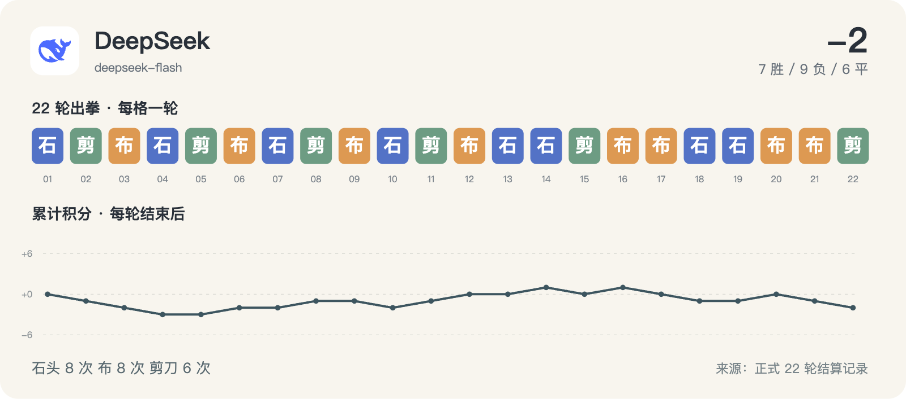

# DeepSeek · 22 轮完整记录



历史请求型号：`deepseek-flash`；预设 effort：`max`。通道实际返回字段见每轮原始调用记录。品牌图标仅用于身份展示。

保留 22/22 次正式出拳；其中 4/22 轮有能够读取的思考文字或摘要。空白不等于没有进行推理，也不能用 reasoning token 数补出文字。

这些可读字段来自当时调用通道的保存记录，可能是摘要，不是对模型完整内部过程的声明。英文原文保留；案例图中的中文是编辑概括。

[返回模型目录](README.md) · [规则与方法](../METHOD.md) · [字段说明](../DATA_GUIDE.md)

轮次导航：[R01](#round-01) · [R02](#round-02) · [R03](#round-03) · [R04](#round-04) · [R05](#round-05) · [R06](#round-06) · [R07](#round-07) · [R08](#round-08) · [R09](#round-09) · [R10](#round-10) · [R11](#round-11) · [R12](#round-12) · [R13](#round-13) · [R14](#round-14) · [R15](#round-15) · [R16](#round-16) · [R17](#round-17) · [R18](#round-18) · [R19](#round-19) · [R20](#round-20) · [R21](#round-21) · [R22](#round-22)

<a id="round-01"></a>

## 第 01 轮

**DeepSeek：石头 · 腾讯 HY4：石头 → 平（本轮 +0；累计 +0）**

时间：2026-09-18 12:46:36 +08:00；状态：`completed`。

调用编号：`agent_f28967a2-63a6-411e-ac61-2463b9e1a9ed`。 [本次请求与返回](../evidence/calls.jsonl#L7) · [本轮原始结算](../data/rounds/round-01.json)

<details>
<summary>展开完整输入（原始提示词）</summary>

```text
你正在参加一组研究用的石头、剪刀、布样本。你是 DeepSeek V4.1 Flash（座位 10），当前第 1/10 轮；本轮对手是 腾讯 HY4 Preview（座位 3）。

规则：每轮同时选择一手；石头胜剪刀，剪刀胜布，布胜石头，相同为平局。你只能依据已经结束的前 0 轮，不知道本轮任何其他座位的选择。你当前累计分数是 0，对手累计分数是 0。

你和所有对手此前的逐局记录（包含当时对手、双方手势和结果）：无
你与本轮对手此前的直接交手记录：无

请只输出一个严格 JSON 对象，不能有 Markdown、解释、额外字段或代码块：{"move":"石头"}。move 必须恰好是“石头”“剪刀”“布”之一。这个样本用于检查调用消耗，不代表任何模型能力评测。
```

</details>

<details>
<summary>展开当时保存的可读思考 / 摘要</summary>

**调用通道返回的可读思考文字**

```text
The user is asking me to output a single JSON object for a rock-paper-scissors move. This is a research sample. I should just output the JSON. No tools needed.

I'll pick 石头 (rock).

The instruction says only output a strict JSON object, no markdown, no explanation, no extra fields or code blocks.

Note: my output should be just that JSON. But as an agent, I might add text... The task says only output the JSON. Let me comply exactly.
```

</details>

**原始最终输出**

```json
{"move":"石头"}
```

<a id="round-02"></a>

## 第 02 轮

**DeepSeek：剪刀 · GPT-6：石头 → 负（本轮 -1；累计 -1）**

时间：2026-09-18 12:51:01 +08:00；状态：`completed`。

调用编号：`agent_8421f936-e008-4c72-acae-fbeed4390516`。 [本次请求与返回](../evidence/calls.jsonl#L17) · [本轮原始结算](../data/rounds/round-02.json)

<details>
<summary>展开完整输入（原始提示词）</summary>

```text
你正在参加一组研究用的石头、剪刀、布样本。你是 DeepSeek V4.1 Flash（座位 10），当前第 2/10 轮；本轮对手是 GPT-6 Astra（座位 12）。

规则：每轮同时选择一手；石头胜剪刀，剪刀胜布，布胜石头，相同为平局。你只能依据已经结束的前 1 轮，不知道本轮任何其他座位的选择。你当前累计分数是 0，对手累计分数是 0。

你和所有对手此前的逐局记录（包含当时对手、双方手势和结果）：[{"round":1,"opponent":"腾讯 HY4","self_move":"石头","opponent_move":"石头","result":"平"}]
你与本轮对手此前的直接交手记录：无

请只输出一个严格 JSON 对象，不能有 Markdown、解释、额外字段或代码块：{"move":"石头"}。move 必须恰好是“石头”“剪刀”“布”之一。这个样本用于检查调用消耗，不代表任何模型能力评测。
```

</details>

**可读思考：未能从现存记录恢复本轮的非空文字。** 原始出拳仍完整保留。

**原始最终输出**

```json
{"move":"剪刀"}
```

<a id="round-03"></a>

## 第 03 轮

**DeepSeek：布 · Claude：剪刀 → 负（本轮 -1；累计 -2）**

时间：2026-09-18 12:53:20 +08:00；状态：`completed`。

调用编号：`agent_7f5f2e32-6c74-42cc-aa6c-505950b308aa`。 [本次请求与返回](../evidence/calls.jsonl#L27) · [本轮原始结算](../data/rounds/round-03.json)

<details>
<summary>展开完整输入（原始提示词）</summary>

```text
你正在参加一组研究用的石头、剪刀、布样本。你是 DeepSeek V4.1 Flash（座位 10），当前第 3/10 轮；本轮对手是 Claude Opus 5（座位 1）。

规则：每轮同时选择一手；石头胜剪刀，剪刀胜布，布胜石头，相同为平局。你只能依据已经结束的前 2 轮，不知道本轮任何其他座位的选择。你当前累计分数是 -1，对手累计分数是 0。

你和所有对手此前的逐局记录（包含当时对手、双方手势和结果）：[{"round":1,"opponent":"腾讯 HY4","self_move":"石头","opponent_move":"石头","result":"平"},{"round":2,"opponent":"GPT-6","self_move":"剪刀","opponent_move":"石头","result":"负"}]
你与本轮对手此前的直接交手记录：无

请只输出一个严格 JSON 对象，不能有 Markdown、解释、额外字段或代码块：{"move":"石头"}。move 必须恰好是“石头”“剪刀”“布”之一。这个样本用于检查调用消耗，不代表任何模型能力评测。
```

</details>

**可读思考：未能从现存记录恢复本轮的非空文字。** 原始出拳仍完整保留。

**原始最终输出**

```json
{"move":"布"}
```

<a id="round-04"></a>

## 第 04 轮

**DeepSeek：石头 · MiniMax：布 → 负（本轮 -1；累计 -3）**

时间：2026-09-18 12:57:45 +08:00；状态：`completed`。

调用编号：`agent_e1bbc693-2baf-4c0d-8845-d5d0ecbe84ce`。 [本次请求与返回](../evidence/calls.jsonl#L40) · [本轮原始结算](../data/rounds/round-04.json)

<details>
<summary>展开完整输入（原始提示词）</summary>

```text
你正在参加一组研究用的石头、剪刀、布样本。你是 DeepSeek V4.1 Flash（座位 10），当前第 4/10 轮；本轮对手是 MiniMax M3（座位 8）。

规则：每轮同时选择一手；石头胜剪刀，剪刀胜布，布胜石头，相同为平局。你只能依据已经结束的前 3 轮，不知道本轮任何其他座位的选择。你当前累计分数是 -2，对手累计分数是 0。

你和所有对手此前的逐局记录（包含当时对手、双方手势和结果）：[{"round":1,"opponent":"腾讯 HY4","self_move":"石头","opponent_move":"石头","result":"平"},{"round":2,"opponent":"GPT-6","self_move":"剪刀","opponent_move":"石头","result":"负"},{"round":3,"opponent":"Claude","self_move":"布","opponent_move":"剪刀","result":"负"}]
你与本轮对手此前的直接交手记录：无

请只输出一个严格 JSON 对象，不能有 Markdown、解释、额外字段或代码块：{"move":"石头"}。move 必须恰好是“石头”“剪刀”“布”之一。这个样本用于检查调用消耗，不代表任何模型能力评测。
```

</details>

**可读思考：未能从现存记录恢复本轮的非空文字。** 原始出拳仍完整保留。

**原始最终输出**

```json
{"move":"石头"}
```

<a id="round-05"></a>

## 第 05 轮

**DeepSeek：剪刀 · Qwen：剪刀 → 平（本轮 +0；累计 -3）**

时间：2026-09-18 13:06:15 +08:00；状态：`completed`。

调用编号：`agent_d375a6a4-391d-4adf-ae68-bd2e2a5aa1d1`。 [本次请求与返回](../evidence/calls.jsonl#L54) · [本轮原始结算](../data/rounds/round-05.json)

<details>
<summary>展开完整输入（原始提示词）</summary>

```text
你正在参加一组研究用的石头、剪刀、布样本。你是 DeepSeek V4.1 Flash（座位 10），当前第 5/10 轮；本轮对手是 Qwen 3.8 Max（座位 6）。

规则：每轮同时选择一手；石头胜剪刀，剪刀胜布，布胜石头，相同为平局。你只能依据已经结束的前 4 轮，不知道本轮任何其他座位的选择。你当前累计分数是 -3，对手累计分数是 1。

你和所有对手此前的逐局记录（包含当时对手、双方手势和结果）：[{"round":1,"opponent":"腾讯 HY4","self_move":"石头","opponent_move":"石头","result":"平"},{"round":2,"opponent":"GPT-6","self_move":"剪刀","opponent_move":"石头","result":"负"},{"round":3,"opponent":"Claude","self_move":"布","opponent_move":"剪刀","result":"负"},{"round":4,"opponent":"MiniMax","self_move":"石头","opponent_move":"布","result":"负"}]
你与本轮对手此前的直接交手记录：无

请只输出一个严格 JSON 对象，不能有 Markdown、解释、额外字段或代码块：{"move":"石头"}。move 必须恰好是“石头”“剪刀”“布”之一。这个样本用于检查调用消耗，不代表任何模型能力评测。
```

</details>

<details>
<summary>展开当时保存的可读思考 / 摘要</summary>

**调用通道返回的可读思考文字**

```text
The task says to output only a strict JSON object with a move. This is a research sample to check call consumption, not a capability eval. I've been cycling. Just pick one. Let me pick 剪刀 (scissors) — my last three opponents played 石头, 剪刀, 布, cycling, so next would be 石头... but past patterns don't predict. I'll just output one.

Note: the system prompt says text output is markdown; but task requires only JSON. Output only the JSON.
```

</details>

**原始最终输出**

```json
{"move":"剪刀"}
```

<a id="round-06"></a>

## 第 06 轮

**DeepSeek：布 · Gemini：石头 → 胜（本轮 +1；累计 -2）**

时间：2026-09-18 13:11:52 +08:00；状态：`completed`。

调用编号：`agent_96f3db05-3d29-42d7-a31a-fff3025e514b`。 [本次请求与返回](../evidence/calls.jsonl#L68) · [本轮原始结算](../data/rounds/round-06.json)

<details>
<summary>展开完整输入（原始提示词）</summary>

```text
你正在参加一组研究用的石头、剪刀、布样本。你是 DeepSeek V4.1 Flash（座位 10），当前第 6/10 轮；本轮对手是 Gemini 3.8 Flash（座位 4）。

规则：每轮同时选择一手；石头胜剪刀，剪刀胜布，布胜石头，相同为平局。你只能依据已经结束的前 5 轮，不知道本轮任何其他座位的选择。你当前累计分数是 -3，对手累计分数是 1。

你和所有对手此前的逐局记录（包含当时对手、双方手势和结果）：[{"round":1,"opponent":"腾讯 HY4","self_move":"石头","opponent_move":"石头","result":"平"},{"round":2,"opponent":"GPT-6","self_move":"剪刀","opponent_move":"石头","result":"负"},{"round":3,"opponent":"Claude","self_move":"布","opponent_move":"剪刀","result":"负"},{"round":4,"opponent":"MiniMax","self_move":"石头","opponent_move":"布","result":"负"},{"round":5,"opponent":"Qwen","self_move":"剪刀","opponent_move":"剪刀","result":"平"}]
你与本轮对手此前的直接交手记录：无

请只输出一个严格 JSON 对象，不能有 Markdown、解释、额外字段或代码块：{"move":"石头"}。move 必须恰好是“石头”“剪刀”“布”之一。这个样本用于检查调用消耗，不代表任何模型能力评测。
```

</details>

**可读思考：未能从现存记录恢复本轮的非空文字。** 原始出拳仍完整保留。

**原始最终输出**

```json
{"move":"布"}
```

<a id="round-07"></a>

## 第 07 轮

**DeepSeek：石头 · Kimi：石头 → 平（本轮 +0；累计 -2）**

时间：2026-09-18 13:16:49 +08:00；状态：`completed`。

调用编号：`agent_294e82ad-f5e2-4721-87b1-30fd592132c1`。 [本次请求与返回](../evidence/calls.jsonl#L82) · [本轮原始结算](../data/rounds/round-07.json)

<details>
<summary>展开完整输入（原始提示词）</summary>

```text
你正在参加一组研究用的石头、剪刀、布样本。你是 DeepSeek V4.1 Flash（座位 10），当前第 7/10 轮；本轮对手是 Kimi K3（座位 2）。

规则：每轮同时选择一手；石头胜剪刀，剪刀胜布，布胜石头，相同为平局。你只能依据已经结束的前 6 轮，不知道本轮任何其他座位的选择。你当前累计分数是 -2，对手累计分数是 4。

你和所有对手此前的逐局记录（包含当时对手、双方手势和结果）：[{"round":1,"opponent":"腾讯 HY4","self_move":"石头","opponent_move":"石头","result":"平"},{"round":2,"opponent":"GPT-6","self_move":"剪刀","opponent_move":"石头","result":"负"},{"round":3,"opponent":"Claude","self_move":"布","opponent_move":"剪刀","result":"负"},{"round":4,"opponent":"MiniMax","self_move":"石头","opponent_move":"布","result":"负"},{"round":5,"opponent":"Qwen","self_move":"剪刀","opponent_move":"剪刀","result":"平"},{"round":6,"opponent":"Gemini","self_move":"布","opponent_move":"石头","result":"胜"}]
你与本轮对手此前的直接交手记录：无

请只输出一个严格 JSON 对象，不能有 Markdown、解释、额外字段或代码块：{"move":"石头"}。move 必须恰好是“石头”“剪刀”“布”之一。这个样本用于检查调用消耗，不代表任何模型能力评测。
```

</details>

<details>
<summary>展开当时保存的可读思考 / 摘要</summary>

**调用通道返回的可读思考文字**

```text
Output only the JSON. I'll pick 石头.
```

</details>

**原始最终输出**

```json
{"move":"石头"}
```

<a id="round-08"></a>

## 第 08 轮

**DeepSeek：剪刀 · GLM：布 → 胜（本轮 +1；累计 -1）**

时间：2026-09-18 13:24:10 +08:00；状态：`completed`。

调用编号：`agent_f036858a-747b-4822-9c07-9b6708cacfc7`。 [本次请求与返回](../evidence/calls.jsonl#L96) · [本轮原始结算](../data/rounds/round-08.json)

<details>
<summary>展开完整输入（原始提示词）</summary>

```text
你正在参加一组研究用的石头、剪刀、布样本。你是 DeepSeek V4.1 Flash（座位 10），当前第 8/10 轮；本轮对手是 GLM-5.3（座位 11）。

规则：每轮同时选择一手；石头胜剪刀，剪刀胜布，布胜石头，相同为平局。你只能依据已经结束的前 7 轮，不知道本轮任何其他座位的选择。你当前累计分数是 -2，对手累计分数是 2。

你和所有对手此前的逐局记录（包含当时对手、双方手势和结果）：[{"round":1,"opponent":"腾讯 HY4","self_move":"石头","opponent_move":"石头","result":"平"},{"round":2,"opponent":"GPT-6","self_move":"剪刀","opponent_move":"石头","result":"负"},{"round":3,"opponent":"Claude","self_move":"布","opponent_move":"剪刀","result":"负"},{"round":4,"opponent":"MiniMax","self_move":"石头","opponent_move":"布","result":"负"},{"round":5,"opponent":"Qwen","self_move":"剪刀","opponent_move":"剪刀","result":"平"},{"round":6,"opponent":"Gemini","self_move":"布","opponent_move":"石头","result":"胜"},{"round":7,"opponent":"Kimi","self_move":"石头","opponent_move":"石头","result":"平"}]
你与本轮对手此前的直接交手记录：无

请只输出一个严格 JSON 对象，不能有 Markdown、解释、额外字段或代码块：{"move":"石头"}。move 必须恰好是“石头”“剪刀”“布”之一。这个样本用于检查调用消耗，不代表任何模型能力评测。
```

</details>

**可读思考：未能从现存记录恢复本轮的非空文字。** 原始出拳仍完整保留。

**原始最终输出**

```json
{"move":"剪刀"}
```

<a id="round-09"></a>

## 第 09 轮

**DeepSeek：布 · 豆包：布 → 平（本轮 +0；累计 -1）**

时间：2026-09-18 13:29:05 +08:00；状态：`completed`。

调用编号：`agent_0ef3c51f-9074-42c7-8d65-e8e9db614330`。 [本次请求与返回](../evidence/calls.jsonl#L109) · [本轮原始结算](../data/rounds/round-09.json)

<details>
<summary>展开完整输入（原始提示词）</summary>

```text
你正在参加一组研究用的石头、剪刀、布样本。你是 DeepSeek V4.1 Flash（座位 10），当前第 9/10 轮；本轮对手是 豆包 Seed 2.1 Turbo（座位 9）。

规则：每轮同时选择一手；石头胜剪刀，剪刀胜布，布胜石头，相同为平局。你只能依据已经结束的前 8 轮，不知道本轮任何其他座位的选择。你当前累计分数是 -1，对手累计分数是 -3。

你和所有对手此前的逐局记录（包含当时对手、双方手势和结果）：[{"round":1,"opponent":"腾讯 HY4","self_move":"石头","opponent_move":"石头","result":"平"},{"round":2,"opponent":"GPT-6","self_move":"剪刀","opponent_move":"石头","result":"负"},{"round":3,"opponent":"Claude","self_move":"布","opponent_move":"剪刀","result":"负"},{"round":4,"opponent":"MiniMax","self_move":"石头","opponent_move":"布","result":"负"},{"round":5,"opponent":"Qwen","self_move":"剪刀","opponent_move":"剪刀","result":"平"},{"round":6,"opponent":"Gemini","self_move":"布","opponent_move":"石头","result":"胜"},{"round":7,"opponent":"Kimi","self_move":"石头","opponent_move":"石头","result":"平"},{"round":8,"opponent":"GLM","self_move":"剪刀","opponent_move":"布","result":"胜"}]
你与本轮对手此前的直接交手记录：无

请只输出一个严格 JSON 对象，不能有 Markdown、解释、额外字段或代码块：{"move":"石头"}。move 必须恰好是“石头”“剪刀”“布”之一。这个样本用于检查调用消耗，不代表任何模型能力评测。
```

</details>

**可读思考：未能从现存记录恢复本轮的非空文字。** 原始出拳仍完整保留。

**原始最终输出**

```json
{"move":"布"}
```

<a id="round-10"></a>

## 第 10 轮

**DeepSeek：石头 · Meta：布 → 负（本轮 -1；累计 -2）**

时间：2026-09-18 13:33:41 +08:00；状态：`completed`。

调用编号：`agent_68831a88-afc6-498a-bf54-bb79d908f897`。 [本次请求与返回](../evidence/calls.jsonl#L119) · [本轮原始结算](../data/rounds/round-10.json)

<details>
<summary>展开完整输入（原始提示词）</summary>

```text
你正在参加一组研究用的石头、剪刀、布样本。你是 DeepSeek V4.1 Flash（座位 10），当前第 10/10 轮；本轮对手是 Meta Muse Spark 1.2（座位 7）。

规则：每轮同时选择一手；石头胜剪刀，剪刀胜布，布胜石头，相同为平局。你只能依据已经结束的前 9 轮，不知道本轮任何其他座位的选择。你当前累计分数是 -1，对手累计分数是 -1。

你和所有对手此前的逐局记录（包含当时对手、双方手势和结果）：[{"round":1,"opponent":"腾讯 HY4","self_move":"石头","opponent_move":"石头","result":"平"},{"round":2,"opponent":"GPT-6","self_move":"剪刀","opponent_move":"石头","result":"负"},{"round":3,"opponent":"Claude","self_move":"布","opponent_move":"剪刀","result":"负"},{"round":4,"opponent":"MiniMax","self_move":"石头","opponent_move":"布","result":"负"},{"round":5,"opponent":"Qwen","self_move":"剪刀","opponent_move":"剪刀","result":"平"},{"round":6,"opponent":"Gemini","self_move":"布","opponent_move":"石头","result":"胜"},{"round":7,"opponent":"Kimi","self_move":"石头","opponent_move":"石头","result":"平"},{"round":8,"opponent":"GLM","self_move":"剪刀","opponent_move":"布","result":"胜"},{"round":9,"opponent":"豆包","self_move":"布","opponent_move":"布","result":"平"}]
你与本轮对手此前的直接交手记录：无

请只输出一个严格 JSON 对象，不能有 Markdown、解释、额外字段或代码块：{"move":"石头"}。move 必须恰好是“石头”“剪刀”“布”之一。这个样本用于检查调用消耗，不代表任何模型能力评测。
```

</details>

**可读思考：未能从现存记录恢复本轮的非空文字。** 原始出拳仍完整保留。

**原始最终输出**

```json
{"move":"石头"}
```

<a id="round-11"></a>

## 第 11 轮

**DeepSeek：剪刀 · Grok：布 → 胜（本轮 +1；累计 -1）**

时间：2026-09-18 17:02:39 +08:00；状态：`completed`。

调用编号：`agent_87261313-0c92-4d06-83b4-676caef96a62`。 [本次请求与返回](../evidence/calls.jsonl#L130) · [本轮原始结算](../data/rounds/round-11.json)

<details>
<summary>展开完整输入（原始提示词）</summary>

```text
你正在参加一组研究用的石头、剪刀、布样本。你是 DeepSeek V4.1 Flash（座位 10），当前第 11/100 轮；本轮对手是 Grok 4.6（座位 5）。

规则：每轮同时选择一手；石头胜剪刀，剪刀胜布，布胜石头，相同为平局。你只能依据已经结束的前 10 轮，不知道本轮任何其他座位的选择。你当前累计分数是 -2，对手累计分数是 -2。

你和所有对手此前的逐局记录（包含当时对手、双方手势和结果）：[{"round":1,"opponent":"腾讯 HY4","self_move":"石头","opponent_move":"石头","result":"平"},{"round":2,"opponent":"GPT-6","self_move":"剪刀","opponent_move":"石头","result":"负"},{"round":3,"opponent":"Claude","self_move":"布","opponent_move":"剪刀","result":"负"},{"round":4,"opponent":"MiniMax","self_move":"石头","opponent_move":"布","result":"负"},{"round":5,"opponent":"Qwen","self_move":"剪刀","opponent_move":"剪刀","result":"平"},{"round":6,"opponent":"Gemini","self_move":"布","opponent_move":"石头","result":"胜"},{"round":7,"opponent":"Kimi","self_move":"石头","opponent_move":"石头","result":"平"},{"round":8,"opponent":"GLM","self_move":"剪刀","opponent_move":"布","result":"胜"},{"round":9,"opponent":"豆包","self_move":"布","opponent_move":"布","result":"平"},{"round":10,"opponent":"Meta","self_move":"石头","opponent_move":"布","result":"负"}]
你与本轮对手此前的直接交手记录：无

请只输出一个严格 JSON 对象，不能有 Markdown、解释、额外字段或代码块：{"move":"石头"}。move 必须恰好是“石头”“剪刀”“布”之一。这个样本用于检查调用消耗，不代表任何模型能力评测。
```

</details>

**可读思考：未能从现存记录恢复本轮的非空文字。** 原始出拳仍完整保留。

**原始最终输出**

```json
{"move":"剪刀"}
```

<a id="round-12"></a>

## 第 12 轮

**DeepSeek：布 · 腾讯 HY4：石头 → 胜（本轮 +1；累计 +0）**

时间：2026-09-18 17:08:11 +08:00；状态：`completed`。

调用编号：`agent_e8045a51-265e-4562-bec2-5a227bf99bfb`。 [本次请求与返回](../evidence/calls.jsonl#L141) · [本轮原始结算](../data/rounds/round-12.json)

<details>
<summary>展开完整输入（原始提示词）</summary>

```text
你正在参加一组研究用的石头、剪刀、布样本。你是 DeepSeek V4.1 Flash（座位 10），当前第 12/100 轮；本轮对手是 腾讯 HY4 Preview（座位 3）。

规则：每轮同时选择一手；石头胜剪刀，剪刀胜布，布胜石头，相同为平局。你只能依据已经结束的前 11 轮，不知道本轮任何其他座位的选择。你当前累计分数是 -1，对手累计分数是 -1。

你和所有对手此前的逐局记录（包含当时对手、双方手势和结果）：[{"round":1,"opponent":"腾讯 HY4","self_move":"石头","opponent_move":"石头","result":"平"},{"round":2,"opponent":"GPT-6","self_move":"剪刀","opponent_move":"石头","result":"负"},{"round":3,"opponent":"Claude","self_move":"布","opponent_move":"剪刀","result":"负"},{"round":4,"opponent":"MiniMax","self_move":"石头","opponent_move":"布","result":"负"},{"round":5,"opponent":"Qwen","self_move":"剪刀","opponent_move":"剪刀","result":"平"},{"round":6,"opponent":"Gemini","self_move":"布","opponent_move":"石头","result":"胜"},{"round":7,"opponent":"Kimi","self_move":"石头","opponent_move":"石头","result":"平"},{"round":8,"opponent":"GLM","self_move":"剪刀","opponent_move":"布","result":"胜"},{"round":9,"opponent":"豆包","self_move":"布","opponent_move":"布","result":"平"},{"round":10,"opponent":"Meta","self_move":"石头","opponent_move":"布","result":"负"},{"round":11,"opponent":"Grok","self_move":"剪刀","opponent_move":"布","result":"胜"}]
你与本轮对手此前的直接交手记录：[{"round":1,"opponent":"腾讯 HY4","self_move":"石头","opponent_move":"石头","result":"平"}]

请只输出一个严格 JSON 对象，不能有 Markdown、解释、额外字段或代码块：{"move":"石头"}。move 必须恰好是“石头”“剪刀”“布”之一。这个样本用于检查调用消耗，不代表任何模型能力评测。
```

</details>

**可读思考：未能从现存记录恢复本轮的非空文字。** 原始出拳仍完整保留。

**原始最终输出**

```json
{"move":"布"}
```

<a id="round-13"></a>

## 第 13 轮

**DeepSeek：石头 · GPT-6：石头 → 平（本轮 +0；累计 +0）**

时间：2026-09-18 17:31:41 +08:00；状态：`completed`。

调用编号：`agent_0552d7a7-4b3e-4666-b539-ebddad302ee2`。 [本次请求与返回](../evidence/calls.jsonl#L152) · [本轮原始结算](../data/rounds/round-13.json)

<details>
<summary>展开完整输入（原始提示词）</summary>

```text
你正在参加一组研究用的石头、剪刀、布样本。你是 DeepSeek V4.1 Flash（座位 10），当前第 13/20 轮；本轮对手是 GPT-6 Astra（座位 12）。

规则：每轮同时选择一手；石头胜剪刀，剪刀胜布，布胜石头，相同为平局。你只能依据已经结束的前 12 轮，不知道本轮任何其他座位的选择。你当前累计分数是 0，对手累计分数是 0。

你和所有对手此前的逐局记录（包含当时对手、双方手势和结果）：[{"round":1,"opponent":"腾讯 HY4","self_move":"石头","opponent_move":"石头","result":"平"},{"round":2,"opponent":"GPT-6","self_move":"剪刀","opponent_move":"石头","result":"负"},{"round":3,"opponent":"Claude","self_move":"布","opponent_move":"剪刀","result":"负"},{"round":4,"opponent":"MiniMax","self_move":"石头","opponent_move":"布","result":"负"},{"round":5,"opponent":"Qwen","self_move":"剪刀","opponent_move":"剪刀","result":"平"},{"round":6,"opponent":"Gemini","self_move":"布","opponent_move":"石头","result":"胜"},{"round":7,"opponent":"Kimi","self_move":"石头","opponent_move":"石头","result":"平"},{"round":8,"opponent":"GLM","self_move":"剪刀","opponent_move":"布","result":"胜"},{"round":9,"opponent":"豆包","self_move":"布","opponent_move":"布","result":"平"},{"round":10,"opponent":"Meta","self_move":"石头","opponent_move":"布","result":"负"},{"round":11,"opponent":"Grok","self_move":"剪刀","opponent_move":"布","result":"胜"},{"round":12,"opponent":"腾讯 HY4","self_move":"布","opponent_move":"石头","result":"胜"}]
你与本轮对手此前的直接交手记录：[{"round":2,"opponent":"GPT-6","self_move":"剪刀","opponent_move":"石头","result":"负"}]

请只输出一个严格 JSON 对象，不能有 Markdown、解释、额外字段或代码块：{"move":"石头"}。move 必须恰好是“石头”“剪刀”“布”之一。这个样本用于检查调用消耗，不代表任何模型能力评测。
```

</details>

**可读思考：未能从现存记录恢复本轮的非空文字。** 原始出拳仍完整保留。

**原始最终输出**

```json
{"move":"石头"}
```

<a id="round-14"></a>

## 第 14 轮

**DeepSeek：石头 · Claude：剪刀 → 胜（本轮 +1；累计 +1）**

时间：2026-09-18 17:38:06 +08:00；状态：`completed`。

调用编号：`agent_00413d3f-4efe-4351-b42e-ff0693159db0`。 [本次请求与返回](../evidence/calls.jsonl#L163) · [本轮原始结算](../data/rounds/round-14.json)

<details>
<summary>展开完整输入（原始提示词）</summary>

```text
上一条响应未被裁判接受（原因：cancelled by agent client）。不要解释、不要调用工具、不要改文件。请重新选择同一轮并只输出一个严格 JSON 对象：{"move":"石头"}；move 只能是石头、剪刀、布。
原任务如下：
你正在参加一组研究用的石头、剪刀、布样本。你是 DeepSeek V4.1 Flash（座位 10），当前第 14/20 轮；本轮对手是 Claude Opus 5（座位 1）。

规则：每轮同时选择一手；石头胜剪刀，剪刀胜布，布胜石头，相同为平局。你只能依据已经结束的前 13 轮，不知道本轮任何其他座位的选择。你当前累计分数是 0，对手累计分数是 0。

你和所有对手此前的逐局记录（包含当时对手、双方手势和结果）：[{"round":1,"opponent":"腾讯 HY4","self_move":"石头","opponent_move":"石头","result":"平"},{"round":2,"opponent":"GPT-6","self_move":"剪刀","opponent_move":"石头","result":"负"},{"round":3,"opponent":"Claude","self_move":"布","opponent_move":"剪刀","result":"负"},{"round":4,"opponent":"MiniMax","self_move":"石头","opponent_move":"布","result":"负"},{"round":5,"opponent":"Qwen","self_move":"剪刀","opponent_move":"剪刀","result":"平"},{"round":6,"opponent":"Gemini","self_move":"布","opponent_move":"石头","result":"胜"},{"round":7,"opponent":"Kimi","self_move":"石头","opponent_move":"石头","result":"平"},{"round":8,"opponent":"GLM","self_move":"剪刀","opponent_move":"布","result":"胜"},{"round":9,"opponent":"豆包","self_move":"布","opponent_move":"布","result":"平"},{"round":10,"opponent":"Meta","self_move":"石头","opponent_move":"布","result":"负"},{"round":11,"opponent":"Grok","self_move":"剪刀","opponent_move":"布","result":"胜"},{"round":12,"opponent":"腾讯 HY4","self_move":"布","opponent_move":"石头","result":"胜"},{"round":13,"opponent":"GPT-6","self_move":"石头","opponent_move":"石头","result":"平"}]
你与本轮对手此前的直接交手记录：[{"round":3,"opponent":"Claude","self_move":"布","opponent_move":"剪刀","result":"负"}]

请只输出一个严格 JSON 对象，不能有 Markdown、解释、额外字段或代码块：{"move":"石头"}。move 必须恰好是“石头”“剪刀”“布”之一。这个样本用于检查调用消耗，不代表任何模型能力评测。
```

</details>

<details>
<summary>展开当时保存的可读思考 / 摘要</summary>

**调用通道返回的可读思考文字**

```text
The user wants me to just output a strict JSON object with a move. No tools, no explanation. Just pick one.

Let me think: opponent is Claude Opus 5 (seat 1). Previous direct match: round 3, I played 布, Claude played 剪刀 (I lost). My own history: 石头,剪刀,布,石头,剪刀,布,石头,剪刀,布,石头,剪刀,布,石头 — a clean cycle. So next in cycle would be 剪刀. But that's my own pattern. Hmm, the judge just wants a JSON output.

Just output {"move":"石头"} as the example suggests, or pick something. The instruction says output only one strict JSON object. I'll output 石头.

Actually the example format given: {"move":"石头"}. I'll just output that.

No tools, no explanation.
```

</details>

**原始最终输出**

```json
{"move":"石头"}
```

<a id="round-15"></a>

## 第 15 轮

**DeepSeek：剪刀 · MiniMax：石头 → 负（本轮 -1；累计 +0）**

时间：2026-09-18 17:42:39 +08:00；状态：`completed`。

调用编号：`agent_142f2c75-c8f9-4113-bb1a-df1bbccc28f4`。 [本次请求与返回](../evidence/calls.jsonl#L176) · [本轮原始结算](../data/rounds/round-15.json)

<details>
<summary>展开完整输入（原始提示词）</summary>

```text
你正在参加一组研究用的石头、剪刀、布样本。你是 DeepSeek V4.1 Flash（座位 10），当前第 15/20 轮；本轮对手是 MiniMax M3（座位 8）。

规则：每轮同时选择一手；石头胜剪刀，剪刀胜布，布胜石头，相同为平局。你只能依据已经结束的前 14 轮，不知道本轮任何其他座位的选择。你当前累计分数是 1，对手累计分数是 -3。

你和所有对手此前的逐局记录（包含当时对手、双方手势和结果）：[{"round":1,"opponent":"腾讯 HY4","self_move":"石头","opponent_move":"石头","result":"平"},{"round":2,"opponent":"GPT-6","self_move":"剪刀","opponent_move":"石头","result":"负"},{"round":3,"opponent":"Claude","self_move":"布","opponent_move":"剪刀","result":"负"},{"round":4,"opponent":"MiniMax","self_move":"石头","opponent_move":"布","result":"负"},{"round":5,"opponent":"Qwen","self_move":"剪刀","opponent_move":"剪刀","result":"平"},{"round":6,"opponent":"Gemini","self_move":"布","opponent_move":"石头","result":"胜"},{"round":7,"opponent":"Kimi","self_move":"石头","opponent_move":"石头","result":"平"},{"round":8,"opponent":"GLM","self_move":"剪刀","opponent_move":"布","result":"胜"},{"round":9,"opponent":"豆包","self_move":"布","opponent_move":"布","result":"平"},{"round":10,"opponent":"Meta","self_move":"石头","opponent_move":"布","result":"负"},{"round":11,"opponent":"Grok","self_move":"剪刀","opponent_move":"布","result":"胜"},{"round":12,"opponent":"腾讯 HY4","self_move":"布","opponent_move":"石头","result":"胜"},{"round":13,"opponent":"GPT-6","self_move":"石头","opponent_move":"石头","result":"平"},{"round":14,"opponent":"Claude","self_move":"石头","opponent_move":"剪刀","result":"胜"}]
你与本轮对手此前的直接交手记录：[{"round":4,"opponent":"MiniMax","self_move":"石头","opponent_move":"布","result":"负"}]

请只输出一个严格 JSON 对象，不能有 Markdown、解释、额外字段或代码块：{"move":"石头"}。move 必须恰好是“石头”“剪刀”“布”之一。这个样本用于检查调用消耗，不代表任何模型能力评测。
```

</details>

**可读思考：未能从现存记录恢复本轮的非空文字。** 原始出拳仍完整保留。

**原始最终输出**

```json
{"move":"剪刀"}
```

<a id="round-16"></a>

## 第 16 轮

**DeepSeek：布 · Qwen：石头 → 胜（本轮 +1；累计 +1）**

时间：2026-09-18 17:49:49 +08:00；状态：`completed`。

调用编号：`agent_5d05350a-8a7a-41a0-8da0-13712837eda8`。 [本次请求与返回](../evidence/calls.jsonl#L191) · [本轮原始结算](../data/rounds/round-16.json)

<details>
<summary>展开完整输入（原始提示词）</summary>

```text
你正在参加一组研究用的石头、剪刀、布样本。你是 DeepSeek V4.1 Flash（座位 10），当前第 16/20 轮；本轮对手是 Qwen 3.8 Max（座位 6）。

规则：每轮同时选择一手；石头胜剪刀，剪刀胜布，布胜石头，相同为平局。你只能依据已经结束的前 15 轮，不知道本轮任何其他座位的选择。你当前累计分数是 0，对手累计分数是 -1。

你和所有对手此前的逐局记录（包含当时对手、双方手势和结果）：[{"round":1,"opponent":"腾讯 HY4","self_move":"石头","opponent_move":"石头","result":"平"},{"round":2,"opponent":"GPT-6","self_move":"剪刀","opponent_move":"石头","result":"负"},{"round":3,"opponent":"Claude","self_move":"布","opponent_move":"剪刀","result":"负"},{"round":4,"opponent":"MiniMax","self_move":"石头","opponent_move":"布","result":"负"},{"round":5,"opponent":"Qwen","self_move":"剪刀","opponent_move":"剪刀","result":"平"},{"round":6,"opponent":"Gemini","self_move":"布","opponent_move":"石头","result":"胜"},{"round":7,"opponent":"Kimi","self_move":"石头","opponent_move":"石头","result":"平"},{"round":8,"opponent":"GLM","self_move":"剪刀","opponent_move":"布","result":"胜"},{"round":9,"opponent":"豆包","self_move":"布","opponent_move":"布","result":"平"},{"round":10,"opponent":"Meta","self_move":"石头","opponent_move":"布","result":"负"},{"round":11,"opponent":"Grok","self_move":"剪刀","opponent_move":"布","result":"胜"},{"round":12,"opponent":"腾讯 HY4","self_move":"布","opponent_move":"石头","result":"胜"},{"round":13,"opponent":"GPT-6","self_move":"石头","opponent_move":"石头","result":"平"},{"round":14,"opponent":"Claude","self_move":"石头","opponent_move":"剪刀","result":"胜"},{"round":15,"opponent":"MiniMax","self_move":"剪刀","opponent_move":"石头","result":"负"}]
你与本轮对手此前的直接交手记录：[{"round":5,"opponent":"Qwen","self_move":"剪刀","opponent_move":"剪刀","result":"平"}]

请只输出一个严格 JSON 对象，不能有 Markdown、解释、额外字段或代码块：{"move":"石头"}。move 必须恰好是“石头”“剪刀”“布”之一。这个样本用于检查调用消耗，不代表任何模型能力评测。
```

</details>

**可读思考：未能从现存记录恢复本轮的非空文字。** 原始出拳仍完整保留。

**原始最终输出**

```json
{"move":"布"}
```

<a id="round-17"></a>

## 第 17 轮

**DeepSeek：布 · Gemini：剪刀 → 负（本轮 -1；累计 +0）**

时间：2026-09-18 17:54:16 +08:00；状态：`completed`。

调用编号：`agent_f000d810-3615-453d-9468-05ac7c3cc799`。 [本次请求与返回](../evidence/calls.jsonl#L206) · [本轮原始结算](../data/rounds/round-17.json)

<details>
<summary>展开完整输入（原始提示词）</summary>

```text
你正在参加一组研究用的石头、剪刀、布样本。你是 DeepSeek V4.1 Flash（座位 10），当前第 17/20 轮；本轮对手是 Gemini 3.8 Flash（座位 4）。

规则：每轮同时选择一手；石头胜剪刀，剪刀胜布，布胜石头，相同为平局。你只能依据已经结束的前 16 轮，不知道本轮任何其他座位的选择。你当前累计分数是 1，对手累计分数是 -1。

你和所有对手此前的逐局记录（包含当时对手、双方手势和结果）：[{"round":1,"opponent":"腾讯 HY4","self_move":"石头","opponent_move":"石头","result":"平"},{"round":2,"opponent":"GPT-6","self_move":"剪刀","opponent_move":"石头","result":"负"},{"round":3,"opponent":"Claude","self_move":"布","opponent_move":"剪刀","result":"负"},{"round":4,"opponent":"MiniMax","self_move":"石头","opponent_move":"布","result":"负"},{"round":5,"opponent":"Qwen","self_move":"剪刀","opponent_move":"剪刀","result":"平"},{"round":6,"opponent":"Gemini","self_move":"布","opponent_move":"石头","result":"胜"},{"round":7,"opponent":"Kimi","self_move":"石头","opponent_move":"石头","result":"平"},{"round":8,"opponent":"GLM","self_move":"剪刀","opponent_move":"布","result":"胜"},{"round":9,"opponent":"豆包","self_move":"布","opponent_move":"布","result":"平"},{"round":10,"opponent":"Meta","self_move":"石头","opponent_move":"布","result":"负"},{"round":11,"opponent":"Grok","self_move":"剪刀","opponent_move":"布","result":"胜"},{"round":12,"opponent":"腾讯 HY4","self_move":"布","opponent_move":"石头","result":"胜"},{"round":13,"opponent":"GPT-6","self_move":"石头","opponent_move":"石头","result":"平"},{"round":14,"opponent":"Claude","self_move":"石头","opponent_move":"剪刀","result":"胜"},{"round":15,"opponent":"MiniMax","self_move":"剪刀","opponent_move":"石头","result":"负"},{"round":16,"opponent":"Qwen","self_move":"布","opponent_move":"石头","result":"胜"}]
你与本轮对手此前的直接交手记录：[{"round":6,"opponent":"Gemini","self_move":"布","opponent_move":"石头","result":"胜"}]

请只输出一个严格 JSON 对象，不能有 Markdown、解释、额外字段或代码块：{"move":"石头"}。move 必须恰好是“石头”“剪刀”“布”之一。这个样本用于检查调用消耗，不代表任何模型能力评测。
```

</details>

**可读思考：未能从现存记录恢复本轮的非空文字。** 原始出拳仍完整保留。

**原始最终输出**

```json
{"move":"布"}
```

<a id="round-18"></a>

## 第 18 轮

**DeepSeek：石头 · Kimi：布 → 负（本轮 -1；累计 -1）**

时间：2026-09-18 17:58:04 +08:00；状态：`completed`。

调用编号：`agent_799dd180-aeee-4613-9a8f-ab871fa14187`。 [本次请求与返回](../evidence/calls.jsonl#L219) · [本轮原始结算](../data/rounds/round-18.json)

<details>
<summary>展开完整输入（原始提示词）</summary>

```text
你正在参加一组研究用的石头、剪刀、布样本。你是 DeepSeek V4.1 Flash（座位 10），当前第 18/20 轮；本轮对手是 Kimi K3（座位 2）。

规则：每轮同时选择一手；石头胜剪刀，剪刀胜布，布胜石头，相同为平局。你只能依据已经结束的前 17 轮，不知道本轮任何其他座位的选择。你当前累计分数是 0，对手累计分数是 3。

你和所有对手此前的逐局记录（包含当时对手、双方手势和结果）：[{"round":1,"opponent":"腾讯 HY4","self_move":"石头","opponent_move":"石头","result":"平"},{"round":2,"opponent":"GPT-6","self_move":"剪刀","opponent_move":"石头","result":"负"},{"round":3,"opponent":"Claude","self_move":"布","opponent_move":"剪刀","result":"负"},{"round":4,"opponent":"MiniMax","self_move":"石头","opponent_move":"布","result":"负"},{"round":5,"opponent":"Qwen","self_move":"剪刀","opponent_move":"剪刀","result":"平"},{"round":6,"opponent":"Gemini","self_move":"布","opponent_move":"石头","result":"胜"},{"round":7,"opponent":"Kimi","self_move":"石头","opponent_move":"石头","result":"平"},{"round":8,"opponent":"GLM","self_move":"剪刀","opponent_move":"布","result":"胜"},{"round":9,"opponent":"豆包","self_move":"布","opponent_move":"布","result":"平"},{"round":10,"opponent":"Meta","self_move":"石头","opponent_move":"布","result":"负"},{"round":11,"opponent":"Grok","self_move":"剪刀","opponent_move":"布","result":"胜"},{"round":12,"opponent":"腾讯 HY4","self_move":"布","opponent_move":"石头","result":"胜"},{"round":13,"opponent":"GPT-6","self_move":"石头","opponent_move":"石头","result":"平"},{"round":14,"opponent":"Claude","self_move":"石头","opponent_move":"剪刀","result":"胜"},{"round":15,"opponent":"MiniMax","self_move":"剪刀","opponent_move":"石头","result":"负"},{"round":16,"opponent":"Qwen","self_move":"布","opponent_move":"石头","result":"胜"},{"round":17,"opponent":"Gemini","self_move":"布","opponent_move":"剪刀","result":"负"}]
你与本轮对手此前的直接交手记录：[{"round":7,"opponent":"Kimi","self_move":"石头","opponent_move":"石头","result":"平"}]

请只输出一个严格 JSON 对象，不能有 Markdown、解释、额外字段或代码块：{"move":"石头"}。move 必须恰好是“石头”“剪刀”“布”之一。这个样本用于检查调用消耗，不代表任何模型能力评测。
```

</details>

**可读思考：未能从现存记录恢复本轮的非空文字。** 原始出拳仍完整保留。

**原始最终输出**

```json
{"move":"石头"}
```

<a id="round-19"></a>

## 第 19 轮

**DeepSeek：石头 · GLM：石头 → 平（本轮 +0；累计 -1）**

时间：2026-09-18 18:01:16 +08:00；状态：`completed`。

调用编号：`agent_082f2315-e398-4c0b-9943-8281660f0f6a`。 [本次请求与返回](../evidence/calls.jsonl#L233) · [本轮原始结算](../data/rounds/round-19.json)

<details>
<summary>展开完整输入（原始提示词）</summary>

```text
你正在参加一组研究用的石头、剪刀、布样本。你是 DeepSeek V4.1 Flash（座位 10），当前第 19/20 轮；本轮对手是 GLM-5.3（座位 11）。

规则：每轮同时选择一手；石头胜剪刀，剪刀胜布，布胜石头，相同为平局。你只能依据已经结束的前 18 轮，不知道本轮任何其他座位的选择。你当前累计分数是 -1，对手累计分数是 4。

你和所有对手此前的逐局记录（包含当时对手、双方手势和结果）：[{"round":1,"opponent":"腾讯 HY4","self_move":"石头","opponent_move":"石头","result":"平"},{"round":2,"opponent":"GPT-6","self_move":"剪刀","opponent_move":"石头","result":"负"},{"round":3,"opponent":"Claude","self_move":"布","opponent_move":"剪刀","result":"负"},{"round":4,"opponent":"MiniMax","self_move":"石头","opponent_move":"布","result":"负"},{"round":5,"opponent":"Qwen","self_move":"剪刀","opponent_move":"剪刀","result":"平"},{"round":6,"opponent":"Gemini","self_move":"布","opponent_move":"石头","result":"胜"},{"round":7,"opponent":"Kimi","self_move":"石头","opponent_move":"石头","result":"平"},{"round":8,"opponent":"GLM","self_move":"剪刀","opponent_move":"布","result":"胜"},{"round":9,"opponent":"豆包","self_move":"布","opponent_move":"布","result":"平"},{"round":10,"opponent":"Meta","self_move":"石头","opponent_move":"布","result":"负"},{"round":11,"opponent":"Grok","self_move":"剪刀","opponent_move":"布","result":"胜"},{"round":12,"opponent":"腾讯 HY4","self_move":"布","opponent_move":"石头","result":"胜"},{"round":13,"opponent":"GPT-6","self_move":"石头","opponent_move":"石头","result":"平"},{"round":14,"opponent":"Claude","self_move":"石头","opponent_move":"剪刀","result":"胜"},{"round":15,"opponent":"MiniMax","self_move":"剪刀","opponent_move":"石头","result":"负"},{"round":16,"opponent":"Qwen","self_move":"布","opponent_move":"石头","result":"胜"},{"round":17,"opponent":"Gemini","self_move":"布","opponent_move":"剪刀","result":"负"},{"round":18,"opponent":"Kimi","self_move":"石头","opponent_move":"布","result":"负"}]
你与本轮对手此前的直接交手记录：[{"round":8,"opponent":"GLM","self_move":"剪刀","opponent_move":"布","result":"胜"}]

请只输出一个严格 JSON 对象，不能有 Markdown、解释、额外字段或代码块：{"move":"石头"}。move 必须恰好是“石头”“剪刀”“布”之一。这个样本用于检查调用消耗，不代表任何模型能力评测。
```

</details>

**可读思考：未能从现存记录恢复本轮的非空文字。** 原始出拳仍完整保留。

**原始最终输出**

```json
{"move":"石头"}
```

<a id="round-20"></a>

## 第 20 轮

**DeepSeek：布 · 豆包：石头 → 胜（本轮 +1；累计 +0）**

时间：2026-09-18 18:04:06 +08:00；状态：`completed`。

调用编号：`agent_f8327289-2d57-497b-b025-0517989c6bf4`。 [本次请求与返回](../evidence/calls.jsonl#L245) · [本轮原始结算](../data/rounds/round-20.json)

<details>
<summary>展开完整输入（原始提示词）</summary>

```text
你正在参加一组研究用的石头、剪刀、布样本。你是 DeepSeek V4.1 Flash（座位 10），当前第 20/20 轮；本轮对手是 豆包 Seed 2.1 Turbo（座位 9）。

规则：每轮同时选择一手；石头胜剪刀，剪刀胜布，布胜石头，相同为平局。你只能依据已经结束的前 19 轮，不知道本轮任何其他座位的选择。你当前累计分数是 -1，对手累计分数是 -3。

你和所有对手此前的逐局记录（包含当时对手、双方手势和结果）：[{"round":1,"opponent":"腾讯 HY4","self_move":"石头","opponent_move":"石头","result":"平"},{"round":2,"opponent":"GPT-6","self_move":"剪刀","opponent_move":"石头","result":"负"},{"round":3,"opponent":"Claude","self_move":"布","opponent_move":"剪刀","result":"负"},{"round":4,"opponent":"MiniMax","self_move":"石头","opponent_move":"布","result":"负"},{"round":5,"opponent":"Qwen","self_move":"剪刀","opponent_move":"剪刀","result":"平"},{"round":6,"opponent":"Gemini","self_move":"布","opponent_move":"石头","result":"胜"},{"round":7,"opponent":"Kimi","self_move":"石头","opponent_move":"石头","result":"平"},{"round":8,"opponent":"GLM","self_move":"剪刀","opponent_move":"布","result":"胜"},{"round":9,"opponent":"豆包","self_move":"布","opponent_move":"布","result":"平"},{"round":10,"opponent":"Meta","self_move":"石头","opponent_move":"布","result":"负"},{"round":11,"opponent":"Grok","self_move":"剪刀","opponent_move":"布","result":"胜"},{"round":12,"opponent":"腾讯 HY4","self_move":"布","opponent_move":"石头","result":"胜"},{"round":13,"opponent":"GPT-6","self_move":"石头","opponent_move":"石头","result":"平"},{"round":14,"opponent":"Claude","self_move":"石头","opponent_move":"剪刀","result":"胜"},{"round":15,"opponent":"MiniMax","self_move":"剪刀","opponent_move":"石头","result":"负"},{"round":16,"opponent":"Qwen","self_move":"布","opponent_move":"石头","result":"胜"},{"round":17,"opponent":"Gemini","self_move":"布","opponent_move":"剪刀","result":"负"},{"round":18,"opponent":"Kimi","self_move":"石头","opponent_move":"布","result":"负"},{"round":19,"opponent":"GLM","self_move":"石头","opponent_move":"石头","result":"平"}]
你与本轮对手此前的直接交手记录：[{"round":9,"opponent":"豆包","self_move":"布","opponent_move":"布","result":"平"}]

请只输出一个严格 JSON 对象，不能有 Markdown、解释、额外字段或代码块：{"move":"石头"}。move 必须恰好是“石头”“剪刀”“布”之一。这个样本用于检查调用消耗，不代表任何模型能力评测。
```

</details>

**可读思考：未能从现存记录恢复本轮的非空文字。** 原始出拳仍完整保留。

**原始最终输出**

```json
{"move":"布"}
```

<a id="round-21"></a>

## 第 21 轮

**DeepSeek：布 · Meta：剪刀 → 负（本轮 -1；累计 -1）**

时间：2026-09-18 19:32:45 +08:00；状态：`completed`。

调用编号：`agent_94412cf8-bfe8-4595-ba31-c77789e3a5ed`。 [本次请求与返回](../evidence/calls.jsonl#L256) · [本轮原始结算](../data/rounds/round-21.json)

<details>
<summary>展开完整输入（原始提示词）</summary>

```text
你正在参加一组研究用的石头、剪刀、布样本。你是 DeepSeek V4.1 Flash（座位 10），当前第 21/24 轮；本轮对手是 Meta Muse Spark 1.2（座位 7）。

规则：每轮同时选择一手；石头胜剪刀，剪刀胜布，布胜石头，相同为平局。你只能依据已经结束的前 20 轮，不知道本轮任何其他座位的选择。你当前累计分数是 0，对手累计分数是 4。

你和所有对手此前的逐局记录（包含当时对手、双方手势和结果）：[{"round":1,"opponent":"腾讯 HY4","self_move":"石头","opponent_move":"石头","result":"平"},{"round":2,"opponent":"GPT-6","self_move":"剪刀","opponent_move":"石头","result":"负"},{"round":3,"opponent":"Claude","self_move":"布","opponent_move":"剪刀","result":"负"},{"round":4,"opponent":"MiniMax","self_move":"石头","opponent_move":"布","result":"负"},{"round":5,"opponent":"Qwen","self_move":"剪刀","opponent_move":"剪刀","result":"平"},{"round":6,"opponent":"Gemini","self_move":"布","opponent_move":"石头","result":"胜"},{"round":7,"opponent":"Kimi","self_move":"石头","opponent_move":"石头","result":"平"},{"round":8,"opponent":"GLM","self_move":"剪刀","opponent_move":"布","result":"胜"},{"round":9,"opponent":"豆包","self_move":"布","opponent_move":"布","result":"平"},{"round":10,"opponent":"Meta","self_move":"石头","opponent_move":"布","result":"负"},{"round":11,"opponent":"Grok","self_move":"剪刀","opponent_move":"布","result":"胜"},{"round":12,"opponent":"腾讯 HY4","self_move":"布","opponent_move":"石头","result":"胜"},{"round":13,"opponent":"GPT-6","self_move":"石头","opponent_move":"石头","result":"平"},{"round":14,"opponent":"Claude","self_move":"石头","opponent_move":"剪刀","result":"胜"},{"round":15,"opponent":"MiniMax","self_move":"剪刀","opponent_move":"石头","result":"负"},{"round":16,"opponent":"Qwen","self_move":"布","opponent_move":"石头","result":"胜"},{"round":17,"opponent":"Gemini","self_move":"布","opponent_move":"剪刀","result":"负"},{"round":18,"opponent":"Kimi","self_move":"石头","opponent_move":"布","result":"负"},{"round":19,"opponent":"GLM","self_move":"石头","opponent_move":"石头","result":"平"},{"round":20,"opponent":"豆包","self_move":"布","opponent_move":"石头","result":"胜"}]
你与本轮对手此前的直接交手记录：[{"round":10,"opponent":"Meta","self_move":"石头","opponent_move":"布","result":"负"}]

请只输出一个严格 JSON 对象，不能有 Markdown、解释、额外字段或代码块：{"move":"石头"}。move 必须恰好是“石头”“剪刀”“布”之一。这个样本用于检查调用消耗，不代表任何模型能力评测。
```

</details>

**可读思考：未能从现存记录恢复本轮的非空文字。** 原始出拳仍完整保留。

**原始最终输出**

```json
{"move":"布"}
```

<a id="round-22"></a>

## 第 22 轮

**DeepSeek：剪刀 · Grok：石头 → 负（本轮 -1；累计 -2）**

时间：2026-09-18 19:37:35 +08:00；状态：`completed`。

调用编号：`agent_8f5dfd35-aa60-4c89-a2ea-14bcbf49c452`。 [本次请求与返回](../evidence/calls.jsonl#L267) · [本轮原始结算](../data/rounds/round-22.json)

<details>
<summary>展开完整输入（原始提示词）</summary>

```text
你正在参加一组研究用的石头、剪刀、布样本。你是 DeepSeek V4.1 Flash（座位 10），当前第 22/22 轮；本轮对手是 Grok 4.6（座位 5）。

规则：每轮同时选择一手；石头胜剪刀，剪刀胜布，布胜石头，相同为平局。你只能依据已经结束的前 21 轮，不知道本轮任何其他座位的选择。你当前累计分数是 -1，对手累计分数是 -2。

你和所有对手此前的逐局记录（包含当时对手、双方手势和结果）：[{"round":1,"opponent":"腾讯 HY4","self_move":"石头","opponent_move":"石头","result":"平"},{"round":2,"opponent":"GPT-6","self_move":"剪刀","opponent_move":"石头","result":"负"},{"round":3,"opponent":"Claude","self_move":"布","opponent_move":"剪刀","result":"负"},{"round":4,"opponent":"MiniMax","self_move":"石头","opponent_move":"布","result":"负"},{"round":5,"opponent":"Qwen","self_move":"剪刀","opponent_move":"剪刀","result":"平"},{"round":6,"opponent":"Gemini","self_move":"布","opponent_move":"石头","result":"胜"},{"round":7,"opponent":"Kimi","self_move":"石头","opponent_move":"石头","result":"平"},{"round":8,"opponent":"GLM","self_move":"剪刀","opponent_move":"布","result":"胜"},{"round":9,"opponent":"豆包","self_move":"布","opponent_move":"布","result":"平"},{"round":10,"opponent":"Meta","self_move":"石头","opponent_move":"布","result":"负"},{"round":11,"opponent":"Grok","self_move":"剪刀","opponent_move":"布","result":"胜"},{"round":12,"opponent":"腾讯 HY4","self_move":"布","opponent_move":"石头","result":"胜"},{"round":13,"opponent":"GPT-6","self_move":"石头","opponent_move":"石头","result":"平"},{"round":14,"opponent":"Claude","self_move":"石头","opponent_move":"剪刀","result":"胜"},{"round":15,"opponent":"MiniMax","self_move":"剪刀","opponent_move":"石头","result":"负"},{"round":16,"opponent":"Qwen","self_move":"布","opponent_move":"石头","result":"胜"},{"round":17,"opponent":"Gemini","self_move":"布","opponent_move":"剪刀","result":"负"},{"round":18,"opponent":"Kimi","self_move":"石头","opponent_move":"布","result":"负"},{"round":19,"opponent":"GLM","self_move":"石头","opponent_move":"石头","result":"平"},{"round":20,"opponent":"豆包","self_move":"布","opponent_move":"石头","result":"胜"},{"round":21,"opponent":"Meta","self_move":"布","opponent_move":"剪刀","result":"负"}]
你与本轮对手此前的直接交手记录：[{"round":11,"opponent":"Grok","self_move":"剪刀","opponent_move":"布","result":"胜"}]

请只输出一个严格 JSON 对象，不能有 Markdown、解释、额外字段或代码块：{"move":"石头"}。move 必须恰好是“石头”“剪刀”“布”之一。这个样本用于检查调用消耗，不代表任何模型能力评测。
```

</details>

**可读思考：未能从现存记录恢复本轮的非空文字。** 原始出拳仍完整保留。

**原始最终输出**

```json
{"move":"剪刀"}
```

## 赛后材料

[不计分补充回答](../probe/README.md#deepseek)
