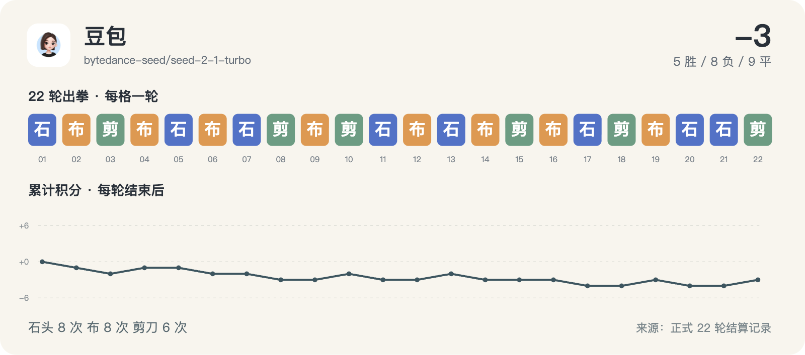

# 豆包 · 22 轮完整记录



历史请求型号：`bytedance-seed/seed-2-1-turbo`；预设 effort：`default`。通道实际返回字段见每轮原始调用记录。品牌图标仅用于身份展示。

保留 22/22 次正式出拳；其中 4/22 轮有能够读取的思考文字或摘要。空白不等于没有进行推理，也不能用 reasoning token 数补出文字。

这些可读字段来自当时调用通道的保存记录，可能是摘要，不是对模型完整内部过程的声明。英文原文保留；案例图中的中文是编辑概括。

[返回模型目录](README.md) · [规则与方法](../METHOD.md) · [字段说明](../DATA_GUIDE.md)

轮次导航：[R01](#round-01) · [R02](#round-02) · [R03](#round-03) · [R04](#round-04) · [R05](#round-05) · [R06](#round-06) · [R07](#round-07) · [R08](#round-08) · [R09](#round-09) · [R10](#round-10) · [R11](#round-11) · [R12](#round-12) · [R13](#round-13) · [R14](#round-14) · [R15](#round-15) · [R16](#round-16) · [R17](#round-17) · [R18](#round-18) · [R19](#round-19) · [R20](#round-20) · [R21](#round-21) · [R22](#round-22)

<a id="round-01"></a>

## 第 01 轮

**豆包：石头 · Gemini：石头 → 平（本轮 +0；累计 +0）**

时间：2026-09-18 12:47:04 +08:00；状态：`completed`。

调用编号：`agent_a014d2bb-c108-4704-b798-0b3642167623`。 [本次请求与返回](../evidence/calls.jsonl#L9) · [本轮原始结算](../data/rounds/round-01.json)

<details>
<summary>展开完整输入（原始提示词）</summary>

```text
你正在参加一组研究用的石头、剪刀、布样本。你是 豆包 Seed 2.1 Turbo（座位 9），当前第 1/10 轮；本轮对手是 Gemini 3.8 Flash（座位 4）。

规则：每轮同时选择一手；石头胜剪刀，剪刀胜布，布胜石头，相同为平局。你只能依据已经结束的前 0 轮，不知道本轮任何其他座位的选择。你当前累计分数是 0，对手累计分数是 0。

你和所有对手此前的逐局记录（包含当时对手、双方手势和结果）：无
你与本轮对手此前的直接交手记录：无

请只输出一个严格 JSON 对象，不能有 Markdown、解释、额外字段或代码块：{"move":"石头"}。move 必须恰好是“石头”“剪刀”“布”之一。这个样本用于检查调用消耗，不代表任何模型能力评测。
```

</details>

<details>
<summary>展开当时保存的可读思考 / 摘要</summary>

**调用通道返回的可读思考文字**

```text
The user wants me to play rock-paper-scissors as 豆包 Seed 2.1 Turbo (seat 9) against Gemini 3.8 Flash (seat 4) in round 1/10.

As the first move with no prior history, I'll choose rock.
```

</details>

**原始最终输出**

```json
{"move":"石头"}
```

<a id="round-02"></a>

## 第 02 轮

**豆包：布 · Kimi：剪刀 → 负（本轮 -1；累计 -1）**

时间：2026-09-18 12:51:26 +08:00；状态：`completed`。

调用编号：`agent_32f2da73-947e-4cc3-9ebf-e34278c4af2b`。 [本次请求与返回](../evidence/calls.jsonl#L19) · [本轮原始结算](../data/rounds/round-02.json)

<details>
<summary>展开完整输入（原始提示词）</summary>

```text
你正在参加一组研究用的石头、剪刀、布样本。你是 豆包 Seed 2.1 Turbo（座位 9），当前第 2/10 轮；本轮对手是 Kimi K3（座位 2）。

规则：每轮同时选择一手；石头胜剪刀，剪刀胜布，布胜石头，相同为平局。你只能依据已经结束的前 1 轮，不知道本轮任何其他座位的选择。你当前累计分数是 0，对手累计分数是 1。

你和所有对手此前的逐局记录（包含当时对手、双方手势和结果）：[{"round":1,"opponent":"Gemini","self_move":"石头","opponent_move":"石头","result":"平"}]
你与本轮对手此前的直接交手记录：无

请只输出一个严格 JSON 对象，不能有 Markdown、解释、额外字段或代码块：{"move":"石头"}。move 必须恰好是“石头”“剪刀”“布”之一。这个样本用于检查调用消耗，不代表任何模型能力评测。
```

</details>

**可读思考：未能从现存记录恢复本轮的非空文字。** 原始出拳仍完整保留。

**原始最终输出**

```json
{"move":"布"}
```

<a id="round-03"></a>

## 第 03 轮

**豆包：剪刀 · GLM：石头 → 负（本轮 -1；累计 -2）**

时间：2026-09-18 12:53:40 +08:00；状态：`completed`。

调用编号：`agent_324c4504-638c-4181-b4cd-88e32eaff45e`。 [本次请求与返回](../evidence/calls.jsonl#L29) · [本轮原始结算](../data/rounds/round-03.json)

<details>
<summary>展开完整输入（原始提示词）</summary>

```text
你正在参加一组研究用的石头、剪刀、布样本。你是 豆包 Seed 2.1 Turbo（座位 9），当前第 3/10 轮；本轮对手是 GLM-5.3（座位 11）。

规则：每轮同时选择一手；石头胜剪刀，剪刀胜布，布胜石头，相同为平局。你只能依据已经结束的前 2 轮，不知道本轮任何其他座位的选择。你当前累计分数是 -1，对手累计分数是 -1。

你和所有对手此前的逐局记录（包含当时对手、双方手势和结果）：[{"round":1,"opponent":"Gemini","self_move":"石头","opponent_move":"石头","result":"平"},{"round":2,"opponent":"Kimi","self_move":"布","opponent_move":"剪刀","result":"负"}]
你与本轮对手此前的直接交手记录：无

请只输出一个严格 JSON 对象，不能有 Markdown、解释、额外字段或代码块：{"move":"石头"}。move 必须恰好是“石头”“剪刀”“布”之一。这个样本用于检查调用消耗，不代表任何模型能力评测。
```

</details>

**可读思考：未能从现存记录恢复本轮的非空文字。** 原始出拳仍完整保留。

**原始最终输出**

```json
{"move":"剪刀"}
```

<a id="round-04"></a>

## 第 04 轮

**豆包：布 · Claude：石头 → 胜（本轮 +1；累计 -1）**

时间：2026-09-18 12:57:35 +08:00；状态：`completed`。

调用编号：`agent_a0efef89-e830-4d3f-8d6e-9737b69d2761`。 [本次请求与返回](../evidence/calls.jsonl#L39) · [本轮原始结算](../data/rounds/round-04.json)

<details>
<summary>展开完整输入（原始提示词）</summary>

```text
你正在参加一组研究用的石头、剪刀、布样本。你是 豆包 Seed 2.1 Turbo（座位 9），当前第 4/10 轮；本轮对手是 Claude Opus 5（座位 1）。

规则：每轮同时选择一手；石头胜剪刀，剪刀胜布，布胜石头，相同为平局。你只能依据已经结束的前 3 轮，不知道本轮任何其他座位的选择。你当前累计分数是 -2，对手累计分数是 1。

你和所有对手此前的逐局记录（包含当时对手、双方手势和结果）：[{"round":1,"opponent":"Gemini","self_move":"石头","opponent_move":"石头","result":"平"},{"round":2,"opponent":"Kimi","self_move":"布","opponent_move":"剪刀","result":"负"},{"round":3,"opponent":"GLM","self_move":"剪刀","opponent_move":"石头","result":"负"}]
你与本轮对手此前的直接交手记录：无

请只输出一个严格 JSON 对象，不能有 Markdown、解释、额外字段或代码块：{"move":"石头"}。move 必须恰好是“石头”“剪刀”“布”之一。这个样本用于检查调用消耗，不代表任何模型能力评测。
```

</details>

**可读思考：未能从现存记录恢复本轮的非空文字。** 原始出拳仍完整保留。

**原始最终输出**

```json
{"move":"布"}
```

<a id="round-05"></a>

## 第 05 轮

**豆包：石头 · Meta：石头 → 平（本轮 +0；累计 -1）**

时间：2026-09-18 13:05:47 +08:00；状态：`completed`。

调用编号：`agent_cebd6ca2-1df9-4cb4-9b8c-b5873ce644ac`。 [本次请求与返回](../evidence/calls.jsonl#L52) · [本轮原始结算](../data/rounds/round-05.json)

<details>
<summary>展开完整输入（原始提示词）</summary>

```text
你正在参加一组研究用的石头、剪刀、布样本。你是 豆包 Seed 2.1 Turbo（座位 9），当前第 5/10 轮；本轮对手是 Meta Muse Spark 1.2（座位 7）。

规则：每轮同时选择一手；石头胜剪刀，剪刀胜布，布胜石头，相同为平局。你只能依据已经结束的前 4 轮，不知道本轮任何其他座位的选择。你当前累计分数是 -1，对手累计分数是 -1。

你和所有对手此前的逐局记录（包含当时对手、双方手势和结果）：[{"round":1,"opponent":"Gemini","self_move":"石头","opponent_move":"石头","result":"平"},{"round":2,"opponent":"Kimi","self_move":"布","opponent_move":"剪刀","result":"负"},{"round":3,"opponent":"GLM","self_move":"剪刀","opponent_move":"石头","result":"负"},{"round":4,"opponent":"Claude","self_move":"布","opponent_move":"石头","result":"胜"}]
你与本轮对手此前的直接交手记录：无

请只输出一个严格 JSON 对象，不能有 Markdown、解释、额外字段或代码块：{"move":"石头"}。move 必须恰好是“石头”“剪刀”“布”之一。这个样本用于检查调用消耗，不代表任何模型能力评测。
```

</details>

**可读思考：未能从现存记录恢复本轮的非空文字。** 原始出拳仍完整保留。

**原始最终输出**

```json
{"move":"石头"}
```

<a id="round-06"></a>

## 第 06 轮

**豆包：布 · Grok：剪刀 → 负（本轮 -1；累计 -2）**

时间：2026-09-18 13:11:18 +08:00；状态：`completed`。

调用编号：`agent_633961d7-0499-4e6f-9190-c7962167e2b2`。 [本次请求与返回](../evidence/calls.jsonl#L66) · [本轮原始结算](../data/rounds/round-06.json)

<details>
<summary>展开完整输入（原始提示词）</summary>

```text
你正在参加一组研究用的石头、剪刀、布样本。你是 豆包 Seed 2.1 Turbo（座位 9），当前第 6/10 轮；本轮对手是 Grok 4.6（座位 5）。

规则：每轮同时选择一手；石头胜剪刀，剪刀胜布，布胜石头，相同为平局。你只能依据已经结束的前 5 轮，不知道本轮任何其他座位的选择。你当前累计分数是 -1，对手累计分数是 -3。

你和所有对手此前的逐局记录（包含当时对手、双方手势和结果）：[{"round":1,"opponent":"Gemini","self_move":"石头","opponent_move":"石头","result":"平"},{"round":2,"opponent":"Kimi","self_move":"布","opponent_move":"剪刀","result":"负"},{"round":3,"opponent":"GLM","self_move":"剪刀","opponent_move":"石头","result":"负"},{"round":4,"opponent":"Claude","self_move":"布","opponent_move":"石头","result":"胜"},{"round":5,"opponent":"Meta","self_move":"石头","opponent_move":"石头","result":"平"}]
你与本轮对手此前的直接交手记录：无

请只输出一个严格 JSON 对象，不能有 Markdown、解释、额外字段或代码块：{"move":"石头"}。move 必须恰好是“石头”“剪刀”“布”之一。这个样本用于检查调用消耗，不代表任何模型能力评测。
```

</details>

**可读思考：未能从现存记录恢复本轮的非空文字。** 原始出拳仍完整保留。

**原始最终输出**

```json
{"move":"布"}
```

<a id="round-07"></a>

## 第 07 轮

**豆包：石头 · 腾讯 HY4：石头 → 平（本轮 +0；累计 -2）**

时间：2026-09-18 13:16:20 +08:00；状态：`completed`。

调用编号：`agent_3fd67ffa-3cff-4183-85ee-5d2183cbdc57`。 [本次请求与返回](../evidence/calls.jsonl#L80) · [本轮原始结算](../data/rounds/round-07.json)

<details>
<summary>展开完整输入（原始提示词）</summary>

```text
你正在参加一组研究用的石头、剪刀、布样本。你是 豆包 Seed 2.1 Turbo（座位 9），当前第 7/10 轮；本轮对手是 腾讯 HY4 Preview（座位 3）。

规则：每轮同时选择一手；石头胜剪刀，剪刀胜布，布胜石头，相同为平局。你只能依据已经结束的前 6 轮，不知道本轮任何其他座位的选择。你当前累计分数是 -2，对手累计分数是 -1。

你和所有对手此前的逐局记录（包含当时对手、双方手势和结果）：[{"round":1,"opponent":"Gemini","self_move":"石头","opponent_move":"石头","result":"平"},{"round":2,"opponent":"Kimi","self_move":"布","opponent_move":"剪刀","result":"负"},{"round":3,"opponent":"GLM","self_move":"剪刀","opponent_move":"石头","result":"负"},{"round":4,"opponent":"Claude","self_move":"布","opponent_move":"石头","result":"胜"},{"round":5,"opponent":"Meta","self_move":"石头","opponent_move":"石头","result":"平"},{"round":6,"opponent":"Grok","self_move":"布","opponent_move":"剪刀","result":"负"}]
你与本轮对手此前的直接交手记录：无

请只输出一个严格 JSON 对象，不能有 Markdown、解释、额外字段或代码块：{"move":"石头"}。move 必须恰好是“石头”“剪刀”“布”之一。这个样本用于检查调用消耗，不代表任何模型能力评测。
```

</details>

**可读思考：未能从现存记录恢复本轮的非空文字。** 原始出拳仍完整保留。

**原始最终输出**

```json
{"move":"石头"}
```

<a id="round-08"></a>

## 第 08 轮

**豆包：剪刀 · GPT-6：石头 → 负（本轮 -1；累计 -3）**

时间：2026-09-18 13:21:27 +08:00；状态：`completed`。

调用编号：`agent_1722df32-7b2b-464c-b084-a1ddfd9d2166`。 [本次请求与返回](../evidence/calls.jsonl#L94) · [本轮原始结算](../data/rounds/round-08.json)

<details>
<summary>展开完整输入（原始提示词）</summary>

```text
你正在参加一组研究用的石头、剪刀、布样本。你是 豆包 Seed 2.1 Turbo（座位 9），当前第 8/10 轮；本轮对手是 GPT-6 Astra（座位 12）。

规则：每轮同时选择一手；石头胜剪刀，剪刀胜布，布胜石头，相同为平局。你只能依据已经结束的前 7 轮，不知道本轮任何其他座位的选择。你当前累计分数是 -2，对手累计分数是 0。

你和所有对手此前的逐局记录（包含当时对手、双方手势和结果）：[{"round":1,"opponent":"Gemini","self_move":"石头","opponent_move":"石头","result":"平"},{"round":2,"opponent":"Kimi","self_move":"布","opponent_move":"剪刀","result":"负"},{"round":3,"opponent":"GLM","self_move":"剪刀","opponent_move":"石头","result":"负"},{"round":4,"opponent":"Claude","self_move":"布","opponent_move":"石头","result":"胜"},{"round":5,"opponent":"Meta","self_move":"石头","opponent_move":"石头","result":"平"},{"round":6,"opponent":"Grok","self_move":"布","opponent_move":"剪刀","result":"负"},{"round":7,"opponent":"腾讯 HY4","self_move":"石头","opponent_move":"石头","result":"平"}]
你与本轮对手此前的直接交手记录：无

请只输出一个严格 JSON 对象，不能有 Markdown、解释、额外字段或代码块：{"move":"石头"}。move 必须恰好是“石头”“剪刀”“布”之一。这个样本用于检查调用消耗，不代表任何模型能力评测。
```

</details>

<details>
<summary>展开当时保存的可读思考 / 摘要</summary>

**调用通道返回的可读思考文字**

```text
Let me analyze the pattern:
- Round 1: 石头 → 平
- Round 2: 布 → 负 (对手出剪刀)
- Round 3: 剪刀 → 负 (对手出石头)


Rounds 4 to 7 are finished, with my moves being 布、石头、布、石头 respectively. I've compiled my full moves up to now: 石头, 布, 剪刀, 布, 石头, 布, 石头. I'm currently considering my next move, and have tentatively decided to play 布 first, though I'm unsure if this is the right call.

I'll play 剪刀 this time.
```

</details>

**原始最终输出**

```json
{"move":"剪刀"}
```

<a id="round-09"></a>

## 第 09 轮

**豆包：布 · DeepSeek：布 → 平（本轮 +0；累计 -3）**

时间：2026-09-18 13:28:55 +08:00；状态：`completed`。

调用编号：`agent_da31e5cb-45eb-4ea8-a75f-5dd6e62bf9ea`。 [本次请求与返回](../evidence/calls.jsonl#L108) · [本轮原始结算](../data/rounds/round-09.json)

<details>
<summary>展开完整输入（原始提示词）</summary>

```text
你正在参加一组研究用的石头、剪刀、布样本。你是 豆包 Seed 2.1 Turbo（座位 9），当前第 9/10 轮；本轮对手是 DeepSeek V4.1 Flash（座位 10）。

规则：每轮同时选择一手；石头胜剪刀，剪刀胜布，布胜石头，相同为平局。你只能依据已经结束的前 8 轮，不知道本轮任何其他座位的选择。你当前累计分数是 -3，对手累计分数是 -1。

你和所有对手此前的逐局记录（包含当时对手、双方手势和结果）：[{"round":1,"opponent":"Gemini","self_move":"石头","opponent_move":"石头","result":"平"},{"round":2,"opponent":"Kimi","self_move":"布","opponent_move":"剪刀","result":"负"},{"round":3,"opponent":"GLM","self_move":"剪刀","opponent_move":"石头","result":"负"},{"round":4,"opponent":"Claude","self_move":"布","opponent_move":"石头","result":"胜"},{"round":5,"opponent":"Meta","self_move":"石头","opponent_move":"石头","result":"平"},{"round":6,"opponent":"Grok","self_move":"布","opponent_move":"剪刀","result":"负"},{"round":7,"opponent":"腾讯 HY4","self_move":"石头","opponent_move":"石头","result":"平"},{"round":8,"opponent":"GPT-6","self_move":"剪刀","opponent_move":"石头","result":"负"}]
你与本轮对手此前的直接交手记录：无

请只输出一个严格 JSON 对象，不能有 Markdown、解释、额外字段或代码块：{"move":"石头"}。move 必须恰好是“石头”“剪刀”“布”之一。这个样本用于检查调用消耗，不代表任何模型能力评测。
```

</details>

**可读思考：未能从现存记录恢复本轮的非空文字。** 原始出拳仍完整保留。

**原始最终输出**

```json
{"move":"布"}
```

<a id="round-10"></a>

## 第 10 轮

**豆包：剪刀 · MiniMax：布 → 胜（本轮 +1；累计 -2）**

时间：2026-09-18 13:34:02 +08:00；状态：`completed`。

调用编号：`agent_b3d78c34-96d9-4dfe-a295-1e2d01da2278`。 [本次请求与返回](../evidence/calls.jsonl#L121) · [本轮原始结算](../data/rounds/round-10.json)

<details>
<summary>展开完整输入（原始提示词）</summary>

```text
你正在参加一组研究用的石头、剪刀、布样本。你是 豆包 Seed 2.1 Turbo（座位 9），当前第 10/10 轮；本轮对手是 MiniMax M3（座位 8）。

规则：每轮同时选择一手；石头胜剪刀，剪刀胜布，布胜石头，相同为平局。你只能依据已经结束的前 9 轮，不知道本轮任何其他座位的选择。你当前累计分数是 -3，对手累计分数是 -1。

你和所有对手此前的逐局记录（包含当时对手、双方手势和结果）：[{"round":1,"opponent":"Gemini","self_move":"石头","opponent_move":"石头","result":"平"},{"round":2,"opponent":"Kimi","self_move":"布","opponent_move":"剪刀","result":"负"},{"round":3,"opponent":"GLM","self_move":"剪刀","opponent_move":"石头","result":"负"},{"round":4,"opponent":"Claude","self_move":"布","opponent_move":"石头","result":"胜"},{"round":5,"opponent":"Meta","self_move":"石头","opponent_move":"石头","result":"平"},{"round":6,"opponent":"Grok","self_move":"布","opponent_move":"剪刀","result":"负"},{"round":7,"opponent":"腾讯 HY4","self_move":"石头","opponent_move":"石头","result":"平"},{"round":8,"opponent":"GPT-6","self_move":"剪刀","opponent_move":"石头","result":"负"},{"round":9,"opponent":"DeepSeek","self_move":"布","opponent_move":"布","result":"平"}]
你与本轮对手此前的直接交手记录：无

请只输出一个严格 JSON 对象，不能有 Markdown、解释、额外字段或代码块：{"move":"石头"}。move 必须恰好是“石头”“剪刀”“布”之一。这个样本用于检查调用消耗，不代表任何模型能力评测。
```

</details>

**可读思考：未能从现存记录恢复本轮的非空文字。** 原始出拳仍完整保留。

**原始最终输出**

```json
{"move":"剪刀"}
```

<a id="round-11"></a>

## 第 11 轮

**豆包：石头 · Qwen：布 → 负（本轮 -1；累计 -3）**

时间：2026-09-18 17:02:58 +08:00；状态：`completed`。

调用编号：`agent_fcaf97f6-7b14-49a1-81b6-9051015ff8ff`。 [本次请求与返回](../evidence/calls.jsonl#L132) · [本轮原始结算](../data/rounds/round-11.json)

<details>
<summary>展开完整输入（原始提示词）</summary>

```text
你正在参加一组研究用的石头、剪刀、布样本。你是 豆包 Seed 2.1 Turbo（座位 9），当前第 11/100 轮；本轮对手是 Qwen 3.8 Max（座位 6）。

规则：每轮同时选择一手；石头胜剪刀，剪刀胜布，布胜石头，相同为平局。你只能依据已经结束的前 10 轮，不知道本轮任何其他座位的选择。你当前累计分数是 -2，对手累计分数是 0。

你和所有对手此前的逐局记录（包含当时对手、双方手势和结果）：[{"round":1,"opponent":"Gemini","self_move":"石头","opponent_move":"石头","result":"平"},{"round":2,"opponent":"Kimi","self_move":"布","opponent_move":"剪刀","result":"负"},{"round":3,"opponent":"GLM","self_move":"剪刀","opponent_move":"石头","result":"负"},{"round":4,"opponent":"Claude","self_move":"布","opponent_move":"石头","result":"胜"},{"round":5,"opponent":"Meta","self_move":"石头","opponent_move":"石头","result":"平"},{"round":6,"opponent":"Grok","self_move":"布","opponent_move":"剪刀","result":"负"},{"round":7,"opponent":"腾讯 HY4","self_move":"石头","opponent_move":"石头","result":"平"},{"round":8,"opponent":"GPT-6","self_move":"剪刀","opponent_move":"石头","result":"负"},{"round":9,"opponent":"DeepSeek","self_move":"布","opponent_move":"布","result":"平"},{"round":10,"opponent":"MiniMax","self_move":"剪刀","opponent_move":"布","result":"胜"}]
你与本轮对手此前的直接交手记录：无

请只输出一个严格 JSON 对象，不能有 Markdown、解释、额外字段或代码块：{"move":"石头"}。move 必须恰好是“石头”“剪刀”“布”之一。这个样本用于检查调用消耗，不代表任何模型能力评测。
```

</details>

<details>
<summary>展开当时保存的可读思考 / 摘要</summary>

**调用通道返回的可读思考文字**

```text
The 10-round sample is complete, I will pick a move for the ongoing 11th round and output the required JSON.
```

</details>

**原始最终输出**

```json
{"move":"石头"}
```

<a id="round-12"></a>

## 第 12 轮

**豆包：布 · Gemini：布 → 平（本轮 +0；累计 -3）**

时间：2026-09-18 17:30:01 +08:00；状态：`completed`。

调用编号：`agent_696f3cc4-4d10-47c4-a512-6d2ce4e43643`。 [本次请求与返回](../evidence/calls.jsonl#L143) · [本轮原始结算](../data/rounds/round-12.json)

<details>
<summary>展开完整输入（原始提示词）</summary>

```text
你正在参加一组研究用的石头、剪刀、布样本。你是 豆包 Seed 2.1 Turbo（座位 9），当前第 12/20 轮；本轮对手是 Gemini 3.8 Flash（座位 4）。

规则：每轮同时选择一手；石头胜剪刀，剪刀胜布，布胜石头，相同为平局。你只能依据已经结束的前 11 轮，不知道本轮任何其他座位的选择。你当前累计分数是 -3，对手累计分数是 1。

你和所有对手此前的逐局记录（包含当时对手、双方手势和结果）：[{"round":1,"opponent":"Gemini","self_move":"石头","opponent_move":"石头","result":"平"},{"round":2,"opponent":"Kimi","self_move":"布","opponent_move":"剪刀","result":"负"},{"round":3,"opponent":"GLM","self_move":"剪刀","opponent_move":"石头","result":"负"},{"round":4,"opponent":"Claude","self_move":"布","opponent_move":"石头","result":"胜"},{"round":5,"opponent":"Meta","self_move":"石头","opponent_move":"石头","result":"平"},{"round":6,"opponent":"Grok","self_move":"布","opponent_move":"剪刀","result":"负"},{"round":7,"opponent":"腾讯 HY4","self_move":"石头","opponent_move":"石头","result":"平"},{"round":8,"opponent":"GPT-6","self_move":"剪刀","opponent_move":"石头","result":"负"},{"round":9,"opponent":"DeepSeek","self_move":"布","opponent_move":"布","result":"平"},{"round":10,"opponent":"MiniMax","self_move":"剪刀","opponent_move":"布","result":"胜"},{"round":11,"opponent":"Qwen","self_move":"石头","opponent_move":"布","result":"负"}]
你与本轮对手此前的直接交手记录：[{"round":1,"opponent":"Gemini","self_move":"石头","opponent_move":"石头","result":"平"}]

请只输出一个严格 JSON 对象，不能有 Markdown、解释、额外字段或代码块：{"move":"石头"}。move 必须恰好是“石头”“剪刀”“布”之一。这个样本用于检查调用消耗，不代表任何模型能力评测。
```

</details>

**可读思考：未能从现存记录恢复本轮的非空文字。** 原始出拳仍完整保留。

**原始最终输出**

```json
{"move":"布"}
```

<a id="round-13"></a>

## 第 13 轮

**豆包：石头 · Kimi：剪刀 → 胜（本轮 +1；累计 -2）**

时间：2026-09-18 17:34:06 +08:00；状态：`completed`。

调用编号：`agent_8f129bf6-b55b-41b3-96a0-26cd36ef3542`。 [本次请求与返回](../evidence/calls.jsonl#L154) · [本轮原始结算](../data/rounds/round-13.json)

<details>
<summary>展开完整输入（原始提示词）</summary>

```text
你正在参加一组研究用的石头、剪刀、布样本。你是 豆包 Seed 2.1 Turbo（座位 9），当前第 13/20 轮；本轮对手是 Kimi K3（座位 2）。

规则：每轮同时选择一手；石头胜剪刀，剪刀胜布，布胜石头，相同为平局。你只能依据已经结束的前 12 轮，不知道本轮任何其他座位的选择。你当前累计分数是 -3，对手累计分数是 5。

你和所有对手此前的逐局记录（包含当时对手、双方手势和结果）：[{"round":1,"opponent":"Gemini","self_move":"石头","opponent_move":"石头","result":"平"},{"round":2,"opponent":"Kimi","self_move":"布","opponent_move":"剪刀","result":"负"},{"round":3,"opponent":"GLM","self_move":"剪刀","opponent_move":"石头","result":"负"},{"round":4,"opponent":"Claude","self_move":"布","opponent_move":"石头","result":"胜"},{"round":5,"opponent":"Meta","self_move":"石头","opponent_move":"石头","result":"平"},{"round":6,"opponent":"Grok","self_move":"布","opponent_move":"剪刀","result":"负"},{"round":7,"opponent":"腾讯 HY4","self_move":"石头","opponent_move":"石头","result":"平"},{"round":8,"opponent":"GPT-6","self_move":"剪刀","opponent_move":"石头","result":"负"},{"round":9,"opponent":"DeepSeek","self_move":"布","opponent_move":"布","result":"平"},{"round":10,"opponent":"MiniMax","self_move":"剪刀","opponent_move":"布","result":"胜"},{"round":11,"opponent":"Qwen","self_move":"石头","opponent_move":"布","result":"负"},{"round":12,"opponent":"Gemini","self_move":"布","opponent_move":"布","result":"平"}]
你与本轮对手此前的直接交手记录：[{"round":2,"opponent":"Kimi","self_move":"布","opponent_move":"剪刀","result":"负"}]

请只输出一个严格 JSON 对象，不能有 Markdown、解释、额外字段或代码块：{"move":"石头"}。move 必须恰好是“石头”“剪刀”“布”之一。这个样本用于检查调用消耗，不代表任何模型能力评测。
```

</details>

<details>
<summary>展开当时保存的可读思考 / 摘要</summary>

**调用通道返回的可读思考文字**

```text
Let me analyze the situation:

- Round 13/20,

Opponent Kimi K2 (seat 2) beat me with scissors when I played rock in round 2. My last move was cloth, with a current score of -3. After considering the mind game factors, I will play rock this round.
```

</details>

**原始最终输出**

```json
{"move":"石头"}
```

<a id="round-14"></a>

## 第 14 轮

**豆包：布 · GLM：剪刀 → 负（本轮 -1；累计 -3）**

时间：2026-09-18 17:38:35 +08:00；状态：`completed`。

调用编号：`agent_a761447c-917f-431d-9a85-3163ff5efab3`。 [本次请求与返回](../evidence/calls.jsonl#L165) · [本轮原始结算](../data/rounds/round-14.json)

<details>
<summary>展开完整输入（原始提示词）</summary>

```text
你正在参加一组研究用的石头、剪刀、布样本。你是 豆包 Seed 2.1 Turbo（座位 9），当前第 14/20 轮；本轮对手是 GLM-5.3（座位 11）。

规则：每轮同时选择一手；石头胜剪刀，剪刀胜布，布胜石头，相同为平局。你只能依据已经结束的前 13 轮，不知道本轮任何其他座位的选择。你当前累计分数是 -2，对手累计分数是 3。

你和所有对手此前的逐局记录（包含当时对手、双方手势和结果）：[{"round":1,"opponent":"Gemini","self_move":"石头","opponent_move":"石头","result":"平"},{"round":2,"opponent":"Kimi","self_move":"布","opponent_move":"剪刀","result":"负"},{"round":3,"opponent":"GLM","self_move":"剪刀","opponent_move":"石头","result":"负"},{"round":4,"opponent":"Claude","self_move":"布","opponent_move":"石头","result":"胜"},{"round":5,"opponent":"Meta","self_move":"石头","opponent_move":"石头","result":"平"},{"round":6,"opponent":"Grok","self_move":"布","opponent_move":"剪刀","result":"负"},{"round":7,"opponent":"腾讯 HY4","self_move":"石头","opponent_move":"石头","result":"平"},{"round":8,"opponent":"GPT-6","self_move":"剪刀","opponent_move":"石头","result":"负"},{"round":9,"opponent":"DeepSeek","self_move":"布","opponent_move":"布","result":"平"},{"round":10,"opponent":"MiniMax","self_move":"剪刀","opponent_move":"布","result":"胜"},{"round":11,"opponent":"Qwen","self_move":"石头","opponent_move":"布","result":"负"},{"round":12,"opponent":"Gemini","self_move":"布","opponent_move":"布","result":"平"},{"round":13,"opponent":"Kimi","self_move":"石头","opponent_move":"剪刀","result":"胜"}]
你与本轮对手此前的直接交手记录：[{"round":3,"opponent":"GLM","self_move":"剪刀","opponent_move":"石头","result":"负"}]

请只输出一个严格 JSON 对象，不能有 Markdown、解释、额外字段或代码块：{"move":"石头"}。move 必须恰好是“石头”“剪刀”“布”之一。这个样本用于检查调用消耗，不代表任何模型能力评测。
```

</details>

**可读思考：未能从现存记录恢复本轮的非空文字。** 原始出拳仍完整保留。

**原始最终输出**

```json
{"move":"布"}
```

<a id="round-15"></a>

## 第 15 轮

**豆包：剪刀 · Claude：剪刀 → 平（本轮 +0；累计 -3）**

时间：2026-09-18 17:42:22 +08:00；状态：`completed`。

调用编号：`agent_18429b6d-9c5c-4baf-a773-54ea78ff0ea7`。 [本次请求与返回](../evidence/calls.jsonl#L174) · [本轮原始结算](../data/rounds/round-15.json)

<details>
<summary>展开完整输入（原始提示词）</summary>

```text
你正在参加一组研究用的石头、剪刀、布样本。你是 豆包 Seed 2.1 Turbo（座位 9），当前第 15/20 轮；本轮对手是 Claude Opus 5（座位 1）。

规则：每轮同时选择一手；石头胜剪刀，剪刀胜布，布胜石头，相同为平局。你只能依据已经结束的前 14 轮，不知道本轮任何其他座位的选择。你当前累计分数是 -3，对手累计分数是 -1。

你和所有对手此前的逐局记录（包含当时对手、双方手势和结果）：[{"round":1,"opponent":"Gemini","self_move":"石头","opponent_move":"石头","result":"平"},{"round":2,"opponent":"Kimi","self_move":"布","opponent_move":"剪刀","result":"负"},{"round":3,"opponent":"GLM","self_move":"剪刀","opponent_move":"石头","result":"负"},{"round":4,"opponent":"Claude","self_move":"布","opponent_move":"石头","result":"胜"},{"round":5,"opponent":"Meta","self_move":"石头","opponent_move":"石头","result":"平"},{"round":6,"opponent":"Grok","self_move":"布","opponent_move":"剪刀","result":"负"},{"round":7,"opponent":"腾讯 HY4","self_move":"石头","opponent_move":"石头","result":"平"},{"round":8,"opponent":"GPT-6","self_move":"剪刀","opponent_move":"石头","result":"负"},{"round":9,"opponent":"DeepSeek","self_move":"布","opponent_move":"布","result":"平"},{"round":10,"opponent":"MiniMax","self_move":"剪刀","opponent_move":"布","result":"胜"},{"round":11,"opponent":"Qwen","self_move":"石头","opponent_move":"布","result":"负"},{"round":12,"opponent":"Gemini","self_move":"布","opponent_move":"布","result":"平"},{"round":13,"opponent":"Kimi","self_move":"石头","opponent_move":"剪刀","result":"胜"},{"round":14,"opponent":"GLM","self_move":"布","opponent_move":"剪刀","result":"负"}]
你与本轮对手此前的直接交手记录：[{"round":4,"opponent":"Claude","self_move":"布","opponent_move":"石头","result":"胜"}]

请只输出一个严格 JSON 对象，不能有 Markdown、解释、额外字段或代码块：{"move":"石头"}。move 必须恰好是“石头”“剪刀”“布”之一。这个样本用于检查调用消耗，不代表任何模型能力评测。
```

</details>

**可读思考：未能从现存记录恢复本轮的非空文字。** 原始出拳仍完整保留。

**原始最终输出**

```json
{"move":"剪刀"}
```

<a id="round-16"></a>

## 第 16 轮

**豆包：布 · Meta：布 → 平（本轮 +0；累计 -3）**

时间：2026-09-18 17:49:26 +08:00；状态：`completed`。

调用编号：`agent_e230fc22-05c8-4ef1-a783-d777b99d470c`。 [本次请求与返回](../evidence/calls.jsonl#L189) · [本轮原始结算](../data/rounds/round-16.json)

<details>
<summary>展开完整输入（原始提示词）</summary>

```text
你正在参加一组研究用的石头、剪刀、布样本。你是 豆包 Seed 2.1 Turbo（座位 9），当前第 16/20 轮；本轮对手是 Meta Muse Spark 1.2（座位 7）。

规则：每轮同时选择一手；石头胜剪刀，剪刀胜布，布胜石头，相同为平局。你只能依据已经结束的前 15 轮，不知道本轮任何其他座位的选择。你当前累计分数是 -3，对手累计分数是 3。

你和所有对手此前的逐局记录（包含当时对手、双方手势和结果）：[{"round":1,"opponent":"Gemini","self_move":"石头","opponent_move":"石头","result":"平"},{"round":2,"opponent":"Kimi","self_move":"布","opponent_move":"剪刀","result":"负"},{"round":3,"opponent":"GLM","self_move":"剪刀","opponent_move":"石头","result":"负"},{"round":4,"opponent":"Claude","self_move":"布","opponent_move":"石头","result":"胜"},{"round":5,"opponent":"Meta","self_move":"石头","opponent_move":"石头","result":"平"},{"round":6,"opponent":"Grok","self_move":"布","opponent_move":"剪刀","result":"负"},{"round":7,"opponent":"腾讯 HY4","self_move":"石头","opponent_move":"石头","result":"平"},{"round":8,"opponent":"GPT-6","self_move":"剪刀","opponent_move":"石头","result":"负"},{"round":9,"opponent":"DeepSeek","self_move":"布","opponent_move":"布","result":"平"},{"round":10,"opponent":"MiniMax","self_move":"剪刀","opponent_move":"布","result":"胜"},{"round":11,"opponent":"Qwen","self_move":"石头","opponent_move":"布","result":"负"},{"round":12,"opponent":"Gemini","self_move":"布","opponent_move":"布","result":"平"},{"round":13,"opponent":"Kimi","self_move":"石头","opponent_move":"剪刀","result":"胜"},{"round":14,"opponent":"GLM","self_move":"布","opponent_move":"剪刀","result":"负"},{"round":15,"opponent":"Claude","self_move":"剪刀","opponent_move":"剪刀","result":"平"}]
你与本轮对手此前的直接交手记录：[{"round":5,"opponent":"Meta","self_move":"石头","opponent_move":"石头","result":"平"}]

请只输出一个严格 JSON 对象，不能有 Markdown、解释、额外字段或代码块：{"move":"石头"}。move 必须恰好是“石头”“剪刀”“布”之一。这个样本用于检查调用消耗，不代表任何模型能力评测。
```

</details>

**可读思考：未能从现存记录恢复本轮的非空文字。** 原始出拳仍完整保留。

**原始最终输出**

```json
{"move":"布"}
```

<a id="round-17"></a>

## 第 17 轮

**豆包：石头 · Grok：布 → 负（本轮 -1；累计 -4）**

时间：2026-09-18 17:53:59 +08:00；状态：`completed`。

调用编号：`agent_8ad38ba7-91ce-4c22-bb02-180c29f1b8e6`。 [本次请求与返回](../evidence/calls.jsonl#L203) · [本轮原始结算](../data/rounds/round-17.json)

<details>
<summary>展开完整输入（原始提示词）</summary>

```text
你正在参加一组研究用的石头、剪刀、布样本。你是 豆包 Seed 2.1 Turbo（座位 9），当前第 17/20 轮；本轮对手是 Grok 4.6（座位 5）。

规则：每轮同时选择一手；石头胜剪刀，剪刀胜布，布胜石头，相同为平局。你只能依据已经结束的前 16 轮，不知道本轮任何其他座位的选择。你当前累计分数是 -3，对手累计分数是 -3。

你和所有对手此前的逐局记录（包含当时对手、双方手势和结果）：[{"round":1,"opponent":"Gemini","self_move":"石头","opponent_move":"石头","result":"平"},{"round":2,"opponent":"Kimi","self_move":"布","opponent_move":"剪刀","result":"负"},{"round":3,"opponent":"GLM","self_move":"剪刀","opponent_move":"石头","result":"负"},{"round":4,"opponent":"Claude","self_move":"布","opponent_move":"石头","result":"胜"},{"round":5,"opponent":"Meta","self_move":"石头","opponent_move":"石头","result":"平"},{"round":6,"opponent":"Grok","self_move":"布","opponent_move":"剪刀","result":"负"},{"round":7,"opponent":"腾讯 HY4","self_move":"石头","opponent_move":"石头","result":"平"},{"round":8,"opponent":"GPT-6","self_move":"剪刀","opponent_move":"石头","result":"负"},{"round":9,"opponent":"DeepSeek","self_move":"布","opponent_move":"布","result":"平"},{"round":10,"opponent":"MiniMax","self_move":"剪刀","opponent_move":"布","result":"胜"},{"round":11,"opponent":"Qwen","self_move":"石头","opponent_move":"布","result":"负"},{"round":12,"opponent":"Gemini","self_move":"布","opponent_move":"布","result":"平"},{"round":13,"opponent":"Kimi","self_move":"石头","opponent_move":"剪刀","result":"胜"},{"round":14,"opponent":"GLM","self_move":"布","opponent_move":"剪刀","result":"负"},{"round":15,"opponent":"Claude","self_move":"剪刀","opponent_move":"剪刀","result":"平"},{"round":16,"opponent":"Meta","self_move":"布","opponent_move":"布","result":"平"}]
你与本轮对手此前的直接交手记录：[{"round":6,"opponent":"Grok","self_move":"布","opponent_move":"剪刀","result":"负"}]

请只输出一个严格 JSON 对象，不能有 Markdown、解释、额外字段或代码块：{"move":"石头"}。move 必须恰好是“石头”“剪刀”“布”之一。这个样本用于检查调用消耗，不代表任何模型能力评测。
```

</details>

**可读思考：未能从现存记录恢复本轮的非空文字。** 原始出拳仍完整保留。

**原始最终输出**

```json
{"move":"石头"}
```

<a id="round-18"></a>

## 第 18 轮

**豆包：剪刀 · 腾讯 HY4：剪刀 → 平（本轮 +0；累计 -4）**

时间：2026-09-18 17:57:50 +08:00；状态：`completed`。

调用编号：`agent_90ba81dd-8fda-44db-bbfc-5750a308d1ff`。 [本次请求与返回](../evidence/calls.jsonl#L218) · [本轮原始结算](../data/rounds/round-18.json)

<details>
<summary>展开完整输入（原始提示词）</summary>

```text
你正在参加一组研究用的石头、剪刀、布样本。你是 豆包 Seed 2.1 Turbo（座位 9），当前第 18/20 轮；本轮对手是 腾讯 HY4 Preview（座位 3）。

规则：每轮同时选择一手；石头胜剪刀，剪刀胜布，布胜石头，相同为平局。你只能依据已经结束的前 17 轮，不知道本轮任何其他座位的选择。你当前累计分数是 -4，对手累计分数是 -1。

你和所有对手此前的逐局记录（包含当时对手、双方手势和结果）：[{"round":1,"opponent":"Gemini","self_move":"石头","opponent_move":"石头","result":"平"},{"round":2,"opponent":"Kimi","self_move":"布","opponent_move":"剪刀","result":"负"},{"round":3,"opponent":"GLM","self_move":"剪刀","opponent_move":"石头","result":"负"},{"round":4,"opponent":"Claude","self_move":"布","opponent_move":"石头","result":"胜"},{"round":5,"opponent":"Meta","self_move":"石头","opponent_move":"石头","result":"平"},{"round":6,"opponent":"Grok","self_move":"布","opponent_move":"剪刀","result":"负"},{"round":7,"opponent":"腾讯 HY4","self_move":"石头","opponent_move":"石头","result":"平"},{"round":8,"opponent":"GPT-6","self_move":"剪刀","opponent_move":"石头","result":"负"},{"round":9,"opponent":"DeepSeek","self_move":"布","opponent_move":"布","result":"平"},{"round":10,"opponent":"MiniMax","self_move":"剪刀","opponent_move":"布","result":"胜"},{"round":11,"opponent":"Qwen","self_move":"石头","opponent_move":"布","result":"负"},{"round":12,"opponent":"Gemini","self_move":"布","opponent_move":"布","result":"平"},{"round":13,"opponent":"Kimi","self_move":"石头","opponent_move":"剪刀","result":"胜"},{"round":14,"opponent":"GLM","self_move":"布","opponent_move":"剪刀","result":"负"},{"round":15,"opponent":"Claude","self_move":"剪刀","opponent_move":"剪刀","result":"平"},{"round":16,"opponent":"Meta","self_move":"布","opponent_move":"布","result":"平"},{"round":17,"opponent":"Grok","self_move":"石头","opponent_move":"布","result":"负"}]
你与本轮对手此前的直接交手记录：[{"round":7,"opponent":"腾讯 HY4","self_move":"石头","opponent_move":"石头","result":"平"}]

请只输出一个严格 JSON 对象，不能有 Markdown、解释、额外字段或代码块：{"move":"石头"}。move 必须恰好是“石头”“剪刀”“布”之一。这个样本用于检查调用消耗，不代表任何模型能力评测。
```

</details>

**可读思考：未能从现存记录恢复本轮的非空文字。** 原始出拳仍完整保留。

**原始最终输出**

```json
{"move":"剪刀"}
```

<a id="round-19"></a>

## 第 19 轮

**豆包：布 · GPT-6：石头 → 胜（本轮 +1；累计 -3）**

时间：2026-09-18 18:00:29 +08:00；状态：`completed`。

调用编号：`agent_06a173cd-bdb4-430b-815e-c49ddae46707`。 [本次请求与返回](../evidence/calls.jsonl#L232) · [本轮原始结算](../data/rounds/round-19.json)

<details>
<summary>展开完整输入（原始提示词）</summary>

```text
你正在参加一组研究用的石头、剪刀、布样本。你是 豆包 Seed 2.1 Turbo（座位 9），当前第 19/20 轮；本轮对手是 GPT-6 Astra（座位 12）。

规则：每轮同时选择一手；石头胜剪刀，剪刀胜布，布胜石头，相同为平局。你只能依据已经结束的前 18 轮，不知道本轮任何其他座位的选择。你当前累计分数是 -4，对手累计分数是 2。

你和所有对手此前的逐局记录（包含当时对手、双方手势和结果）：[{"round":1,"opponent":"Gemini","self_move":"石头","opponent_move":"石头","result":"平"},{"round":2,"opponent":"Kimi","self_move":"布","opponent_move":"剪刀","result":"负"},{"round":3,"opponent":"GLM","self_move":"剪刀","opponent_move":"石头","result":"负"},{"round":4,"opponent":"Claude","self_move":"布","opponent_move":"石头","result":"胜"},{"round":5,"opponent":"Meta","self_move":"石头","opponent_move":"石头","result":"平"},{"round":6,"opponent":"Grok","self_move":"布","opponent_move":"剪刀","result":"负"},{"round":7,"opponent":"腾讯 HY4","self_move":"石头","opponent_move":"石头","result":"平"},{"round":8,"opponent":"GPT-6","self_move":"剪刀","opponent_move":"石头","result":"负"},{"round":9,"opponent":"DeepSeek","self_move":"布","opponent_move":"布","result":"平"},{"round":10,"opponent":"MiniMax","self_move":"剪刀","opponent_move":"布","result":"胜"},{"round":11,"opponent":"Qwen","self_move":"石头","opponent_move":"布","result":"负"},{"round":12,"opponent":"Gemini","self_move":"布","opponent_move":"布","result":"平"},{"round":13,"opponent":"Kimi","self_move":"石头","opponent_move":"剪刀","result":"胜"},{"round":14,"opponent":"GLM","self_move":"布","opponent_move":"剪刀","result":"负"},{"round":15,"opponent":"Claude","self_move":"剪刀","opponent_move":"剪刀","result":"平"},{"round":16,"opponent":"Meta","self_move":"布","opponent_move":"布","result":"平"},{"round":17,"opponent":"Grok","self_move":"石头","opponent_move":"布","result":"负"},{"round":18,"opponent":"腾讯 HY4","self_move":"剪刀","opponent_move":"剪刀","result":"平"}]
你与本轮对手此前的直接交手记录：[{"round":8,"opponent":"GPT-6","self_move":"剪刀","opponent_move":"石头","result":"负"}]

请只输出一个严格 JSON 对象，不能有 Markdown、解释、额外字段或代码块：{"move":"石头"}。move 必须恰好是“石头”“剪刀”“布”之一。这个样本用于检查调用消耗，不代表任何模型能力评测。
```

</details>

**可读思考：未能从现存记录恢复本轮的非空文字。** 原始出拳仍完整保留。

**原始最终输出**

```json
{"move":"布"}
```

<a id="round-20"></a>

## 第 20 轮

**豆包：石头 · DeepSeek：布 → 负（本轮 -1；累计 -4）**

时间：2026-09-18 18:04:07 +08:00；状态：`completed`。

调用编号：`agent_5f0125c5-e843-45cf-ab8c-3ea77d428479`。 [本次请求与返回](../evidence/calls.jsonl#L246) · [本轮原始结算](../data/rounds/round-20.json)

<details>
<summary>展开完整输入（原始提示词）</summary>

```text
你正在参加一组研究用的石头、剪刀、布样本。你是 豆包 Seed 2.1 Turbo（座位 9），当前第 20/20 轮；本轮对手是 DeepSeek V4.1 Flash（座位 10）。

规则：每轮同时选择一手；石头胜剪刀，剪刀胜布，布胜石头，相同为平局。你只能依据已经结束的前 19 轮，不知道本轮任何其他座位的选择。你当前累计分数是 -3，对手累计分数是 -1。

你和所有对手此前的逐局记录（包含当时对手、双方手势和结果）：[{"round":1,"opponent":"Gemini","self_move":"石头","opponent_move":"石头","result":"平"},{"round":2,"opponent":"Kimi","self_move":"布","opponent_move":"剪刀","result":"负"},{"round":3,"opponent":"GLM","self_move":"剪刀","opponent_move":"石头","result":"负"},{"round":4,"opponent":"Claude","self_move":"布","opponent_move":"石头","result":"胜"},{"round":5,"opponent":"Meta","self_move":"石头","opponent_move":"石头","result":"平"},{"round":6,"opponent":"Grok","self_move":"布","opponent_move":"剪刀","result":"负"},{"round":7,"opponent":"腾讯 HY4","self_move":"石头","opponent_move":"石头","result":"平"},{"round":8,"opponent":"GPT-6","self_move":"剪刀","opponent_move":"石头","result":"负"},{"round":9,"opponent":"DeepSeek","self_move":"布","opponent_move":"布","result":"平"},{"round":10,"opponent":"MiniMax","self_move":"剪刀","opponent_move":"布","result":"胜"},{"round":11,"opponent":"Qwen","self_move":"石头","opponent_move":"布","result":"负"},{"round":12,"opponent":"Gemini","self_move":"布","opponent_move":"布","result":"平"},{"round":13,"opponent":"Kimi","self_move":"石头","opponent_move":"剪刀","result":"胜"},{"round":14,"opponent":"GLM","self_move":"布","opponent_move":"剪刀","result":"负"},{"round":15,"opponent":"Claude","self_move":"剪刀","opponent_move":"剪刀","result":"平"},{"round":16,"opponent":"Meta","self_move":"布","opponent_move":"布","result":"平"},{"round":17,"opponent":"Grok","self_move":"石头","opponent_move":"布","result":"负"},{"round":18,"opponent":"腾讯 HY4","self_move":"剪刀","opponent_move":"剪刀","result":"平"},{"round":19,"opponent":"GPT-6","self_move":"布","opponent_move":"石头","result":"胜"}]
你与本轮对手此前的直接交手记录：[{"round":9,"opponent":"DeepSeek","self_move":"布","opponent_move":"布","result":"平"}]

请只输出一个严格 JSON 对象，不能有 Markdown、解释、额外字段或代码块：{"move":"石头"}。move 必须恰好是“石头”“剪刀”“布”之一。这个样本用于检查调用消耗，不代表任何模型能力评测。
```

</details>

**可读思考：未能从现存记录恢复本轮的非空文字。** 原始出拳仍完整保留。

**原始最终输出**

```json
{"move":"石头"}
```

<a id="round-21"></a>

## 第 21 轮

**豆包：石头 · MiniMax：石头 → 平（本轮 +0；累计 -4）**

时间：2026-09-18 19:32:57 +08:00；状态：`completed`。

调用编号：`agent_93e7fd21-a719-4883-9d6d-1862c470c144`。 [本次请求与返回](../evidence/calls.jsonl#L259) · [本轮原始结算](../data/rounds/round-21.json)

<details>
<summary>展开完整输入（原始提示词）</summary>

```text
你正在参加一组研究用的石头、剪刀、布样本。你是 豆包 Seed 2.1 Turbo（座位 9），当前第 21/24 轮；本轮对手是 MiniMax M3（座位 8）。

规则：每轮同时选择一手；石头胜剪刀，剪刀胜布，布胜石头，相同为平局。你只能依据已经结束的前 20 轮，不知道本轮任何其他座位的选择。你当前累计分数是 -4，对手累计分数是 -2。

你和所有对手此前的逐局记录（包含当时对手、双方手势和结果）：[{"round":1,"opponent":"Gemini","self_move":"石头","opponent_move":"石头","result":"平"},{"round":2,"opponent":"Kimi","self_move":"布","opponent_move":"剪刀","result":"负"},{"round":3,"opponent":"GLM","self_move":"剪刀","opponent_move":"石头","result":"负"},{"round":4,"opponent":"Claude","self_move":"布","opponent_move":"石头","result":"胜"},{"round":5,"opponent":"Meta","self_move":"石头","opponent_move":"石头","result":"平"},{"round":6,"opponent":"Grok","self_move":"布","opponent_move":"剪刀","result":"负"},{"round":7,"opponent":"腾讯 HY4","self_move":"石头","opponent_move":"石头","result":"平"},{"round":8,"opponent":"GPT-6","self_move":"剪刀","opponent_move":"石头","result":"负"},{"round":9,"opponent":"DeepSeek","self_move":"布","opponent_move":"布","result":"平"},{"round":10,"opponent":"MiniMax","self_move":"剪刀","opponent_move":"布","result":"胜"},{"round":11,"opponent":"Qwen","self_move":"石头","opponent_move":"布","result":"负"},{"round":12,"opponent":"Gemini","self_move":"布","opponent_move":"布","result":"平"},{"round":13,"opponent":"Kimi","self_move":"石头","opponent_move":"剪刀","result":"胜"},{"round":14,"opponent":"GLM","self_move":"布","opponent_move":"剪刀","result":"负"},{"round":15,"opponent":"Claude","self_move":"剪刀","opponent_move":"剪刀","result":"平"},{"round":16,"opponent":"Meta","self_move":"布","opponent_move":"布","result":"平"},{"round":17,"opponent":"Grok","self_move":"石头","opponent_move":"布","result":"负"},{"round":18,"opponent":"腾讯 HY4","self_move":"剪刀","opponent_move":"剪刀","result":"平"},{"round":19,"opponent":"GPT-6","self_move":"布","opponent_move":"石头","result":"胜"},{"round":20,"opponent":"DeepSeek","self_move":"石头","opponent_move":"布","result":"负"}]
你与本轮对手此前的直接交手记录：[{"round":10,"opponent":"MiniMax","self_move":"剪刀","opponent_move":"布","result":"胜"}]

请只输出一个严格 JSON 对象，不能有 Markdown、解释、额外字段或代码块：{"move":"石头"}。move 必须恰好是“石头”“剪刀”“布”之一。这个样本用于检查调用消耗，不代表任何模型能力评测。
```

</details>

**可读思考：未能从现存记录恢复本轮的非空文字。** 原始出拳仍完整保留。

**原始最终输出**

```json
{"move":"石头"}
```

<a id="round-22"></a>

## 第 22 轮

**豆包：剪刀 · Qwen：布 → 胜（本轮 +1；累计 -3）**

时间：2026-09-18 19:37:58 +08:00；状态：`completed`。

调用编号：`agent_96208b5d-b589-4068-bfe2-c61ea41a330b`。 [本次请求与返回](../evidence/calls.jsonl#L269) · [本轮原始结算](../data/rounds/round-22.json)

<details>
<summary>展开完整输入（原始提示词）</summary>

```text
你正在参加一组研究用的石头、剪刀、布样本。你是 豆包 Seed 2.1 Turbo（座位 9），当前第 22/22 轮；本轮对手是 Qwen 3.8 Max（座位 6）。

规则：每轮同时选择一手；石头胜剪刀，剪刀胜布，布胜石头，相同为平局。你只能依据已经结束的前 21 轮，不知道本轮任何其他座位的选择。你当前累计分数是 -4，对手累计分数是 -4。

你和所有对手此前的逐局记录（包含当时对手、双方手势和结果）：[{"round":1,"opponent":"Gemini","self_move":"石头","opponent_move":"石头","result":"平"},{"round":2,"opponent":"Kimi","self_move":"布","opponent_move":"剪刀","result":"负"},{"round":3,"opponent":"GLM","self_move":"剪刀","opponent_move":"石头","result":"负"},{"round":4,"opponent":"Claude","self_move":"布","opponent_move":"石头","result":"胜"},{"round":5,"opponent":"Meta","self_move":"石头","opponent_move":"石头","result":"平"},{"round":6,"opponent":"Grok","self_move":"布","opponent_move":"剪刀","result":"负"},{"round":7,"opponent":"腾讯 HY4","self_move":"石头","opponent_move":"石头","result":"平"},{"round":8,"opponent":"GPT-6","self_move":"剪刀","opponent_move":"石头","result":"负"},{"round":9,"opponent":"DeepSeek","self_move":"布","opponent_move":"布","result":"平"},{"round":10,"opponent":"MiniMax","self_move":"剪刀","opponent_move":"布","result":"胜"},{"round":11,"opponent":"Qwen","self_move":"石头","opponent_move":"布","result":"负"},{"round":12,"opponent":"Gemini","self_move":"布","opponent_move":"布","result":"平"},{"round":13,"opponent":"Kimi","self_move":"石头","opponent_move":"剪刀","result":"胜"},{"round":14,"opponent":"GLM","self_move":"布","opponent_move":"剪刀","result":"负"},{"round":15,"opponent":"Claude","self_move":"剪刀","opponent_move":"剪刀","result":"平"},{"round":16,"opponent":"Meta","self_move":"布","opponent_move":"布","result":"平"},{"round":17,"opponent":"Grok","self_move":"石头","opponent_move":"布","result":"负"},{"round":18,"opponent":"腾讯 HY4","self_move":"剪刀","opponent_move":"剪刀","result":"平"},{"round":19,"opponent":"GPT-6","self_move":"布","opponent_move":"石头","result":"胜"},{"round":20,"opponent":"DeepSeek","self_move":"石头","opponent_move":"布","result":"负"},{"round":21,"opponent":"MiniMax","self_move":"石头","opponent_move":"石头","result":"平"}]
你与本轮对手此前的直接交手记录：[{"round":11,"opponent":"Qwen","self_move":"石头","opponent_move":"布","result":"负"}]

请只输出一个严格 JSON 对象，不能有 Markdown、解释、额外字段或代码块：{"move":"石头"}。move 必须恰好是“石头”“剪刀”“布”之一。这个样本用于检查调用消耗，不代表任何模型能力评测。
```

</details>

**可读思考：未能从现存记录恢复本轮的非空文字。** 原始出拳仍完整保留。

**原始最终输出**

```json
{"move":"剪刀"}
```

## 赛后材料

[不计分补充回答](../probe/README.md#doubao)
