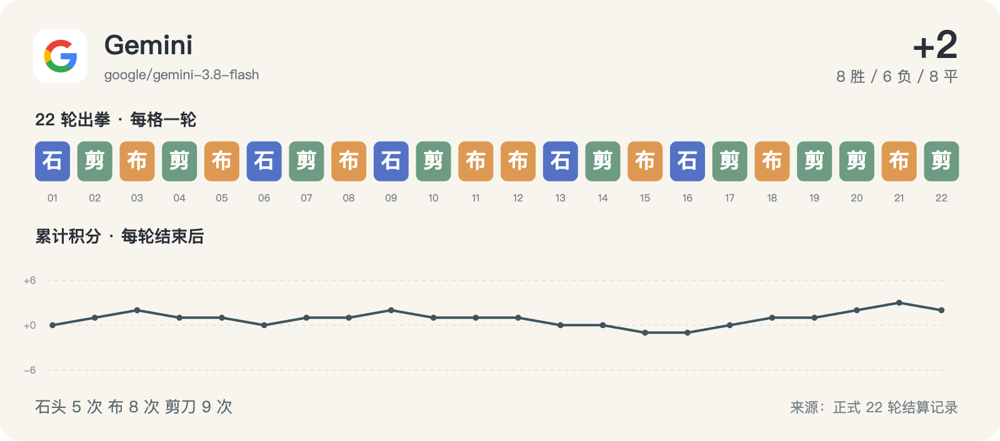

# Gemini · 22 轮完整记录



历史请求型号：`google/gemini-3.8-flash`；预设 effort：`high`。通道实际返回字段见每轮原始调用记录。品牌图标仅用于身份展示。

保留 22/22 次正式出拳；其中 1/22 轮有能够读取的思考文字或摘要。空白不等于没有进行推理，也不能用 reasoning token 数补出文字。

这些可读字段来自当时调用通道的保存记录，可能是摘要，不是对模型完整内部过程的声明。英文原文保留；案例图中的中文是编辑概括。

[返回模型目录](README.md) · [规则与方法](../METHOD.md) · [字段说明](../DATA_GUIDE.md)

轮次导航：[R01](#round-01) · [R02](#round-02) · [R03](#round-03) · [R04](#round-04) · [R05](#round-05) · [R06](#round-06) · [R07](#round-07) · [R08](#round-08) · [R09](#round-09) · [R10](#round-10) · [R11](#round-11) · [R12](#round-12) · [R13](#round-13) · [R14](#round-14) · [R15](#round-15) · [R16](#round-16) · [R17](#round-17) · [R18](#round-18) · [R19](#round-19) · [R20](#round-20) · [R21](#round-21) · [R22](#round-22)

<a id="round-01"></a>

## 第 01 轮

**Gemini：石头 · 豆包：石头 → 平（本轮 +0；累计 +0）**

时间：2026-09-18 12:46:46 +08:00；状态：`completed`。

调用编号：`agent_ad5ecd18-1e72-4aab-bd79-8aea97701830`。 [本次请求与返回](../evidence/calls.jsonl#L8) · [本轮原始结算](../data/rounds/round-01.json)

<details>
<summary>展开完整输入（原始提示词）</summary>

```text
你正在参加一组研究用的石头、剪刀、布样本。你是 Gemini 3.8 Flash（座位 4），当前第 1/10 轮；本轮对手是 豆包 Seed 2.1 Turbo（座位 9）。

规则：每轮同时选择一手；石头胜剪刀，剪刀胜布，布胜石头，相同为平局。你只能依据已经结束的前 0 轮，不知道本轮任何其他座位的选择。你当前累计分数是 0，对手累计分数是 0。

你和所有对手此前的逐局记录（包含当时对手、双方手势和结果）：无
你与本轮对手此前的直接交手记录：无

请只输出一个严格 JSON 对象，不能有 Markdown、解释、额外字段或代码块：{"move":"石头"}。move 必须恰好是“石头”“剪刀”“布”之一。这个样本用于检查调用消耗，不代表任何模型能力评测。
```

</details>

<details>
<summary>展开当时保存的可读思考 / 摘要</summary>

**调用通道返回的可读思考文字**

```text
**Processing Game Input**

I am analyzing the user's request for the first round of a rock-paper-scissors game. I'm noting the specified models and the strict JSON output requirement from the opponent.
```

</details>

**原始最终输出**

```json
{"move":"石头"}
```

<a id="round-02"></a>

## 第 02 轮

**Gemini：剪刀 · Meta：布 → 胜（本轮 +1；累计 +1）**

时间：2026-09-18 12:52:10 +08:00；状态：`completed`。

调用编号：`agent_421b0794-2d3b-445d-a762-301ce0769be9`。 [本次请求与返回](../evidence/calls.jsonl#L22) · [本轮原始结算](../data/rounds/round-02.json)

<details>
<summary>展开完整输入（原始提示词）</summary>

```text
你正在参加一组研究用的石头、剪刀、布样本。你是 Gemini 3.8 Flash（座位 4），当前第 2/10 轮；本轮对手是 Meta Muse Spark 1.2（座位 7）。

规则：每轮同时选择一手；石头胜剪刀，剪刀胜布，布胜石头，相同为平局。你只能依据已经结束的前 1 轮，不知道本轮任何其他座位的选择。你当前累计分数是 0，对手累计分数是 0。

你和所有对手此前的逐局记录（包含当时对手、双方手势和结果）：[{"round":1,"opponent":"豆包","self_move":"石头","opponent_move":"石头","result":"平"}]
你与本轮对手此前的直接交手记录：无

请只输出一个严格 JSON 对象，不能有 Markdown、解释、额外字段或代码块：{"move":"石头"}。move 必须恰好是“石头”“剪刀”“布”之一。这个样本用于检查调用消耗，不代表任何模型能力评测。
```

</details>

**可读思考：未能从现存记录恢复本轮的非空文字。** 原始出拳仍完整保留。

**原始最终输出**

```json
{"move":"剪刀"}
```

<a id="round-03"></a>

## 第 03 轮

**Gemini：布 · Grok：石头 → 胜（本轮 +1；累计 +2）**

时间：2026-09-18 12:57:03 +08:00；状态：`completed`。

调用编号：`agent_5269fd92-0d23-454e-b7d2-04d37e62a9f8`。 [本次请求与返回](../evidence/calls.jsonl#L36) · [本轮原始结算](../data/rounds/round-03.json)

<details>
<summary>展开完整输入（原始提示词）</summary>

```text
你正在参加一组研究用的石头、剪刀、布样本。你是 Gemini 3.8 Flash（座位 4），当前第 3/10 轮；本轮对手是 Grok 4.6（座位 5）。

规则：每轮同时选择一手；石头胜剪刀，剪刀胜布，布胜石头，相同为平局。你只能依据已经结束的前 2 轮，不知道本轮任何其他座位的选择。你当前累计分数是 1，对手累计分数是 -1。

你和所有对手此前的逐局记录（包含当时对手、双方手势和结果）：[{"round":1,"opponent":"豆包","self_move":"石头","opponent_move":"石头","result":"平"},{"round":2,"opponent":"Meta","self_move":"剪刀","opponent_move":"布","result":"胜"}]
你与本轮对手此前的直接交手记录：无

请只输出一个严格 JSON 对象，不能有 Markdown、解释、额外字段或代码块：{"move":"石头"}。move 必须恰好是“石头”“剪刀”“布”之一。这个样本用于检查调用消耗，不代表任何模型能力评测。
```

</details>

**可读思考：未能从现存记录恢复本轮的非空文字。** 原始出拳仍完整保留。

**原始最终输出**

```json
{"move":"布"}
```

<a id="round-04"></a>

## 第 04 轮

**Gemini：剪刀 · 腾讯 HY4：石头 → 负（本轮 -1；累计 +1）**

时间：2026-09-18 13:05:12 +08:00；状态：`completed`。

调用编号：`agent_99001164-e902-422c-afbc-29f45ee6885d`。 [本次请求与返回](../evidence/calls.jsonl#L49) · [本轮原始结算](../data/rounds/round-04.json)

<details>
<summary>展开完整输入（原始提示词）</summary>

```text
你正在参加一组研究用的石头、剪刀、布样本。你是 Gemini 3.8 Flash（座位 4），当前第 4/10 轮；本轮对手是 腾讯 HY4 Preview（座位 3）。

规则：每轮同时选择一手；石头胜剪刀，剪刀胜布，布胜石头，相同为平局。你只能依据已经结束的前 3 轮，不知道本轮任何其他座位的选择。你当前累计分数是 2，对手累计分数是 0。

你和所有对手此前的逐局记录（包含当时对手、双方手势和结果）：[{"round":1,"opponent":"豆包","self_move":"石头","opponent_move":"石头","result":"平"},{"round":2,"opponent":"Meta","self_move":"剪刀","opponent_move":"布","result":"胜"},{"round":3,"opponent":"Grok","self_move":"布","opponent_move":"石头","result":"胜"}]
你与本轮对手此前的直接交手记录：无

请只输出一个严格 JSON 对象，不能有 Markdown、解释、额外字段或代码块：{"move":"石头"}。move 必须恰好是“石头”“剪刀”“布”之一。这个样本用于检查调用消耗，不代表任何模型能力评测。
```

</details>

**可读思考：未能从现存记录恢复本轮的非空文字。** 原始出拳仍完整保留。

**原始最终输出**

```json
{"move":"剪刀"}
```

<a id="round-05"></a>

## 第 05 轮

**Gemini：布 · GPT-6：布 → 平（本轮 +0；累计 +1）**

时间：2026-09-18 13:09:46 +08:00；状态：`completed`。

调用编号：`agent_8a5f3e8c-2ce9-4e40-93fd-67da3601fe54`。 [本次请求与返回](../evidence/calls.jsonl#L59) · [本轮原始结算](../data/rounds/round-05.json)

<details>
<summary>展开完整输入（原始提示词）</summary>

```text
你正在参加一组研究用的石头、剪刀、布样本。你是 Gemini 3.8 Flash（座位 4），当前第 5/10 轮；本轮对手是 GPT-6 Astra（座位 12）。

规则：每轮同时选择一手；石头胜剪刀，剪刀胜布，布胜石头，相同为平局。你只能依据已经结束的前 4 轮，不知道本轮任何其他座位的选择。你当前累计分数是 1，对手累计分数是 1。

你和所有对手此前的逐局记录（包含当时对手、双方手势和结果）：[{"round":1,"opponent":"豆包","self_move":"石头","opponent_move":"石头","result":"平"},{"round":2,"opponent":"Meta","self_move":"剪刀","opponent_move":"布","result":"胜"},{"round":3,"opponent":"Grok","self_move":"布","opponent_move":"石头","result":"胜"},{"round":4,"opponent":"腾讯 HY4","self_move":"剪刀","opponent_move":"石头","result":"负"}]
你与本轮对手此前的直接交手记录：无

请只输出一个严格 JSON 对象，不能有 Markdown、解释、额外字段或代码块：{"move":"石头"}。move 必须恰好是“石头”“剪刀”“布”之一。这个样本用于检查调用消耗，不代表任何模型能力评测。
```

</details>

**可读思考：未能从现存记录恢复本轮的非空文字。** 原始出拳仍完整保留。

**原始最终输出**

```json
{"move":"布"}
```

<a id="round-06"></a>

## 第 06 轮

**Gemini：石头 · DeepSeek：布 → 负（本轮 -1；累计 +0）**

时间：2026-09-18 13:12:02 +08:00；状态：`completed`。

调用编号：`agent_cdabc034-20ed-4e57-97c8-e7c9d79afcad`。 [本次请求与返回](../evidence/calls.jsonl#L69) · [本轮原始结算](../data/rounds/round-06.json)

<details>
<summary>展开完整输入（原始提示词）</summary>

```text
你正在参加一组研究用的石头、剪刀、布样本。你是 Gemini 3.8 Flash（座位 4），当前第 6/10 轮；本轮对手是 DeepSeek V4.1 Flash（座位 10）。

规则：每轮同时选择一手；石头胜剪刀，剪刀胜布，布胜石头，相同为平局。你只能依据已经结束的前 5 轮，不知道本轮任何其他座位的选择。你当前累计分数是 1，对手累计分数是 -3。

你和所有对手此前的逐局记录（包含当时对手、双方手势和结果）：[{"round":1,"opponent":"豆包","self_move":"石头","opponent_move":"石头","result":"平"},{"round":2,"opponent":"Meta","self_move":"剪刀","opponent_move":"布","result":"胜"},{"round":3,"opponent":"Grok","self_move":"布","opponent_move":"石头","result":"胜"},{"round":4,"opponent":"腾讯 HY4","self_move":"剪刀","opponent_move":"石头","result":"负"},{"round":5,"opponent":"GPT-6","self_move":"布","opponent_move":"布","result":"平"}]
你与本轮对手此前的直接交手记录：无

请只输出一个严格 JSON 对象，不能有 Markdown、解释、额外字段或代码块：{"move":"石头"}。move 必须恰好是“石头”“剪刀”“布”之一。这个样本用于检查调用消耗，不代表任何模型能力评测。
```

</details>

**可读思考：未能从现存记录恢复本轮的非空文字。** 原始出拳仍完整保留。

**原始最终输出**

```json
{"move":"石头"}
```

<a id="round-07"></a>

## 第 07 轮

**Gemini：剪刀 · MiniMax：布 → 胜（本轮 +1；累计 +1）**

时间：2026-09-18 13:16:05 +08:00；状态：`completed`。

调用编号：`agent_d7a44313-e02e-44ea-a381-d1d8072dd079`。 [本次请求与返回](../evidence/calls.jsonl#L79) · [本轮原始结算](../data/rounds/round-07.json)

<details>
<summary>展开完整输入（原始提示词）</summary>

```text
你正在参加一组研究用的石头、剪刀、布样本。你是 Gemini 3.8 Flash（座位 4），当前第 7/10 轮；本轮对手是 MiniMax M3（座位 8）。

规则：每轮同时选择一手；石头胜剪刀，剪刀胜布，布胜石头，相同为平局。你只能依据已经结束的前 6 轮，不知道本轮任何其他座位的选择。你当前累计分数是 0，对手累计分数是 0。

你和所有对手此前的逐局记录（包含当时对手、双方手势和结果）：[{"round":1,"opponent":"豆包","self_move":"石头","opponent_move":"石头","result":"平"},{"round":2,"opponent":"Meta","self_move":"剪刀","opponent_move":"布","result":"胜"},{"round":3,"opponent":"Grok","self_move":"布","opponent_move":"石头","result":"胜"},{"round":4,"opponent":"腾讯 HY4","self_move":"剪刀","opponent_move":"石头","result":"负"},{"round":5,"opponent":"GPT-6","self_move":"布","opponent_move":"布","result":"平"},{"round":6,"opponent":"DeepSeek","self_move":"石头","opponent_move":"布","result":"负"}]
你与本轮对手此前的直接交手记录：无

请只输出一个严格 JSON 对象，不能有 Markdown、解释、额外字段或代码块：{"move":"石头"}。move 必须恰好是“石头”“剪刀”“布”之一。这个样本用于检查调用消耗，不代表任何模型能力评测。
```

</details>

**可读思考：未能从现存记录恢复本轮的非空文字。** 原始出拳仍完整保留。

**原始最终输出**

```json
{"move":"剪刀"}
```

<a id="round-08"></a>

## 第 08 轮

**Gemini：布 · Qwen：布 → 平（本轮 +0；累计 +1）**

时间：2026-09-18 13:20:18 +08:00；状态：`completed`。

调用编号：`agent_d5a22e62-82bb-4f8d-9cdb-a9bdb8424215`。 [本次请求与返回](../evidence/calls.jsonl#L89) · [本轮原始结算](../data/rounds/round-08.json)

<details>
<summary>展开完整输入（原始提示词）</summary>

```text
你正在参加一组研究用的石头、剪刀、布样本。你是 Gemini 3.8 Flash（座位 4），当前第 8/10 轮；本轮对手是 Qwen 3.8 Max（座位 6）。

规则：每轮同时选择一手；石头胜剪刀，剪刀胜布，布胜石头，相同为平局。你只能依据已经结束的前 7 轮，不知道本轮任何其他座位的选择。你当前累计分数是 1，对手累计分数是 1。

你和所有对手此前的逐局记录（包含当时对手、双方手势和结果）：[{"round":1,"opponent":"豆包","self_move":"石头","opponent_move":"石头","result":"平"},{"round":2,"opponent":"Meta","self_move":"剪刀","opponent_move":"布","result":"胜"},{"round":3,"opponent":"Grok","self_move":"布","opponent_move":"石头","result":"胜"},{"round":4,"opponent":"腾讯 HY4","self_move":"剪刀","opponent_move":"石头","result":"负"},{"round":5,"opponent":"GPT-6","self_move":"布","opponent_move":"布","result":"平"},{"round":6,"opponent":"DeepSeek","self_move":"石头","opponent_move":"布","result":"负"},{"round":7,"opponent":"MiniMax","self_move":"剪刀","opponent_move":"布","result":"胜"}]
你与本轮对手此前的直接交手记录：无

请只输出一个严格 JSON 对象，不能有 Markdown、解释、额外字段或代码块：{"move":"石头"}。move 必须恰好是“石头”“剪刀”“布”之一。这个样本用于检查调用消耗，不代表任何模型能力评测。
```

</details>

**可读思考：未能从现存记录恢复本轮的非空文字。** 原始出拳仍完整保留。

**原始最终输出**

```json
{"move":"布"}
```

<a id="round-09"></a>

## 第 09 轮

**Gemini：石头 · Claude：剪刀 → 胜（本轮 +1；累计 +2）**

时间：2026-09-18 13:24:42 +08:00；状态：`completed`。

调用编号：`agent_3e6fbd3a-68d8-4898-a552-4791cca45ec6`。 [本次请求与返回](../evidence/calls.jsonl#L99) · [本轮原始结算](../data/rounds/round-09.json)

<details>
<summary>展开完整输入（原始提示词）</summary>

```text
你正在参加一组研究用的石头、剪刀、布样本。你是 Gemini 3.8 Flash（座位 4），当前第 9/10 轮；本轮对手是 Claude Opus 5（座位 1）。

规则：每轮同时选择一手；石头胜剪刀，剪刀胜布，布胜石头，相同为平局。你只能依据已经结束的前 8 轮，不知道本轮任何其他座位的选择。你当前累计分数是 1，对手累计分数是 0。

你和所有对手此前的逐局记录（包含当时对手、双方手势和结果）：[{"round":1,"opponent":"豆包","self_move":"石头","opponent_move":"石头","result":"平"},{"round":2,"opponent":"Meta","self_move":"剪刀","opponent_move":"布","result":"胜"},{"round":3,"opponent":"Grok","self_move":"布","opponent_move":"石头","result":"胜"},{"round":4,"opponent":"腾讯 HY4","self_move":"剪刀","opponent_move":"石头","result":"负"},{"round":5,"opponent":"GPT-6","self_move":"布","opponent_move":"布","result":"平"},{"round":6,"opponent":"DeepSeek","self_move":"石头","opponent_move":"布","result":"负"},{"round":7,"opponent":"MiniMax","self_move":"剪刀","opponent_move":"布","result":"胜"},{"round":8,"opponent":"Qwen","self_move":"布","opponent_move":"布","result":"平"}]
你与本轮对手此前的直接交手记录：无

请只输出一个严格 JSON 对象，不能有 Markdown、解释、额外字段或代码块：{"move":"石头"}。move 必须恰好是“石头”“剪刀”“布”之一。这个样本用于检查调用消耗，不代表任何模型能力评测。
```

</details>

**可读思考：未能从现存记录恢复本轮的非空文字。** 原始出拳仍完整保留。

**原始最终输出**

```json
{"move":"石头"}
```

<a id="round-10"></a>

## 第 10 轮

**Gemini：剪刀 · Kimi：石头 → 负（本轮 -1；累计 +1）**

时间：2026-09-18 13:29:35 +08:00；状态：`completed`。

调用编号：`agent_3a3d9389-a598-4908-9120-5bbeb4775cd8`。 [本次请求与返回](../evidence/calls.jsonl#L112) · [本轮原始结算](../data/rounds/round-10.json)

<details>
<summary>展开完整输入（原始提示词）</summary>

```text
你正在参加一组研究用的石头、剪刀、布样本。你是 Gemini 3.8 Flash（座位 4），当前第 10/10 轮；本轮对手是 Kimi K3（座位 2）。

规则：每轮同时选择一手；石头胜剪刀，剪刀胜布，布胜石头，相同为平局。你只能依据已经结束的前 9 轮，不知道本轮任何其他座位的选择。你当前累计分数是 2，对手累计分数是 4。

你和所有对手此前的逐局记录（包含当时对手、双方手势和结果）：[{"round":1,"opponent":"豆包","self_move":"石头","opponent_move":"石头","result":"平"},{"round":2,"opponent":"Meta","self_move":"剪刀","opponent_move":"布","result":"胜"},{"round":3,"opponent":"Grok","self_move":"布","opponent_move":"石头","result":"胜"},{"round":4,"opponent":"腾讯 HY4","self_move":"剪刀","opponent_move":"石头","result":"负"},{"round":5,"opponent":"GPT-6","self_move":"布","opponent_move":"布","result":"平"},{"round":6,"opponent":"DeepSeek","self_move":"石头","opponent_move":"布","result":"负"},{"round":7,"opponent":"MiniMax","self_move":"剪刀","opponent_move":"布","result":"胜"},{"round":8,"opponent":"Qwen","self_move":"布","opponent_move":"布","result":"平"},{"round":9,"opponent":"Claude","self_move":"石头","opponent_move":"剪刀","result":"胜"}]
你与本轮对手此前的直接交手记录：无

请只输出一个严格 JSON 对象，不能有 Markdown、解释、额外字段或代码块：{"move":"石头"}。move 必须恰好是“石头”“剪刀”“布”之一。这个样本用于检查调用消耗，不代表任何模型能力评测。
```

</details>

**可读思考：未能从现存记录恢复本轮的非空文字。** 原始出拳仍完整保留。

**原始最终输出**

```json
{"move":"剪刀"}
```

<a id="round-11"></a>

## 第 11 轮

**Gemini：布 · GLM：布 → 平（本轮 +0；累计 +1）**

时间：2026-09-18 17:02:24 +08:00；状态：`completed`。

调用编号：`agent_64532301-afd1-4363-a7f5-9535d25a61db`。 [本次请求与返回](../evidence/calls.jsonl#L128) · [本轮原始结算](../data/rounds/round-11.json)

<details>
<summary>展开完整输入（原始提示词）</summary>

```text
你正在参加一组研究用的石头、剪刀、布样本。你是 Gemini 3.8 Flash（座位 4），当前第 11/100 轮；本轮对手是 GLM-5.3（座位 11）。

规则：每轮同时选择一手；石头胜剪刀，剪刀胜布，布胜石头，相同为平局。你只能依据已经结束的前 10 轮，不知道本轮任何其他座位的选择。你当前累计分数是 1，对手累计分数是 2。

你和所有对手此前的逐局记录（包含当时对手、双方手势和结果）：[{"round":1,"opponent":"豆包","self_move":"石头","opponent_move":"石头","result":"平"},{"round":2,"opponent":"Meta","self_move":"剪刀","opponent_move":"布","result":"胜"},{"round":3,"opponent":"Grok","self_move":"布","opponent_move":"石头","result":"胜"},{"round":4,"opponent":"腾讯 HY4","self_move":"剪刀","opponent_move":"石头","result":"负"},{"round":5,"opponent":"GPT-6","self_move":"布","opponent_move":"布","result":"平"},{"round":6,"opponent":"DeepSeek","self_move":"石头","opponent_move":"布","result":"负"},{"round":7,"opponent":"MiniMax","self_move":"剪刀","opponent_move":"布","result":"胜"},{"round":8,"opponent":"Qwen","self_move":"布","opponent_move":"布","result":"平"},{"round":9,"opponent":"Claude","self_move":"石头","opponent_move":"剪刀","result":"胜"},{"round":10,"opponent":"Kimi","self_move":"剪刀","opponent_move":"石头","result":"负"}]
你与本轮对手此前的直接交手记录：无

请只输出一个严格 JSON 对象，不能有 Markdown、解释、额外字段或代码块：{"move":"石头"}。move 必须恰好是“石头”“剪刀”“布”之一。这个样本用于检查调用消耗，不代表任何模型能力评测。
```

</details>

**可读思考：未能从现存记录恢复本轮的非空文字。** 原始出拳仍完整保留。

**原始最终输出**

```json
{"move":"布"}
```

<a id="round-12"></a>

## 第 12 轮

**Gemini：布 · 豆包：布 → 平（本轮 +0；累计 +1）**

时间：2026-09-18 17:30:02 +08:00；状态：`completed`。

调用编号：`agent_75c5d12e-ffa6-4505-ba5a-e01d318e5bc5`。 [本次请求与返回](../evidence/calls.jsonl#L144) · [本轮原始结算](../data/rounds/round-12.json)

<details>
<summary>展开完整输入（原始提示词）</summary>

```text
你正在参加一组研究用的石头、剪刀、布样本。你是 Gemini 3.8 Flash（座位 4），当前第 12/20 轮；本轮对手是 豆包 Seed 2.1 Turbo（座位 9）。

规则：每轮同时选择一手；石头胜剪刀，剪刀胜布，布胜石头，相同为平局。你只能依据已经结束的前 11 轮，不知道本轮任何其他座位的选择。你当前累计分数是 1，对手累计分数是 -3。

你和所有对手此前的逐局记录（包含当时对手、双方手势和结果）：[{"round":1,"opponent":"豆包","self_move":"石头","opponent_move":"石头","result":"平"},{"round":2,"opponent":"Meta","self_move":"剪刀","opponent_move":"布","result":"胜"},{"round":3,"opponent":"Grok","self_move":"布","opponent_move":"石头","result":"胜"},{"round":4,"opponent":"腾讯 HY4","self_move":"剪刀","opponent_move":"石头","result":"负"},{"round":5,"opponent":"GPT-6","self_move":"布","opponent_move":"布","result":"平"},{"round":6,"opponent":"DeepSeek","self_move":"石头","opponent_move":"布","result":"负"},{"round":7,"opponent":"MiniMax","self_move":"剪刀","opponent_move":"布","result":"胜"},{"round":8,"opponent":"Qwen","self_move":"布","opponent_move":"布","result":"平"},{"round":9,"opponent":"Claude","self_move":"石头","opponent_move":"剪刀","result":"胜"},{"round":10,"opponent":"Kimi","self_move":"剪刀","opponent_move":"石头","result":"负"},{"round":11,"opponent":"GLM","self_move":"布","opponent_move":"布","result":"平"}]
你与本轮对手此前的直接交手记录：[{"round":1,"opponent":"豆包","self_move":"石头","opponent_move":"石头","result":"平"}]

请只输出一个严格 JSON 对象，不能有 Markdown、解释、额外字段或代码块：{"move":"石头"}。move 必须恰好是“石头”“剪刀”“布”之一。这个样本用于检查调用消耗，不代表任何模型能力评测。
```

</details>

**可读思考：未能从现存记录恢复本轮的非空文字。** 原始出拳仍完整保留。

**原始最终输出**

```json
{"move":"布"}
```

<a id="round-13"></a>

## 第 13 轮

**Gemini：石头 · Meta：布 → 负（本轮 -1；累计 +0）**

时间：2026-09-18 17:34:46 +08:00；状态：`completed`。

调用编号：`agent_43013309-8bea-4f8d-8ef4-9f8c9a672bd4`。 [本次请求与返回](../evidence/calls.jsonl#L158) · [本轮原始结算](../data/rounds/round-13.json)

<details>
<summary>展开完整输入（原始提示词）</summary>

```text
你正在参加一组研究用的石头、剪刀、布样本。你是 Gemini 3.8 Flash（座位 4），当前第 13/20 轮；本轮对手是 Meta Muse Spark 1.2（座位 7）。

规则：每轮同时选择一手；石头胜剪刀，剪刀胜布，布胜石头，相同为平局。你只能依据已经结束的前 12 轮，不知道本轮任何其他座位的选择。你当前累计分数是 1，对手累计分数是 1。

你和所有对手此前的逐局记录（包含当时对手、双方手势和结果）：[{"round":1,"opponent":"豆包","self_move":"石头","opponent_move":"石头","result":"平"},{"round":2,"opponent":"Meta","self_move":"剪刀","opponent_move":"布","result":"胜"},{"round":3,"opponent":"Grok","self_move":"布","opponent_move":"石头","result":"胜"},{"round":4,"opponent":"腾讯 HY4","self_move":"剪刀","opponent_move":"石头","result":"负"},{"round":5,"opponent":"GPT-6","self_move":"布","opponent_move":"布","result":"平"},{"round":6,"opponent":"DeepSeek","self_move":"石头","opponent_move":"布","result":"负"},{"round":7,"opponent":"MiniMax","self_move":"剪刀","opponent_move":"布","result":"胜"},{"round":8,"opponent":"Qwen","self_move":"布","opponent_move":"布","result":"平"},{"round":9,"opponent":"Claude","self_move":"石头","opponent_move":"剪刀","result":"胜"},{"round":10,"opponent":"Kimi","self_move":"剪刀","opponent_move":"石头","result":"负"},{"round":11,"opponent":"GLM","self_move":"布","opponent_move":"布","result":"平"},{"round":12,"opponent":"豆包","self_move":"布","opponent_move":"布","result":"平"}]
你与本轮对手此前的直接交手记录：[{"round":2,"opponent":"Meta","self_move":"剪刀","opponent_move":"布","result":"胜"}]

请只输出一个严格 JSON 对象，不能有 Markdown、解释、额外字段或代码块：{"move":"石头"}。move 必须恰好是“石头”“剪刀”“布”之一。这个样本用于检查调用消耗，不代表任何模型能力评测。
```

</details>

**可读思考：未能从现存记录恢复本轮的非空文字。** 原始出拳仍完整保留。

**原始最终输出**

```json
{"move":"石头"}
```

<a id="round-14"></a>

## 第 14 轮

**Gemini：剪刀 · Grok：剪刀 → 平（本轮 +0；累计 +0）**

时间：2026-09-18 17:41:59 +08:00；状态：`completed`。

调用编号：`agent_5b75be79-6481-48af-a32d-cfb2daa1429a`。 [本次请求与返回](../evidence/calls.jsonl#L173) · [本轮原始结算](../data/rounds/round-14.json)

<details>
<summary>展开完整输入（原始提示词）</summary>

```text
你正在参加一组研究用的石头、剪刀、布样本。你是 Gemini 3.8 Flash（座位 4），当前第 14/20 轮；本轮对手是 Grok 4.6（座位 5）。

规则：每轮同时选择一手；石头胜剪刀，剪刀胜布，布胜石头，相同为平局。你只能依据已经结束的前 13 轮，不知道本轮任何其他座位的选择。你当前累计分数是 0，对手累计分数是 -3。

你和所有对手此前的逐局记录（包含当时对手、双方手势和结果）：[{"round":1,"opponent":"豆包","self_move":"石头","opponent_move":"石头","result":"平"},{"round":2,"opponent":"Meta","self_move":"剪刀","opponent_move":"布","result":"胜"},{"round":3,"opponent":"Grok","self_move":"布","opponent_move":"石头","result":"胜"},{"round":4,"opponent":"腾讯 HY4","self_move":"剪刀","opponent_move":"石头","result":"负"},{"round":5,"opponent":"GPT-6","self_move":"布","opponent_move":"布","result":"平"},{"round":6,"opponent":"DeepSeek","self_move":"石头","opponent_move":"布","result":"负"},{"round":7,"opponent":"MiniMax","self_move":"剪刀","opponent_move":"布","result":"胜"},{"round":8,"opponent":"Qwen","self_move":"布","opponent_move":"布","result":"平"},{"round":9,"opponent":"Claude","self_move":"石头","opponent_move":"剪刀","result":"胜"},{"round":10,"opponent":"Kimi","self_move":"剪刀","opponent_move":"石头","result":"负"},{"round":11,"opponent":"GLM","self_move":"布","opponent_move":"布","result":"平"},{"round":12,"opponent":"豆包","self_move":"布","opponent_move":"布","result":"平"},{"round":13,"opponent":"Meta","self_move":"石头","opponent_move":"布","result":"负"}]
你与本轮对手此前的直接交手记录：[{"round":3,"opponent":"Grok","self_move":"布","opponent_move":"石头","result":"胜"}]

请只输出一个严格 JSON 对象，不能有 Markdown、解释、额外字段或代码块：{"move":"石头"}。move 必须恰好是“石头”“剪刀”“布”之一。这个样本用于检查调用消耗，不代表任何模型能力评测。
```

</details>

**可读思考：未能从现存记录恢复本轮的非空文字。** 原始出拳仍完整保留。

**原始最终输出**

```json
{"move":"剪刀"}
```

<a id="round-15"></a>

## 第 15 轮

**Gemini：布 · 腾讯 HY4：剪刀 → 负（本轮 -1；累计 -1）**

时间：2026-09-18 17:48:50 +08:00；状态：`completed`。

调用编号：`agent_994eccbb-fe97-450b-a3ea-6d2d6427e134`。 [本次请求与返回](../evidence/calls.jsonl#L186) · [本轮原始结算](../data/rounds/round-15.json)

<details>
<summary>展开完整输入（原始提示词）</summary>

```text
你正在参加一组研究用的石头、剪刀、布样本。你是 Gemini 3.8 Flash（座位 4），当前第 15/20 轮；本轮对手是 腾讯 HY4 Preview（座位 3）。

规则：每轮同时选择一手；石头胜剪刀，剪刀胜布，布胜石头，相同为平局。你只能依据已经结束的前 14 轮，不知道本轮任何其他座位的选择。你当前累计分数是 0，对手累计分数是 -2。

你和所有对手此前的逐局记录（包含当时对手、双方手势和结果）：[{"round":1,"opponent":"豆包","self_move":"石头","opponent_move":"石头","result":"平"},{"round":2,"opponent":"Meta","self_move":"剪刀","opponent_move":"布","result":"胜"},{"round":3,"opponent":"Grok","self_move":"布","opponent_move":"石头","result":"胜"},{"round":4,"opponent":"腾讯 HY4","self_move":"剪刀","opponent_move":"石头","result":"负"},{"round":5,"opponent":"GPT-6","self_move":"布","opponent_move":"布","result":"平"},{"round":6,"opponent":"DeepSeek","self_move":"石头","opponent_move":"布","result":"负"},{"round":7,"opponent":"MiniMax","self_move":"剪刀","opponent_move":"布","result":"胜"},{"round":8,"opponent":"Qwen","self_move":"布","opponent_move":"布","result":"平"},{"round":9,"opponent":"Claude","self_move":"石头","opponent_move":"剪刀","result":"胜"},{"round":10,"opponent":"Kimi","self_move":"剪刀","opponent_move":"石头","result":"负"},{"round":11,"opponent":"GLM","self_move":"布","opponent_move":"布","result":"平"},{"round":12,"opponent":"豆包","self_move":"布","opponent_move":"布","result":"平"},{"round":13,"opponent":"Meta","self_move":"石头","opponent_move":"布","result":"负"},{"round":14,"opponent":"Grok","self_move":"剪刀","opponent_move":"剪刀","result":"平"}]
你与本轮对手此前的直接交手记录：[{"round":4,"opponent":"腾讯 HY4","self_move":"剪刀","opponent_move":"石头","result":"负"}]

请只输出一个严格 JSON 对象，不能有 Markdown、解释、额外字段或代码块：{"move":"石头"}。move 必须恰好是“石头”“剪刀”“布”之一。这个样本用于检查调用消耗，不代表任何模型能力评测。
```

</details>

**可读思考：未能从现存记录恢复本轮的非空文字。** 原始出拳仍完整保留。

**原始最终输出**

```json
{"move":"布"}
```

<a id="round-16"></a>

## 第 16 轮

**Gemini：石头 · GPT-6：石头 → 平（本轮 +0；累计 -1）**

时间：2026-09-18 17:50:37 +08:00；状态：`completed`。

调用编号：`agent_c5540968-2caa-41dd-90af-9d4994c3681a`。 [本次请求与返回](../evidence/calls.jsonl#L196) · [本轮原始结算](../data/rounds/round-16.json)

<details>
<summary>展开完整输入（原始提示词）</summary>

```text
你正在参加一组研究用的石头、剪刀、布样本。你是 Gemini 3.8 Flash（座位 4），当前第 16/20 轮；本轮对手是 GPT-6 Astra（座位 12）。

规则：每轮同时选择一手；石头胜剪刀，剪刀胜布，布胜石头，相同为平局。你只能依据已经结束的前 15 轮，不知道本轮任何其他座位的选择。你当前累计分数是 -1，对手累计分数是 2。

你和所有对手此前的逐局记录（包含当时对手、双方手势和结果）：[{"round":1,"opponent":"豆包","self_move":"石头","opponent_move":"石头","result":"平"},{"round":2,"opponent":"Meta","self_move":"剪刀","opponent_move":"布","result":"胜"},{"round":3,"opponent":"Grok","self_move":"布","opponent_move":"石头","result":"胜"},{"round":4,"opponent":"腾讯 HY4","self_move":"剪刀","opponent_move":"石头","result":"负"},{"round":5,"opponent":"GPT-6","self_move":"布","opponent_move":"布","result":"平"},{"round":6,"opponent":"DeepSeek","self_move":"石头","opponent_move":"布","result":"负"},{"round":7,"opponent":"MiniMax","self_move":"剪刀","opponent_move":"布","result":"胜"},{"round":8,"opponent":"Qwen","self_move":"布","opponent_move":"布","result":"平"},{"round":9,"opponent":"Claude","self_move":"石头","opponent_move":"剪刀","result":"胜"},{"round":10,"opponent":"Kimi","self_move":"剪刀","opponent_move":"石头","result":"负"},{"round":11,"opponent":"GLM","self_move":"布","opponent_move":"布","result":"平"},{"round":12,"opponent":"豆包","self_move":"布","opponent_move":"布","result":"平"},{"round":13,"opponent":"Meta","self_move":"石头","opponent_move":"布","result":"负"},{"round":14,"opponent":"Grok","self_move":"剪刀","opponent_move":"剪刀","result":"平"},{"round":15,"opponent":"腾讯 HY4","self_move":"布","opponent_move":"剪刀","result":"负"}]
你与本轮对手此前的直接交手记录：[{"round":5,"opponent":"GPT-6","self_move":"布","opponent_move":"布","result":"平"}]

请只输出一个严格 JSON 对象，不能有 Markdown、解释、额外字段或代码块：{"move":"石头"}。move 必须恰好是“石头”“剪刀”“布”之一。这个样本用于检查调用消耗，不代表任何模型能力评测。
```

</details>

**可读思考：未能从现存记录恢复本轮的非空文字。** 原始出拳仍完整保留。

**原始最终输出**

```json
{"move":"石头"}
```

<a id="round-17"></a>

## 第 17 轮

**Gemini：剪刀 · DeepSeek：布 → 胜（本轮 +1；累计 +0）**

时间：2026-09-18 17:54:15 +08:00；状态：`completed`。

调用编号：`agent_cdb8d8f6-e9a4-4466-98d2-596072ffc2f8`。 [本次请求与返回](../evidence/calls.jsonl#L205) · [本轮原始结算](../data/rounds/round-17.json)

<details>
<summary>展开完整输入（原始提示词）</summary>

```text
你正在参加一组研究用的石头、剪刀、布样本。你是 Gemini 3.8 Flash（座位 4），当前第 17/20 轮；本轮对手是 DeepSeek V4.1 Flash（座位 10）。

规则：每轮同时选择一手；石头胜剪刀，剪刀胜布，布胜石头，相同为平局。你只能依据已经结束的前 16 轮，不知道本轮任何其他座位的选择。你当前累计分数是 -1，对手累计分数是 1。

你和所有对手此前的逐局记录（包含当时对手、双方手势和结果）：[{"round":1,"opponent":"豆包","self_move":"石头","opponent_move":"石头","result":"平"},{"round":2,"opponent":"Meta","self_move":"剪刀","opponent_move":"布","result":"胜"},{"round":3,"opponent":"Grok","self_move":"布","opponent_move":"石头","result":"胜"},{"round":4,"opponent":"腾讯 HY4","self_move":"剪刀","opponent_move":"石头","result":"负"},{"round":5,"opponent":"GPT-6","self_move":"布","opponent_move":"布","result":"平"},{"round":6,"opponent":"DeepSeek","self_move":"石头","opponent_move":"布","result":"负"},{"round":7,"opponent":"MiniMax","self_move":"剪刀","opponent_move":"布","result":"胜"},{"round":8,"opponent":"Qwen","self_move":"布","opponent_move":"布","result":"平"},{"round":9,"opponent":"Claude","self_move":"石头","opponent_move":"剪刀","result":"胜"},{"round":10,"opponent":"Kimi","self_move":"剪刀","opponent_move":"石头","result":"负"},{"round":11,"opponent":"GLM","self_move":"布","opponent_move":"布","result":"平"},{"round":12,"opponent":"豆包","self_move":"布","opponent_move":"布","result":"平"},{"round":13,"opponent":"Meta","self_move":"石头","opponent_move":"布","result":"负"},{"round":14,"opponent":"Grok","self_move":"剪刀","opponent_move":"剪刀","result":"平"},{"round":15,"opponent":"腾讯 HY4","self_move":"布","opponent_move":"剪刀","result":"负"},{"round":16,"opponent":"GPT-6","self_move":"石头","opponent_move":"石头","result":"平"}]
你与本轮对手此前的直接交手记录：[{"round":6,"opponent":"DeepSeek","self_move":"石头","opponent_move":"布","result":"负"}]

请只输出一个严格 JSON 对象，不能有 Markdown、解释、额外字段或代码块：{"move":"石头"}。move 必须恰好是“石头”“剪刀”“布”之一。这个样本用于检查调用消耗，不代表任何模型能力评测。
```

</details>

**可读思考：未能从现存记录恢复本轮的非空文字。** 原始出拳仍完整保留。

**原始最终输出**

```json
{"move":"剪刀"}
```

<a id="round-18"></a>

## 第 18 轮

**Gemini：布 · MiniMax：石头 → 胜（本轮 +1；累计 +1）**

时间：2026-09-18 17:57:31 +08:00；状态：`completed`。

调用编号：`agent_746a5ed0-66b1-4dd2-af7b-5d5d860bb75e`。 [本次请求与返回](../evidence/calls.jsonl#L215) · [本轮原始结算](../data/rounds/round-18.json)

<details>
<summary>展开完整输入（原始提示词）</summary>

```text
你正在参加一组研究用的石头、剪刀、布样本。你是 Gemini 3.8 Flash（座位 4），当前第 18/20 轮；本轮对手是 MiniMax M3（座位 8）。

规则：每轮同时选择一手；石头胜剪刀，剪刀胜布，布胜石头，相同为平局。你只能依据已经结束的前 17 轮，不知道本轮任何其他座位的选择。你当前累计分数是 0，对手累计分数是 -1。

你和所有对手此前的逐局记录（包含当时对手、双方手势和结果）：[{"round":1,"opponent":"豆包","self_move":"石头","opponent_move":"石头","result":"平"},{"round":2,"opponent":"Meta","self_move":"剪刀","opponent_move":"布","result":"胜"},{"round":3,"opponent":"Grok","self_move":"布","opponent_move":"石头","result":"胜"},{"round":4,"opponent":"腾讯 HY4","self_move":"剪刀","opponent_move":"石头","result":"负"},{"round":5,"opponent":"GPT-6","self_move":"布","opponent_move":"布","result":"平"},{"round":6,"opponent":"DeepSeek","self_move":"石头","opponent_move":"布","result":"负"},{"round":7,"opponent":"MiniMax","self_move":"剪刀","opponent_move":"布","result":"胜"},{"round":8,"opponent":"Qwen","self_move":"布","opponent_move":"布","result":"平"},{"round":9,"opponent":"Claude","self_move":"石头","opponent_move":"剪刀","result":"胜"},{"round":10,"opponent":"Kimi","self_move":"剪刀","opponent_move":"石头","result":"负"},{"round":11,"opponent":"GLM","self_move":"布","opponent_move":"布","result":"平"},{"round":12,"opponent":"豆包","self_move":"布","opponent_move":"布","result":"平"},{"round":13,"opponent":"Meta","self_move":"石头","opponent_move":"布","result":"负"},{"round":14,"opponent":"Grok","self_move":"剪刀","opponent_move":"剪刀","result":"平"},{"round":15,"opponent":"腾讯 HY4","self_move":"布","opponent_move":"剪刀","result":"负"},{"round":16,"opponent":"GPT-6","self_move":"石头","opponent_move":"石头","result":"平"},{"round":17,"opponent":"DeepSeek","self_move":"剪刀","opponent_move":"布","result":"胜"}]
你与本轮对手此前的直接交手记录：[{"round":7,"opponent":"MiniMax","self_move":"剪刀","opponent_move":"布","result":"胜"}]

请只输出一个严格 JSON 对象，不能有 Markdown、解释、额外字段或代码块：{"move":"石头"}。move 必须恰好是“石头”“剪刀”“布”之一。这个样本用于检查调用消耗，不代表任何模型能力评测。
```

</details>

**可读思考：未能从现存记录恢复本轮的非空文字。** 原始出拳仍完整保留。

**原始最终输出**

```json
{"move":"布"}
```

<a id="round-19"></a>

## 第 19 轮

**Gemini：剪刀 · Qwen：剪刀 → 平（本轮 +0；累计 +1）**

时间：2026-09-18 17:59:16 +08:00；状态：`completed`。

调用编号：`agent_84c7513b-4549-4e6c-a378-cd663bd7b899`。 [本次请求与返回](../evidence/calls.jsonl#L225) · [本轮原始结算](../data/rounds/round-19.json)

<details>
<summary>展开完整输入（原始提示词）</summary>

```text
你正在参加一组研究用的石头、剪刀、布样本。你是 Gemini 3.8 Flash（座位 4），当前第 19/20 轮；本轮对手是 Qwen 3.8 Max（座位 6）。

规则：每轮同时选择一手；石头胜剪刀，剪刀胜布，布胜石头，相同为平局。你只能依据已经结束的前 18 轮，不知道本轮任何其他座位的选择。你当前累计分数是 1，对手累计分数是 -2。

你和所有对手此前的逐局记录（包含当时对手、双方手势和结果）：[{"round":1,"opponent":"豆包","self_move":"石头","opponent_move":"石头","result":"平"},{"round":2,"opponent":"Meta","self_move":"剪刀","opponent_move":"布","result":"胜"},{"round":3,"opponent":"Grok","self_move":"布","opponent_move":"石头","result":"胜"},{"round":4,"opponent":"腾讯 HY4","self_move":"剪刀","opponent_move":"石头","result":"负"},{"round":5,"opponent":"GPT-6","self_move":"布","opponent_move":"布","result":"平"},{"round":6,"opponent":"DeepSeek","self_move":"石头","opponent_move":"布","result":"负"},{"round":7,"opponent":"MiniMax","self_move":"剪刀","opponent_move":"布","result":"胜"},{"round":8,"opponent":"Qwen","self_move":"布","opponent_move":"布","result":"平"},{"round":9,"opponent":"Claude","self_move":"石头","opponent_move":"剪刀","result":"胜"},{"round":10,"opponent":"Kimi","self_move":"剪刀","opponent_move":"石头","result":"负"},{"round":11,"opponent":"GLM","self_move":"布","opponent_move":"布","result":"平"},{"round":12,"opponent":"豆包","self_move":"布","opponent_move":"布","result":"平"},{"round":13,"opponent":"Meta","self_move":"石头","opponent_move":"布","result":"负"},{"round":14,"opponent":"Grok","self_move":"剪刀","opponent_move":"剪刀","result":"平"},{"round":15,"opponent":"腾讯 HY4","self_move":"布","opponent_move":"剪刀","result":"负"},{"round":16,"opponent":"GPT-6","self_move":"石头","opponent_move":"石头","result":"平"},{"round":17,"opponent":"DeepSeek","self_move":"剪刀","opponent_move":"布","result":"胜"},{"round":18,"opponent":"MiniMax","self_move":"布","opponent_move":"石头","result":"胜"}]
你与本轮对手此前的直接交手记录：[{"round":8,"opponent":"Qwen","self_move":"布","opponent_move":"布","result":"平"}]

请只输出一个严格 JSON 对象，不能有 Markdown、解释、额外字段或代码块：{"move":"石头"}。move 必须恰好是“石头”“剪刀”“布”之一。这个样本用于检查调用消耗，不代表任何模型能力评测。
```

</details>

**可读思考：未能从现存记录恢复本轮的非空文字。** 原始出拳仍完整保留。

**原始最终输出**

```json
{"move":"剪刀"}
```

<a id="round-20"></a>

## 第 20 轮

**Gemini：剪刀 · Claude：布 → 胜（本轮 +1；累计 +2）**

时间：2026-09-18 18:01:36 +08:00；状态：`completed`。

调用编号：`agent_39ab0145-7a6e-47ca-9ca7-be83a6b724fd`。 [本次请求与返回](../evidence/calls.jsonl#L236) · [本轮原始结算](../data/rounds/round-20.json)

<details>
<summary>展开完整输入（原始提示词）</summary>

```text
你正在参加一组研究用的石头、剪刀、布样本。你是 Gemini 3.8 Flash（座位 4），当前第 20/20 轮；本轮对手是 Claude Opus 5（座位 1）。

规则：每轮同时选择一手；石头胜剪刀，剪刀胜布，布胜石头，相同为平局。你只能依据已经结束的前 19 轮，不知道本轮任何其他座位的选择。你当前累计分数是 1，对手累计分数是 -2。

你和所有对手此前的逐局记录（包含当时对手、双方手势和结果）：[{"round":1,"opponent":"豆包","self_move":"石头","opponent_move":"石头","result":"平"},{"round":2,"opponent":"Meta","self_move":"剪刀","opponent_move":"布","result":"胜"},{"round":3,"opponent":"Grok","self_move":"布","opponent_move":"石头","result":"胜"},{"round":4,"opponent":"腾讯 HY4","self_move":"剪刀","opponent_move":"石头","result":"负"},{"round":5,"opponent":"GPT-6","self_move":"布","opponent_move":"布","result":"平"},{"round":6,"opponent":"DeepSeek","self_move":"石头","opponent_move":"布","result":"负"},{"round":7,"opponent":"MiniMax","self_move":"剪刀","opponent_move":"布","result":"胜"},{"round":8,"opponent":"Qwen","self_move":"布","opponent_move":"布","result":"平"},{"round":9,"opponent":"Claude","self_move":"石头","opponent_move":"剪刀","result":"胜"},{"round":10,"opponent":"Kimi","self_move":"剪刀","opponent_move":"石头","result":"负"},{"round":11,"opponent":"GLM","self_move":"布","opponent_move":"布","result":"平"},{"round":12,"opponent":"豆包","self_move":"布","opponent_move":"布","result":"平"},{"round":13,"opponent":"Meta","self_move":"石头","opponent_move":"布","result":"负"},{"round":14,"opponent":"Grok","self_move":"剪刀","opponent_move":"剪刀","result":"平"},{"round":15,"opponent":"腾讯 HY4","self_move":"布","opponent_move":"剪刀","result":"负"},{"round":16,"opponent":"GPT-6","self_move":"石头","opponent_move":"石头","result":"平"},{"round":17,"opponent":"DeepSeek","self_move":"剪刀","opponent_move":"布","result":"胜"},{"round":18,"opponent":"MiniMax","self_move":"布","opponent_move":"石头","result":"胜"},{"round":19,"opponent":"Qwen","self_move":"剪刀","opponent_move":"剪刀","result":"平"}]
你与本轮对手此前的直接交手记录：[{"round":9,"opponent":"Claude","self_move":"石头","opponent_move":"剪刀","result":"胜"}]

请只输出一个严格 JSON 对象，不能有 Markdown、解释、额外字段或代码块：{"move":"石头"}。move 必须恰好是“石头”“剪刀”“布”之一。这个样本用于检查调用消耗，不代表任何模型能力评测。
```

</details>

**可读思考：未能从现存记录恢复本轮的非空文字。** 原始出拳仍完整保留。

**原始最终输出**

```json
{"move":"剪刀"}
```

<a id="round-21"></a>

## 第 21 轮

**Gemini：布 · Kimi：石头 → 胜（本轮 +1；累计 +3）**

时间：2026-09-18 19:31:26 +08:00；状态：`completed`。

调用编号：`agent_5ce315b4-0544-427e-a2d6-47c719fe640c`。 [本次请求与返回](../evidence/calls.jsonl#L250) · [本轮原始结算](../data/rounds/round-21.json)

<details>
<summary>展开完整输入（原始提示词）</summary>

```text
你正在参加一组研究用的石头、剪刀、布样本。你是 Gemini 3.8 Flash（座位 4），当前第 21/24 轮；本轮对手是 Kimi K3（座位 2）。

规则：每轮同时选择一手；石头胜剪刀，剪刀胜布，布胜石头，相同为平局。你只能依据已经结束的前 20 轮，不知道本轮任何其他座位的选择。你当前累计分数是 2，对手累计分数是 4。

你和所有对手此前的逐局记录（包含当时对手、双方手势和结果）：[{"round":1,"opponent":"豆包","self_move":"石头","opponent_move":"石头","result":"平"},{"round":2,"opponent":"Meta","self_move":"剪刀","opponent_move":"布","result":"胜"},{"round":3,"opponent":"Grok","self_move":"布","opponent_move":"石头","result":"胜"},{"round":4,"opponent":"腾讯 HY4","self_move":"剪刀","opponent_move":"石头","result":"负"},{"round":5,"opponent":"GPT-6","self_move":"布","opponent_move":"布","result":"平"},{"round":6,"opponent":"DeepSeek","self_move":"石头","opponent_move":"布","result":"负"},{"round":7,"opponent":"MiniMax","self_move":"剪刀","opponent_move":"布","result":"胜"},{"round":8,"opponent":"Qwen","self_move":"布","opponent_move":"布","result":"平"},{"round":9,"opponent":"Claude","self_move":"石头","opponent_move":"剪刀","result":"胜"},{"round":10,"opponent":"Kimi","self_move":"剪刀","opponent_move":"石头","result":"负"},{"round":11,"opponent":"GLM","self_move":"布","opponent_move":"布","result":"平"},{"round":12,"opponent":"豆包","self_move":"布","opponent_move":"布","result":"平"},{"round":13,"opponent":"Meta","self_move":"石头","opponent_move":"布","result":"负"},{"round":14,"opponent":"Grok","self_move":"剪刀","opponent_move":"剪刀","result":"平"},{"round":15,"opponent":"腾讯 HY4","self_move":"布","opponent_move":"剪刀","result":"负"},{"round":16,"opponent":"GPT-6","self_move":"石头","opponent_move":"石头","result":"平"},{"round":17,"opponent":"DeepSeek","self_move":"剪刀","opponent_move":"布","result":"胜"},{"round":18,"opponent":"MiniMax","self_move":"布","opponent_move":"石头","result":"胜"},{"round":19,"opponent":"Qwen","self_move":"剪刀","opponent_move":"剪刀","result":"平"},{"round":20,"opponent":"Claude","self_move":"剪刀","opponent_move":"布","result":"胜"}]
你与本轮对手此前的直接交手记录：[{"round":10,"opponent":"Kimi","self_move":"剪刀","opponent_move":"石头","result":"负"}]

请只输出一个严格 JSON 对象，不能有 Markdown、解释、额外字段或代码块：{"move":"石头"}。move 必须恰好是“石头”“剪刀”“布”之一。这个样本用于检查调用消耗，不代表任何模型能力评测。
```

</details>

**可读思考：未能从现存记录恢复本轮的非空文字。** 原始出拳仍完整保留。

**原始最终输出**

```json
{"move":"布"}
```

<a id="round-22"></a>

## 第 22 轮

**Gemini：剪刀 · GLM：石头 → 负（本轮 -1；累计 +2）**

时间：2026-09-18 19:37:21 +08:00；状态：`completed`。

调用编号：`agent_e82cea15-76fc-48fd-8784-762f15f047d8`。 [本次请求与返回](../evidence/calls.jsonl#L264) · [本轮原始结算](../data/rounds/round-22.json)

<details>
<summary>展开完整输入（原始提示词）</summary>

```text
你正在参加一组研究用的石头、剪刀、布样本。你是 Gemini 3.8 Flash（座位 4），当前第 22/22 轮；本轮对手是 GLM-5.3（座位 11）。

规则：每轮同时选择一手；石头胜剪刀，剪刀胜布，布胜石头，相同为平局。你只能依据已经结束的前 21 轮，不知道本轮任何其他座位的选择。你当前累计分数是 3，对手累计分数是 6。

你和所有对手此前的逐局记录（包含当时对手、双方手势和结果）：[{"round":1,"opponent":"豆包","self_move":"石头","opponent_move":"石头","result":"平"},{"round":2,"opponent":"Meta","self_move":"剪刀","opponent_move":"布","result":"胜"},{"round":3,"opponent":"Grok","self_move":"布","opponent_move":"石头","result":"胜"},{"round":4,"opponent":"腾讯 HY4","self_move":"剪刀","opponent_move":"石头","result":"负"},{"round":5,"opponent":"GPT-6","self_move":"布","opponent_move":"布","result":"平"},{"round":6,"opponent":"DeepSeek","self_move":"石头","opponent_move":"布","result":"负"},{"round":7,"opponent":"MiniMax","self_move":"剪刀","opponent_move":"布","result":"胜"},{"round":8,"opponent":"Qwen","self_move":"布","opponent_move":"布","result":"平"},{"round":9,"opponent":"Claude","self_move":"石头","opponent_move":"剪刀","result":"胜"},{"round":10,"opponent":"Kimi","self_move":"剪刀","opponent_move":"石头","result":"负"},{"round":11,"opponent":"GLM","self_move":"布","opponent_move":"布","result":"平"},{"round":12,"opponent":"豆包","self_move":"布","opponent_move":"布","result":"平"},{"round":13,"opponent":"Meta","self_move":"石头","opponent_move":"布","result":"负"},{"round":14,"opponent":"Grok","self_move":"剪刀","opponent_move":"剪刀","result":"平"},{"round":15,"opponent":"腾讯 HY4","self_move":"布","opponent_move":"剪刀","result":"负"},{"round":16,"opponent":"GPT-6","self_move":"石头","opponent_move":"石头","result":"平"},{"round":17,"opponent":"DeepSeek","self_move":"剪刀","opponent_move":"布","result":"胜"},{"round":18,"opponent":"MiniMax","self_move":"布","opponent_move":"石头","result":"胜"},{"round":19,"opponent":"Qwen","self_move":"剪刀","opponent_move":"剪刀","result":"平"},{"round":20,"opponent":"Claude","self_move":"剪刀","opponent_move":"布","result":"胜"},{"round":21,"opponent":"Kimi","self_move":"布","opponent_move":"石头","result":"胜"}]
你与本轮对手此前的直接交手记录：[{"round":11,"opponent":"GLM","self_move":"布","opponent_move":"布","result":"平"}]

请只输出一个严格 JSON 对象，不能有 Markdown、解释、额外字段或代码块：{"move":"石头"}。move 必须恰好是“石头”“剪刀”“布”之一。这个样本用于检查调用消耗，不代表任何模型能力评测。
```

</details>

**可读思考：未能从现存记录恢复本轮的非空文字。** 原始出拳仍完整保留。

**原始最终输出**

```json
{"move":"剪刀"}
```

## 赛后材料

[不计分补充回答](../probe/README.md#gemini)
