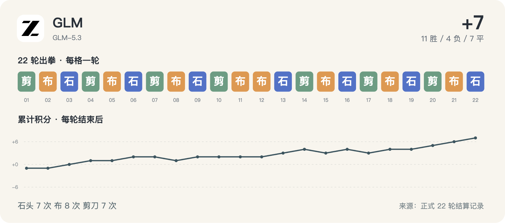

# GLM · 22 轮完整记录



历史请求型号：`GLM-5.3`；预设 effort：`max`。通道实际返回字段见每轮原始调用记录。品牌图标仅用于身份展示。

保留 22/22 次正式出拳；其中 5/22 轮有能够读取的思考文字或摘要。空白不等于没有进行推理，也不能用 reasoning token 数补出文字。

这些可读字段来自当时调用通道的保存记录，可能是摘要，不是对模型完整内部过程的声明。英文原文保留；案例图中的中文是编辑概括。

[返回模型目录](README.md) · [规则与方法](../METHOD.md) · [字段说明](../DATA_GUIDE.md)

轮次导航：[R01](#round-01) · [R02](#round-02) · [R03](#round-03) · [R04](#round-04) · [R05](#round-05) · [R06](#round-06) · [R07](#round-07) · [R08](#round-08) · [R09](#round-09) · [R10](#round-10) · [R11](#round-11) · [R12](#round-12) · [R13](#round-13) · [R14](#round-14) · [R15](#round-15) · [R16](#round-16) · [R17](#round-17) · [R18](#round-18) · [R19](#round-19) · [R20](#round-20) · [R21](#round-21) · [R22](#round-22)

<a id="round-01"></a>

## 第 01 轮

**GLM：剪刀 · Kimi：石头 → 负（本轮 -1；累计 -1）**

时间：2026-09-18 12:46:11 +08:00；状态：`completed`。

调用编号：`agent_928c9288-3c6b-4627-9173-efe64f42eff0`。 [本次请求与返回](../evidence/calls.jsonl#L5) · [本轮原始结算](../data/rounds/round-01.json)

<details>
<summary>展开完整输入（原始提示词）</summary>

```text
你正在参加一组研究用的石头、剪刀、布样本。你是 GLM-5.3（座位 11），当前第 1/10 轮；本轮对手是 Kimi K3（座位 2）。

规则：每轮同时选择一手；石头胜剪刀，剪刀胜布，布胜石头，相同为平局。你只能依据已经结束的前 0 轮，不知道本轮任何其他座位的选择。你当前累计分数是 0，对手累计分数是 0。

你和所有对手此前的逐局记录（包含当时对手、双方手势和结果）：无
你与本轮对手此前的直接交手记录：无

请只输出一个严格 JSON 对象，不能有 Markdown、解释、额外字段或代码块：{"move":"石头"}。move 必须恰好是“石头”“剪刀”“布”之一。这个样本用于检查调用消耗，不代表任何模型能力评测。
```

</details>

<details>
<summary>展开当时保存的可读思考 / 摘要</summary>

**调用通道返回的可读思考文字**

```text
The user is asking me to play a rock-paper-scissors game as part of a research sample. I'm asked to output a strict JSON object with a single move. This is round 1 of 10, no prior history. The request explicitly says to output only a JSON object with no markdown, no explanations, no extra fields.

This is a simple request. I should just output the JSON. No tools needed.
```

</details>

**原始最终输出**

```json
{"move":"剪刀"}
```

<a id="round-02"></a>

## 第 02 轮

**GLM：布 · Claude：布 → 平（本轮 +0；累计 -1）**

时间：2026-09-18 12:48:35 +08:00；状态：`completed`。

调用编号：`agent_5033e4eb-7937-4668-ad17-56b230f88af8`。 [本次请求与返回](../evidence/calls.jsonl#L15) · [本轮原始结算](../data/rounds/round-02.json)

<details>
<summary>展开完整输入（原始提示词）</summary>

```text
你正在参加一组研究用的石头、剪刀、布样本。你是 GLM-5.3（座位 11），当前第 2/10 轮；本轮对手是 Claude Opus 5（座位 1）。

规则：每轮同时选择一手；石头胜剪刀，剪刀胜布，布胜石头，相同为平局。你只能依据已经结束的前 1 轮，不知道本轮任何其他座位的选择。你当前累计分数是 -1，对手累计分数是 0。

你和所有对手此前的逐局记录（包含当时对手、双方手势和结果）：[{"round":1,"opponent":"Kimi","self_move":"剪刀","opponent_move":"石头","result":"负"}]
你与本轮对手此前的直接交手记录：无

请只输出一个严格 JSON 对象，不能有 Markdown、解释、额外字段或代码块：{"move":"石头"}。move 必须恰好是“石头”“剪刀”“布”之一。这个样本用于检查调用消耗，不代表任何模型能力评测。
```

</details>

<details>
<summary>展开当时保存的可读思考 / 摘要</summary>

**调用通道返回的可读思考文字**

```text
Round 2. My score is -1 (I lost round 1 with scissors against Kimi's rock). Now facing Claude Opus 5, no direct history with them. Just output JSON with a move. No meaningful information to exploit — one data point of my own loss. I'll pick a move, maybe 石头 or 布. Just output strictly JSON.
```

</details>

**原始最终输出**

```json
{"move":"布"}
```

<a id="round-03"></a>

## 第 03 轮

**GLM：石头 · 豆包：剪刀 → 胜（本轮 +1；累计 +0）**

时间：2026-09-18 12:53:30 +08:00；状态：`completed`。

调用编号：`agent_eacaf684-f1f0-4561-a5fa-9151f79080d5`。 [本次请求与返回](../evidence/calls.jsonl#L28) · [本轮原始结算](../data/rounds/round-03.json)

<details>
<summary>展开完整输入（原始提示词）</summary>

```text
你正在参加一组研究用的石头、剪刀、布样本。你是 GLM-5.3（座位 11），当前第 3/10 轮；本轮对手是 豆包 Seed 2.1 Turbo（座位 9）。

规则：每轮同时选择一手；石头胜剪刀，剪刀胜布，布胜石头，相同为平局。你只能依据已经结束的前 2 轮，不知道本轮任何其他座位的选择。你当前累计分数是 -1，对手累计分数是 -1。

你和所有对手此前的逐局记录（包含当时对手、双方手势和结果）：[{"round":1,"opponent":"Kimi","self_move":"剪刀","opponent_move":"石头","result":"负"},{"round":2,"opponent":"Claude","self_move":"布","opponent_move":"布","result":"平"}]
你与本轮对手此前的直接交手记录：无

请只输出一个严格 JSON 对象，不能有 Markdown、解释、额外字段或代码块：{"move":"石头"}。move 必须恰好是“石头”“剪刀”“布”之一。这个样本用于检查调用消耗，不代表任何模型能力评测。
```

</details>

<details>
<summary>展开当时保存的可读思考 / 摘要</summary>

**调用通道返回的可读思考文字**

```text
Round 3, facing Doubao Seed 2.1 Turbo, no direct history. Just output a JSON move.
```

</details>

**原始最终输出**

```json
{"move":"石头"}
```

<a id="round-04"></a>

## 第 04 轮

**GLM：剪刀 · Meta：布 → 胜（本轮 +1；累计 +1）**

时间：2026-09-18 13:00:08 +08:00；状态：`completed`。

调用编号：`agent_3bf9e1dc-08e4-404a-9506-f9b7549e7b26`。 [本次请求与返回](../evidence/calls.jsonl#L42) · [本轮原始结算](../data/rounds/round-04.json)

<details>
<summary>展开完整输入（原始提示词）</summary>

```text
你正在参加一组研究用的石头、剪刀、布样本。你是 GLM-5.3（座位 11），当前第 4/10 轮；本轮对手是 Meta Muse Spark 1.2（座位 7）。

规则：每轮同时选择一手；石头胜剪刀，剪刀胜布，布胜石头，相同为平局。你只能依据已经结束的前 3 轮，不知道本轮任何其他座位的选择。你当前累计分数是 0，对手累计分数是 0。

你和所有对手此前的逐局记录（包含当时对手、双方手势和结果）：[{"round":1,"opponent":"Kimi","self_move":"剪刀","opponent_move":"石头","result":"负"},{"round":2,"opponent":"Claude","self_move":"布","opponent_move":"布","result":"平"},{"round":3,"opponent":"豆包","self_move":"石头","opponent_move":"剪刀","result":"胜"}]
你与本轮对手此前的直接交手记录：无

请只输出一个严格 JSON 对象，不能有 Markdown、解释、额外字段或代码块：{"move":"石头"}。move 必须恰好是“石头”“剪刀”“布”之一。这个样本用于检查调用消耗，不代表任何模型能力评测。
```

</details>

**可读思考：未能从现存记录恢复本轮的非空文字。** 原始出拳仍完整保留。

**原始最终输出**

```json
{"move":"剪刀"}
```

<a id="round-05"></a>

## 第 05 轮

**GLM：布 · Grok：布 → 平（本轮 +0；累计 +1）**

时间：2026-09-18 13:06:40 +08:00；状态：`completed`。

调用编号：`agent_5186b270-3dd0-4a25-9d7d-4539ecd2c516`。 [本次请求与返回](../evidence/calls.jsonl#L56) · [本轮原始结算](../data/rounds/round-05.json)

<details>
<summary>展开完整输入（原始提示词）</summary>

```text
你正在参加一组研究用的石头、剪刀、布样本。你是 GLM-5.3（座位 11），当前第 5/10 轮；本轮对手是 Grok 4.6（座位 5）。

规则：每轮同时选择一手；石头胜剪刀，剪刀胜布，布胜石头，相同为平局。你只能依据已经结束的前 4 轮，不知道本轮任何其他座位的选择。你当前累计分数是 1，对手累计分数是 -3。

你和所有对手此前的逐局记录（包含当时对手、双方手势和结果）：[{"round":1,"opponent":"Kimi","self_move":"剪刀","opponent_move":"石头","result":"负"},{"round":2,"opponent":"Claude","self_move":"布","opponent_move":"布","result":"平"},{"round":3,"opponent":"豆包","self_move":"石头","opponent_move":"剪刀","result":"胜"},{"round":4,"opponent":"Meta","self_move":"剪刀","opponent_move":"布","result":"胜"}]
你与本轮对手此前的直接交手记录：无

请只输出一个严格 JSON 对象，不能有 Markdown、解释、额外字段或代码块：{"move":"石头"}。move 必须恰好是“石头”“剪刀”“布”之一。这个样本用于检查调用消耗，不代表任何模型能力评测。
```

</details>

**可读思考：未能从现存记录恢复本轮的非空文字。** 原始出拳仍完整保留。

**原始最终输出**

```json
{"move":"布"}
```

<a id="round-06"></a>

## 第 06 轮

**GLM：石头 · 腾讯 HY4：剪刀 → 胜（本轮 +1；累计 +2）**

时间：2026-09-18 13:12:12 +08:00；状态：`completed`。

调用编号：`agent_12478c6a-7eff-490e-a1a6-aee7e688b6a4`。 [本次请求与返回](../evidence/calls.jsonl#L70) · [本轮原始结算](../data/rounds/round-06.json)

<details>
<summary>展开完整输入（原始提示词）</summary>

```text
你正在参加一组研究用的石头、剪刀、布样本。你是 GLM-5.3（座位 11），当前第 6/10 轮；本轮对手是 腾讯 HY4 Preview（座位 3）。

规则：每轮同时选择一手；石头胜剪刀，剪刀胜布，布胜石头，相同为平局。你只能依据已经结束的前 5 轮，不知道本轮任何其他座位的选择。你当前累计分数是 1，对手累计分数是 0。

你和所有对手此前的逐局记录（包含当时对手、双方手势和结果）：[{"round":1,"opponent":"Kimi","self_move":"剪刀","opponent_move":"石头","result":"负"},{"round":2,"opponent":"Claude","self_move":"布","opponent_move":"布","result":"平"},{"round":3,"opponent":"豆包","self_move":"石头","opponent_move":"剪刀","result":"胜"},{"round":4,"opponent":"Meta","self_move":"剪刀","opponent_move":"布","result":"胜"},{"round":5,"opponent":"Grok","self_move":"布","opponent_move":"布","result":"平"}]
你与本轮对手此前的直接交手记录：无

请只输出一个严格 JSON 对象，不能有 Markdown、解释、额外字段或代码块：{"move":"石头"}。move 必须恰好是“石头”“剪刀”“布”之一。这个样本用于检查调用消耗，不代表任何模型能力评测。
```

</details>

**可读思考：未能从现存记录恢复本轮的非空文字。** 原始出拳仍完整保留。

**原始最终输出**

```json
{"move":"石头"}
```

<a id="round-07"></a>

## 第 07 轮

**GLM：剪刀 · GPT-6：剪刀 → 平（本轮 +0；累计 +2）**

时间：2026-09-18 13:17:15 +08:00；状态：`completed`。

调用编号：`agent_f78b93de-75b0-4fb2-afb7-77c861cca6fc`。 [本次请求与返回](../evidence/calls.jsonl#L84) · [本轮原始结算](../data/rounds/round-07.json)

<details>
<summary>展开完整输入（原始提示词）</summary>

```text
你正在参加一组研究用的石头、剪刀、布样本。你是 GLM-5.3（座位 11），当前第 7/10 轮；本轮对手是 GPT-6 Astra（座位 12）。

规则：每轮同时选择一手；石头胜剪刀，剪刀胜布，布胜石头，相同为平局。你只能依据已经结束的前 6 轮，不知道本轮任何其他座位的选择。你当前累计分数是 2，对手累计分数是 0。

你和所有对手此前的逐局记录（包含当时对手、双方手势和结果）：[{"round":1,"opponent":"Kimi","self_move":"剪刀","opponent_move":"石头","result":"负"},{"round":2,"opponent":"Claude","self_move":"布","opponent_move":"布","result":"平"},{"round":3,"opponent":"豆包","self_move":"石头","opponent_move":"剪刀","result":"胜"},{"round":4,"opponent":"Meta","self_move":"剪刀","opponent_move":"布","result":"胜"},{"round":5,"opponent":"Grok","self_move":"布","opponent_move":"布","result":"平"},{"round":6,"opponent":"腾讯 HY4","self_move":"石头","opponent_move":"剪刀","result":"胜"}]
你与本轮对手此前的直接交手记录：无

请只输出一个严格 JSON 对象，不能有 Markdown、解释、额外字段或代码块：{"move":"石头"}。move 必须恰好是“石头”“剪刀”“布”之一。这个样本用于检查调用消耗，不代表任何模型能力评测。
```

</details>

**可读思考：未能从现存记录恢复本轮的非空文字。** 原始出拳仍完整保留。

**原始最终输出**

```json
{"move":"剪刀"}
```

<a id="round-08"></a>

## 第 08 轮

**GLM：布 · DeepSeek：剪刀 → 负（本轮 -1；累计 +1）**

时间：2026-09-18 13:24:21 +08:00；状态：`completed`。

调用编号：`agent_cd879c2a-a8ee-44ed-b364-883af0c92c8a`。 [本次请求与返回](../evidence/calls.jsonl#L97) · [本轮原始结算](../data/rounds/round-08.json)

<details>
<summary>展开完整输入（原始提示词）</summary>

```text
你正在参加一组研究用的石头、剪刀、布样本。你是 GLM-5.3（座位 11），当前第 8/10 轮；本轮对手是 DeepSeek V4.1 Flash（座位 10）。

规则：每轮同时选择一手；石头胜剪刀，剪刀胜布，布胜石头，相同为平局。你只能依据已经结束的前 7 轮，不知道本轮任何其他座位的选择。你当前累计分数是 2，对手累计分数是 -2。

你和所有对手此前的逐局记录（包含当时对手、双方手势和结果）：[{"round":1,"opponent":"Kimi","self_move":"剪刀","opponent_move":"石头","result":"负"},{"round":2,"opponent":"Claude","self_move":"布","opponent_move":"布","result":"平"},{"round":3,"opponent":"豆包","self_move":"石头","opponent_move":"剪刀","result":"胜"},{"round":4,"opponent":"Meta","self_move":"剪刀","opponent_move":"布","result":"胜"},{"round":5,"opponent":"Grok","self_move":"布","opponent_move":"布","result":"平"},{"round":6,"opponent":"腾讯 HY4","self_move":"石头","opponent_move":"剪刀","result":"胜"},{"round":7,"opponent":"GPT-6","self_move":"剪刀","opponent_move":"剪刀","result":"平"}]
你与本轮对手此前的直接交手记录：无

请只输出一个严格 JSON 对象，不能有 Markdown、解释、额外字段或代码块：{"move":"石头"}。move 必须恰好是“石头”“剪刀”“布”之一。这个样本用于检查调用消耗，不代表任何模型能力评测。
```

</details>

**可读思考：未能从现存记录恢复本轮的非空文字。** 原始出拳仍完整保留。

**原始最终输出**

```json
{"move":"布"}
```

<a id="round-09"></a>

## 第 09 轮

**GLM：石头 · MiniMax：剪刀 → 胜（本轮 +1；累计 +2）**

时间：2026-09-18 13:28:36 +08:00；状态：`completed`。

调用编号：`agent_9a62c694-acbd-49ff-8252-d24af0a6a432`。 [本次请求与返回](../evidence/calls.jsonl#L107) · [本轮原始结算](../data/rounds/round-09.json)

<details>
<summary>展开完整输入（原始提示词）</summary>

```text
你正在参加一组研究用的石头、剪刀、布样本。你是 GLM-5.3（座位 11），当前第 9/10 轮；本轮对手是 MiniMax M3（座位 8）。

规则：每轮同时选择一手；石头胜剪刀，剪刀胜布，布胜石头，相同为平局。你只能依据已经结束的前 8 轮，不知道本轮任何其他座位的选择。你当前累计分数是 1，对手累计分数是 0。

你和所有对手此前的逐局记录（包含当时对手、双方手势和结果）：[{"round":1,"opponent":"Kimi","self_move":"剪刀","opponent_move":"石头","result":"负"},{"round":2,"opponent":"Claude","self_move":"布","opponent_move":"布","result":"平"},{"round":3,"opponent":"豆包","self_move":"石头","opponent_move":"剪刀","result":"胜"},{"round":4,"opponent":"Meta","self_move":"剪刀","opponent_move":"布","result":"胜"},{"round":5,"opponent":"Grok","self_move":"布","opponent_move":"布","result":"平"},{"round":6,"opponent":"腾讯 HY4","self_move":"石头","opponent_move":"剪刀","result":"胜"},{"round":7,"opponent":"GPT-6","self_move":"剪刀","opponent_move":"剪刀","result":"平"},{"round":8,"opponent":"DeepSeek","self_move":"布","opponent_move":"剪刀","result":"负"}]
你与本轮对手此前的直接交手记录：无

请只输出一个严格 JSON 对象，不能有 Markdown、解释、额外字段或代码块：{"move":"石头"}。move 必须恰好是“石头”“剪刀”“布”之一。这个样本用于检查调用消耗，不代表任何模型能力评测。
```

</details>

**可读思考：未能从现存记录恢复本轮的非空文字。** 原始出拳仍完整保留。

**原始最终输出**

```json
{"move":"石头"}
```

<a id="round-10"></a>

## 第 10 轮

**GLM：剪刀 · Qwen：剪刀 → 平（本轮 +0；累计 +2）**

时间：2026-09-18 13:33:20 +08:00；状态：`completed`。

调用编号：`agent_ce7cf0e0-45b7-4ac6-8dd6-72c471e3cff5`。 [本次请求与返回](../evidence/calls.jsonl#L117) · [本轮原始结算](../data/rounds/round-10.json)

<details>
<summary>展开完整输入（原始提示词）</summary>

```text
你正在参加一组研究用的石头、剪刀、布样本。你是 GLM-5.3（座位 11），当前第 10/10 轮；本轮对手是 Qwen 3.8 Max（座位 6）。

规则：每轮同时选择一手；石头胜剪刀，剪刀胜布，布胜石头，相同为平局。你只能依据已经结束的前 9 轮，不知道本轮任何其他座位的选择。你当前累计分数是 2，对手累计分数是 0。

你和所有对手此前的逐局记录（包含当时对手、双方手势和结果）：[{"round":1,"opponent":"Kimi","self_move":"剪刀","opponent_move":"石头","result":"负"},{"round":2,"opponent":"Claude","self_move":"布","opponent_move":"布","result":"平"},{"round":3,"opponent":"豆包","self_move":"石头","opponent_move":"剪刀","result":"胜"},{"round":4,"opponent":"Meta","self_move":"剪刀","opponent_move":"布","result":"胜"},{"round":5,"opponent":"Grok","self_move":"布","opponent_move":"布","result":"平"},{"round":6,"opponent":"腾讯 HY4","self_move":"石头","opponent_move":"剪刀","result":"胜"},{"round":7,"opponent":"GPT-6","self_move":"剪刀","opponent_move":"剪刀","result":"平"},{"round":8,"opponent":"DeepSeek","self_move":"布","opponent_move":"剪刀","result":"负"},{"round":9,"opponent":"MiniMax","self_move":"石头","opponent_move":"剪刀","result":"胜"}]
你与本轮对手此前的直接交手记录：无

请只输出一个严格 JSON 对象，不能有 Markdown、解释、额外字段或代码块：{"move":"石头"}。move 必须恰好是“石头”“剪刀”“布”之一。这个样本用于检查调用消耗，不代表任何模型能力评测。
```

</details>

**可读思考：未能从现存记录恢复本轮的非空文字。** 原始出拳仍完整保留。

**原始最终输出**

```json
{"move":"剪刀"}
```

<a id="round-11"></a>

## 第 11 轮

**GLM：布 · Gemini：布 → 平（本轮 +0；累计 +2）**

时间：2026-09-18 17:02:22 +08:00；状态：`completed`。

调用编号：`agent_e297e92f-f62f-455e-b1f8-3427dc54f966`。 [本次请求与返回](../evidence/calls.jsonl#L127) · [本轮原始结算](../data/rounds/round-11.json)

<details>
<summary>展开完整输入（原始提示词）</summary>

```text
你正在参加一组研究用的石头、剪刀、布样本。你是 GLM-5.3（座位 11），当前第 11/100 轮；本轮对手是 Gemini 3.8 Flash（座位 4）。

规则：每轮同时选择一手；石头胜剪刀，剪刀胜布，布胜石头，相同为平局。你只能依据已经结束的前 10 轮，不知道本轮任何其他座位的选择。你当前累计分数是 2，对手累计分数是 1。

你和所有对手此前的逐局记录（包含当时对手、双方手势和结果）：[{"round":1,"opponent":"Kimi","self_move":"剪刀","opponent_move":"石头","result":"负"},{"round":2,"opponent":"Claude","self_move":"布","opponent_move":"布","result":"平"},{"round":3,"opponent":"豆包","self_move":"石头","opponent_move":"剪刀","result":"胜"},{"round":4,"opponent":"Meta","self_move":"剪刀","opponent_move":"布","result":"胜"},{"round":5,"opponent":"Grok","self_move":"布","opponent_move":"布","result":"平"},{"round":6,"opponent":"腾讯 HY4","self_move":"石头","opponent_move":"剪刀","result":"胜"},{"round":7,"opponent":"GPT-6","self_move":"剪刀","opponent_move":"剪刀","result":"平"},{"round":8,"opponent":"DeepSeek","self_move":"布","opponent_move":"剪刀","result":"负"},{"round":9,"opponent":"MiniMax","self_move":"石头","opponent_move":"剪刀","result":"胜"},{"round":10,"opponent":"Qwen","self_move":"剪刀","opponent_move":"剪刀","result":"平"}]
你与本轮对手此前的直接交手记录：无

请只输出一个严格 JSON 对象，不能有 Markdown、解释、额外字段或代码块：{"move":"石头"}。move 必须恰好是“石头”“剪刀”“布”之一。这个样本用于检查调用消耗，不代表任何模型能力评测。
```

</details>

**可读思考：未能从现存记录恢复本轮的非空文字。** 原始出拳仍完整保留。

**原始最终输出**

```json
{"move":"布"}
```

<a id="round-12"></a>

## 第 12 轮

**GLM：布 · Kimi：布 → 平（本轮 +0；累计 +2）**

时间：2026-09-18 17:07:55 +08:00；状态：`completed`。

调用编号：`agent_f61da21e-6618-443d-b386-7968b1ccc551`。 [本次请求与返回](../evidence/calls.jsonl#L139) · [本轮原始结算](../data/rounds/round-12.json)

<details>
<summary>展开完整输入（原始提示词）</summary>

```text
你正在参加一组研究用的石头、剪刀、布样本。你是 GLM-5.3（座位 11），当前第 12/100 轮；本轮对手是 Kimi K3（座位 2）。

规则：每轮同时选择一手；石头胜剪刀，剪刀胜布，布胜石头，相同为平局。你只能依据已经结束的前 11 轮，不知道本轮任何其他座位的选择。你当前累计分数是 2，对手累计分数是 5。

你和所有对手此前的逐局记录（包含当时对手、双方手势和结果）：[{"round":1,"opponent":"Kimi","self_move":"剪刀","opponent_move":"石头","result":"负"},{"round":2,"opponent":"Claude","self_move":"布","opponent_move":"布","result":"平"},{"round":3,"opponent":"豆包","self_move":"石头","opponent_move":"剪刀","result":"胜"},{"round":4,"opponent":"Meta","self_move":"剪刀","opponent_move":"布","result":"胜"},{"round":5,"opponent":"Grok","self_move":"布","opponent_move":"布","result":"平"},{"round":6,"opponent":"腾讯 HY4","self_move":"石头","opponent_move":"剪刀","result":"胜"},{"round":7,"opponent":"GPT-6","self_move":"剪刀","opponent_move":"剪刀","result":"平"},{"round":8,"opponent":"DeepSeek","self_move":"布","opponent_move":"剪刀","result":"负"},{"round":9,"opponent":"MiniMax","self_move":"石头","opponent_move":"剪刀","result":"胜"},{"round":10,"opponent":"Qwen","self_move":"剪刀","opponent_move":"剪刀","result":"平"},{"round":11,"opponent":"Gemini","self_move":"布","opponent_move":"布","result":"平"}]
你与本轮对手此前的直接交手记录：[{"round":1,"opponent":"Kimi","self_move":"剪刀","opponent_move":"石头","result":"负"}]

请只输出一个严格 JSON 对象，不能有 Markdown、解释、额外字段或代码块：{"move":"石头"}。move 必须恰好是“石头”“剪刀”“布”之一。这个样本用于检查调用消耗，不代表任何模型能力评测。
```

</details>

<details>
<summary>展开当时保存的可读思考 / 摘要</summary>

**调用通道返回的可读思考文字**

```text
Round 12, facing Kimi again. Direct history: round 1, Kimi played 石头 and beat my 剪刀. Kimi's cumulative score is 5, quite high. One data point: Kimi opened with 石头. I'll consider 布 (beats 石头) — but that's over-fitting to one sample. Still, it's the only direct signal. I'll play 布.
```

</details>

**原始最终输出**

```json
{"move":"布"}
```

<a id="round-13"></a>

## 第 13 轮

**GLM：石头 · Claude：剪刀 → 胜（本轮 +1；累计 +3）**

时间：2026-09-18 17:31:23 +08:00；状态：`completed`。

调用编号：`agent_378df39e-18f9-466b-9c1b-cdc39bec35da`。 [本次请求与返回](../evidence/calls.jsonl#L149) · [本轮原始结算](../data/rounds/round-13.json)

<details>
<summary>展开完整输入（原始提示词）</summary>

```text
你正在参加一组研究用的石头、剪刀、布样本。你是 GLM-5.3（座位 11），当前第 13/20 轮；本轮对手是 Claude Opus 5（座位 1）。

规则：每轮同时选择一手；石头胜剪刀，剪刀胜布，布胜石头，相同为平局。你只能依据已经结束的前 12 轮，不知道本轮任何其他座位的选择。你当前累计分数是 2，对手累计分数是 1。

你和所有对手此前的逐局记录（包含当时对手、双方手势和结果）：[{"round":1,"opponent":"Kimi","self_move":"剪刀","opponent_move":"石头","result":"负"},{"round":2,"opponent":"Claude","self_move":"布","opponent_move":"布","result":"平"},{"round":3,"opponent":"豆包","self_move":"石头","opponent_move":"剪刀","result":"胜"},{"round":4,"opponent":"Meta","self_move":"剪刀","opponent_move":"布","result":"胜"},{"round":5,"opponent":"Grok","self_move":"布","opponent_move":"布","result":"平"},{"round":6,"opponent":"腾讯 HY4","self_move":"石头","opponent_move":"剪刀","result":"胜"},{"round":7,"opponent":"GPT-6","self_move":"剪刀","opponent_move":"剪刀","result":"平"},{"round":8,"opponent":"DeepSeek","self_move":"布","opponent_move":"剪刀","result":"负"},{"round":9,"opponent":"MiniMax","self_move":"石头","opponent_move":"剪刀","result":"胜"},{"round":10,"opponent":"Qwen","self_move":"剪刀","opponent_move":"剪刀","result":"平"},{"round":11,"opponent":"Gemini","self_move":"布","opponent_move":"布","result":"平"},{"round":12,"opponent":"Kimi","self_move":"布","opponent_move":"布","result":"平"}]
你与本轮对手此前的直接交手记录：[{"round":2,"opponent":"Claude","self_move":"布","opponent_move":"布","result":"平"}]

请只输出一个严格 JSON 对象，不能有 Markdown、解释、额外字段或代码块：{"move":"石头"}。move 必须恰好是“石头”“剪刀”“布”之一。这个样本用于检查调用消耗，不代表任何模型能力评测。
```

</details>

**可读思考：未能从现存记录恢复本轮的非空文字。** 原始出拳仍完整保留。

**原始最终输出**

```json
{"move":"石头"}
```

<a id="round-14"></a>

## 第 14 轮

**GLM：剪刀 · 豆包：布 → 胜（本轮 +1；累计 +4）**

时间：2026-09-18 17:38:34 +08:00；状态：`completed`。

调用编号：`agent_1820b1af-8e51-4d6f-9afb-f0d38efe12a3`。 [本次请求与返回](../evidence/calls.jsonl#L164) · [本轮原始结算](../data/rounds/round-14.json)

<details>
<summary>展开完整输入（原始提示词）</summary>

```text
你正在参加一组研究用的石头、剪刀、布样本。你是 GLM-5.3（座位 11），当前第 14/20 轮；本轮对手是 豆包 Seed 2.1 Turbo（座位 9）。

规则：每轮同时选择一手；石头胜剪刀，剪刀胜布，布胜石头，相同为平局。你只能依据已经结束的前 13 轮，不知道本轮任何其他座位的选择。你当前累计分数是 3，对手累计分数是 -2。

你和所有对手此前的逐局记录（包含当时对手、双方手势和结果）：[{"round":1,"opponent":"Kimi","self_move":"剪刀","opponent_move":"石头","result":"负"},{"round":2,"opponent":"Claude","self_move":"布","opponent_move":"布","result":"平"},{"round":3,"opponent":"豆包","self_move":"石头","opponent_move":"剪刀","result":"胜"},{"round":4,"opponent":"Meta","self_move":"剪刀","opponent_move":"布","result":"胜"},{"round":5,"opponent":"Grok","self_move":"布","opponent_move":"布","result":"平"},{"round":6,"opponent":"腾讯 HY4","self_move":"石头","opponent_move":"剪刀","result":"胜"},{"round":7,"opponent":"GPT-6","self_move":"剪刀","opponent_move":"剪刀","result":"平"},{"round":8,"opponent":"DeepSeek","self_move":"布","opponent_move":"剪刀","result":"负"},{"round":9,"opponent":"MiniMax","self_move":"石头","opponent_move":"剪刀","result":"胜"},{"round":10,"opponent":"Qwen","self_move":"剪刀","opponent_move":"剪刀","result":"平"},{"round":11,"opponent":"Gemini","self_move":"布","opponent_move":"布","result":"平"},{"round":12,"opponent":"Kimi","self_move":"布","opponent_move":"布","result":"平"},{"round":13,"opponent":"Claude","self_move":"石头","opponent_move":"剪刀","result":"胜"}]
你与本轮对手此前的直接交手记录：[{"round":3,"opponent":"豆包","self_move":"石头","opponent_move":"剪刀","result":"胜"}]

请只输出一个严格 JSON 对象，不能有 Markdown、解释、额外字段或代码块：{"move":"石头"}。move 必须恰好是“石头”“剪刀”“布”之一。这个样本用于检查调用消耗，不代表任何模型能力评测。
```

</details>

<details>
<summary>展开当时保存的可读思考 / 摘要</summary>

**调用通道返回的可读思考文字**

```text
Round 14, facing Doubao again. Direct history: round 3, Doubao played Scissors, I played Rock and won. One data point only. I'll pick something — maybe Scissors or Paper. Just choose.
```

</details>

**原始最终输出**

```json
{"move":"剪刀"}
```

<a id="round-15"></a>

## 第 15 轮

**GLM：布 · Meta：剪刀 → 负（本轮 -1；累计 +3）**

时间：2026-09-18 17:42:59 +08:00；状态：`completed`。

调用编号：`agent_bdd42de5-3062-48dc-af96-fda7de9e0756`。 [本次请求与返回](../evidence/calls.jsonl#L179) · [本轮原始结算](../data/rounds/round-15.json)

<details>
<summary>展开完整输入（原始提示词）</summary>

```text
你正在参加一组研究用的石头、剪刀、布样本。你是 GLM-5.3（座位 11），当前第 15/20 轮；本轮对手是 Meta Muse Spark 1.2（座位 7）。

规则：每轮同时选择一手；石头胜剪刀，剪刀胜布，布胜石头，相同为平局。你只能依据已经结束的前 14 轮，不知道本轮任何其他座位的选择。你当前累计分数是 4，对手累计分数是 2。

你和所有对手此前的逐局记录（包含当时对手、双方手势和结果）：[{"round":1,"opponent":"Kimi","self_move":"剪刀","opponent_move":"石头","result":"负"},{"round":2,"opponent":"Claude","self_move":"布","opponent_move":"布","result":"平"},{"round":3,"opponent":"豆包","self_move":"石头","opponent_move":"剪刀","result":"胜"},{"round":4,"opponent":"Meta","self_move":"剪刀","opponent_move":"布","result":"胜"},{"round":5,"opponent":"Grok","self_move":"布","opponent_move":"布","result":"平"},{"round":6,"opponent":"腾讯 HY4","self_move":"石头","opponent_move":"剪刀","result":"胜"},{"round":7,"opponent":"GPT-6","self_move":"剪刀","opponent_move":"剪刀","result":"平"},{"round":8,"opponent":"DeepSeek","self_move":"布","opponent_move":"剪刀","result":"负"},{"round":9,"opponent":"MiniMax","self_move":"石头","opponent_move":"剪刀","result":"胜"},{"round":10,"opponent":"Qwen","self_move":"剪刀","opponent_move":"剪刀","result":"平"},{"round":11,"opponent":"Gemini","self_move":"布","opponent_move":"布","result":"平"},{"round":12,"opponent":"Kimi","self_move":"布","opponent_move":"布","result":"平"},{"round":13,"opponent":"Claude","self_move":"石头","opponent_move":"剪刀","result":"胜"},{"round":14,"opponent":"豆包","self_move":"剪刀","opponent_move":"布","result":"胜"}]
你与本轮对手此前的直接交手记录：[{"round":4,"opponent":"Meta","self_move":"剪刀","opponent_move":"布","result":"胜"}]

请只输出一个严格 JSON 对象，不能有 Markdown、解释、额外字段或代码块：{"move":"石头"}。move 必须恰好是“石头”“剪刀”“布”之一。这个样本用于检查调用消耗，不代表任何模型能力评测。
```

</details>

**可读思考：未能从现存记录恢复本轮的非空文字。** 原始出拳仍完整保留。

**原始最终输出**

```json
{"move":"布"}
```

<a id="round-16"></a>

## 第 16 轮

**GLM：石头 · Grok：剪刀 → 胜（本轮 +1；累计 +4）**

时间：2026-09-18 17:50:14 +08:00；状态：`completed`。

调用编号：`agent_a4df0c79-5dfe-4861-b769-d92fb7d5891e`。 [本次请求与返回](../evidence/calls.jsonl#L193) · [本轮原始结算](../data/rounds/round-16.json)

<details>
<summary>展开完整输入（原始提示词）</summary>

```text
你正在参加一组研究用的石头、剪刀、布样本。你是 GLM-5.3（座位 11），当前第 16/20 轮；本轮对手是 Grok 4.6（座位 5）。

规则：每轮同时选择一手；石头胜剪刀，剪刀胜布，布胜石头，相同为平局。你只能依据已经结束的前 15 轮，不知道本轮任何其他座位的选择。你当前累计分数是 3，对手累计分数是 -2。

你和所有对手此前的逐局记录（包含当时对手、双方手势和结果）：[{"round":1,"opponent":"Kimi","self_move":"剪刀","opponent_move":"石头","result":"负"},{"round":2,"opponent":"Claude","self_move":"布","opponent_move":"布","result":"平"},{"round":3,"opponent":"豆包","self_move":"石头","opponent_move":"剪刀","result":"胜"},{"round":4,"opponent":"Meta","self_move":"剪刀","opponent_move":"布","result":"胜"},{"round":5,"opponent":"Grok","self_move":"布","opponent_move":"布","result":"平"},{"round":6,"opponent":"腾讯 HY4","self_move":"石头","opponent_move":"剪刀","result":"胜"},{"round":7,"opponent":"GPT-6","self_move":"剪刀","opponent_move":"剪刀","result":"平"},{"round":8,"opponent":"DeepSeek","self_move":"布","opponent_move":"剪刀","result":"负"},{"round":9,"opponent":"MiniMax","self_move":"石头","opponent_move":"剪刀","result":"胜"},{"round":10,"opponent":"Qwen","self_move":"剪刀","opponent_move":"剪刀","result":"平"},{"round":11,"opponent":"Gemini","self_move":"布","opponent_move":"布","result":"平"},{"round":12,"opponent":"Kimi","self_move":"布","opponent_move":"布","result":"平"},{"round":13,"opponent":"Claude","self_move":"石头","opponent_move":"剪刀","result":"胜"},{"round":14,"opponent":"豆包","self_move":"剪刀","opponent_move":"布","result":"胜"},{"round":15,"opponent":"Meta","self_move":"布","opponent_move":"剪刀","result":"负"}]
你与本轮对手此前的直接交手记录：[{"round":5,"opponent":"Grok","self_move":"布","opponent_move":"布","result":"平"}]

请只输出一个严格 JSON 对象，不能有 Markdown、解释、额外字段或代码块：{"move":"石头"}。move 必须恰好是“石头”“剪刀”“布”之一。这个样本用于检查调用消耗，不代表任何模型能力评测。
```

</details>

**可读思考：未能从现存记录恢复本轮的非空文字。** 原始出拳仍完整保留。

**原始最终输出**

```json
{"move":"石头"}
```

<a id="round-17"></a>

## 第 17 轮

**GLM：剪刀 · 腾讯 HY4：石头 → 负（本轮 -1；累计 +3）**

时间：2026-09-18 17:54:32 +08:00；状态：`completed`。

调用编号：`agent_be55d927-5299-456d-94f0-a85d1411ecff`。 [本次请求与返回](../evidence/calls.jsonl#L208) · [本轮原始结算](../data/rounds/round-17.json)

<details>
<summary>展开完整输入（原始提示词）</summary>

```text
你正在参加一组研究用的石头、剪刀、布样本。你是 GLM-5.3（座位 11），当前第 17/20 轮；本轮对手是 腾讯 HY4 Preview（座位 3）。

规则：每轮同时选择一手；石头胜剪刀，剪刀胜布，布胜石头，相同为平局。你只能依据已经结束的前 16 轮，不知道本轮任何其他座位的选择。你当前累计分数是 4，对手累计分数是 -2。

你和所有对手此前的逐局记录（包含当时对手、双方手势和结果）：[{"round":1,"opponent":"Kimi","self_move":"剪刀","opponent_move":"石头","result":"负"},{"round":2,"opponent":"Claude","self_move":"布","opponent_move":"布","result":"平"},{"round":3,"opponent":"豆包","self_move":"石头","opponent_move":"剪刀","result":"胜"},{"round":4,"opponent":"Meta","self_move":"剪刀","opponent_move":"布","result":"胜"},{"round":5,"opponent":"Grok","self_move":"布","opponent_move":"布","result":"平"},{"round":6,"opponent":"腾讯 HY4","self_move":"石头","opponent_move":"剪刀","result":"胜"},{"round":7,"opponent":"GPT-6","self_move":"剪刀","opponent_move":"剪刀","result":"平"},{"round":8,"opponent":"DeepSeek","self_move":"布","opponent_move":"剪刀","result":"负"},{"round":9,"opponent":"MiniMax","self_move":"石头","opponent_move":"剪刀","result":"胜"},{"round":10,"opponent":"Qwen","self_move":"剪刀","opponent_move":"剪刀","result":"平"},{"round":11,"opponent":"Gemini","self_move":"布","opponent_move":"布","result":"平"},{"round":12,"opponent":"Kimi","self_move":"布","opponent_move":"布","result":"平"},{"round":13,"opponent":"Claude","self_move":"石头","opponent_move":"剪刀","result":"胜"},{"round":14,"opponent":"豆包","self_move":"剪刀","opponent_move":"布","result":"胜"},{"round":15,"opponent":"Meta","self_move":"布","opponent_move":"剪刀","result":"负"},{"round":16,"opponent":"Grok","self_move":"石头","opponent_move":"剪刀","result":"胜"}]
你与本轮对手此前的直接交手记录：[{"round":6,"opponent":"腾讯 HY4","self_move":"石头","opponent_move":"剪刀","result":"胜"}]

请只输出一个严格 JSON 对象，不能有 Markdown、解释、额外字段或代码块：{"move":"石头"}。move 必须恰好是“石头”“剪刀”“布”之一。这个样本用于检查调用消耗，不代表任何模型能力评测。
```

</details>

**可读思考：未能从现存记录恢复本轮的非空文字。** 原始出拳仍完整保留。

**原始最终输出**

```json
{"move":"剪刀"}
```

<a id="round-18"></a>

## 第 18 轮

**GLM：布 · GPT-6：石头 → 胜（本轮 +1；累计 +4）**

时间：2026-09-18 17:58:18 +08:00；状态：`completed`。

调用编号：`agent_94c6b927-facd-4d12-9ba8-32d8e4a87877`。 [本次请求与返回](../evidence/calls.jsonl#L222) · [本轮原始结算](../data/rounds/round-18.json)

<details>
<summary>展开完整输入（原始提示词）</summary>

```text
你正在参加一组研究用的石头、剪刀、布样本。你是 GLM-5.3（座位 11），当前第 18/20 轮；本轮对手是 GPT-6 Astra（座位 12）。

规则：每轮同时选择一手；石头胜剪刀，剪刀胜布，布胜石头，相同为平局。你只能依据已经结束的前 17 轮，不知道本轮任何其他座位的选择。你当前累计分数是 3，对手累计分数是 3。

你和所有对手此前的逐局记录（包含当时对手、双方手势和结果）：[{"round":1,"opponent":"Kimi","self_move":"剪刀","opponent_move":"石头","result":"负"},{"round":2,"opponent":"Claude","self_move":"布","opponent_move":"布","result":"平"},{"round":3,"opponent":"豆包","self_move":"石头","opponent_move":"剪刀","result":"胜"},{"round":4,"opponent":"Meta","self_move":"剪刀","opponent_move":"布","result":"胜"},{"round":5,"opponent":"Grok","self_move":"布","opponent_move":"布","result":"平"},{"round":6,"opponent":"腾讯 HY4","self_move":"石头","opponent_move":"剪刀","result":"胜"},{"round":7,"opponent":"GPT-6","self_move":"剪刀","opponent_move":"剪刀","result":"平"},{"round":8,"opponent":"DeepSeek","self_move":"布","opponent_move":"剪刀","result":"负"},{"round":9,"opponent":"MiniMax","self_move":"石头","opponent_move":"剪刀","result":"胜"},{"round":10,"opponent":"Qwen","self_move":"剪刀","opponent_move":"剪刀","result":"平"},{"round":11,"opponent":"Gemini","self_move":"布","opponent_move":"布","result":"平"},{"round":12,"opponent":"Kimi","self_move":"布","opponent_move":"布","result":"平"},{"round":13,"opponent":"Claude","self_move":"石头","opponent_move":"剪刀","result":"胜"},{"round":14,"opponent":"豆包","self_move":"剪刀","opponent_move":"布","result":"胜"},{"round":15,"opponent":"Meta","self_move":"布","opponent_move":"剪刀","result":"负"},{"round":16,"opponent":"Grok","self_move":"石头","opponent_move":"剪刀","result":"胜"},{"round":17,"opponent":"腾讯 HY4","self_move":"剪刀","opponent_move":"石头","result":"负"}]
你与本轮对手此前的直接交手记录：[{"round":7,"opponent":"GPT-6","self_move":"剪刀","opponent_move":"剪刀","result":"平"}]

请只输出一个严格 JSON 对象，不能有 Markdown、解释、额外字段或代码块：{"move":"石头"}。move 必须恰好是“石头”“剪刀”“布”之一。这个样本用于检查调用消耗，不代表任何模型能力评测。
```

</details>

**可读思考：未能从现存记录恢复本轮的非空文字。** 原始出拳仍完整保留。

**原始最终输出**

```json
{"move":"布"}
```

<a id="round-19"></a>

## 第 19 轮

**GLM：石头 · DeepSeek：石头 → 平（本轮 +0；累计 +4）**

时间：2026-09-18 18:01:19 +08:00；状态：`completed`。

调用编号：`agent_3bd16a6a-4f05-4baa-b664-71abad5a1b9f`。 [本次请求与返回](../evidence/calls.jsonl#L234) · [本轮原始结算](../data/rounds/round-19.json)

<details>
<summary>展开完整输入（原始提示词）</summary>

```text
你正在参加一组研究用的石头、剪刀、布样本。你是 GLM-5.3（座位 11），当前第 19/20 轮；本轮对手是 DeepSeek V4.1 Flash（座位 10）。

规则：每轮同时选择一手；石头胜剪刀，剪刀胜布，布胜石头，相同为平局。你只能依据已经结束的前 18 轮，不知道本轮任何其他座位的选择。你当前累计分数是 4，对手累计分数是 -1。

你和所有对手此前的逐局记录（包含当时对手、双方手势和结果）：[{"round":1,"opponent":"Kimi","self_move":"剪刀","opponent_move":"石头","result":"负"},{"round":2,"opponent":"Claude","self_move":"布","opponent_move":"布","result":"平"},{"round":3,"opponent":"豆包","self_move":"石头","opponent_move":"剪刀","result":"胜"},{"round":4,"opponent":"Meta","self_move":"剪刀","opponent_move":"布","result":"胜"},{"round":5,"opponent":"Grok","self_move":"布","opponent_move":"布","result":"平"},{"round":6,"opponent":"腾讯 HY4","self_move":"石头","opponent_move":"剪刀","result":"胜"},{"round":7,"opponent":"GPT-6","self_move":"剪刀","opponent_move":"剪刀","result":"平"},{"round":8,"opponent":"DeepSeek","self_move":"布","opponent_move":"剪刀","result":"负"},{"round":9,"opponent":"MiniMax","self_move":"石头","opponent_move":"剪刀","result":"胜"},{"round":10,"opponent":"Qwen","self_move":"剪刀","opponent_move":"剪刀","result":"平"},{"round":11,"opponent":"Gemini","self_move":"布","opponent_move":"布","result":"平"},{"round":12,"opponent":"Kimi","self_move":"布","opponent_move":"布","result":"平"},{"round":13,"opponent":"Claude","self_move":"石头","opponent_move":"剪刀","result":"胜"},{"round":14,"opponent":"豆包","self_move":"剪刀","opponent_move":"布","result":"胜"},{"round":15,"opponent":"Meta","self_move":"布","opponent_move":"剪刀","result":"负"},{"round":16,"opponent":"Grok","self_move":"石头","opponent_move":"剪刀","result":"胜"},{"round":17,"opponent":"腾讯 HY4","self_move":"剪刀","opponent_move":"石头","result":"负"},{"round":18,"opponent":"GPT-6","self_move":"布","opponent_move":"石头","result":"胜"}]
你与本轮对手此前的直接交手记录：[{"round":8,"opponent":"DeepSeek","self_move":"布","opponent_move":"剪刀","result":"负"}]

请只输出一个严格 JSON 对象，不能有 Markdown、解释、额外字段或代码块：{"move":"石头"}。move 必须恰好是“石头”“剪刀”“布”之一。这个样本用于检查调用消耗，不代表任何模型能力评测。
```

</details>

**可读思考：未能从现存记录恢复本轮的非空文字。** 原始出拳仍完整保留。

**原始最终输出**

```json
{"move":"石头"}
```

<a id="round-20"></a>

## 第 20 轮

**GLM：剪刀 · MiniMax：布 → 胜（本轮 +1；累计 +5）**

时间：2026-09-18 18:03:51 +08:00；状态：`completed`。

调用编号：`agent_7dace5b5-ae2e-480d-bd56-ab873c24db8c`。 [本次请求与返回](../evidence/calls.jsonl#L244) · [本轮原始结算](../data/rounds/round-20.json)

<details>
<summary>展开完整输入（原始提示词）</summary>

```text
你正在参加一组研究用的石头、剪刀、布样本。你是 GLM-5.3（座位 11），当前第 20/20 轮；本轮对手是 MiniMax M3（座位 8）。

规则：每轮同时选择一手；石头胜剪刀，剪刀胜布，布胜石头，相同为平局。你只能依据已经结束的前 19 轮，不知道本轮任何其他座位的选择。你当前累计分数是 4，对手累计分数是 -1。

你和所有对手此前的逐局记录（包含当时对手、双方手势和结果）：[{"round":1,"opponent":"Kimi","self_move":"剪刀","opponent_move":"石头","result":"负"},{"round":2,"opponent":"Claude","self_move":"布","opponent_move":"布","result":"平"},{"round":3,"opponent":"豆包","self_move":"石头","opponent_move":"剪刀","result":"胜"},{"round":4,"opponent":"Meta","self_move":"剪刀","opponent_move":"布","result":"胜"},{"round":5,"opponent":"Grok","self_move":"布","opponent_move":"布","result":"平"},{"round":6,"opponent":"腾讯 HY4","self_move":"石头","opponent_move":"剪刀","result":"胜"},{"round":7,"opponent":"GPT-6","self_move":"剪刀","opponent_move":"剪刀","result":"平"},{"round":8,"opponent":"DeepSeek","self_move":"布","opponent_move":"剪刀","result":"负"},{"round":9,"opponent":"MiniMax","self_move":"石头","opponent_move":"剪刀","result":"胜"},{"round":10,"opponent":"Qwen","self_move":"剪刀","opponent_move":"剪刀","result":"平"},{"round":11,"opponent":"Gemini","self_move":"布","opponent_move":"布","result":"平"},{"round":12,"opponent":"Kimi","self_move":"布","opponent_move":"布","result":"平"},{"round":13,"opponent":"Claude","self_move":"石头","opponent_move":"剪刀","result":"胜"},{"round":14,"opponent":"豆包","self_move":"剪刀","opponent_move":"布","result":"胜"},{"round":15,"opponent":"Meta","self_move":"布","opponent_move":"剪刀","result":"负"},{"round":16,"opponent":"Grok","self_move":"石头","opponent_move":"剪刀","result":"胜"},{"round":17,"opponent":"腾讯 HY4","self_move":"剪刀","opponent_move":"石头","result":"负"},{"round":18,"opponent":"GPT-6","self_move":"布","opponent_move":"石头","result":"胜"},{"round":19,"opponent":"DeepSeek","self_move":"石头","opponent_move":"石头","result":"平"}]
你与本轮对手此前的直接交手记录：[{"round":9,"opponent":"MiniMax","self_move":"石头","opponent_move":"剪刀","result":"胜"}]

请只输出一个严格 JSON 对象，不能有 Markdown、解释、额外字段或代码块：{"move":"石头"}。move 必须恰好是“石头”“剪刀”“布”之一。这个样本用于检查调用消耗，不代表任何模型能力评测。
```

</details>

**可读思考：未能从现存记录恢复本轮的非空文字。** 原始出拳仍完整保留。

**原始最终输出**

```json
{"move":"剪刀"}
```

<a id="round-21"></a>

## 第 21 轮

**GLM：布 · Qwen：石头 → 胜（本轮 +1；累计 +6）**

时间：2026-09-18 19:32:25 +08:00；状态：`completed`。

调用编号：`agent_126bbf88-4b6f-4d41-baaa-39aba6303330`。 [本次请求与返回](../evidence/calls.jsonl#L254) · [本轮原始结算](../data/rounds/round-21.json)

<details>
<summary>展开完整输入（原始提示词）</summary>

```text
你正在参加一组研究用的石头、剪刀、布样本。你是 GLM-5.3（座位 11），当前第 21/24 轮；本轮对手是 Qwen 3.8 Max（座位 6）。

规则：每轮同时选择一手；石头胜剪刀，剪刀胜布，布胜石头，相同为平局。你只能依据已经结束的前 20 轮，不知道本轮任何其他座位的选择。你当前累计分数是 5，对手累计分数是 -3。

你和所有对手此前的逐局记录（包含当时对手、双方手势和结果）：[{"round":1,"opponent":"Kimi","self_move":"剪刀","opponent_move":"石头","result":"负"},{"round":2,"opponent":"Claude","self_move":"布","opponent_move":"布","result":"平"},{"round":3,"opponent":"豆包","self_move":"石头","opponent_move":"剪刀","result":"胜"},{"round":4,"opponent":"Meta","self_move":"剪刀","opponent_move":"布","result":"胜"},{"round":5,"opponent":"Grok","self_move":"布","opponent_move":"布","result":"平"},{"round":6,"opponent":"腾讯 HY4","self_move":"石头","opponent_move":"剪刀","result":"胜"},{"round":7,"opponent":"GPT-6","self_move":"剪刀","opponent_move":"剪刀","result":"平"},{"round":8,"opponent":"DeepSeek","self_move":"布","opponent_move":"剪刀","result":"负"},{"round":9,"opponent":"MiniMax","self_move":"石头","opponent_move":"剪刀","result":"胜"},{"round":10,"opponent":"Qwen","self_move":"剪刀","opponent_move":"剪刀","result":"平"},{"round":11,"opponent":"Gemini","self_move":"布","opponent_move":"布","result":"平"},{"round":12,"opponent":"Kimi","self_move":"布","opponent_move":"布","result":"平"},{"round":13,"opponent":"Claude","self_move":"石头","opponent_move":"剪刀","result":"胜"},{"round":14,"opponent":"豆包","self_move":"剪刀","opponent_move":"布","result":"胜"},{"round":15,"opponent":"Meta","self_move":"布","opponent_move":"剪刀","result":"负"},{"round":16,"opponent":"Grok","self_move":"石头","opponent_move":"剪刀","result":"胜"},{"round":17,"opponent":"腾讯 HY4","self_move":"剪刀","opponent_move":"石头","result":"负"},{"round":18,"opponent":"GPT-6","self_move":"布","opponent_move":"石头","result":"胜"},{"round":19,"opponent":"DeepSeek","self_move":"石头","opponent_move":"石头","result":"平"},{"round":20,"opponent":"MiniMax","self_move":"剪刀","opponent_move":"布","result":"胜"}]
你与本轮对手此前的直接交手记录：[{"round":10,"opponent":"Qwen","self_move":"剪刀","opponent_move":"剪刀","result":"平"}]

请只输出一个严格 JSON 对象，不能有 Markdown、解释、额外字段或代码块：{"move":"石头"}。move 必须恰好是“石头”“剪刀”“布”之一。这个样本用于检查调用消耗，不代表任何模型能力评测。
```

</details>

**可读思考：未能从现存记录恢复本轮的非空文字。** 原始出拳仍完整保留。

**原始最终输出**

```json
{"move":"布"}
```

<a id="round-22"></a>

## 第 22 轮

**GLM：石头 · Gemini：剪刀 → 胜（本轮 +1；累计 +7）**

时间：2026-09-18 19:37:22 +08:00；状态：`completed`。

调用编号：`agent_38af35f3-0a07-48ce-9556-80406a3bbdba`。 [本次请求与返回](../evidence/calls.jsonl#L265) · [本轮原始结算](../data/rounds/round-22.json)

<details>
<summary>展开完整输入（原始提示词）</summary>

```text
你正在参加一组研究用的石头、剪刀、布样本。你是 GLM-5.3（座位 11），当前第 22/22 轮；本轮对手是 Gemini 3.8 Flash（座位 4）。

规则：每轮同时选择一手；石头胜剪刀，剪刀胜布，布胜石头，相同为平局。你只能依据已经结束的前 21 轮，不知道本轮任何其他座位的选择。你当前累计分数是 6，对手累计分数是 3。

你和所有对手此前的逐局记录（包含当时对手、双方手势和结果）：[{"round":1,"opponent":"Kimi","self_move":"剪刀","opponent_move":"石头","result":"负"},{"round":2,"opponent":"Claude","self_move":"布","opponent_move":"布","result":"平"},{"round":3,"opponent":"豆包","self_move":"石头","opponent_move":"剪刀","result":"胜"},{"round":4,"opponent":"Meta","self_move":"剪刀","opponent_move":"布","result":"胜"},{"round":5,"opponent":"Grok","self_move":"布","opponent_move":"布","result":"平"},{"round":6,"opponent":"腾讯 HY4","self_move":"石头","opponent_move":"剪刀","result":"胜"},{"round":7,"opponent":"GPT-6","self_move":"剪刀","opponent_move":"剪刀","result":"平"},{"round":8,"opponent":"DeepSeek","self_move":"布","opponent_move":"剪刀","result":"负"},{"round":9,"opponent":"MiniMax","self_move":"石头","opponent_move":"剪刀","result":"胜"},{"round":10,"opponent":"Qwen","self_move":"剪刀","opponent_move":"剪刀","result":"平"},{"round":11,"opponent":"Gemini","self_move":"布","opponent_move":"布","result":"平"},{"round":12,"opponent":"Kimi","self_move":"布","opponent_move":"布","result":"平"},{"round":13,"opponent":"Claude","self_move":"石头","opponent_move":"剪刀","result":"胜"},{"round":14,"opponent":"豆包","self_move":"剪刀","opponent_move":"布","result":"胜"},{"round":15,"opponent":"Meta","self_move":"布","opponent_move":"剪刀","result":"负"},{"round":16,"opponent":"Grok","self_move":"石头","opponent_move":"剪刀","result":"胜"},{"round":17,"opponent":"腾讯 HY4","self_move":"剪刀","opponent_move":"石头","result":"负"},{"round":18,"opponent":"GPT-6","self_move":"布","opponent_move":"石头","result":"胜"},{"round":19,"opponent":"DeepSeek","self_move":"石头","opponent_move":"石头","result":"平"},{"round":20,"opponent":"MiniMax","self_move":"剪刀","opponent_move":"布","result":"胜"},{"round":21,"opponent":"Qwen","self_move":"布","opponent_move":"石头","result":"胜"}]
你与本轮对手此前的直接交手记录：[{"round":11,"opponent":"Gemini","self_move":"布","opponent_move":"布","result":"平"}]

请只输出一个严格 JSON 对象，不能有 Markdown、解释、额外字段或代码块：{"move":"石头"}。move 必须恰好是“石头”“剪刀”“布”之一。这个样本用于检查调用消耗，不代表任何模型能力评测。
```

</details>

**可读思考：未能从现存记录恢复本轮的非空文字。** 原始出拳仍完整保留。

**原始最终输出**

```json
{"move":"石头"}
```

## 赛后材料

[模型自我复盘](../reviews/glm.md) · [不计分补充回答](../probe/README.md#glm)
