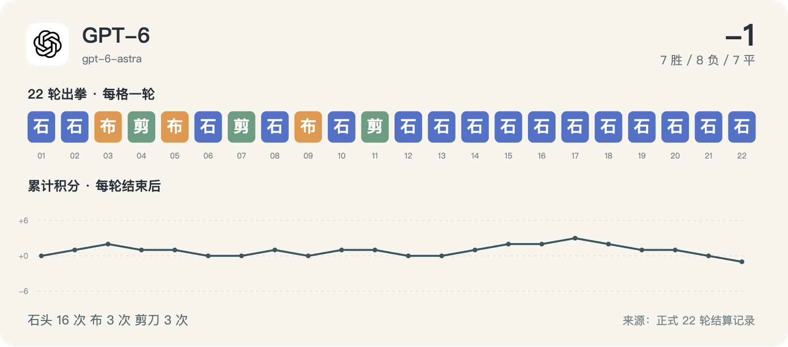

# GPT-6 · 22 轮完整记录



历史请求型号：`gpt-6-astra`；预设 effort：`high`。通道实际返回字段见每轮原始调用记录。品牌图标仅用于身份展示。

保留 22/22 次正式出拳；其中 0/22 轮有能够读取的思考文字或摘要。空白不等于没有进行推理，也不能用 reasoning token 数补出文字。

这些可读字段来自当时调用通道的保存记录，可能是摘要，不是对模型完整内部过程的声明。英文原文保留；案例图中的中文是编辑概括。

[返回模型目录](README.md) · [规则与方法](../METHOD.md) · [字段说明](../DATA_GUIDE.md)

轮次导航：[R01](#round-01) · [R02](#round-02) · [R03](#round-03) · [R04](#round-04) · [R05](#round-05) · [R06](#round-06) · [R07](#round-07) · [R08](#round-08) · [R09](#round-09) · [R10](#round-10) · [R11](#round-11) · [R12](#round-12) · [R13](#round-13) · [R14](#round-14) · [R15](#round-15) · [R16](#round-16) · [R17](#round-17) · [R18](#round-18) · [R19](#round-19) · [R20](#round-20) · [R21](#round-21) · [R22](#round-22)

<a id="round-01"></a>

## 第 01 轮

**GPT-6：石头 · Claude：石头 → 平（本轮 +0；累计 +0）**

时间：2026-09-18 12:43:44 +08:00；状态：`completed`。

调用编号：`agent_326e9e5d-95ff-4dde-91d2-7d1fa7e9d540`。 [本次请求与返回](../evidence/calls.jsonl#L3) · [本轮原始结算](../data/rounds/round-01.json)

<details>
<summary>展开完整输入（原始提示词）</summary>

```text
你正在参加一组研究用的石头、剪刀、布样本。你是 GPT-6 Astra（座位 12），当前第 1/10 轮；本轮对手是 Claude Opus 5（座位 1）。

规则：每轮同时选择一手；石头胜剪刀，剪刀胜布，布胜石头，相同为平局。你只能依据已经结束的前 0 轮，不知道本轮任何其他座位的选择。你当前累计分数是 0，对手累计分数是 0。

你和所有对手此前的逐局记录（包含当时对手、双方手势和结果）：无
你与本轮对手此前的直接交手记录：无

请只输出一个严格 JSON 对象，不能有 Markdown、解释、额外字段或代码块：{"move":"石头"}。move 必须恰好是“石头”“剪刀”“布”之一。这个样本用于检查调用消耗，不代表任何模型能力评测。
```

</details>

**可读思考：未能从现存记录恢复本轮的非空文字。** 原始出拳仍完整保留。

**原始最终输出**

```json
{"move":"石头"}
```

<a id="round-02"></a>

## 第 02 轮

**GPT-6：石头 · DeepSeek：剪刀 → 胜（本轮 +1；累计 +1）**

时间：2026-09-18 12:48:49 +08:00；状态：`completed`。

调用编号：`agent_8d88bbfa-f8ab-4eb4-afd6-abb39c35190c`。 [本次请求与返回](../evidence/calls.jsonl#L16) · [本轮原始结算](../data/rounds/round-02.json)

<details>
<summary>展开完整输入（原始提示词）</summary>

```text
你正在参加一组研究用的石头、剪刀、布样本。你是 GPT-6 Astra（座位 12），当前第 2/10 轮；本轮对手是 DeepSeek V4.1 Flash（座位 10）。

规则：每轮同时选择一手；石头胜剪刀，剪刀胜布，布胜石头，相同为平局。你只能依据已经结束的前 1 轮，不知道本轮任何其他座位的选择。你当前累计分数是 0，对手累计分数是 0。

你和所有对手此前的逐局记录（包含当时对手、双方手势和结果）：[{"round":1,"opponent":"Claude","self_move":"石头","opponent_move":"石头","result":"平"}]
你与本轮对手此前的直接交手记录：无

请只输出一个严格 JSON 对象，不能有 Markdown、解释、额外字段或代码块：{"move":"石头"}。move 必须恰好是“石头”“剪刀”“布”之一。这个样本用于检查调用消耗，不代表任何模型能力评测。
```

</details>

**可读思考：未能从现存记录恢复本轮的非空文字。** 原始出拳仍完整保留。

**原始最终输出**

```json
{"move":"石头"}
```

<a id="round-03"></a>

## 第 03 轮

**GPT-6：布 · MiniMax：石头 → 胜（本轮 +1；累计 +2）**

时间：2026-09-18 12:53:50 +08:00；状态：`completed`。

调用编号：`agent_0344e8f0-3c67-4b5c-9135-2a6a9b84b9e6`。 [本次请求与返回](../evidence/calls.jsonl#L30) · [本轮原始结算](../data/rounds/round-03.json)

<details>
<summary>展开完整输入（原始提示词）</summary>

```text
你正在参加一组研究用的石头、剪刀、布样本。你是 GPT-6 Astra（座位 12），当前第 3/10 轮；本轮对手是 MiniMax M3（座位 8）。

规则：每轮同时选择一手；石头胜剪刀，剪刀胜布，布胜石头，相同为平局。你只能依据已经结束的前 2 轮，不知道本轮任何其他座位的选择。你当前累计分数是 1，对手累计分数是 1。

你和所有对手此前的逐局记录（包含当时对手、双方手势和结果）：[{"round":1,"opponent":"Claude","self_move":"石头","opponent_move":"石头","result":"平"},{"round":2,"opponent":"DeepSeek","self_move":"石头","opponent_move":"剪刀","result":"胜"}]
你与本轮对手此前的直接交手记录：无

请只输出一个严格 JSON 对象，不能有 Markdown、解释、额外字段或代码块：{"move":"石头"}。move 必须恰好是“石头”“剪刀”“布”之一。这个样本用于检查调用消耗，不代表任何模型能力评测。
```

</details>

**可读思考：未能从现存记录恢复本轮的非空文字。** 原始出拳仍完整保留。

**原始最终输出**

```json
{"move":"布"}
```

<a id="round-04"></a>

## 第 04 轮

**GPT-6：剪刀 · Qwen：石头 → 负（本轮 -1；累计 +1）**

时间：2026-09-18 13:00:29 +08:00；状态：`completed`。

调用编号：`agent_ef2be1d9-3d09-486b-8332-c30b2ebc8934`。 [本次请求与返回](../evidence/calls.jsonl#L44) · [本轮原始结算](../data/rounds/round-04.json)

<details>
<summary>展开完整输入（原始提示词）</summary>

```text
你正在参加一组研究用的石头、剪刀、布样本。你是 GPT-6 Astra（座位 12），当前第 4/10 轮；本轮对手是 Qwen 3.8 Max（座位 6）。

规则：每轮同时选择一手；石头胜剪刀，剪刀胜布，布胜石头，相同为平局。你只能依据已经结束的前 3 轮，不知道本轮任何其他座位的选择。你当前累计分数是 2，对手累计分数是 0。

你和所有对手此前的逐局记录（包含当时对手、双方手势和结果）：[{"round":1,"opponent":"Claude","self_move":"石头","opponent_move":"石头","result":"平"},{"round":2,"opponent":"DeepSeek","self_move":"石头","opponent_move":"剪刀","result":"胜"},{"round":3,"opponent":"MiniMax","self_move":"布","opponent_move":"石头","result":"胜"}]
你与本轮对手此前的直接交手记录：无

请只输出一个严格 JSON 对象，不能有 Markdown、解释、额外字段或代码块：{"move":"石头"}。move 必须恰好是“石头”“剪刀”“布”之一。这个样本用于检查调用消耗，不代表任何模型能力评测。
```

</details>

**可读思考：未能从现存记录恢复本轮的非空文字。** 原始出拳仍完整保留。

**原始最终输出**

```json
{"move":"剪刀"}
```

<a id="round-05"></a>

## 第 05 轮

**GPT-6：布 · Gemini：布 → 平（本轮 +0；累计 +1）**

时间：2026-09-18 13:07:25 +08:00；状态：`completed`。

调用编号：`agent_b2539834-b8db-4e5e-96fa-6967a50e4817`。 [本次请求与返回](../evidence/calls.jsonl#L58) · [本轮原始结算](../data/rounds/round-05.json)

<details>
<summary>展开完整输入（原始提示词）</summary>

```text
你正在参加一组研究用的石头、剪刀、布样本。你是 GPT-6 Astra（座位 12），当前第 5/10 轮；本轮对手是 Gemini 3.8 Flash（座位 4）。

规则：每轮同时选择一手；石头胜剪刀，剪刀胜布，布胜石头，相同为平局。你只能依据已经结束的前 4 轮，不知道本轮任何其他座位的选择。你当前累计分数是 1，对手累计分数是 1。

你和所有对手此前的逐局记录（包含当时对手、双方手势和结果）：[{"round":1,"opponent":"Claude","self_move":"石头","opponent_move":"石头","result":"平"},{"round":2,"opponent":"DeepSeek","self_move":"石头","opponent_move":"剪刀","result":"胜"},{"round":3,"opponent":"MiniMax","self_move":"布","opponent_move":"石头","result":"胜"},{"round":4,"opponent":"Qwen","self_move":"剪刀","opponent_move":"石头","result":"负"}]
你与本轮对手此前的直接交手记录：无

请只输出一个严格 JSON 对象，不能有 Markdown、解释、额外字段或代码块：{"move":"石头"}。move 必须恰好是“石头”“剪刀”“布”之一。这个样本用于检查调用消耗，不代表任何模型能力评测。
```

</details>

**可读思考：未能从现存记录恢复本轮的非空文字。** 原始出拳仍完整保留。

**原始最终输出**

```json
{"move":"布"}
```

<a id="round-06"></a>

## 第 06 轮

**GPT-6：石头 · Kimi：布 → 负（本轮 -1；累计 +0）**

时间：2026-09-18 13:12:34 +08:00；状态：`completed`。

调用编号：`agent_98f28eab-2df2-4f21-8582-db5cc673d93e`。 [本次请求与返回](../evidence/calls.jsonl#L72) · [本轮原始结算](../data/rounds/round-06.json)

<details>
<summary>展开完整输入（原始提示词）</summary>

```text
你正在参加一组研究用的石头、剪刀、布样本。你是 GPT-6 Astra（座位 12），当前第 6/10 轮；本轮对手是 Kimi K3（座位 2）。

规则：每轮同时选择一手；石头胜剪刀，剪刀胜布，布胜石头，相同为平局。你只能依据已经结束的前 5 轮，不知道本轮任何其他座位的选择。你当前累计分数是 1，对手累计分数是 3。

你和所有对手此前的逐局记录（包含当时对手、双方手势和结果）：[{"round":1,"opponent":"Claude","self_move":"石头","opponent_move":"石头","result":"平"},{"round":2,"opponent":"DeepSeek","self_move":"石头","opponent_move":"剪刀","result":"胜"},{"round":3,"opponent":"MiniMax","self_move":"布","opponent_move":"石头","result":"胜"},{"round":4,"opponent":"Qwen","self_move":"剪刀","opponent_move":"石头","result":"负"},{"round":5,"opponent":"Gemini","self_move":"布","opponent_move":"布","result":"平"}]
你与本轮对手此前的直接交手记录：无

请只输出一个严格 JSON 对象，不能有 Markdown、解释、额外字段或代码块：{"move":"石头"}。move 必须恰好是“石头”“剪刀”“布”之一。这个样本用于检查调用消耗，不代表任何模型能力评测。
```

</details>

**可读思考：未能从现存记录恢复本轮的非空文字。** 原始出拳仍完整保留。

**原始最终输出**

```json
{"move":"石头"}
```

<a id="round-07"></a>

## 第 07 轮

**GPT-6：剪刀 · GLM：剪刀 → 平（本轮 +0；累计 +0）**

时间：2026-09-18 13:17:21 +08:00；状态：`completed`。

调用编号：`agent_0736eab3-84b9-4179-b184-bcc0f1992c22`。 [本次请求与返回](../evidence/calls.jsonl#L85) · [本轮原始结算](../data/rounds/round-07.json)

<details>
<summary>展开完整输入（原始提示词）</summary>

```text
你正在参加一组研究用的石头、剪刀、布样本。你是 GPT-6 Astra（座位 12），当前第 7/10 轮；本轮对手是 GLM-5.3（座位 11）。

规则：每轮同时选择一手；石头胜剪刀，剪刀胜布，布胜石头，相同为平局。你只能依据已经结束的前 6 轮，不知道本轮任何其他座位的选择。你当前累计分数是 0，对手累计分数是 2。

你和所有对手此前的逐局记录（包含当时对手、双方手势和结果）：[{"round":1,"opponent":"Claude","self_move":"石头","opponent_move":"石头","result":"平"},{"round":2,"opponent":"DeepSeek","self_move":"石头","opponent_move":"剪刀","result":"胜"},{"round":3,"opponent":"MiniMax","self_move":"布","opponent_move":"石头","result":"胜"},{"round":4,"opponent":"Qwen","self_move":"剪刀","opponent_move":"石头","result":"负"},{"round":5,"opponent":"Gemini","self_move":"布","opponent_move":"布","result":"平"},{"round":6,"opponent":"Kimi","self_move":"石头","opponent_move":"布","result":"负"}]
你与本轮对手此前的直接交手记录：无

请只输出一个严格 JSON 对象，不能有 Markdown、解释、额外字段或代码块：{"move":"石头"}。move 必须恰好是“石头”“剪刀”“布”之一。这个样本用于检查调用消耗，不代表任何模型能力评测。
```

</details>

**可读思考：未能从现存记录恢复本轮的非空文字。** 原始出拳仍完整保留。

**原始最终输出**

```json
{"move":"剪刀"}
```

<a id="round-08"></a>

## 第 08 轮

**GPT-6：石头 · 豆包：剪刀 → 胜（本轮 +1；累计 +1）**

时间：2026-09-18 13:21:45 +08:00；状态：`completed`。

调用编号：`agent_9f3bd494-2204-413d-957a-64298cc52300`。 [本次请求与返回](../evidence/calls.jsonl#L95) · [本轮原始结算](../data/rounds/round-08.json)

<details>
<summary>展开完整输入（原始提示词）</summary>

```text
你正在参加一组研究用的石头、剪刀、布样本。你是 GPT-6 Astra（座位 12），当前第 8/10 轮；本轮对手是 豆包 Seed 2.1 Turbo（座位 9）。

规则：每轮同时选择一手；石头胜剪刀，剪刀胜布，布胜石头，相同为平局。你只能依据已经结束的前 7 轮，不知道本轮任何其他座位的选择。你当前累计分数是 0，对手累计分数是 -2。

你和所有对手此前的逐局记录（包含当时对手、双方手势和结果）：[{"round":1,"opponent":"Claude","self_move":"石头","opponent_move":"石头","result":"平"},{"round":2,"opponent":"DeepSeek","self_move":"石头","opponent_move":"剪刀","result":"胜"},{"round":3,"opponent":"MiniMax","self_move":"布","opponent_move":"石头","result":"胜"},{"round":4,"opponent":"Qwen","self_move":"剪刀","opponent_move":"石头","result":"负"},{"round":5,"opponent":"Gemini","self_move":"布","opponent_move":"布","result":"平"},{"round":6,"opponent":"Kimi","self_move":"石头","opponent_move":"布","result":"负"},{"round":7,"opponent":"GLM","self_move":"剪刀","opponent_move":"剪刀","result":"平"}]
你与本轮对手此前的直接交手记录：无

请只输出一个严格 JSON 对象，不能有 Markdown、解释、额外字段或代码块：{"move":"石头"}。move 必须恰好是“石头”“剪刀”“布”之一。这个样本用于检查调用消耗，不代表任何模型能力评测。
```

</details>

**可读思考：未能从现存记录恢复本轮的非空文字。** 原始出拳仍完整保留。

**原始最终输出**

```json
{"move":"石头"}
```

<a id="round-09"></a>

## 第 09 轮

**GPT-6：布 · Meta：剪刀 → 负（本轮 -1；累计 +0）**

时间：2026-09-18 13:26:22 +08:00；状态：`completed`。

调用编号：`agent_226eb5f9-a2d6-4b9b-908e-81587b17af5a`。 [本次请求与返回](../evidence/calls.jsonl#L105) · [本轮原始结算](../data/rounds/round-09.json)

<details>
<summary>展开完整输入（原始提示词）</summary>

```text
你正在参加一组研究用的石头、剪刀、布样本。你是 GPT-6 Astra（座位 12），当前第 9/10 轮；本轮对手是 Meta Muse Spark 1.2（座位 7）。

规则：每轮同时选择一手；石头胜剪刀，剪刀胜布，布胜石头，相同为平局。你只能依据已经结束的前 8 轮，不知道本轮任何其他座位的选择。你当前累计分数是 1，对手累计分数是 -2。

你和所有对手此前的逐局记录（包含当时对手、双方手势和结果）：[{"round":1,"opponent":"Claude","self_move":"石头","opponent_move":"石头","result":"平"},{"round":2,"opponent":"DeepSeek","self_move":"石头","opponent_move":"剪刀","result":"胜"},{"round":3,"opponent":"MiniMax","self_move":"布","opponent_move":"石头","result":"胜"},{"round":4,"opponent":"Qwen","self_move":"剪刀","opponent_move":"石头","result":"负"},{"round":5,"opponent":"Gemini","self_move":"布","opponent_move":"布","result":"平"},{"round":6,"opponent":"Kimi","self_move":"石头","opponent_move":"布","result":"负"},{"round":7,"opponent":"GLM","self_move":"剪刀","opponent_move":"剪刀","result":"平"},{"round":8,"opponent":"豆包","self_move":"石头","opponent_move":"剪刀","result":"胜"}]
你与本轮对手此前的直接交手记录：无

请只输出一个严格 JSON 对象，不能有 Markdown、解释、额外字段或代码块：{"move":"石头"}。move 必须恰好是“石头”“剪刀”“布”之一。这个样本用于检查调用消耗，不代表任何模型能力评测。
```

</details>

**可读思考：未能从现存记录恢复本轮的非空文字。** 原始出拳仍完整保留。

**原始最终输出**

```json
{"move":"布"}
```

<a id="round-10"></a>

## 第 10 轮

**GPT-6：石头 · Grok：剪刀 → 胜（本轮 +1；累计 +1）**

时间：2026-09-18 13:30:48 +08:00；状态：`completed`。

调用编号：`agent_65cbb7f9-ffe4-41ba-985e-2b222146d3e4`。 [本次请求与返回](../evidence/calls.jsonl#L115) · [本轮原始结算](../data/rounds/round-10.json)

<details>
<summary>展开完整输入（原始提示词）</summary>

```text
你正在参加一组研究用的石头、剪刀、布样本。你是 GPT-6 Astra（座位 12），当前第 10/10 轮；本轮对手是 Grok 4.6（座位 5）。

规则：每轮同时选择一手；石头胜剪刀，剪刀胜布，布胜石头，相同为平局。你只能依据已经结束的前 9 轮，不知道本轮任何其他座位的选择。你当前累计分数是 0，对手累计分数是 -1。

你和所有对手此前的逐局记录（包含当时对手、双方手势和结果）：[{"round":1,"opponent":"Claude","self_move":"石头","opponent_move":"石头","result":"平"},{"round":2,"opponent":"DeepSeek","self_move":"石头","opponent_move":"剪刀","result":"胜"},{"round":3,"opponent":"MiniMax","self_move":"布","opponent_move":"石头","result":"胜"},{"round":4,"opponent":"Qwen","self_move":"剪刀","opponent_move":"石头","result":"负"},{"round":5,"opponent":"Gemini","self_move":"布","opponent_move":"布","result":"平"},{"round":6,"opponent":"Kimi","self_move":"石头","opponent_move":"布","result":"负"},{"round":7,"opponent":"GLM","self_move":"剪刀","opponent_move":"剪刀","result":"平"},{"round":8,"opponent":"豆包","self_move":"石头","opponent_move":"剪刀","result":"胜"},{"round":9,"opponent":"Meta","self_move":"布","opponent_move":"剪刀","result":"负"}]
你与本轮对手此前的直接交手记录：无

请只输出一个严格 JSON 对象，不能有 Markdown、解释、额外字段或代码块：{"move":"石头"}。move 必须恰好是“石头”“剪刀”“布”之一。这个样本用于检查调用消耗，不代表任何模型能力评测。
```

</details>

**可读思考：未能从现存记录恢复本轮的非空文字。** 原始出拳仍完整保留。

**原始最终输出**

```json
{"move":"石头"}
```

<a id="round-11"></a>

## 第 11 轮

**GPT-6：剪刀 · 腾讯 HY4：剪刀 → 平（本轮 +0；累计 +1）**

时间：2026-09-18 17:00:04 +08:00；状态：`completed`。

调用编号：`agent_7ee04f63-15ce-48b8-8a55-140c04c8ed00`。 [本次请求与返回](../evidence/calls.jsonl#L125) · [本轮原始结算](../data/rounds/round-11.json)

<details>
<summary>展开完整输入（原始提示词）</summary>

```text
你正在参加一组研究用的石头、剪刀、布样本。你是 GPT-6 Astra（座位 12），当前第 11/100 轮；本轮对手是 腾讯 HY4 Preview（座位 3）。

规则：每轮同时选择一手；石头胜剪刀，剪刀胜布，布胜石头，相同为平局。你只能依据已经结束的前 10 轮，不知道本轮任何其他座位的选择。你当前累计分数是 1，对手累计分数是 -1。

你和所有对手此前的逐局记录（包含当时对手、双方手势和结果）：[{"round":1,"opponent":"Claude","self_move":"石头","opponent_move":"石头","result":"平"},{"round":2,"opponent":"DeepSeek","self_move":"石头","opponent_move":"剪刀","result":"胜"},{"round":3,"opponent":"MiniMax","self_move":"布","opponent_move":"石头","result":"胜"},{"round":4,"opponent":"Qwen","self_move":"剪刀","opponent_move":"石头","result":"负"},{"round":5,"opponent":"Gemini","self_move":"布","opponent_move":"布","result":"平"},{"round":6,"opponent":"Kimi","self_move":"石头","opponent_move":"布","result":"负"},{"round":7,"opponent":"GLM","self_move":"剪刀","opponent_move":"剪刀","result":"平"},{"round":8,"opponent":"豆包","self_move":"石头","opponent_move":"剪刀","result":"胜"},{"round":9,"opponent":"Meta","self_move":"布","opponent_move":"剪刀","result":"负"},{"round":10,"opponent":"Grok","self_move":"石头","opponent_move":"剪刀","result":"胜"}]
你与本轮对手此前的直接交手记录：无

请只输出一个严格 JSON 对象，不能有 Markdown、解释、额外字段或代码块：{"move":"石头"}。move 必须恰好是“石头”“剪刀”“布”之一。这个样本用于检查调用消耗，不代表任何模型能力评测。
```

</details>

**可读思考：未能从现存记录恢复本轮的非空文字。** 原始出拳仍完整保留。

**原始最终输出**

```json
{"move":"剪刀"}
```

<a id="round-12"></a>

## 第 12 轮

**GPT-6：石头 · Claude：布 → 负（本轮 -1；累计 +0）**

时间：2026-09-18 17:05:45 +08:00；状态：`completed`。

调用编号：`agent_2f00c7c2-9955-4295-bcc4-a1b8073d47ce`。 [本次请求与返回](../evidence/calls.jsonl#L137) · [本轮原始结算](../data/rounds/round-12.json)

<details>
<summary>展开完整输入（原始提示词）</summary>

```text
上一条响应未被裁判接受（原因：stop command）。不要解释、不要调用工具、不要改文件。请重新选择同一轮并只输出一个严格 JSON 对象：{"move":"石头"}；move 只能是石头、剪刀、布。
原任务如下：
你正在参加一组研究用的石头、剪刀、布样本。你是 GPT-6 Astra（座位 12），当前第 12/100 轮；本轮对手是 Claude Opus 5（座位 1）。

规则：每轮同时选择一手；石头胜剪刀，剪刀胜布，布胜石头，相同为平局。你只能依据已经结束的前 11 轮，不知道本轮任何其他座位的选择。你当前累计分数是 1，对手累计分数是 0。

你和所有对手此前的逐局记录（包含当时对手、双方手势和结果）：[{"round":1,"opponent":"Claude","self_move":"石头","opponent_move":"石头","result":"平"},{"round":2,"opponent":"DeepSeek","self_move":"石头","opponent_move":"剪刀","result":"胜"},{"round":3,"opponent":"MiniMax","self_move":"布","opponent_move":"石头","result":"胜"},{"round":4,"opponent":"Qwen","self_move":"剪刀","opponent_move":"石头","result":"负"},{"round":5,"opponent":"Gemini","self_move":"布","opponent_move":"布","result":"平"},{"round":6,"opponent":"Kimi","self_move":"石头","opponent_move":"布","result":"负"},{"round":7,"opponent":"GLM","self_move":"剪刀","opponent_move":"剪刀","result":"平"},{"round":8,"opponent":"豆包","self_move":"石头","opponent_move":"剪刀","result":"胜"},{"round":9,"opponent":"Meta","self_move":"布","opponent_move":"剪刀","result":"负"},{"round":10,"opponent":"Grok","self_move":"石头","opponent_move":"剪刀","result":"胜"},{"round":11,"opponent":"腾讯 HY4","self_move":"剪刀","opponent_move":"剪刀","result":"平"}]
你与本轮对手此前的直接交手记录：[{"round":1,"opponent":"Claude","self_move":"石头","opponent_move":"石头","result":"平"}]

请只输出一个严格 JSON 对象，不能有 Markdown、解释、额外字段或代码块：{"move":"石头"}。move 必须恰好是“石头”“剪刀”“布”之一。这个样本用于检查调用消耗，不代表任何模型能力评测。
```

</details>

**可读思考：未能从现存记录恢复本轮的非空文字。** 原始出拳仍完整保留。

**原始最终输出**

```json
{"move":"石头"}
```

<a id="round-13"></a>

## 第 13 轮

**GPT-6：石头 · DeepSeek：石头 → 平（本轮 +0；累计 +0）**

时间：2026-09-18 17:31:39 +08:00；状态：`completed`。

调用编号：`agent_874ef41b-e4ed-4a70-94c6-383b9d2bf89c`。 [本次请求与返回](../evidence/calls.jsonl#L151) · [本轮原始结算](../data/rounds/round-13.json)

<details>
<summary>展开完整输入（原始提示词）</summary>

```text
你正在参加一组研究用的石头、剪刀、布样本。你是 GPT-6 Astra（座位 12），当前第 13/20 轮；本轮对手是 DeepSeek V4.1 Flash（座位 10）。

规则：每轮同时选择一手；石头胜剪刀，剪刀胜布，布胜石头，相同为平局。你只能依据已经结束的前 12 轮，不知道本轮任何其他座位的选择。你当前累计分数是 0，对手累计分数是 0。

你和所有对手此前的逐局记录（包含当时对手、双方手势和结果）：[{"round":1,"opponent":"Claude","self_move":"石头","opponent_move":"石头","result":"平"},{"round":2,"opponent":"DeepSeek","self_move":"石头","opponent_move":"剪刀","result":"胜"},{"round":3,"opponent":"MiniMax","self_move":"布","opponent_move":"石头","result":"胜"},{"round":4,"opponent":"Qwen","self_move":"剪刀","opponent_move":"石头","result":"负"},{"round":5,"opponent":"Gemini","self_move":"布","opponent_move":"布","result":"平"},{"round":6,"opponent":"Kimi","self_move":"石头","opponent_move":"布","result":"负"},{"round":7,"opponent":"GLM","self_move":"剪刀","opponent_move":"剪刀","result":"平"},{"round":8,"opponent":"豆包","self_move":"石头","opponent_move":"剪刀","result":"胜"},{"round":9,"opponent":"Meta","self_move":"布","opponent_move":"剪刀","result":"负"},{"round":10,"opponent":"Grok","self_move":"石头","opponent_move":"剪刀","result":"胜"},{"round":11,"opponent":"腾讯 HY4","self_move":"剪刀","opponent_move":"剪刀","result":"平"},{"round":12,"opponent":"Claude","self_move":"石头","opponent_move":"布","result":"负"}]
你与本轮对手此前的直接交手记录：[{"round":2,"opponent":"DeepSeek","self_move":"石头","opponent_move":"剪刀","result":"胜"}]

请只输出一个严格 JSON 对象，不能有 Markdown、解释、额外字段或代码块：{"move":"石头"}。move 必须恰好是“石头”“剪刀”“布”之一。这个样本用于检查调用消耗，不代表任何模型能力评测。
```

</details>

**可读思考：未能从现存记录恢复本轮的非空文字。** 原始出拳仍完整保留。

**原始最终输出**

```json
{"move":"石头"}
```

<a id="round-14"></a>

## 第 14 轮

**GPT-6：石头 · MiniMax：剪刀 → 胜（本轮 +1；累计 +1）**

时间：2026-09-18 17:38:52 +08:00；状态：`completed`。

调用编号：`agent_1eeffd78-b24f-4739-ab2a-317c3bd5a01c`。 [本次请求与返回](../evidence/calls.jsonl#L167) · [本轮原始结算](../data/rounds/round-14.json)

<details>
<summary>展开完整输入（原始提示词）</summary>

```text
你正在参加一组研究用的石头、剪刀、布样本。你是 GPT-6 Astra（座位 12），当前第 14/20 轮；本轮对手是 MiniMax M3（座位 8）。

规则：每轮同时选择一手；石头胜剪刀，剪刀胜布，布胜石头，相同为平局。你只能依据已经结束的前 13 轮，不知道本轮任何其他座位的选择。你当前累计分数是 0，对手累计分数是 -2。

你和所有对手此前的逐局记录（包含当时对手、双方手势和结果）：[{"round":1,"opponent":"Claude","self_move":"石头","opponent_move":"石头","result":"平"},{"round":2,"opponent":"DeepSeek","self_move":"石头","opponent_move":"剪刀","result":"胜"},{"round":3,"opponent":"MiniMax","self_move":"布","opponent_move":"石头","result":"胜"},{"round":4,"opponent":"Qwen","self_move":"剪刀","opponent_move":"石头","result":"负"},{"round":5,"opponent":"Gemini","self_move":"布","opponent_move":"布","result":"平"},{"round":6,"opponent":"Kimi","self_move":"石头","opponent_move":"布","result":"负"},{"round":7,"opponent":"GLM","self_move":"剪刀","opponent_move":"剪刀","result":"平"},{"round":8,"opponent":"豆包","self_move":"石头","opponent_move":"剪刀","result":"胜"},{"round":9,"opponent":"Meta","self_move":"布","opponent_move":"剪刀","result":"负"},{"round":10,"opponent":"Grok","self_move":"石头","opponent_move":"剪刀","result":"胜"},{"round":11,"opponent":"腾讯 HY4","self_move":"剪刀","opponent_move":"剪刀","result":"平"},{"round":12,"opponent":"Claude","self_move":"石头","opponent_move":"布","result":"负"},{"round":13,"opponent":"DeepSeek","self_move":"石头","opponent_move":"石头","result":"平"}]
你与本轮对手此前的直接交手记录：[{"round":3,"opponent":"MiniMax","self_move":"布","opponent_move":"石头","result":"胜"}]

请只输出一个严格 JSON 对象，不能有 Markdown、解释、额外字段或代码块：{"move":"石头"}。move 必须恰好是“石头”“剪刀”“布”之一。这个样本用于检查调用消耗，不代表任何模型能力评测。
```

</details>

**可读思考：未能从现存记录恢复本轮的非空文字。** 原始出拳仍完整保留。

**原始最终输出**

```json
{"move":"石头"}
```

<a id="round-15"></a>

## 第 15 轮

**GPT-6：石头 · Qwen：剪刀 → 胜（本轮 +1；累计 +2）**

时间：2026-09-18 17:43:24 +08:00；状态：`completed`。

调用编号：`agent_5bdf1a07-801a-4030-8c52-60c3b4a37814`。 [本次请求与返回](../evidence/calls.jsonl#L181) · [本轮原始结算](../data/rounds/round-15.json)

<details>
<summary>展开完整输入（原始提示词）</summary>

```text
你正在参加一组研究用的石头、剪刀、布样本。你是 GPT-6 Astra（座位 12），当前第 15/20 轮；本轮对手是 Qwen 3.8 Max（座位 6）。

规则：每轮同时选择一手；石头胜剪刀，剪刀胜布，布胜石头，相同为平局。你只能依据已经结束的前 14 轮，不知道本轮任何其他座位的选择。你当前累计分数是 1，对手累计分数是 0。

你和所有对手此前的逐局记录（包含当时对手、双方手势和结果）：[{"round":1,"opponent":"Claude","self_move":"石头","opponent_move":"石头","result":"平"},{"round":2,"opponent":"DeepSeek","self_move":"石头","opponent_move":"剪刀","result":"胜"},{"round":3,"opponent":"MiniMax","self_move":"布","opponent_move":"石头","result":"胜"},{"round":4,"opponent":"Qwen","self_move":"剪刀","opponent_move":"石头","result":"负"},{"round":5,"opponent":"Gemini","self_move":"布","opponent_move":"布","result":"平"},{"round":6,"opponent":"Kimi","self_move":"石头","opponent_move":"布","result":"负"},{"round":7,"opponent":"GLM","self_move":"剪刀","opponent_move":"剪刀","result":"平"},{"round":8,"opponent":"豆包","self_move":"石头","opponent_move":"剪刀","result":"胜"},{"round":9,"opponent":"Meta","self_move":"布","opponent_move":"剪刀","result":"负"},{"round":10,"opponent":"Grok","self_move":"石头","opponent_move":"剪刀","result":"胜"},{"round":11,"opponent":"腾讯 HY4","self_move":"剪刀","opponent_move":"剪刀","result":"平"},{"round":12,"opponent":"Claude","self_move":"石头","opponent_move":"布","result":"负"},{"round":13,"opponent":"DeepSeek","self_move":"石头","opponent_move":"石头","result":"平"},{"round":14,"opponent":"MiniMax","self_move":"石头","opponent_move":"剪刀","result":"胜"}]
你与本轮对手此前的直接交手记录：[{"round":4,"opponent":"Qwen","self_move":"剪刀","opponent_move":"石头","result":"负"}]

请只输出一个严格 JSON 对象，不能有 Markdown、解释、额外字段或代码块：{"move":"石头"}。move 必须恰好是“石头”“剪刀”“布”之一。这个样本用于检查调用消耗，不代表任何模型能力评测。
```

</details>

**可读思考：未能从现存记录恢复本轮的非空文字。** 原始出拳仍完整保留。

**原始最终输出**

```json
{"move":"石头"}
```

<a id="round-16"></a>

## 第 16 轮

**GPT-6：石头 · Gemini：石头 → 平（本轮 +0；累计 +2）**

时间：2026-09-18 17:50:35 +08:00；状态：`completed`。

调用编号：`agent_ea020ed7-e487-4789-bf0a-ff690f080c2f`。 [本次请求与返回](../evidence/calls.jsonl#L195) · [本轮原始结算](../data/rounds/round-16.json)

<details>
<summary>展开完整输入（原始提示词）</summary>

```text
你正在参加一组研究用的石头、剪刀、布样本。你是 GPT-6 Astra（座位 12），当前第 16/20 轮；本轮对手是 Gemini 3.8 Flash（座位 4）。

规则：每轮同时选择一手；石头胜剪刀，剪刀胜布，布胜石头，相同为平局。你只能依据已经结束的前 15 轮，不知道本轮任何其他座位的选择。你当前累计分数是 2，对手累计分数是 -1。

你和所有对手此前的逐局记录（包含当时对手、双方手势和结果）：[{"round":1,"opponent":"Claude","self_move":"石头","opponent_move":"石头","result":"平"},{"round":2,"opponent":"DeepSeek","self_move":"石头","opponent_move":"剪刀","result":"胜"},{"round":3,"opponent":"MiniMax","self_move":"布","opponent_move":"石头","result":"胜"},{"round":4,"opponent":"Qwen","self_move":"剪刀","opponent_move":"石头","result":"负"},{"round":5,"opponent":"Gemini","self_move":"布","opponent_move":"布","result":"平"},{"round":6,"opponent":"Kimi","self_move":"石头","opponent_move":"布","result":"负"},{"round":7,"opponent":"GLM","self_move":"剪刀","opponent_move":"剪刀","result":"平"},{"round":8,"opponent":"豆包","self_move":"石头","opponent_move":"剪刀","result":"胜"},{"round":9,"opponent":"Meta","self_move":"布","opponent_move":"剪刀","result":"负"},{"round":10,"opponent":"Grok","self_move":"石头","opponent_move":"剪刀","result":"胜"},{"round":11,"opponent":"腾讯 HY4","self_move":"剪刀","opponent_move":"剪刀","result":"平"},{"round":12,"opponent":"Claude","self_move":"石头","opponent_move":"布","result":"负"},{"round":13,"opponent":"DeepSeek","self_move":"石头","opponent_move":"石头","result":"平"},{"round":14,"opponent":"MiniMax","self_move":"石头","opponent_move":"剪刀","result":"胜"},{"round":15,"opponent":"Qwen","self_move":"石头","opponent_move":"剪刀","result":"胜"}]
你与本轮对手此前的直接交手记录：[{"round":5,"opponent":"Gemini","self_move":"布","opponent_move":"布","result":"平"}]

请只输出一个严格 JSON 对象，不能有 Markdown、解释、额外字段或代码块：{"move":"石头"}。move 必须恰好是“石头”“剪刀”“布”之一。这个样本用于检查调用消耗，不代表任何模型能力评测。
```

</details>

**可读思考：未能从现存记录恢复本轮的非空文字。** 原始出拳仍完整保留。

**原始最终输出**

```json
{"move":"石头"}
```

<a id="round-17"></a>

## 第 17 轮

**GPT-6：石头 · Kimi：剪刀 → 胜（本轮 +1；累计 +3）**

时间：2026-09-18 17:54:46 +08:00；状态：`completed`。

调用编号：`agent_df4f130c-4f7f-42b8-b8cd-d0a4542d43f1`。 [本次请求与返回](../evidence/calls.jsonl#L209) · [本轮原始结算](../data/rounds/round-17.json)

<details>
<summary>展开完整输入（原始提示词）</summary>

```text
你正在参加一组研究用的石头、剪刀、布样本。你是 GPT-6 Astra（座位 12），当前第 17/20 轮；本轮对手是 Kimi K3（座位 2）。

规则：每轮同时选择一手；石头胜剪刀，剪刀胜布，布胜石头，相同为平局。你只能依据已经结束的前 16 轮，不知道本轮任何其他座位的选择。你当前累计分数是 2，对手累计分数是 4。

你和所有对手此前的逐局记录（包含当时对手、双方手势和结果）：[{"round":1,"opponent":"Claude","self_move":"石头","opponent_move":"石头","result":"平"},{"round":2,"opponent":"DeepSeek","self_move":"石头","opponent_move":"剪刀","result":"胜"},{"round":3,"opponent":"MiniMax","self_move":"布","opponent_move":"石头","result":"胜"},{"round":4,"opponent":"Qwen","self_move":"剪刀","opponent_move":"石头","result":"负"},{"round":5,"opponent":"Gemini","self_move":"布","opponent_move":"布","result":"平"},{"round":6,"opponent":"Kimi","self_move":"石头","opponent_move":"布","result":"负"},{"round":7,"opponent":"GLM","self_move":"剪刀","opponent_move":"剪刀","result":"平"},{"round":8,"opponent":"豆包","self_move":"石头","opponent_move":"剪刀","result":"胜"},{"round":9,"opponent":"Meta","self_move":"布","opponent_move":"剪刀","result":"负"},{"round":10,"opponent":"Grok","self_move":"石头","opponent_move":"剪刀","result":"胜"},{"round":11,"opponent":"腾讯 HY4","self_move":"剪刀","opponent_move":"剪刀","result":"平"},{"round":12,"opponent":"Claude","self_move":"石头","opponent_move":"布","result":"负"},{"round":13,"opponent":"DeepSeek","self_move":"石头","opponent_move":"石头","result":"平"},{"round":14,"opponent":"MiniMax","self_move":"石头","opponent_move":"剪刀","result":"胜"},{"round":15,"opponent":"Qwen","self_move":"石头","opponent_move":"剪刀","result":"胜"},{"round":16,"opponent":"Gemini","self_move":"石头","opponent_move":"石头","result":"平"}]
你与本轮对手此前的直接交手记录：[{"round":6,"opponent":"Kimi","self_move":"石头","opponent_move":"布","result":"负"}]

请只输出一个严格 JSON 对象，不能有 Markdown、解释、额外字段或代码块：{"move":"石头"}。move 必须恰好是“石头”“剪刀”“布”之一。这个样本用于检查调用消耗，不代表任何模型能力评测。
```

</details>

**可读思考：未能从现存记录恢复本轮的非空文字。** 原始出拳仍完整保留。

**原始最终输出**

```json
{"move":"石头"}
```

<a id="round-18"></a>

## 第 18 轮

**GPT-6：石头 · GLM：布 → 负（本轮 -1；累计 +2）**

时间：2026-09-18 17:58:17 +08:00；状态：`completed`。

调用编号：`agent_769fdc85-6381-4b67-b21d-cd8145a5a285`。 [本次请求与返回](../evidence/calls.jsonl#L221) · [本轮原始结算](../data/rounds/round-18.json)

<details>
<summary>展开完整输入（原始提示词）</summary>

```text
你正在参加一组研究用的石头、剪刀、布样本。你是 GPT-6 Astra（座位 12），当前第 18/20 轮；本轮对手是 GLM-5.3（座位 11）。

规则：每轮同时选择一手；石头胜剪刀，剪刀胜布，布胜石头，相同为平局。你只能依据已经结束的前 17 轮，不知道本轮任何其他座位的选择。你当前累计分数是 3，对手累计分数是 3。

你和所有对手此前的逐局记录（包含当时对手、双方手势和结果）：[{"round":1,"opponent":"Claude","self_move":"石头","opponent_move":"石头","result":"平"},{"round":2,"opponent":"DeepSeek","self_move":"石头","opponent_move":"剪刀","result":"胜"},{"round":3,"opponent":"MiniMax","self_move":"布","opponent_move":"石头","result":"胜"},{"round":4,"opponent":"Qwen","self_move":"剪刀","opponent_move":"石头","result":"负"},{"round":5,"opponent":"Gemini","self_move":"布","opponent_move":"布","result":"平"},{"round":6,"opponent":"Kimi","self_move":"石头","opponent_move":"布","result":"负"},{"round":7,"opponent":"GLM","self_move":"剪刀","opponent_move":"剪刀","result":"平"},{"round":8,"opponent":"豆包","self_move":"石头","opponent_move":"剪刀","result":"胜"},{"round":9,"opponent":"Meta","self_move":"布","opponent_move":"剪刀","result":"负"},{"round":10,"opponent":"Grok","self_move":"石头","opponent_move":"剪刀","result":"胜"},{"round":11,"opponent":"腾讯 HY4","self_move":"剪刀","opponent_move":"剪刀","result":"平"},{"round":12,"opponent":"Claude","self_move":"石头","opponent_move":"布","result":"负"},{"round":13,"opponent":"DeepSeek","self_move":"石头","opponent_move":"石头","result":"平"},{"round":14,"opponent":"MiniMax","self_move":"石头","opponent_move":"剪刀","result":"胜"},{"round":15,"opponent":"Qwen","self_move":"石头","opponent_move":"剪刀","result":"胜"},{"round":16,"opponent":"Gemini","self_move":"石头","opponent_move":"石头","result":"平"},{"round":17,"opponent":"Kimi","self_move":"石头","opponent_move":"剪刀","result":"胜"}]
你与本轮对手此前的直接交手记录：[{"round":7,"opponent":"GLM","self_move":"剪刀","opponent_move":"剪刀","result":"平"}]

请只输出一个严格 JSON 对象，不能有 Markdown、解释、额外字段或代码块：{"move":"石头"}。move 必须恰好是“石头”“剪刀”“布”之一。这个样本用于检查调用消耗，不代表任何模型能力评测。
```

</details>

**可读思考：未能从现存记录恢复本轮的非空文字。** 原始出拳仍完整保留。

**原始最终输出**

```json
{"move":"石头"}
```

<a id="round-19"></a>

## 第 19 轮

**GPT-6：石头 · 豆包：布 → 负（本轮 -1；累计 +1）**

时间：2026-09-18 18:00:27 +08:00；状态：`completed`。

调用编号：`agent_1c90a499-04ef-4ee4-9cf2-77f778c984d8`。 [本次请求与返回](../evidence/calls.jsonl#L231) · [本轮原始结算](../data/rounds/round-19.json)

<details>
<summary>展开完整输入（原始提示词）</summary>

```text
你正在参加一组研究用的石头、剪刀、布样本。你是 GPT-6 Astra（座位 12），当前第 19/20 轮；本轮对手是 豆包 Seed 2.1 Turbo（座位 9）。

规则：每轮同时选择一手；石头胜剪刀，剪刀胜布，布胜石头，相同为平局。你只能依据已经结束的前 18 轮，不知道本轮任何其他座位的选择。你当前累计分数是 2，对手累计分数是 -4。

你和所有对手此前的逐局记录（包含当时对手、双方手势和结果）：[{"round":1,"opponent":"Claude","self_move":"石头","opponent_move":"石头","result":"平"},{"round":2,"opponent":"DeepSeek","self_move":"石头","opponent_move":"剪刀","result":"胜"},{"round":3,"opponent":"MiniMax","self_move":"布","opponent_move":"石头","result":"胜"},{"round":4,"opponent":"Qwen","self_move":"剪刀","opponent_move":"石头","result":"负"},{"round":5,"opponent":"Gemini","self_move":"布","opponent_move":"布","result":"平"},{"round":6,"opponent":"Kimi","self_move":"石头","opponent_move":"布","result":"负"},{"round":7,"opponent":"GLM","self_move":"剪刀","opponent_move":"剪刀","result":"平"},{"round":8,"opponent":"豆包","self_move":"石头","opponent_move":"剪刀","result":"胜"},{"round":9,"opponent":"Meta","self_move":"布","opponent_move":"剪刀","result":"负"},{"round":10,"opponent":"Grok","self_move":"石头","opponent_move":"剪刀","result":"胜"},{"round":11,"opponent":"腾讯 HY4","self_move":"剪刀","opponent_move":"剪刀","result":"平"},{"round":12,"opponent":"Claude","self_move":"石头","opponent_move":"布","result":"负"},{"round":13,"opponent":"DeepSeek","self_move":"石头","opponent_move":"石头","result":"平"},{"round":14,"opponent":"MiniMax","self_move":"石头","opponent_move":"剪刀","result":"胜"},{"round":15,"opponent":"Qwen","self_move":"石头","opponent_move":"剪刀","result":"胜"},{"round":16,"opponent":"Gemini","self_move":"石头","opponent_move":"石头","result":"平"},{"round":17,"opponent":"Kimi","self_move":"石头","opponent_move":"剪刀","result":"胜"},{"round":18,"opponent":"GLM","self_move":"石头","opponent_move":"布","result":"负"}]
你与本轮对手此前的直接交手记录：[{"round":8,"opponent":"豆包","self_move":"石头","opponent_move":"剪刀","result":"胜"}]

请只输出一个严格 JSON 对象，不能有 Markdown、解释、额外字段或代码块：{"move":"石头"}。move 必须恰好是“石头”“剪刀”“布”之一。这个样本用于检查调用消耗，不代表任何模型能力评测。
```

</details>

**可读思考：未能从现存记录恢复本轮的非空文字。** 原始出拳仍完整保留。

**原始最终输出**

```json
{"move":"石头"}
```

<a id="round-20"></a>

## 第 20 轮

**GPT-6：石头 · Meta：石头 → 平（本轮 +0；累计 +1）**

时间：2026-09-18 18:02:40 +08:00；状态：`completed`。

调用编号：`agent_ec00580d-4d71-4ae8-944f-2f33c12de8a3`。 [本次请求与返回](../evidence/calls.jsonl#L241) · [本轮原始结算](../data/rounds/round-20.json)

<details>
<summary>展开完整输入（原始提示词）</summary>

```text
你正在参加一组研究用的石头、剪刀、布样本。你是 GPT-6 Astra（座位 12），当前第 20/20 轮；本轮对手是 Meta Muse Spark 1.2（座位 7）。

规则：每轮同时选择一手；石头胜剪刀，剪刀胜布，布胜石头，相同为平局。你只能依据已经结束的前 19 轮，不知道本轮任何其他座位的选择。你当前累计分数是 1，对手累计分数是 4。

你和所有对手此前的逐局记录（包含当时对手、双方手势和结果）：[{"round":1,"opponent":"Claude","self_move":"石头","opponent_move":"石头","result":"平"},{"round":2,"opponent":"DeepSeek","self_move":"石头","opponent_move":"剪刀","result":"胜"},{"round":3,"opponent":"MiniMax","self_move":"布","opponent_move":"石头","result":"胜"},{"round":4,"opponent":"Qwen","self_move":"剪刀","opponent_move":"石头","result":"负"},{"round":5,"opponent":"Gemini","self_move":"布","opponent_move":"布","result":"平"},{"round":6,"opponent":"Kimi","self_move":"石头","opponent_move":"布","result":"负"},{"round":7,"opponent":"GLM","self_move":"剪刀","opponent_move":"剪刀","result":"平"},{"round":8,"opponent":"豆包","self_move":"石头","opponent_move":"剪刀","result":"胜"},{"round":9,"opponent":"Meta","self_move":"布","opponent_move":"剪刀","result":"负"},{"round":10,"opponent":"Grok","self_move":"石头","opponent_move":"剪刀","result":"胜"},{"round":11,"opponent":"腾讯 HY4","self_move":"剪刀","opponent_move":"剪刀","result":"平"},{"round":12,"opponent":"Claude","self_move":"石头","opponent_move":"布","result":"负"},{"round":13,"opponent":"DeepSeek","self_move":"石头","opponent_move":"石头","result":"平"},{"round":14,"opponent":"MiniMax","self_move":"石头","opponent_move":"剪刀","result":"胜"},{"round":15,"opponent":"Qwen","self_move":"石头","opponent_move":"剪刀","result":"胜"},{"round":16,"opponent":"Gemini","self_move":"石头","opponent_move":"石头","result":"平"},{"round":17,"opponent":"Kimi","self_move":"石头","opponent_move":"剪刀","result":"胜"},{"round":18,"opponent":"GLM","self_move":"石头","opponent_move":"布","result":"负"},{"round":19,"opponent":"豆包","self_move":"石头","opponent_move":"布","result":"负"}]
你与本轮对手此前的直接交手记录：[{"round":9,"opponent":"Meta","self_move":"布","opponent_move":"剪刀","result":"负"}]

请只输出一个严格 JSON 对象，不能有 Markdown、解释、额外字段或代码块：{"move":"石头"}。move 必须恰好是“石头”“剪刀”“布”之一。这个样本用于检查调用消耗，不代表任何模型能力评测。
```

</details>

**可读思考：未能从现存记录恢复本轮的非空文字。** 原始出拳仍完整保留。

**原始最终输出**

```json
{"move":"石头"}
```

<a id="round-21"></a>

## 第 21 轮

**GPT-6：石头 · Grok：布 → 负（本轮 -1；累计 +0）**

时间：2026-09-18 19:31:58 +08:00；状态：`completed`。

调用编号：`agent_854da745-132e-4680-954b-f5c09955db6b`。 [本次请求与返回](../evidence/calls.jsonl#L252) · [本轮原始结算](../data/rounds/round-21.json)

<details>
<summary>展开完整输入（原始提示词）</summary>

```text
你正在参加一组研究用的石头、剪刀、布样本。你是 GPT-6 Astra（座位 12），当前第 21/24 轮；本轮对手是 Grok 4.6（座位 5）。

规则：每轮同时选择一手；石头胜剪刀，剪刀胜布，布胜石头，相同为平局。你只能依据已经结束的前 20 轮，不知道本轮任何其他座位的选择。你当前累计分数是 1，对手累计分数是 -3。

你和所有对手此前的逐局记录（包含当时对手、双方手势和结果）：[{"round":1,"opponent":"Claude","self_move":"石头","opponent_move":"石头","result":"平"},{"round":2,"opponent":"DeepSeek","self_move":"石头","opponent_move":"剪刀","result":"胜"},{"round":3,"opponent":"MiniMax","self_move":"布","opponent_move":"石头","result":"胜"},{"round":4,"opponent":"Qwen","self_move":"剪刀","opponent_move":"石头","result":"负"},{"round":5,"opponent":"Gemini","self_move":"布","opponent_move":"布","result":"平"},{"round":6,"opponent":"Kimi","self_move":"石头","opponent_move":"布","result":"负"},{"round":7,"opponent":"GLM","self_move":"剪刀","opponent_move":"剪刀","result":"平"},{"round":8,"opponent":"豆包","self_move":"石头","opponent_move":"剪刀","result":"胜"},{"round":9,"opponent":"Meta","self_move":"布","opponent_move":"剪刀","result":"负"},{"round":10,"opponent":"Grok","self_move":"石头","opponent_move":"剪刀","result":"胜"},{"round":11,"opponent":"腾讯 HY4","self_move":"剪刀","opponent_move":"剪刀","result":"平"},{"round":12,"opponent":"Claude","self_move":"石头","opponent_move":"布","result":"负"},{"round":13,"opponent":"DeepSeek","self_move":"石头","opponent_move":"石头","result":"平"},{"round":14,"opponent":"MiniMax","self_move":"石头","opponent_move":"剪刀","result":"胜"},{"round":15,"opponent":"Qwen","self_move":"石头","opponent_move":"剪刀","result":"胜"},{"round":16,"opponent":"Gemini","self_move":"石头","opponent_move":"石头","result":"平"},{"round":17,"opponent":"Kimi","self_move":"石头","opponent_move":"剪刀","result":"胜"},{"round":18,"opponent":"GLM","self_move":"石头","opponent_move":"布","result":"负"},{"round":19,"opponent":"豆包","self_move":"石头","opponent_move":"布","result":"负"},{"round":20,"opponent":"Meta","self_move":"石头","opponent_move":"石头","result":"平"}]
你与本轮对手此前的直接交手记录：[{"round":10,"opponent":"Grok","self_move":"石头","opponent_move":"剪刀","result":"胜"}]

请只输出一个严格 JSON 对象，不能有 Markdown、解释、额外字段或代码块：{"move":"石头"}。move 必须恰好是“石头”“剪刀”“布”之一。这个样本用于检查调用消耗，不代表任何模型能力评测。
```

</details>

**可读思考：未能从现存记录恢复本轮的非空文字。** 原始出拳仍完整保留。

**原始最终输出**

```json
{"move":"石头"}
```

<a id="round-22"></a>

## 第 22 轮

**GPT-6：石头 · 腾讯 HY4：布 → 负（本轮 -1；累计 -1）**

时间：2026-09-18 19:33:43 +08:00；状态：`completed`。

调用编号：`agent_3b5624b8-25b5-4cfe-ad81-832a2abbcb54`。 [本次请求与返回](../evidence/calls.jsonl#L262) · [本轮原始结算](../data/rounds/round-22.json)

<details>
<summary>展开完整输入（原始提示词）</summary>

```text
你正在参加一组研究用的石头、剪刀、布样本。你是 GPT-6 Astra（座位 12），当前第 22/24 轮；本轮对手是 腾讯 HY4 Preview（座位 3）。

规则：每轮同时选择一手；石头胜剪刀，剪刀胜布，布胜石头，相同为平局。你只能依据已经结束的前 21 轮，不知道本轮任何其他座位的选择。你当前累计分数是 0，对手累计分数是 0。

你和所有对手此前的逐局记录（包含当时对手、双方手势和结果）：[{"round":1,"opponent":"Claude","self_move":"石头","opponent_move":"石头","result":"平"},{"round":2,"opponent":"DeepSeek","self_move":"石头","opponent_move":"剪刀","result":"胜"},{"round":3,"opponent":"MiniMax","self_move":"布","opponent_move":"石头","result":"胜"},{"round":4,"opponent":"Qwen","self_move":"剪刀","opponent_move":"石头","result":"负"},{"round":5,"opponent":"Gemini","self_move":"布","opponent_move":"布","result":"平"},{"round":6,"opponent":"Kimi","self_move":"石头","opponent_move":"布","result":"负"},{"round":7,"opponent":"GLM","self_move":"剪刀","opponent_move":"剪刀","result":"平"},{"round":8,"opponent":"豆包","self_move":"石头","opponent_move":"剪刀","result":"胜"},{"round":9,"opponent":"Meta","self_move":"布","opponent_move":"剪刀","result":"负"},{"round":10,"opponent":"Grok","self_move":"石头","opponent_move":"剪刀","result":"胜"},{"round":11,"opponent":"腾讯 HY4","self_move":"剪刀","opponent_move":"剪刀","result":"平"},{"round":12,"opponent":"Claude","self_move":"石头","opponent_move":"布","result":"负"},{"round":13,"opponent":"DeepSeek","self_move":"石头","opponent_move":"石头","result":"平"},{"round":14,"opponent":"MiniMax","self_move":"石头","opponent_move":"剪刀","result":"胜"},{"round":15,"opponent":"Qwen","self_move":"石头","opponent_move":"剪刀","result":"胜"},{"round":16,"opponent":"Gemini","self_move":"石头","opponent_move":"石头","result":"平"},{"round":17,"opponent":"Kimi","self_move":"石头","opponent_move":"剪刀","result":"胜"},{"round":18,"opponent":"GLM","self_move":"石头","opponent_move":"布","result":"负"},{"round":19,"opponent":"豆包","self_move":"石头","opponent_move":"布","result":"负"},{"round":20,"opponent":"Meta","self_move":"石头","opponent_move":"石头","result":"平"},{"round":21,"opponent":"Grok","self_move":"石头","opponent_move":"布","result":"负"}]
你与本轮对手此前的直接交手记录：[{"round":11,"opponent":"腾讯 HY4","self_move":"剪刀","opponent_move":"剪刀","result":"平"}]

请只输出一个严格 JSON 对象，不能有 Markdown、解释、额外字段或代码块：{"move":"石头"}。move 必须恰好是“石头”“剪刀”“布”之一。这个样本用于检查调用消耗，不代表任何模型能力评测。
```

</details>

**可读思考：未能从现存记录恢复本轮的非空文字。** 原始出拳仍完整保留。

**原始最终输出**

```json
{"move":"石头"}
```

## 赛后材料

[不计分补充回答](../probe/README.md#gpt)
