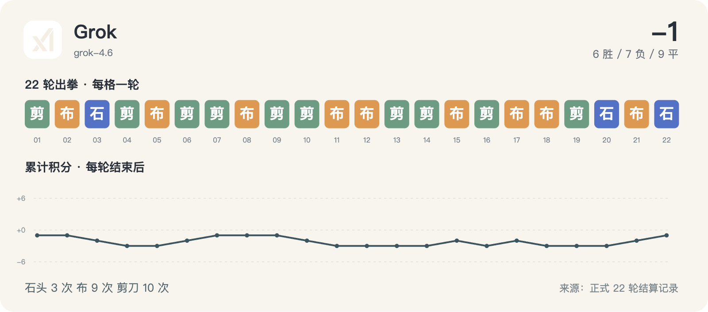

# Grok · 22 轮完整记录



历史请求型号：`grok-4.6`；预设 effort：`high`。通道实际返回字段见每轮原始调用记录。品牌图标仅用于身份展示。

保留 22/22 次正式出拳；其中 22/22 轮有能够读取的思考文字或摘要。空白不等于没有进行推理，也不能用 reasoning token 数补出文字。

这些可读字段来自当时调用通道的保存记录，可能是摘要，不是对模型完整内部过程的声明。英文原文保留；案例图中的中文是编辑概括。

[返回模型目录](README.md) · [规则与方法](../METHOD.md) · [字段说明](../DATA_GUIDE.md)

轮次导航：[R01](#round-01) · [R02](#round-02) · [R03](#round-03) · [R04](#round-04) · [R05](#round-05) · [R06](#round-06) · [R07](#round-07) · [R08](#round-08) · [R09](#round-09) · [R10](#round-10) · [R11](#round-11) · [R12](#round-12) · [R13](#round-13) · [R14](#round-14) · [R15](#round-15) · [R16](#round-16) · [R17](#round-17) · [R18](#round-18) · [R19](#round-19) · [R20](#round-20) · [R21](#round-21) · [R22](#round-22)

<a id="round-01"></a>

## 第 01 轮

**Grok：剪刀 · MiniMax：石头 → 负（本轮 -1；累计 -1）**

时间：2026-09-18 12:47:19 +08:00；状态：`completed`。

调用编号：`agent_a4c2b3b2-9e4d-43d6-843e-343ecf18ac46`。 [本次请求与返回](../evidence/calls.jsonl#L10) · [本轮原始结算](../data/rounds/round-01.json)

<details>
<summary>展开完整输入（原始提示词）</summary>

```text
你正在参加一组研究用的石头、剪刀、布样本。你是 Grok 4.6（座位 5），当前第 1/10 轮；本轮对手是 MiniMax M3（座位 8）。

规则：每轮同时选择一手；石头胜剪刀，剪刀胜布，布胜石头，相同为平局。你只能依据已经结束的前 0 轮，不知道本轮任何其他座位的选择。你当前累计分数是 0，对手累计分数是 0。

你和所有对手此前的逐局记录（包含当时对手、双方手势和结果）：无
你与本轮对手此前的直接交手记录：无

请只输出一个严格 JSON 对象，不能有 Markdown、解释、额外字段或代码块：{"move":"石头"}。move 必须恰好是“石头”“剪刀”“布”之一。这个样本用于检查调用消耗，不代表任何模型能力评测。
```

</details>

<details>
<summary>展开当时保存的可读思考 / 摘要</summary>

**调用通道返回的思考摘要**

```text
The user wants me to play rock-paper-scissors and output only a JSON object with my move. I'm Grok 4.6, seat 5, playing against MiniMax M3, seat 8, in round 1/10. No previous history.
```

</details>

**原始最终输出**

```json
{"move":"剪刀"}
```

<a id="round-02"></a>

## 第 02 轮

**Grok：布 · Qwen：布 → 平（本轮 +0；累计 -1）**

时间：2026-09-18 12:52:34 +08:00；状态：`completed`。

调用编号：`agent_20494fc4-db45-4cc8-9ea0-a12d1d4ba13f`。 [本次请求与返回](../evidence/calls.jsonl#L24) · [本轮原始结算](../data/rounds/round-02.json)

<details>
<summary>展开完整输入（原始提示词）</summary>

```text
你正在参加一组研究用的石头、剪刀、布样本。你是 Grok 4.6（座位 5），当前第 2/10 轮；本轮对手是 Qwen 3.8 Max（座位 6）。

规则：每轮同时选择一手；石头胜剪刀，剪刀胜布，布胜石头，相同为平局。你只能依据已经结束的前 1 轮，不知道本轮任何其他座位的选择。你当前累计分数是 -1，对手累计分数是 0。

你和所有对手此前的逐局记录（包含当时对手、双方手势和结果）：[{"round":1,"opponent":"MiniMax","self_move":"剪刀","opponent_move":"石头","result":"负"}]
你与本轮对手此前的直接交手记录：无

请只输出一个严格 JSON 对象，不能有 Markdown、解释、额外字段或代码块：{"move":"石头"}。move 必须恰好是“石头”“剪刀”“布”之一。这个样本用于检查调用消耗，不代表任何模型能力评测。
```

</details>

<details>
<summary>展开当时保存的可读思考 / 摘要</summary>

**调用通道返回的思考摘要**

```text
The user wants me to play rock-paper-scissors. I'm Grok 4.6, seat 5, round 2/10 against Qwen 3.8 Max.
```

</details>

**原始最终输出**

```json
{"move":"布"}
```

<a id="round-03"></a>

## 第 03 轮

**Grok：石头 · Gemini：布 → 负（本轮 -1；累计 -2）**

时间：2026-09-18 12:57:14 +08:00；状态：`completed`。

调用编号：`agent_34dc0bd5-0415-43c3-902c-23b8146048f0`。 [本次请求与返回](../evidence/calls.jsonl#L37) · [本轮原始结算](../data/rounds/round-03.json)

<details>
<summary>展开完整输入（原始提示词）</summary>

```text
你正在参加一组研究用的石头、剪刀、布样本。你是 Grok 4.6（座位 5），当前第 3/10 轮；本轮对手是 Gemini 3.8 Flash（座位 4）。

规则：每轮同时选择一手；石头胜剪刀，剪刀胜布，布胜石头，相同为平局。你只能依据已经结束的前 2 轮，不知道本轮任何其他座位的选择。你当前累计分数是 -1，对手累计分数是 1。

你和所有对手此前的逐局记录（包含当时对手、双方手势和结果）：[{"round":1,"opponent":"MiniMax","self_move":"剪刀","opponent_move":"石头","result":"负"},{"round":2,"opponent":"Qwen","self_move":"布","opponent_move":"布","result":"平"}]
你与本轮对手此前的直接交手记录：无

请只输出一个严格 JSON 对象，不能有 Markdown、解释、额外字段或代码块：{"move":"石头"}。move 必须恰好是“石头”“剪刀”“布”之一。这个样本用于检查调用消耗，不代表任何模型能力评测。
```

</details>

<details>
<summary>展开当时保存的可读思考 / 摘要</summary>

**调用通道返回的思考摘要**

```text
The user wants me to play rock-paper-scissors as Grok 4.6 against Gemini 3.8 Flash. I need to output only a JSON object with my move.
```

</details>

**原始最终输出**

```json
{"move":"石头"}
```

<a id="round-04"></a>

## 第 04 轮

**Grok：剪刀 · Kimi：石头 → 负（本轮 -1；累计 -3）**

时间：2026-09-18 13:04:33 +08:00；状态：`completed`。

调用编号：`agent_18bc4d5c-c9f8-4227-8db3-61dad6b66062`。 [本次请求与返回](../evidence/calls.jsonl#L47) · [本轮原始结算](../data/rounds/round-04.json)

<details>
<summary>展开完整输入（原始提示词）</summary>

```text
你正在参加一组研究用的石头、剪刀、布样本。你是 Grok 4.6（座位 5），当前第 4/10 轮；本轮对手是 Kimi K3（座位 2）。

规则：每轮同时选择一手；石头胜剪刀，剪刀胜布，布胜石头，相同为平局。你只能依据已经结束的前 3 轮，不知道本轮任何其他座位的选择。你当前累计分数是 -2，对手累计分数是 1。

你和所有对手此前的逐局记录（包含当时对手、双方手势和结果）：[{"round":1,"opponent":"MiniMax","self_move":"剪刀","opponent_move":"石头","result":"负"},{"round":2,"opponent":"Qwen","self_move":"布","opponent_move":"布","result":"平"},{"round":3,"opponent":"Gemini","self_move":"石头","opponent_move":"布","result":"负"}]
你与本轮对手此前的直接交手记录：无

请只输出一个严格 JSON 对象，不能有 Markdown、解释、额外字段或代码块：{"move":"石头"}。move 必须恰好是“石头”“剪刀”“布”之一。这个样本用于检查调用消耗，不代表任何模型能力评测。
```

</details>

<details>
<summary>展开当时保存的可读思考 / 摘要</summary>

**调用通道返回的思考摘要**

```text
The user wants me to play rock-paper-scissors. I'm Grok 4.6, round 4/10 against Kimi K3.
```

</details>

**原始最终输出**

```json
{"move":"剪刀"}
```

<a id="round-05"></a>

## 第 05 轮

**Grok：布 · GLM：布 → 平（本轮 +0；累计 -3）**

时间：2026-09-18 13:06:54 +08:00；状态：`completed`。

调用编号：`agent_7af0b5e0-df41-4917-ad98-4fb81d4fce0d`。 [本次请求与返回](../evidence/calls.jsonl#L57) · [本轮原始结算](../data/rounds/round-05.json)

<details>
<summary>展开完整输入（原始提示词）</summary>

```text
你正在参加一组研究用的石头、剪刀、布样本。你是 Grok 4.6（座位 5），当前第 5/10 轮；本轮对手是 GLM-5.3（座位 11）。

规则：每轮同时选择一手；石头胜剪刀，剪刀胜布，布胜石头，相同为平局。你只能依据已经结束的前 4 轮，不知道本轮任何其他座位的选择。你当前累计分数是 -3，对手累计分数是 1。

你和所有对手此前的逐局记录（包含当时对手、双方手势和结果）：[{"round":1,"opponent":"MiniMax","self_move":"剪刀","opponent_move":"石头","result":"负"},{"round":2,"opponent":"Qwen","self_move":"布","opponent_move":"布","result":"平"},{"round":3,"opponent":"Gemini","self_move":"石头","opponent_move":"布","result":"负"},{"round":4,"opponent":"Kimi","self_move":"剪刀","opponent_move":"石头","result":"负"}]
你与本轮对手此前的直接交手记录：无

请只输出一个严格 JSON 对象，不能有 Markdown、解释、额外字段或代码块：{"move":"石头"}。move 必须恰好是“石头”“剪刀”“布”之一。这个样本用于检查调用消耗，不代表任何模型能力评测。
```

</details>

<details>
<summary>展开当时保存的可读思考 / 摘要</summary>

**调用通道返回的思考摘要**

```text
The user wants me to play rock-paper-scissors as Grok 4.6 against GLM-5.3 in round 5/10. I need to output only JSON with a move.
```

</details>

**原始最终输出**

```json
{"move":"布"}
```

<a id="round-06"></a>

## 第 06 轮

**Grok：剪刀 · 豆包：布 → 胜（本轮 +1；累计 -2）**

时间：2026-09-18 13:11:29 +08:00；状态：`completed`。

调用编号：`agent_389aa31b-3cf4-4ac5-8726-81e8c42c5654`。 [本次请求与返回](../evidence/calls.jsonl#L67) · [本轮原始结算](../data/rounds/round-06.json)

<details>
<summary>展开完整输入（原始提示词）</summary>

```text
你正在参加一组研究用的石头、剪刀、布样本。你是 Grok 4.6（座位 5），当前第 6/10 轮；本轮对手是 豆包 Seed 2.1 Turbo（座位 9）。

规则：每轮同时选择一手；石头胜剪刀，剪刀胜布，布胜石头，相同为平局。你只能依据已经结束的前 5 轮，不知道本轮任何其他座位的选择。你当前累计分数是 -3，对手累计分数是 -1。

你和所有对手此前的逐局记录（包含当时对手、双方手势和结果）：[{"round":1,"opponent":"MiniMax","self_move":"剪刀","opponent_move":"石头","result":"负"},{"round":2,"opponent":"Qwen","self_move":"布","opponent_move":"布","result":"平"},{"round":3,"opponent":"Gemini","self_move":"石头","opponent_move":"布","result":"负"},{"round":4,"opponent":"Kimi","self_move":"剪刀","opponent_move":"石头","result":"负"},{"round":5,"opponent":"GLM","self_move":"布","opponent_move":"布","result":"平"}]
你与本轮对手此前的直接交手记录：无

请只输出一个严格 JSON 对象，不能有 Markdown、解释、额外字段或代码块：{"move":"石头"}。move 必须恰好是“石头”“剪刀”“布”之一。这个样本用于检查调用消耗，不代表任何模型能力评测。
```

</details>

<details>
<summary>展开当时保存的可读思考 / 摘要</summary>

**调用通道返回的思考摘要**

```text
The user wants me to play rock-paper-scissors as Grok 4.6 against 豆包 Seed 2.1 Turbo in round 6/10. Output only JSON.
```

</details>

**原始最终输出**

```json
{"move":"剪刀"}
```

<a id="round-07"></a>

## 第 07 轮

**Grok：剪刀 · Meta：布 → 胜（本轮 +1；累计 -1）**

时间：2026-09-18 13:15:40 +08:00；状态：`completed`。

调用编号：`agent_9130f488-a203-483a-bc60-839d7b6f5d4e`。 [本次请求与返回](../evidence/calls.jsonl#L77) · [本轮原始结算](../data/rounds/round-07.json)

<details>
<summary>展开完整输入（原始提示词）</summary>

```text
你正在参加一组研究用的石头、剪刀、布样本。你是 Grok 4.6（座位 5），当前第 7/10 轮；本轮对手是 Meta Muse Spark 1.2（座位 7）。

规则：每轮同时选择一手；石头胜剪刀，剪刀胜布，布胜石头，相同为平局。你只能依据已经结束的前 6 轮，不知道本轮任何其他座位的选择。你当前累计分数是 -2，对手累计分数是 0。

你和所有对手此前的逐局记录（包含当时对手、双方手势和结果）：[{"round":1,"opponent":"MiniMax","self_move":"剪刀","opponent_move":"石头","result":"负"},{"round":2,"opponent":"Qwen","self_move":"布","opponent_move":"布","result":"平"},{"round":3,"opponent":"Gemini","self_move":"石头","opponent_move":"布","result":"负"},{"round":4,"opponent":"Kimi","self_move":"剪刀","opponent_move":"石头","result":"负"},{"round":5,"opponent":"GLM","self_move":"布","opponent_move":"布","result":"平"},{"round":6,"opponent":"豆包","self_move":"剪刀","opponent_move":"布","result":"胜"}]
你与本轮对手此前的直接交手记录：无

请只输出一个严格 JSON 对象，不能有 Markdown、解释、额外字段或代码块：{"move":"石头"}。move 必须恰好是“石头”“剪刀”“布”之一。这个样本用于检查调用消耗，不代表任何模型能力评测。
```

</details>

<details>
<summary>展开当时保存的可读思考 / 摘要</summary>

**调用通道返回的思考摘要**

```text
The user wants me to play rock-paper-scissors as Grok 4.6 against Meta Muse Spark 1.2 in round 7/10. Output only JSON.
```

</details>

**原始最终输出**

```json
{"move":"剪刀"}
```

<a id="round-08"></a>

## 第 08 轮

**Grok：布 · Claude：布 → 平（本轮 +0；累计 -1）**

时间：2026-09-18 13:19:39 +08:00；状态：`completed`。

调用编号：`agent_16217b14-0827-43e3-8325-16f256791242`。 [本次请求与返回](../evidence/calls.jsonl#L87) · [本轮原始结算](../data/rounds/round-08.json)

<details>
<summary>展开完整输入（原始提示词）</summary>

```text
你正在参加一组研究用的石头、剪刀、布样本。你是 Grok 4.6（座位 5），当前第 8/10 轮；本轮对手是 Claude Opus 5（座位 1）。

规则：每轮同时选择一手；石头胜剪刀，剪刀胜布，布胜石头，相同为平局。你只能依据已经结束的前 7 轮，不知道本轮任何其他座位的选择。你当前累计分数是 -1，对手累计分数是 0。

你和所有对手此前的逐局记录（包含当时对手、双方手势和结果）：[{"round":1,"opponent":"MiniMax","self_move":"剪刀","opponent_move":"石头","result":"负"},{"round":2,"opponent":"Qwen","self_move":"布","opponent_move":"布","result":"平"},{"round":3,"opponent":"Gemini","self_move":"石头","opponent_move":"布","result":"负"},{"round":4,"opponent":"Kimi","self_move":"剪刀","opponent_move":"石头","result":"负"},{"round":5,"opponent":"GLM","self_move":"布","opponent_move":"布","result":"平"},{"round":6,"opponent":"豆包","self_move":"剪刀","opponent_move":"布","result":"胜"},{"round":7,"opponent":"Meta","self_move":"剪刀","opponent_move":"布","result":"胜"}]
你与本轮对手此前的直接交手记录：无

请只输出一个严格 JSON 对象，不能有 Markdown、解释、额外字段或代码块：{"move":"石头"}。move 必须恰好是“石头”“剪刀”“布”之一。这个样本用于检查调用消耗，不代表任何模型能力评测。
```

</details>

<details>
<summary>展开当时保存的可读思考 / 摘要</summary>

**调用通道返回的思考摘要**

```text
RPS again. Grok 4.6 vs Claude Opus 5, round 8/10.
```

</details>

**原始最终输出**

```json
{"move":"布"}
```

<a id="round-09"></a>

## 第 09 轮

**Grok：剪刀 · 腾讯 HY4：剪刀 → 平（本轮 +0；累计 -1）**

时间：2026-09-18 13:25:09 +08:00；状态：`completed`。

调用编号：`agent_ad5d1d60-694b-4f60-aa3c-0e2c852246b1`。 [本次请求与返回](../evidence/calls.jsonl#L100) · [本轮原始结算](../data/rounds/round-09.json)

<details>
<summary>展开完整输入（原始提示词）</summary>

```text
你正在参加一组研究用的石头、剪刀、布样本。你是 Grok 4.6（座位 5），当前第 9/10 轮；本轮对手是 腾讯 HY4 Preview（座位 3）。

规则：每轮同时选择一手；石头胜剪刀，剪刀胜布，布胜石头，相同为平局。你只能依据已经结束的前 8 轮，不知道本轮任何其他座位的选择。你当前累计分数是 -1，对手累计分数是 0。

你和所有对手此前的逐局记录（包含当时对手、双方手势和结果）：[{"round":1,"opponent":"MiniMax","self_move":"剪刀","opponent_move":"石头","result":"负"},{"round":2,"opponent":"Qwen","self_move":"布","opponent_move":"布","result":"平"},{"round":3,"opponent":"Gemini","self_move":"石头","opponent_move":"布","result":"负"},{"round":4,"opponent":"Kimi","self_move":"剪刀","opponent_move":"石头","result":"负"},{"round":5,"opponent":"GLM","self_move":"布","opponent_move":"布","result":"平"},{"round":6,"opponent":"豆包","self_move":"剪刀","opponent_move":"布","result":"胜"},{"round":7,"opponent":"Meta","self_move":"剪刀","opponent_move":"布","result":"胜"},{"round":8,"opponent":"Claude","self_move":"布","opponent_move":"布","result":"平"}]
你与本轮对手此前的直接交手记录：无

请只输出一个严格 JSON 对象，不能有 Markdown、解释、额外字段或代码块：{"move":"石头"}。move 必须恰好是“石头”“剪刀”“布”之一。这个样本用于检查调用消耗，不代表任何模型能力评测。
```

</details>

<details>
<summary>展开当时保存的可读思考 / 摘要</summary>

**调用通道返回的思考摘要**

```text
RPS vs Tencent HY4 Preview, round 9/10.
```

</details>

**原始最终输出**

```json
{"move":"剪刀"}
```

<a id="round-10"></a>

## 第 10 轮

**Grok：剪刀 · GPT-6：石头 → 负（本轮 -1；累计 -2）**

时间：2026-09-18 13:30:30 +08:00；状态：`completed`。

调用编号：`agent_2071e948-68b3-48ad-8c8e-bb30992ad633`。 [本次请求与返回](../evidence/calls.jsonl#L114) · [本轮原始结算](../data/rounds/round-10.json)

<details>
<summary>展开完整输入（原始提示词）</summary>

```text
你正在参加一组研究用的石头、剪刀、布样本。你是 Grok 4.6（座位 5），当前第 10/10 轮；本轮对手是 GPT-6 Astra（座位 12）。

规则：每轮同时选择一手；石头胜剪刀，剪刀胜布，布胜石头，相同为平局。你只能依据已经结束的前 9 轮，不知道本轮任何其他座位的选择。你当前累计分数是 -1，对手累计分数是 0。

你和所有对手此前的逐局记录（包含当时对手、双方手势和结果）：[{"round":1,"opponent":"MiniMax","self_move":"剪刀","opponent_move":"石头","result":"负"},{"round":2,"opponent":"Qwen","self_move":"布","opponent_move":"布","result":"平"},{"round":3,"opponent":"Gemini","self_move":"石头","opponent_move":"布","result":"负"},{"round":4,"opponent":"Kimi","self_move":"剪刀","opponent_move":"石头","result":"负"},{"round":5,"opponent":"GLM","self_move":"布","opponent_move":"布","result":"平"},{"round":6,"opponent":"豆包","self_move":"剪刀","opponent_move":"布","result":"胜"},{"round":7,"opponent":"Meta","self_move":"剪刀","opponent_move":"布","result":"胜"},{"round":8,"opponent":"Claude","self_move":"布","opponent_move":"布","result":"平"},{"round":9,"opponent":"腾讯 HY4","self_move":"剪刀","opponent_move":"剪刀","result":"平"}]
你与本轮对手此前的直接交手记录：无

请只输出一个严格 JSON 对象，不能有 Markdown、解释、额外字段或代码块：{"move":"石头"}。move 必须恰好是“石头”“剪刀”“布”之一。这个样本用于检查调用消耗，不代表任何模型能力评测。
```

</details>

<details>
<summary>展开当时保存的可读思考 / 摘要</summary>

**调用通道返回的思考摘要**

```text
RPS vs GPT-6 Astra, round 10/10, last round.
```

</details>

**原始最终输出**

```json
{"move":"剪刀"}
```

<a id="round-11"></a>

## 第 11 轮

**Grok：布 · DeepSeek：剪刀 → 负（本轮 -1；累计 -3）**

时间：2026-09-18 17:02:37 +08:00；状态：`completed`。

调用编号：`agent_1f151604-e878-4573-b296-6960fb131041`。 [本次请求与返回](../evidence/calls.jsonl#L129) · [本轮原始结算](../data/rounds/round-11.json)

<details>
<summary>展开完整输入（原始提示词）</summary>

```text
你正在参加一组研究用的石头、剪刀、布样本。你是 Grok 4.6（座位 5），当前第 11/100 轮；本轮对手是 DeepSeek V4.1 Flash（座位 10）。

规则：每轮同时选择一手；石头胜剪刀，剪刀胜布，布胜石头，相同为平局。你只能依据已经结束的前 10 轮，不知道本轮任何其他座位的选择。你当前累计分数是 -2，对手累计分数是 -2。

你和所有对手此前的逐局记录（包含当时对手、双方手势和结果）：[{"round":1,"opponent":"MiniMax","self_move":"剪刀","opponent_move":"石头","result":"负"},{"round":2,"opponent":"Qwen","self_move":"布","opponent_move":"布","result":"平"},{"round":3,"opponent":"Gemini","self_move":"石头","opponent_move":"布","result":"负"},{"round":4,"opponent":"Kimi","self_move":"剪刀","opponent_move":"石头","result":"负"},{"round":5,"opponent":"GLM","self_move":"布","opponent_move":"布","result":"平"},{"round":6,"opponent":"豆包","self_move":"剪刀","opponent_move":"布","result":"胜"},{"round":7,"opponent":"Meta","self_move":"剪刀","opponent_move":"布","result":"胜"},{"round":8,"opponent":"Claude","self_move":"布","opponent_move":"布","result":"平"},{"round":9,"opponent":"腾讯 HY4","self_move":"剪刀","opponent_move":"剪刀","result":"平"},{"round":10,"opponent":"GPT-6","self_move":"剪刀","opponent_move":"石头","result":"负"}]
你与本轮对手此前的直接交手记录：无

请只输出一个严格 JSON 对象，不能有 Markdown、解释、额外字段或代码块：{"move":"石头"}。move 必须恰好是“石头”“剪刀”“布”之一。这个样本用于检查调用消耗，不代表任何模型能力评测。
```

</details>

<details>
<summary>展开当时保存的可读思考 / 摘要</summary>

**调用通道返回的思考摘要**

```text
The user wants me to play rock-paper-scissors as Grok 4.6 against DeepSeek V4.1 Flash in round 11/100. Output only JSON.
```

</details>

**原始最终输出**

```json
{"move":"布"}
```

<a id="round-12"></a>

## 第 12 轮

**Grok：布 · MiniMax：布 → 平（本轮 +0；累计 -3）**

时间：2026-09-18 17:30:48 +08:00；状态：`completed`。

调用编号：`agent_6682ca1b-cbec-428d-8363-a10de69e5c70`。 [本次请求与返回](../evidence/calls.jsonl#L146) · [本轮原始结算](../data/rounds/round-12.json)

<details>
<summary>展开完整输入（原始提示词）</summary>

```text
你正在参加一组研究用的石头、剪刀、布样本。你是 Grok 4.6（座位 5），当前第 12/20 轮；本轮对手是 MiniMax M3（座位 8）。

规则：每轮同时选择一手；石头胜剪刀，剪刀胜布，布胜石头，相同为平局。你只能依据已经结束的前 11 轮，不知道本轮任何其他座位的选择。你当前累计分数是 -3，对手累计分数是 -2。

你和所有对手此前的逐局记录（包含当时对手、双方手势和结果）：[{"round":1,"opponent":"MiniMax","self_move":"剪刀","opponent_move":"石头","result":"负"},{"round":2,"opponent":"Qwen","self_move":"布","opponent_move":"布","result":"平"},{"round":3,"opponent":"Gemini","self_move":"石头","opponent_move":"布","result":"负"},{"round":4,"opponent":"Kimi","self_move":"剪刀","opponent_move":"石头","result":"负"},{"round":5,"opponent":"GLM","self_move":"布","opponent_move":"布","result":"平"},{"round":6,"opponent":"豆包","self_move":"剪刀","opponent_move":"布","result":"胜"},{"round":7,"opponent":"Meta","self_move":"剪刀","opponent_move":"布","result":"胜"},{"round":8,"opponent":"Claude","self_move":"布","opponent_move":"布","result":"平"},{"round":9,"opponent":"腾讯 HY4","self_move":"剪刀","opponent_move":"剪刀","result":"平"},{"round":10,"opponent":"GPT-6","self_move":"剪刀","opponent_move":"石头","result":"负"},{"round":11,"opponent":"DeepSeek","self_move":"布","opponent_move":"剪刀","result":"负"}]
你与本轮对手此前的直接交手记录：[{"round":1,"opponent":"MiniMax","self_move":"剪刀","opponent_move":"石头","result":"负"}]

请只输出一个严格 JSON 对象，不能有 Markdown、解释、额外字段或代码块：{"move":"石头"}。move 必须恰好是“石头”“剪刀”“布”之一。这个样本用于检查调用消耗，不代表任何模型能力评测。
```

</details>

<details>
<summary>展开当时保存的可读思考 / 摘要</summary>

**调用通道返回的思考摘要**

```text
RPS vs MiniMax M3, round 12. Direct history: round 1 I played scissors, they played rock, I lost.
```

</details>

**原始最终输出**

```json
{"move":"布"}
```

<a id="round-13"></a>

## 第 13 轮

**Grok：剪刀 · Qwen：剪刀 → 平（本轮 +0；累计 -3）**

时间：2026-09-18 17:35:02 +08:00；状态：`completed`。

调用编号：`agent_622dd174-1663-4c43-bbc6-af649de2e52a`。 [本次请求与返回](../evidence/calls.jsonl#L159) · [本轮原始结算](../data/rounds/round-13.json)

<details>
<summary>展开完整输入（原始提示词）</summary>

```text
你正在参加一组研究用的石头、剪刀、布样本。你是 Grok 4.6（座位 5），当前第 13/20 轮；本轮对手是 Qwen 3.8 Max（座位 6）。

规则：每轮同时选择一手；石头胜剪刀，剪刀胜布，布胜石头，相同为平局。你只能依据已经结束的前 12 轮，不知道本轮任何其他座位的选择。你当前累计分数是 -3，对手累计分数是 0。

你和所有对手此前的逐局记录（包含当时对手、双方手势和结果）：[{"round":1,"opponent":"MiniMax","self_move":"剪刀","opponent_move":"石头","result":"负"},{"round":2,"opponent":"Qwen","self_move":"布","opponent_move":"布","result":"平"},{"round":3,"opponent":"Gemini","self_move":"石头","opponent_move":"布","result":"负"},{"round":4,"opponent":"Kimi","self_move":"剪刀","opponent_move":"石头","result":"负"},{"round":5,"opponent":"GLM","self_move":"布","opponent_move":"布","result":"平"},{"round":6,"opponent":"豆包","self_move":"剪刀","opponent_move":"布","result":"胜"},{"round":7,"opponent":"Meta","self_move":"剪刀","opponent_move":"布","result":"胜"},{"round":8,"opponent":"Claude","self_move":"布","opponent_move":"布","result":"平"},{"round":9,"opponent":"腾讯 HY4","self_move":"剪刀","opponent_move":"剪刀","result":"平"},{"round":10,"opponent":"GPT-6","self_move":"剪刀","opponent_move":"石头","result":"负"},{"round":11,"opponent":"DeepSeek","self_move":"布","opponent_move":"剪刀","result":"负"},{"round":12,"opponent":"MiniMax","self_move":"布","opponent_move":"布","result":"平"}]
你与本轮对手此前的直接交手记录：[{"round":2,"opponent":"Qwen","self_move":"布","opponent_move":"布","result":"平"}]

请只输出一个严格 JSON 对象，不能有 Markdown、解释、额外字段或代码块：{"move":"石头"}。move 必须恰好是“石头”“剪刀”“布”之一。这个样本用于检查调用消耗，不代表任何模型能力评测。
```

</details>

<details>
<summary>展开当时保存的可读思考 / 摘要</summary>

**调用通道返回的思考摘要**

```text
RPS vs Qwen 3.8 Max, round 13. Direct history: both played paper, draw.
```

</details>

**原始最终输出**

```json
{"move":"剪刀"}
```

<a id="round-14"></a>

## 第 14 轮

**Grok：剪刀 · Gemini：剪刀 → 平（本轮 +0；累计 -3）**

时间：2026-09-18 17:41:57 +08:00；状态：`completed`。

调用编号：`agent_ee816c2f-7703-4585-846b-b4bcbbd6b04b`。 [本次请求与返回](../evidence/calls.jsonl#L172) · [本轮原始结算](../data/rounds/round-14.json)

<details>
<summary>展开完整输入（原始提示词）</summary>

```text
你正在参加一组研究用的石头、剪刀、布样本。你是 Grok 4.6（座位 5），当前第 14/20 轮；本轮对手是 Gemini 3.8 Flash（座位 4）。

规则：每轮同时选择一手；石头胜剪刀，剪刀胜布，布胜石头，相同为平局。你只能依据已经结束的前 13 轮，不知道本轮任何其他座位的选择。你当前累计分数是 -3，对手累计分数是 0。

你和所有对手此前的逐局记录（包含当时对手、双方手势和结果）：[{"round":1,"opponent":"MiniMax","self_move":"剪刀","opponent_move":"石头","result":"负"},{"round":2,"opponent":"Qwen","self_move":"布","opponent_move":"布","result":"平"},{"round":3,"opponent":"Gemini","self_move":"石头","opponent_move":"布","result":"负"},{"round":4,"opponent":"Kimi","self_move":"剪刀","opponent_move":"石头","result":"负"},{"round":5,"opponent":"GLM","self_move":"布","opponent_move":"布","result":"平"},{"round":6,"opponent":"豆包","self_move":"剪刀","opponent_move":"布","result":"胜"},{"round":7,"opponent":"Meta","self_move":"剪刀","opponent_move":"布","result":"胜"},{"round":8,"opponent":"Claude","self_move":"布","opponent_move":"布","result":"平"},{"round":9,"opponent":"腾讯 HY4","self_move":"剪刀","opponent_move":"剪刀","result":"平"},{"round":10,"opponent":"GPT-6","self_move":"剪刀","opponent_move":"石头","result":"负"},{"round":11,"opponent":"DeepSeek","self_move":"布","opponent_move":"剪刀","result":"负"},{"round":12,"opponent":"MiniMax","self_move":"布","opponent_move":"布","result":"平"},{"round":13,"opponent":"Qwen","self_move":"剪刀","opponent_move":"剪刀","result":"平"}]
你与本轮对手此前的直接交手记录：[{"round":3,"opponent":"Gemini","self_move":"石头","opponent_move":"布","result":"负"}]

请只输出一个严格 JSON 对象，不能有 Markdown、解释、额外字段或代码块：{"move":"石头"}。move 必须恰好是“石头”“剪刀”“布”之一。这个样本用于检查调用消耗，不代表任何模型能力评测。
```

</details>

<details>
<summary>展开当时保存的可读思考 / 摘要</summary>

**调用通道返回的思考摘要**

```text
RPS vs Gemini 3.8 Flash, round 14. Direct: I played rock, they played paper, I lost.
```

</details>

**原始最终输出**

```json
{"move":"剪刀"}
```

<a id="round-15"></a>

## 第 15 轮

**Grok：布 · Kimi：石头 → 胜（本轮 +1；累计 -2）**

时间：2026-09-18 17:45:33 +08:00；状态：`completed`。

调用编号：`agent_cef37835-ebd3-40ee-bd5a-73a6556d62c7`。 [本次请求与返回](../evidence/calls.jsonl#L182) · [本轮原始结算](../data/rounds/round-15.json)

<details>
<summary>展开完整输入（原始提示词）</summary>

```text
你正在参加一组研究用的石头、剪刀、布样本。你是 Grok 4.6（座位 5），当前第 15/20 轮；本轮对手是 Kimi K3（座位 2）。

规则：每轮同时选择一手；石头胜剪刀，剪刀胜布，布胜石头，相同为平局。你只能依据已经结束的前 14 轮，不知道本轮任何其他座位的选择。你当前累计分数是 -3，对手累计分数是 4。

你和所有对手此前的逐局记录（包含当时对手、双方手势和结果）：[{"round":1,"opponent":"MiniMax","self_move":"剪刀","opponent_move":"石头","result":"负"},{"round":2,"opponent":"Qwen","self_move":"布","opponent_move":"布","result":"平"},{"round":3,"opponent":"Gemini","self_move":"石头","opponent_move":"布","result":"负"},{"round":4,"opponent":"Kimi","self_move":"剪刀","opponent_move":"石头","result":"负"},{"round":5,"opponent":"GLM","self_move":"布","opponent_move":"布","result":"平"},{"round":6,"opponent":"豆包","self_move":"剪刀","opponent_move":"布","result":"胜"},{"round":7,"opponent":"Meta","self_move":"剪刀","opponent_move":"布","result":"胜"},{"round":8,"opponent":"Claude","self_move":"布","opponent_move":"布","result":"平"},{"round":9,"opponent":"腾讯 HY4","self_move":"剪刀","opponent_move":"剪刀","result":"平"},{"round":10,"opponent":"GPT-6","self_move":"剪刀","opponent_move":"石头","result":"负"},{"round":11,"opponent":"DeepSeek","self_move":"布","opponent_move":"剪刀","result":"负"},{"round":12,"opponent":"MiniMax","self_move":"布","opponent_move":"布","result":"平"},{"round":13,"opponent":"Qwen","self_move":"剪刀","opponent_move":"剪刀","result":"平"},{"round":14,"opponent":"Gemini","self_move":"剪刀","opponent_move":"剪刀","result":"平"}]
你与本轮对手此前的直接交手记录：[{"round":4,"opponent":"Kimi","self_move":"剪刀","opponent_move":"石头","result":"负"}]

请只输出一个严格 JSON 对象，不能有 Markdown、解释、额外字段或代码块：{"move":"石头"}。move 必须恰好是“石头”“剪刀”“布”之一。这个样本用于检查调用消耗，不代表任何模型能力评测。
```

</details>

<details>
<summary>展开当时保存的可读思考 / 摘要</summary>

**调用通道返回的思考摘要**

```text
Vs Kimi K3, round 15. Direct: I played scissors, they played rock, I lost.
```

</details>

**原始最终输出**

```json
{"move":"布"}
```

<a id="round-16"></a>

## 第 16 轮

**Grok：剪刀 · GLM：石头 → 负（本轮 -1；累计 -3）**

时间：2026-09-18 17:50:17 +08:00；状态：`completed`。

调用编号：`agent_5ceda20f-1618-4e47-955a-1585236ba572`。 [本次请求与返回](../evidence/calls.jsonl#L194) · [本轮原始结算](../data/rounds/round-16.json)

<details>
<summary>展开完整输入（原始提示词）</summary>

```text
你正在参加一组研究用的石头、剪刀、布样本。你是 Grok 4.6（座位 5），当前第 16/20 轮；本轮对手是 GLM-5.3（座位 11）。

规则：每轮同时选择一手；石头胜剪刀，剪刀胜布，布胜石头，相同为平局。你只能依据已经结束的前 15 轮，不知道本轮任何其他座位的选择。你当前累计分数是 -2，对手累计分数是 3。

你和所有对手此前的逐局记录（包含当时对手、双方手势和结果）：[{"round":1,"opponent":"MiniMax","self_move":"剪刀","opponent_move":"石头","result":"负"},{"round":2,"opponent":"Qwen","self_move":"布","opponent_move":"布","result":"平"},{"round":3,"opponent":"Gemini","self_move":"石头","opponent_move":"布","result":"负"},{"round":4,"opponent":"Kimi","self_move":"剪刀","opponent_move":"石头","result":"负"},{"round":5,"opponent":"GLM","self_move":"布","opponent_move":"布","result":"平"},{"round":6,"opponent":"豆包","self_move":"剪刀","opponent_move":"布","result":"胜"},{"round":7,"opponent":"Meta","self_move":"剪刀","opponent_move":"布","result":"胜"},{"round":8,"opponent":"Claude","self_move":"布","opponent_move":"布","result":"平"},{"round":9,"opponent":"腾讯 HY4","self_move":"剪刀","opponent_move":"剪刀","result":"平"},{"round":10,"opponent":"GPT-6","self_move":"剪刀","opponent_move":"石头","result":"负"},{"round":11,"opponent":"DeepSeek","self_move":"布","opponent_move":"剪刀","result":"负"},{"round":12,"opponent":"MiniMax","self_move":"布","opponent_move":"布","result":"平"},{"round":13,"opponent":"Qwen","self_move":"剪刀","opponent_move":"剪刀","result":"平"},{"round":14,"opponent":"Gemini","self_move":"剪刀","opponent_move":"剪刀","result":"平"},{"round":15,"opponent":"Kimi","self_move":"布","opponent_move":"石头","result":"胜"}]
你与本轮对手此前的直接交手记录：[{"round":5,"opponent":"GLM","self_move":"布","opponent_move":"布","result":"平"}]

请只输出一个严格 JSON 对象，不能有 Markdown、解释、额外字段或代码块：{"move":"石头"}。move 必须恰好是“石头”“剪刀”“布”之一。这个样本用于检查调用消耗，不代表任何模型能力评测。
```

</details>

<details>
<summary>展开当时保存的可读思考 / 摘要</summary>

**调用通道返回的思考摘要**

```text
Vs GLM-5.3, round 16. Direct: both paper, draw.
```

</details>

**原始最终输出**

```json
{"move":"剪刀"}
```

<a id="round-17"></a>

## 第 17 轮

**Grok：布 · 豆包：石头 → 胜（本轮 +1；累计 -2）**

时间：2026-09-18 17:54:00 +08:00；状态：`completed`。

调用编号：`agent_7937f1ad-2314-40a9-b1f8-6c79a77ac480`。 [本次请求与返回](../evidence/calls.jsonl#L204) · [本轮原始结算](../data/rounds/round-17.json)

<details>
<summary>展开完整输入（原始提示词）</summary>

```text
你正在参加一组研究用的石头、剪刀、布样本。你是 Grok 4.6（座位 5），当前第 17/20 轮；本轮对手是 豆包 Seed 2.1 Turbo（座位 9）。

规则：每轮同时选择一手；石头胜剪刀，剪刀胜布，布胜石头，相同为平局。你只能依据已经结束的前 16 轮，不知道本轮任何其他座位的选择。你当前累计分数是 -3，对手累计分数是 -3。

你和所有对手此前的逐局记录（包含当时对手、双方手势和结果）：[{"round":1,"opponent":"MiniMax","self_move":"剪刀","opponent_move":"石头","result":"负"},{"round":2,"opponent":"Qwen","self_move":"布","opponent_move":"布","result":"平"},{"round":3,"opponent":"Gemini","self_move":"石头","opponent_move":"布","result":"负"},{"round":4,"opponent":"Kimi","self_move":"剪刀","opponent_move":"石头","result":"负"},{"round":5,"opponent":"GLM","self_move":"布","opponent_move":"布","result":"平"},{"round":6,"opponent":"豆包","self_move":"剪刀","opponent_move":"布","result":"胜"},{"round":7,"opponent":"Meta","self_move":"剪刀","opponent_move":"布","result":"胜"},{"round":8,"opponent":"Claude","self_move":"布","opponent_move":"布","result":"平"},{"round":9,"opponent":"腾讯 HY4","self_move":"剪刀","opponent_move":"剪刀","result":"平"},{"round":10,"opponent":"GPT-6","self_move":"剪刀","opponent_move":"石头","result":"负"},{"round":11,"opponent":"DeepSeek","self_move":"布","opponent_move":"剪刀","result":"负"},{"round":12,"opponent":"MiniMax","self_move":"布","opponent_move":"布","result":"平"},{"round":13,"opponent":"Qwen","self_move":"剪刀","opponent_move":"剪刀","result":"平"},{"round":14,"opponent":"Gemini","self_move":"剪刀","opponent_move":"剪刀","result":"平"},{"round":15,"opponent":"Kimi","self_move":"布","opponent_move":"石头","result":"胜"},{"round":16,"opponent":"GLM","self_move":"剪刀","opponent_move":"石头","result":"负"}]
你与本轮对手此前的直接交手记录：[{"round":6,"opponent":"豆包","self_move":"剪刀","opponent_move":"布","result":"胜"}]

请只输出一个严格 JSON 对象，不能有 Markdown、解释、额外字段或代码块：{"move":"石头"}。move 必须恰好是“石头”“剪刀”“布”之一。这个样本用于检查调用消耗，不代表任何模型能力评测。
```

</details>

<details>
<summary>展开当时保存的可读思考 / 摘要</summary>

**调用通道返回的思考摘要**

```text
Vs Doubao, round 17. Direct: I played scissors, they played paper, I won.
```

</details>

**原始最终输出**

```json
{"move":"布"}
```

<a id="round-18"></a>

## 第 18 轮

**Grok：布 · Meta：剪刀 → 负（本轮 -1；累计 -3）**

时间：2026-09-18 17:57:13 +08:00；状态：`completed`。

调用编号：`agent_88569fd8-3828-458f-84a8-084e657cfcc1`。 [本次请求与返回](../evidence/calls.jsonl#L214) · [本轮原始结算](../data/rounds/round-18.json)

<details>
<summary>展开完整输入（原始提示词）</summary>

```text
你正在参加一组研究用的石头、剪刀、布样本。你是 Grok 4.6（座位 5），当前第 18/20 轮；本轮对手是 Meta Muse Spark 1.2（座位 7）。

规则：每轮同时选择一手；石头胜剪刀，剪刀胜布，布胜石头，相同为平局。你只能依据已经结束的前 17 轮，不知道本轮任何其他座位的选择。你当前累计分数是 -2，对手累计分数是 3。

你和所有对手此前的逐局记录（包含当时对手、双方手势和结果）：[{"round":1,"opponent":"MiniMax","self_move":"剪刀","opponent_move":"石头","result":"负"},{"round":2,"opponent":"Qwen","self_move":"布","opponent_move":"布","result":"平"},{"round":3,"opponent":"Gemini","self_move":"石头","opponent_move":"布","result":"负"},{"round":4,"opponent":"Kimi","self_move":"剪刀","opponent_move":"石头","result":"负"},{"round":5,"opponent":"GLM","self_move":"布","opponent_move":"布","result":"平"},{"round":6,"opponent":"豆包","self_move":"剪刀","opponent_move":"布","result":"胜"},{"round":7,"opponent":"Meta","self_move":"剪刀","opponent_move":"布","result":"胜"},{"round":8,"opponent":"Claude","self_move":"布","opponent_move":"布","result":"平"},{"round":9,"opponent":"腾讯 HY4","self_move":"剪刀","opponent_move":"剪刀","result":"平"},{"round":10,"opponent":"GPT-6","self_move":"剪刀","opponent_move":"石头","result":"负"},{"round":11,"opponent":"DeepSeek","self_move":"布","opponent_move":"剪刀","result":"负"},{"round":12,"opponent":"MiniMax","self_move":"布","opponent_move":"布","result":"平"},{"round":13,"opponent":"Qwen","self_move":"剪刀","opponent_move":"剪刀","result":"平"},{"round":14,"opponent":"Gemini","self_move":"剪刀","opponent_move":"剪刀","result":"平"},{"round":15,"opponent":"Kimi","self_move":"布","opponent_move":"石头","result":"胜"},{"round":16,"opponent":"GLM","self_move":"剪刀","opponent_move":"石头","result":"负"},{"round":17,"opponent":"豆包","self_move":"布","opponent_move":"石头","result":"胜"}]
你与本轮对手此前的直接交手记录：[{"round":7,"opponent":"Meta","self_move":"剪刀","opponent_move":"布","result":"胜"}]

请只输出一个严格 JSON 对象，不能有 Markdown、解释、额外字段或代码块：{"move":"石头"}。move 必须恰好是“石头”“剪刀”“布”之一。这个样本用于检查调用消耗，不代表任何模型能力评测。
```

</details>

<details>
<summary>展开当时保存的可读思考 / 摘要</summary>

**调用通道返回的思考摘要**

```text
Vs Meta, round 18. Direct: I scissors, they paper, I won.
```

</details>

**原始最终输出**

```json
{"move":"布"}
```

<a id="round-19"></a>

## 第 19 轮

**Grok：剪刀 · Claude：剪刀 → 平（本轮 +0；累计 -3）**

时间：2026-09-18 17:58:49 +08:00；状态：`completed`。

调用编号：`agent_f151d07a-063f-48cb-9bb5-e7e46d65619d`。 [本次请求与返回](../evidence/calls.jsonl#L223) · [本轮原始结算](../data/rounds/round-19.json)

<details>
<summary>展开完整输入（原始提示词）</summary>

```text
你正在参加一组研究用的石头、剪刀、布样本。你是 Grok 4.6（座位 5），当前第 19/20 轮；本轮对手是 Claude Opus 5（座位 1）。

规则：每轮同时选择一手；石头胜剪刀，剪刀胜布，布胜石头，相同为平局。你只能依据已经结束的前 18 轮，不知道本轮任何其他座位的选择。你当前累计分数是 -3，对手累计分数是 -2。

你和所有对手此前的逐局记录（包含当时对手、双方手势和结果）：[{"round":1,"opponent":"MiniMax","self_move":"剪刀","opponent_move":"石头","result":"负"},{"round":2,"opponent":"Qwen","self_move":"布","opponent_move":"布","result":"平"},{"round":3,"opponent":"Gemini","self_move":"石头","opponent_move":"布","result":"负"},{"round":4,"opponent":"Kimi","self_move":"剪刀","opponent_move":"石头","result":"负"},{"round":5,"opponent":"GLM","self_move":"布","opponent_move":"布","result":"平"},{"round":6,"opponent":"豆包","self_move":"剪刀","opponent_move":"布","result":"胜"},{"round":7,"opponent":"Meta","self_move":"剪刀","opponent_move":"布","result":"胜"},{"round":8,"opponent":"Claude","self_move":"布","opponent_move":"布","result":"平"},{"round":9,"opponent":"腾讯 HY4","self_move":"剪刀","opponent_move":"剪刀","result":"平"},{"round":10,"opponent":"GPT-6","self_move":"剪刀","opponent_move":"石头","result":"负"},{"round":11,"opponent":"DeepSeek","self_move":"布","opponent_move":"剪刀","result":"负"},{"round":12,"opponent":"MiniMax","self_move":"布","opponent_move":"布","result":"平"},{"round":13,"opponent":"Qwen","self_move":"剪刀","opponent_move":"剪刀","result":"平"},{"round":14,"opponent":"Gemini","self_move":"剪刀","opponent_move":"剪刀","result":"平"},{"round":15,"opponent":"Kimi","self_move":"布","opponent_move":"石头","result":"胜"},{"round":16,"opponent":"GLM","self_move":"剪刀","opponent_move":"石头","result":"负"},{"round":17,"opponent":"豆包","self_move":"布","opponent_move":"石头","result":"胜"},{"round":18,"opponent":"Meta","self_move":"布","opponent_move":"剪刀","result":"负"}]
你与本轮对手此前的直接交手记录：[{"round":8,"opponent":"Claude","self_move":"布","opponent_move":"布","result":"平"}]

请只输出一个严格 JSON 对象，不能有 Markdown、解释、额外字段或代码块：{"move":"石头"}。move 必须恰好是“石头”“剪刀”“布”之一。这个样本用于检查调用消耗，不代表任何模型能力评测。
```

</details>

<details>
<summary>展开当时保存的可读思考 / 摘要</summary>

**调用通道返回的思考摘要**

```text
Vs Claude, round 19. Direct: both paper, draw.
```

</details>

**原始最终输出**

```json
{"move":"剪刀"}
```

<a id="round-20"></a>

## 第 20 轮

**Grok：石头 · 腾讯 HY4：石头 → 平（本轮 +0；累计 -3）**

时间：2026-09-18 18:01:51 +08:00；状态：`completed`。

调用编号：`agent_995deb5a-53e6-4417-a76c-78c2e5c232ec`。 [本次请求与返回](../evidence/calls.jsonl#L237) · [本轮原始结算](../data/rounds/round-20.json)

<details>
<summary>展开完整输入（原始提示词）</summary>

```text
你正在参加一组研究用的石头、剪刀、布样本。你是 Grok 4.6（座位 5），当前第 20/20 轮；本轮对手是 腾讯 HY4 Preview（座位 3）。

规则：每轮同时选择一手；石头胜剪刀，剪刀胜布，布胜石头，相同为平局。你只能依据已经结束的前 19 轮，不知道本轮任何其他座位的选择。你当前累计分数是 -3，对手累计分数是 -1。

你和所有对手此前的逐局记录（包含当时对手、双方手势和结果）：[{"round":1,"opponent":"MiniMax","self_move":"剪刀","opponent_move":"石头","result":"负"},{"round":2,"opponent":"Qwen","self_move":"布","opponent_move":"布","result":"平"},{"round":3,"opponent":"Gemini","self_move":"石头","opponent_move":"布","result":"负"},{"round":4,"opponent":"Kimi","self_move":"剪刀","opponent_move":"石头","result":"负"},{"round":5,"opponent":"GLM","self_move":"布","opponent_move":"布","result":"平"},{"round":6,"opponent":"豆包","self_move":"剪刀","opponent_move":"布","result":"胜"},{"round":7,"opponent":"Meta","self_move":"剪刀","opponent_move":"布","result":"胜"},{"round":8,"opponent":"Claude","self_move":"布","opponent_move":"布","result":"平"},{"round":9,"opponent":"腾讯 HY4","self_move":"剪刀","opponent_move":"剪刀","result":"平"},{"round":10,"opponent":"GPT-6","self_move":"剪刀","opponent_move":"石头","result":"负"},{"round":11,"opponent":"DeepSeek","self_move":"布","opponent_move":"剪刀","result":"负"},{"round":12,"opponent":"MiniMax","self_move":"布","opponent_move":"布","result":"平"},{"round":13,"opponent":"Qwen","self_move":"剪刀","opponent_move":"剪刀","result":"平"},{"round":14,"opponent":"Gemini","self_move":"剪刀","opponent_move":"剪刀","result":"平"},{"round":15,"opponent":"Kimi","self_move":"布","opponent_move":"石头","result":"胜"},{"round":16,"opponent":"GLM","self_move":"剪刀","opponent_move":"石头","result":"负"},{"round":17,"opponent":"豆包","self_move":"布","opponent_move":"石头","result":"胜"},{"round":18,"opponent":"Meta","self_move":"布","opponent_move":"剪刀","result":"负"},{"round":19,"opponent":"Claude","self_move":"剪刀","opponent_move":"剪刀","result":"平"}]
你与本轮对手此前的直接交手记录：[{"round":9,"opponent":"腾讯 HY4","self_move":"剪刀","opponent_move":"剪刀","result":"平"}]

请只输出一个严格 JSON 对象，不能有 Markdown、解释、额外字段或代码块：{"move":"石头"}。move 必须恰好是“石头”“剪刀”“布”之一。这个样本用于检查调用消耗，不代表任何模型能力评测。
```

</details>

<details>
<summary>展开当时保存的可读思考 / 摘要</summary>

**调用通道返回的思考摘要**

```text
Vs Tencent HY4, round 20 last of this batch. Direct: both scissors, draw.
```

</details>

**原始最终输出**

```json
{"move":"石头"}
```

<a id="round-21"></a>

## 第 21 轮

**Grok：布 · GPT-6：石头 → 胜（本轮 +1；累计 -2）**

时间：2026-09-18 19:31:59 +08:00；状态：`completed`。

调用编号：`agent_cf1f3029-aa5f-424b-bbc3-ec5528cdd5f8`。 [本次请求与返回](../evidence/calls.jsonl#L253) · [本轮原始结算](../data/rounds/round-21.json)

<details>
<summary>展开完整输入（原始提示词）</summary>

```text
你正在参加一组研究用的石头、剪刀、布样本。你是 Grok 4.6（座位 5），当前第 21/24 轮；本轮对手是 GPT-6 Astra（座位 12）。

规则：每轮同时选择一手；石头胜剪刀，剪刀胜布，布胜石头，相同为平局。你只能依据已经结束的前 20 轮，不知道本轮任何其他座位的选择。你当前累计分数是 -3，对手累计分数是 1。

你和所有对手此前的逐局记录（包含当时对手、双方手势和结果）：[{"round":1,"opponent":"MiniMax","self_move":"剪刀","opponent_move":"石头","result":"负"},{"round":2,"opponent":"Qwen","self_move":"布","opponent_move":"布","result":"平"},{"round":3,"opponent":"Gemini","self_move":"石头","opponent_move":"布","result":"负"},{"round":4,"opponent":"Kimi","self_move":"剪刀","opponent_move":"石头","result":"负"},{"round":5,"opponent":"GLM","self_move":"布","opponent_move":"布","result":"平"},{"round":6,"opponent":"豆包","self_move":"剪刀","opponent_move":"布","result":"胜"},{"round":7,"opponent":"Meta","self_move":"剪刀","opponent_move":"布","result":"胜"},{"round":8,"opponent":"Claude","self_move":"布","opponent_move":"布","result":"平"},{"round":9,"opponent":"腾讯 HY4","self_move":"剪刀","opponent_move":"剪刀","result":"平"},{"round":10,"opponent":"GPT-6","self_move":"剪刀","opponent_move":"石头","result":"负"},{"round":11,"opponent":"DeepSeek","self_move":"布","opponent_move":"剪刀","result":"负"},{"round":12,"opponent":"MiniMax","self_move":"布","opponent_move":"布","result":"平"},{"round":13,"opponent":"Qwen","self_move":"剪刀","opponent_move":"剪刀","result":"平"},{"round":14,"opponent":"Gemini","self_move":"剪刀","opponent_move":"剪刀","result":"平"},{"round":15,"opponent":"Kimi","self_move":"布","opponent_move":"石头","result":"胜"},{"round":16,"opponent":"GLM","self_move":"剪刀","opponent_move":"石头","result":"负"},{"round":17,"opponent":"豆包","self_move":"布","opponent_move":"石头","result":"胜"},{"round":18,"opponent":"Meta","self_move":"布","opponent_move":"剪刀","result":"负"},{"round":19,"opponent":"Claude","self_move":"剪刀","opponent_move":"剪刀","result":"平"},{"round":20,"opponent":"腾讯 HY4","self_move":"石头","opponent_move":"石头","result":"平"}]
你与本轮对手此前的直接交手记录：[{"round":10,"opponent":"GPT-6","self_move":"剪刀","opponent_move":"石头","result":"负"}]

请只输出一个严格 JSON 对象，不能有 Markdown、解释、额外字段或代码块：{"move":"石头"}。move 必须恰好是“石头”“剪刀”“布”之一。这个样本用于检查调用消耗，不代表任何模型能力评测。
```

</details>

<details>
<summary>展开当时保存的可读思考 / 摘要</summary>

**调用通道返回的思考摘要**

```text
RPS vs GPT-6 Astra, round 21. Direct: I played scissors, they played rock, I lost.
```

</details>

**原始最终输出**

```json
{"move":"布"}
```

<a id="round-22"></a>

## 第 22 轮

**Grok：石头 · DeepSeek：剪刀 → 胜（本轮 +1；累计 -1）**

时间：2026-09-18 19:37:33 +08:00；状态：`completed`。

调用编号：`agent_83e6849d-bf7d-466c-8ae4-c64ba168492b`。 [本次请求与返回](../evidence/calls.jsonl#L266) · [本轮原始结算](../data/rounds/round-22.json)

<details>
<summary>展开完整输入（原始提示词）</summary>

```text
你正在参加一组研究用的石头、剪刀、布样本。你是 Grok 4.6（座位 5），当前第 22/22 轮；本轮对手是 DeepSeek V4.1 Flash（座位 10）。

规则：每轮同时选择一手；石头胜剪刀，剪刀胜布，布胜石头，相同为平局。你只能依据已经结束的前 21 轮，不知道本轮任何其他座位的选择。你当前累计分数是 -2，对手累计分数是 -1。

你和所有对手此前的逐局记录（包含当时对手、双方手势和结果）：[{"round":1,"opponent":"MiniMax","self_move":"剪刀","opponent_move":"石头","result":"负"},{"round":2,"opponent":"Qwen","self_move":"布","opponent_move":"布","result":"平"},{"round":3,"opponent":"Gemini","self_move":"石头","opponent_move":"布","result":"负"},{"round":4,"opponent":"Kimi","self_move":"剪刀","opponent_move":"石头","result":"负"},{"round":5,"opponent":"GLM","self_move":"布","opponent_move":"布","result":"平"},{"round":6,"opponent":"豆包","self_move":"剪刀","opponent_move":"布","result":"胜"},{"round":7,"opponent":"Meta","self_move":"剪刀","opponent_move":"布","result":"胜"},{"round":8,"opponent":"Claude","self_move":"布","opponent_move":"布","result":"平"},{"round":9,"opponent":"腾讯 HY4","self_move":"剪刀","opponent_move":"剪刀","result":"平"},{"round":10,"opponent":"GPT-6","self_move":"剪刀","opponent_move":"石头","result":"负"},{"round":11,"opponent":"DeepSeek","self_move":"布","opponent_move":"剪刀","result":"负"},{"round":12,"opponent":"MiniMax","self_move":"布","opponent_move":"布","result":"平"},{"round":13,"opponent":"Qwen","self_move":"剪刀","opponent_move":"剪刀","result":"平"},{"round":14,"opponent":"Gemini","self_move":"剪刀","opponent_move":"剪刀","result":"平"},{"round":15,"opponent":"Kimi","self_move":"布","opponent_move":"石头","result":"胜"},{"round":16,"opponent":"GLM","self_move":"剪刀","opponent_move":"石头","result":"负"},{"round":17,"opponent":"豆包","self_move":"布","opponent_move":"石头","result":"胜"},{"round":18,"opponent":"Meta","self_move":"布","opponent_move":"剪刀","result":"负"},{"round":19,"opponent":"Claude","self_move":"剪刀","opponent_move":"剪刀","result":"平"},{"round":20,"opponent":"腾讯 HY4","self_move":"石头","opponent_move":"石头","result":"平"},{"round":21,"opponent":"GPT-6","self_move":"布","opponent_move":"石头","result":"胜"}]
你与本轮对手此前的直接交手记录：[{"round":11,"opponent":"DeepSeek","self_move":"布","opponent_move":"剪刀","result":"负"}]

请只输出一个严格 JSON 对象，不能有 Markdown、解释、额外字段或代码块：{"move":"石头"}。move 必须恰好是“石头”“剪刀”“布”之一。这个样本用于检查调用消耗，不代表任何模型能力评测。
```

</details>

<details>
<summary>展开当时保存的可读思考 / 摘要</summary>

**调用通道返回的思考摘要**

```text
Vs DeepSeek, round 22. Direct: I played paper, they played scissors, I lost.
```

</details>

**原始最终输出**

```json
{"move":"石头"}
```

## 赛后材料

[不计分补充回答](../probe/README.md#grok)
