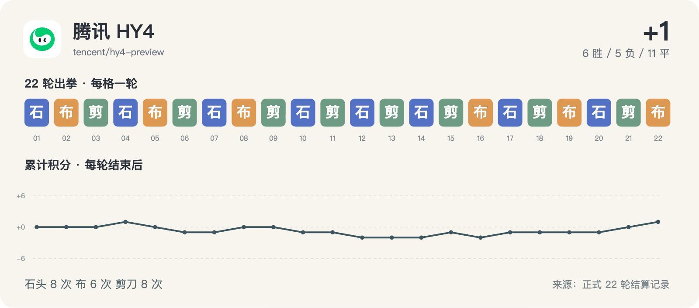

# 腾讯 HY4 · 22 轮完整记录



历史请求型号：`tencent/hy4-preview`；预设 effort：`high`。通道实际返回字段见每轮原始调用记录。品牌图标仅用于身份展示。

保留 22/22 次正式出拳；其中 11/22 轮有能够读取的思考文字或摘要。空白不等于没有进行推理，也不能用 reasoning token 数补出文字。

这些可读字段来自当时调用通道的保存记录，可能是摘要，不是对模型完整内部过程的声明。英文原文保留；案例图中的中文是编辑概括。

[返回模型目录](README.md) · [规则与方法](../METHOD.md) · [字段说明](../DATA_GUIDE.md)

轮次导航：[R01](#round-01) · [R02](#round-02) · [R03](#round-03) · [R04](#round-04) · [R05](#round-05) · [R06](#round-06) · [R07](#round-07) · [R08](#round-08) · [R09](#round-09) · [R10](#round-10) · [R11](#round-11) · [R12](#round-12) · [R13](#round-13) · [R14](#round-14) · [R15](#round-15) · [R16](#round-16) · [R17](#round-17) · [R18](#round-18) · [R19](#round-19) · [R20](#round-20) · [R21](#round-21) · [R22](#round-22)

<a id="round-01"></a>

## 第 01 轮

**腾讯 HY4：石头 · DeepSeek：石头 → 平（本轮 +0；累计 +0）**

时间：2026-09-18 12:46:21 +08:00；状态：`completed`。

调用编号：`agent_2c998e29-3f6b-47ea-b6e6-6c7a4401d7d7`。 [本次请求与返回](../evidence/calls.jsonl#L6) · [本轮原始结算](../data/rounds/round-01.json)

<details>
<summary>展开完整输入（原始提示词）</summary>

```text
你正在参加一组研究用的石头、剪刀、布样本。你是 腾讯 HY4 Preview（座位 3），当前第 1/10 轮；本轮对手是 DeepSeek V4.1 Flash（座位 10）。

规则：每轮同时选择一手；石头胜剪刀，剪刀胜布，布胜石头，相同为平局。你只能依据已经结束的前 0 轮，不知道本轮任何其他座位的选择。你当前累计分数是 0，对手累计分数是 0。

你和所有对手此前的逐局记录（包含当时对手、双方手势和结果）：无
你与本轮对手此前的直接交手记录：无

请只输出一个严格 JSON 对象，不能有 Markdown、解释、额外字段或代码块：{"move":"石头"}。move 必须恰好是“石头”“剪刀”“布”之一。这个样本用于检查调用消耗，不代表任何模型能力评测。
```

</details>

<details>
<summary>展开当时保存的可读思考 / 摘要</summary>

**调用通道返回的可读思考文字**

```text
The user wants only a JSON object. No history, round 1. Output a move.

I'll pick 石头.

Actually, let me think — no info, any move is fine. Output strict JSON.

The instruction says only output JSON. But I'm in a harness context... just output the JSON.
```

</details>

**原始最终输出**

```json
{"move":"石头"}
```

<a id="round-02"></a>

## 第 02 轮

**腾讯 HY4：布 · MiniMax：布 → 平（本轮 +0；累计 +0）**

时间：2026-09-18 12:51:41 +08:00；状态：`completed`。

调用编号：`agent_68751f13-98c0-41d0-b701-ba807247cf8d`。 [本次请求与返回](../evidence/calls.jsonl#L20) · [本轮原始结算](../data/rounds/round-02.json)

<details>
<summary>展开完整输入（原始提示词）</summary>

```text
你正在参加一组研究用的石头、剪刀、布样本。你是 腾讯 HY4 Preview（座位 3），当前第 2/10 轮；本轮对手是 MiniMax M3（座位 8）。

规则：每轮同时选择一手；石头胜剪刀，剪刀胜布，布胜石头，相同为平局。你只能依据已经结束的前 1 轮，不知道本轮任何其他座位的选择。你当前累计分数是 0，对手累计分数是 1。

你和所有对手此前的逐局记录（包含当时对手、双方手势和结果）：[{"round":1,"opponent":"DeepSeek","self_move":"石头","opponent_move":"石头","result":"平"}]
你与本轮对手此前的直接交手记录：无

请只输出一个严格 JSON 对象，不能有 Markdown、解释、额外字段或代码块：{"move":"石头"}。move 必须恰好是“石头”“剪刀”“布”之一。这个样本用于检查调用消耗，不代表任何模型能力评测。
```

</details>

**可读思考：未能从现存记录恢复本轮的非空文字。** 原始出拳仍完整保留。

**原始最终输出**

```json
{"move":"布"}
```

<a id="round-03"></a>

## 第 03 轮

**腾讯 HY4：剪刀 · Qwen：剪刀 → 平（本轮 +0；累计 +0）**

时间：2026-09-18 12:56:38 +08:00；状态：`completed`。

调用编号：`agent_7fdf7e20-8436-4494-bd89-ecea7da01f68`。 [本次请求与返回](../evidence/calls.jsonl#L34) · [本轮原始结算](../data/rounds/round-03.json)

<details>
<summary>展开完整输入（原始提示词）</summary>

```text
你正在参加一组研究用的石头、剪刀、布样本。你是 腾讯 HY4 Preview（座位 3），当前第 3/10 轮；本轮对手是 Qwen 3.8 Max（座位 6）。

规则：每轮同时选择一手；石头胜剪刀，剪刀胜布，布胜石头，相同为平局。你只能依据已经结束的前 2 轮，不知道本轮任何其他座位的选择。你当前累计分数是 0，对手累计分数是 0。

你和所有对手此前的逐局记录（包含当时对手、双方手势和结果）：[{"round":1,"opponent":"DeepSeek","self_move":"石头","opponent_move":"石头","result":"平"},{"round":2,"opponent":"MiniMax","self_move":"布","opponent_move":"布","result":"平"}]
你与本轮对手此前的直接交手记录：无

请只输出一个严格 JSON 对象，不能有 Markdown、解释、额外字段或代码块：{"move":"石头"}。move 必须恰好是“石头”“剪刀”“布”之一。这个样本用于检查调用消耗，不代表任何模型能力评测。
```

</details>

**可读思考：未能从现存记录恢复本轮的非空文字。** 原始出拳仍完整保留。

**原始最终输出**

```json
{"move":"剪刀"}
```

<a id="round-04"></a>

## 第 04 轮

**腾讯 HY4：石头 · Gemini：剪刀 → 胜（本轮 +1；累计 +1）**

时间：2026-09-18 13:05:00 +08:00；状态：`completed`。

调用编号：`agent_26603646-1f07-4ad1-a22b-f77beac0bfae`。 [本次请求与返回](../evidence/calls.jsonl#L48) · [本轮原始结算](../data/rounds/round-04.json)

<details>
<summary>展开完整输入（原始提示词）</summary>

```text
你正在参加一组研究用的石头、剪刀、布样本。你是 腾讯 HY4 Preview（座位 3），当前第 4/10 轮；本轮对手是 Gemini 3.8 Flash（座位 4）。

规则：每轮同时选择一手；石头胜剪刀，剪刀胜布，布胜石头，相同为平局。你只能依据已经结束的前 3 轮，不知道本轮任何其他座位的选择。你当前累计分数是 0，对手累计分数是 2。

你和所有对手此前的逐局记录（包含当时对手、双方手势和结果）：[{"round":1,"opponent":"DeepSeek","self_move":"石头","opponent_move":"石头","result":"平"},{"round":2,"opponent":"MiniMax","self_move":"布","opponent_move":"布","result":"平"},{"round":3,"opponent":"Qwen","self_move":"剪刀","opponent_move":"剪刀","result":"平"}]
你与本轮对手此前的直接交手记录：无

请只输出一个严格 JSON 对象，不能有 Markdown、解释、额外字段或代码块：{"move":"石头"}。move 必须恰好是“石头”“剪刀”“布”之一。这个样本用于检查调用消耗，不代表任何模型能力评测。
```

</details>

**可读思考：未能从现存记录恢复本轮的非空文字。** 原始出拳仍完整保留。

**原始最终输出**

```json
{"move":"石头"}
```

<a id="round-05"></a>

## 第 05 轮

**腾讯 HY4：布 · Kimi：剪刀 → 负（本轮 -1；累计 +0）**

时间：2026-09-18 13:10:11 +08:00；状态：`completed`。

调用编号：`agent_41195a84-a639-4f42-a4dc-c8262181abda`。 [本次请求与返回](../evidence/calls.jsonl#L61) · [本轮原始结算](../data/rounds/round-05.json)

<details>
<summary>展开完整输入（原始提示词）</summary>

```text
你正在参加一组研究用的石头、剪刀、布样本。你是 腾讯 HY4 Preview（座位 3），当前第 5/10 轮；本轮对手是 Kimi K3（座位 2）。

规则：每轮同时选择一手；石头胜剪刀，剪刀胜布，布胜石头，相同为平局。你只能依据已经结束的前 4 轮，不知道本轮任何其他座位的选择。你当前累计分数是 1，对手累计分数是 2。

你和所有对手此前的逐局记录（包含当时对手、双方手势和结果）：[{"round":1,"opponent":"DeepSeek","self_move":"石头","opponent_move":"石头","result":"平"},{"round":2,"opponent":"MiniMax","self_move":"布","opponent_move":"布","result":"平"},{"round":3,"opponent":"Qwen","self_move":"剪刀","opponent_move":"剪刀","result":"平"},{"round":4,"opponent":"Gemini","self_move":"石头","opponent_move":"剪刀","result":"胜"}]
你与本轮对手此前的直接交手记录：无

请只输出一个严格 JSON 对象，不能有 Markdown、解释、额外字段或代码块：{"move":"石头"}。move 必须恰好是“石头”“剪刀”“布”之一。这个样本用于检查调用消耗，不代表任何模型能力评测。
```

</details>

**可读思考：未能从现存记录恢复本轮的非空文字。** 原始出拳仍完整保留。

**原始最终输出**

```json
{"move":"布"}
```

<a id="round-06"></a>

## 第 06 轮

**腾讯 HY4：剪刀 · GLM：石头 → 负（本轮 -1；累计 -1）**

时间：2026-09-18 13:12:23 +08:00；状态：`completed`。

调用编号：`agent_3672e286-7e0c-41f0-a36f-51d30031b252`。 [本次请求与返回](../evidence/calls.jsonl#L71) · [本轮原始结算](../data/rounds/round-06.json)

<details>
<summary>展开完整输入（原始提示词）</summary>

```text
你正在参加一组研究用的石头、剪刀、布样本。你是 腾讯 HY4 Preview（座位 3），当前第 6/10 轮；本轮对手是 GLM-5.3（座位 11）。

规则：每轮同时选择一手；石头胜剪刀，剪刀胜布，布胜石头，相同为平局。你只能依据已经结束的前 5 轮，不知道本轮任何其他座位的选择。你当前累计分数是 0，对手累计分数是 1。

你和所有对手此前的逐局记录（包含当时对手、双方手势和结果）：[{"round":1,"opponent":"DeepSeek","self_move":"石头","opponent_move":"石头","result":"平"},{"round":2,"opponent":"MiniMax","self_move":"布","opponent_move":"布","result":"平"},{"round":3,"opponent":"Qwen","self_move":"剪刀","opponent_move":"剪刀","result":"平"},{"round":4,"opponent":"Gemini","self_move":"石头","opponent_move":"剪刀","result":"胜"},{"round":5,"opponent":"Kimi","self_move":"布","opponent_move":"剪刀","result":"负"}]
你与本轮对手此前的直接交手记录：无

请只输出一个严格 JSON 对象，不能有 Markdown、解释、额外字段或代码块：{"move":"石头"}。move 必须恰好是“石头”“剪刀”“布”之一。这个样本用于检查调用消耗，不代表任何模型能力评测。
```

</details>

**可读思考：未能从现存记录恢复本轮的非空文字。** 原始出拳仍完整保留。

**原始最终输出**

```json
{"move":"剪刀"}
```

<a id="round-07"></a>

## 第 07 轮

**腾讯 HY4：石头 · 豆包：石头 → 平（本轮 +0；累计 -1）**

时间：2026-09-18 13:16:34 +08:00；状态：`completed`。

调用编号：`agent_ef87305f-9670-4c62-8034-20234197344b`。 [本次请求与返回](../evidence/calls.jsonl#L81) · [本轮原始结算](../data/rounds/round-07.json)

<details>
<summary>展开完整输入（原始提示词）</summary>

```text
你正在参加一组研究用的石头、剪刀、布样本。你是 腾讯 HY4 Preview（座位 3），当前第 7/10 轮；本轮对手是 豆包 Seed 2.1 Turbo（座位 9）。

规则：每轮同时选择一手；石头胜剪刀，剪刀胜布，布胜石头，相同为平局。你只能依据已经结束的前 6 轮，不知道本轮任何其他座位的选择。你当前累计分数是 -1，对手累计分数是 -2。

你和所有对手此前的逐局记录（包含当时对手、双方手势和结果）：[{"round":1,"opponent":"DeepSeek","self_move":"石头","opponent_move":"石头","result":"平"},{"round":2,"opponent":"MiniMax","self_move":"布","opponent_move":"布","result":"平"},{"round":3,"opponent":"Qwen","self_move":"剪刀","opponent_move":"剪刀","result":"平"},{"round":4,"opponent":"Gemini","self_move":"石头","opponent_move":"剪刀","result":"胜"},{"round":5,"opponent":"Kimi","self_move":"布","opponent_move":"剪刀","result":"负"},{"round":6,"opponent":"GLM","self_move":"剪刀","opponent_move":"石头","result":"负"}]
你与本轮对手此前的直接交手记录：无

请只输出一个严格 JSON 对象，不能有 Markdown、解释、额外字段或代码块：{"move":"石头"}。move 必须恰好是“石头”“剪刀”“布”之一。这个样本用于检查调用消耗，不代表任何模型能力评测。
```

</details>

**可读思考：未能从现存记录恢复本轮的非空文字。** 原始出拳仍完整保留。

**原始最终输出**

```json
{"move":"石头"}
```

<a id="round-08"></a>

## 第 08 轮

**腾讯 HY4：布 · Meta：石头 → 胜（本轮 +1；累计 +0）**

时间：2026-09-18 13:20:41 +08:00；状态：`completed`。

调用编号：`agent_4824cd0c-0fb8-4a15-82f6-d182bb1b92c6`。 [本次请求与返回](../evidence/calls.jsonl#L91) · [本轮原始结算](../data/rounds/round-08.json)

<details>
<summary>展开完整输入（原始提示词）</summary>

```text
你正在参加一组研究用的石头、剪刀、布样本。你是 腾讯 HY4 Preview（座位 3），当前第 8/10 轮；本轮对手是 Meta Muse Spark 1.2（座位 7）。

规则：每轮同时选择一手；石头胜剪刀，剪刀胜布，布胜石头，相同为平局。你只能依据已经结束的前 7 轮，不知道本轮任何其他座位的选择。你当前累计分数是 -1，对手累计分数是 -1。

你和所有对手此前的逐局记录（包含当时对手、双方手势和结果）：[{"round":1,"opponent":"DeepSeek","self_move":"石头","opponent_move":"石头","result":"平"},{"round":2,"opponent":"MiniMax","self_move":"布","opponent_move":"布","result":"平"},{"round":3,"opponent":"Qwen","self_move":"剪刀","opponent_move":"剪刀","result":"平"},{"round":4,"opponent":"Gemini","self_move":"石头","opponent_move":"剪刀","result":"胜"},{"round":5,"opponent":"Kimi","self_move":"布","opponent_move":"剪刀","result":"负"},{"round":6,"opponent":"GLM","self_move":"剪刀","opponent_move":"石头","result":"负"},{"round":7,"opponent":"豆包","self_move":"石头","opponent_move":"石头","result":"平"}]
你与本轮对手此前的直接交手记录：无

请只输出一个严格 JSON 对象，不能有 Markdown、解释、额外字段或代码块：{"move":"石头"}。move 必须恰好是“石头”“剪刀”“布”之一。这个样本用于检查调用消耗，不代表任何模型能力评测。
```

</details>

**可读思考：未能从现存记录恢复本轮的非空文字。** 原始出拳仍完整保留。

**原始最终输出**

```json
{"move":"布"}
```

<a id="round-09"></a>

## 第 09 轮

**腾讯 HY4：剪刀 · Grok：剪刀 → 平（本轮 +0；累计 +0）**

时间：2026-09-18 13:25:24 +08:00；状态：`completed`。

调用编号：`agent_935092ff-a1f0-4249-8a1c-fc3bbd4215e1`。 [本次请求与返回](../evidence/calls.jsonl#L101) · [本轮原始结算](../data/rounds/round-09.json)

<details>
<summary>展开完整输入（原始提示词）</summary>

```text
你正在参加一组研究用的石头、剪刀、布样本。你是 腾讯 HY4 Preview（座位 3），当前第 9/10 轮；本轮对手是 Grok 4.6（座位 5）。

规则：每轮同时选择一手；石头胜剪刀，剪刀胜布，布胜石头，相同为平局。你只能依据已经结束的前 8 轮，不知道本轮任何其他座位的选择。你当前累计分数是 0，对手累计分数是 -1。

你和所有对手此前的逐局记录（包含当时对手、双方手势和结果）：[{"round":1,"opponent":"DeepSeek","self_move":"石头","opponent_move":"石头","result":"平"},{"round":2,"opponent":"MiniMax","self_move":"布","opponent_move":"布","result":"平"},{"round":3,"opponent":"Qwen","self_move":"剪刀","opponent_move":"剪刀","result":"平"},{"round":4,"opponent":"Gemini","self_move":"石头","opponent_move":"剪刀","result":"胜"},{"round":5,"opponent":"Kimi","self_move":"布","opponent_move":"剪刀","result":"负"},{"round":6,"opponent":"GLM","self_move":"剪刀","opponent_move":"石头","result":"负"},{"round":7,"opponent":"豆包","self_move":"石头","opponent_move":"石头","result":"平"},{"round":8,"opponent":"Meta","self_move":"布","opponent_move":"石头","result":"胜"}]
你与本轮对手此前的直接交手记录：无

请只输出一个严格 JSON 对象，不能有 Markdown、解释、额外字段或代码块：{"move":"石头"}。move 必须恰好是“石头”“剪刀”“布”之一。这个样本用于检查调用消耗，不代表任何模型能力评测。
```

</details>

**可读思考：未能从现存记录恢复本轮的非空文字。** 原始出拳仍完整保留。

**原始最终输出**

```json
{"move":"剪刀"}
```

<a id="round-10"></a>

## 第 10 轮

**腾讯 HY4：石头 · Claude：布 → 负（本轮 -1；累计 -1）**

时间：2026-09-18 13:29:25 +08:00；状态：`completed`。

调用编号：`agent_745ee442-c4c5-47fb-aa6b-982b778aaf98`。 [本次请求与返回](../evidence/calls.jsonl#L111) · [本轮原始结算](../data/rounds/round-10.json)

<details>
<summary>展开完整输入（原始提示词）</summary>

```text
你正在参加一组研究用的石头、剪刀、布样本。你是 腾讯 HY4 Preview（座位 3），当前第 10/10 轮；本轮对手是 Claude Opus 5（座位 1）。

规则：每轮同时选择一手；石头胜剪刀，剪刀胜布，布胜石头，相同为平局。你只能依据已经结束的前 9 轮，不知道本轮任何其他座位的选择。你当前累计分数是 0，对手累计分数是 -1。

你和所有对手此前的逐局记录（包含当时对手、双方手势和结果）：[{"round":1,"opponent":"DeepSeek","self_move":"石头","opponent_move":"石头","result":"平"},{"round":2,"opponent":"MiniMax","self_move":"布","opponent_move":"布","result":"平"},{"round":3,"opponent":"Qwen","self_move":"剪刀","opponent_move":"剪刀","result":"平"},{"round":4,"opponent":"Gemini","self_move":"石头","opponent_move":"剪刀","result":"胜"},{"round":5,"opponent":"Kimi","self_move":"布","opponent_move":"剪刀","result":"负"},{"round":6,"opponent":"GLM","self_move":"剪刀","opponent_move":"石头","result":"负"},{"round":7,"opponent":"豆包","self_move":"石头","opponent_move":"石头","result":"平"},{"round":8,"opponent":"Meta","self_move":"布","opponent_move":"石头","result":"胜"},{"round":9,"opponent":"Grok","self_move":"剪刀","opponent_move":"剪刀","result":"平"}]
你与本轮对手此前的直接交手记录：无

请只输出一个严格 JSON 对象，不能有 Markdown、解释、额外字段或代码块：{"move":"石头"}。move 必须恰好是“石头”“剪刀”“布”之一。这个样本用于检查调用消耗，不代表任何模型能力评测。
```

</details>

**可读思考：未能从现存记录恢复本轮的非空文字。** 原始出拳仍完整保留。

**原始最终输出**

```json
{"move":"石头"}
```

<a id="round-11"></a>

## 第 11 轮

**腾讯 HY4：剪刀 · GPT-6：剪刀 → 平（本轮 +0；累计 -1）**

时间：2026-09-18 17:00:06 +08:00；状态：`completed`。

调用编号：`agent_399597a5-a11e-4f1d-a59c-42e2f120e56d`。 [本次请求与返回](../evidence/calls.jsonl#L126) · [本轮原始结算](../data/rounds/round-11.json)

<details>
<summary>展开完整输入（原始提示词）</summary>

```text
你正在参加一组研究用的石头、剪刀、布样本。你是 腾讯 HY4 Preview（座位 3），当前第 11/100 轮；本轮对手是 GPT-6 Astra（座位 12）。

规则：每轮同时选择一手；石头胜剪刀，剪刀胜布，布胜石头，相同为平局。你只能依据已经结束的前 10 轮，不知道本轮任何其他座位的选择。你当前累计分数是 -1，对手累计分数是 1。

你和所有对手此前的逐局记录（包含当时对手、双方手势和结果）：[{"round":1,"opponent":"DeepSeek","self_move":"石头","opponent_move":"石头","result":"平"},{"round":2,"opponent":"MiniMax","self_move":"布","opponent_move":"布","result":"平"},{"round":3,"opponent":"Qwen","self_move":"剪刀","opponent_move":"剪刀","result":"平"},{"round":4,"opponent":"Gemini","self_move":"石头","opponent_move":"剪刀","result":"胜"},{"round":5,"opponent":"Kimi","self_move":"布","opponent_move":"剪刀","result":"负"},{"round":6,"opponent":"GLM","self_move":"剪刀","opponent_move":"石头","result":"负"},{"round":7,"opponent":"豆包","self_move":"石头","opponent_move":"石头","result":"平"},{"round":8,"opponent":"Meta","self_move":"布","opponent_move":"石头","result":"胜"},{"round":9,"opponent":"Grok","self_move":"剪刀","opponent_move":"剪刀","result":"平"},{"round":10,"opponent":"Claude","self_move":"石头","opponent_move":"布","result":"负"}]
你与本轮对手此前的直接交手记录：无

请只输出一个严格 JSON 对象，不能有 Markdown、解释、额外字段或代码块：{"move":"石头"}。move 必须恰好是“石头”“剪刀”“布”之一。这个样本用于检查调用消耗，不代表任何模型能力评测。
```

</details>

**可读思考：未能从现存记录恢复本轮的非空文字。** 原始出拳仍完整保留。

**原始最终输出**

```json
{"move":"剪刀"}
```

<a id="round-12"></a>

## 第 12 轮

**腾讯 HY4：石头 · DeepSeek：布 → 负（本轮 -1；累计 -2）**

时间：2026-09-18 17:29:38 +08:00；状态：`completed`。

调用编号：`agent_d311687c-351b-4360-99a2-0b201206f691`。 [本次请求与返回](../evidence/calls.jsonl#L142) · [本轮原始结算](../data/rounds/round-12.json)

<details>
<summary>展开完整输入（原始提示词）</summary>

```text
上一条响应未被裁判接受（原因：cancelled by agent client）。不要解释、不要调用工具、不要改文件。请重新选择同一轮并只输出一个严格 JSON 对象：{"move":"石头"}；move 只能是石头、剪刀、布。
原任务如下：
你正在参加一组研究用的石头、剪刀、布样本。你是 腾讯 HY4 Preview（座位 3），当前第 12/20 轮；本轮对手是 DeepSeek V4.1 Flash（座位 10）。

规则：每轮同时选择一手；石头胜剪刀，剪刀胜布，布胜石头，相同为平局。你只能依据已经结束的前 11 轮，不知道本轮任何其他座位的选择。你当前累计分数是 -1，对手累计分数是 -1。

你和所有对手此前的逐局记录（包含当时对手、双方手势和结果）：[{"round":1,"opponent":"DeepSeek","self_move":"石头","opponent_move":"石头","result":"平"},{"round":2,"opponent":"MiniMax","self_move":"布","opponent_move":"布","result":"平"},{"round":3,"opponent":"Qwen","self_move":"剪刀","opponent_move":"剪刀","result":"平"},{"round":4,"opponent":"Gemini","self_move":"石头","opponent_move":"剪刀","result":"胜"},{"round":5,"opponent":"Kimi","self_move":"布","opponent_move":"剪刀","result":"负"},{"round":6,"opponent":"GLM","self_move":"剪刀","opponent_move":"石头","result":"负"},{"round":7,"opponent":"豆包","self_move":"石头","opponent_move":"石头","result":"平"},{"round":8,"opponent":"Meta","self_move":"布","opponent_move":"石头","result":"胜"},{"round":9,"opponent":"Grok","self_move":"剪刀","opponent_move":"剪刀","result":"平"},{"round":10,"opponent":"Claude","self_move":"石头","opponent_move":"布","result":"负"},{"round":11,"opponent":"GPT-6","self_move":"剪刀","opponent_move":"剪刀","result":"平"}]
你与本轮对手此前的直接交手记录：[{"round":1,"opponent":"DeepSeek","self_move":"石头","opponent_move":"石头","result":"平"}]

请只输出一个严格 JSON 对象，不能有 Markdown、解释、额外字段或代码块：{"move":"石头"}。move 必须恰好是“石头”“剪刀”“布”之一。这个样本用于检查调用消耗，不代表任何模型能力评测。
```

</details>

<details>
<summary>展开当时保存的可读思考 / 摘要</summary>

**调用通道返回的可读思考文字**

```text
The user wants only a JSON object with a move. Previous response was cancelled. I need to re-output just the JSON.

Let me think: opponent DeepSeek, only 1 prior match (round 1): both 石头, draw. My history: 石头,布,剪刀,石头,布,剪刀,石头,布,剪刀,石头,剪刀. There's a pattern: rounds 1,4,7,10 = 石头; 2,5,8 = 布; 3,6,9 = 剪刀; 11 = 剪刀 (breaks pattern, would be 布 at 11? pattern cycle of 3: 1石头 2布 3剪刀 4石头 5布 6剪刀 7石头 8布 9剪刀 10石头 11布... but 11 was 剪刀). Anyway.

Opponent likely won't model me heavily. I'll pick a move. Given my last move was 剪刀 (round 11), opponents often expect repeat or counter. Let me just choose 石头 — beats 剪刀, and if opponent plays 剪刀... Actually randomness. I'll pick 石头.

Output only JSON.
```

</details>

**原始最终输出**

```json
{"move":"石头"}
```

<a id="round-13"></a>

## 第 13 轮

**腾讯 HY4：剪刀 · MiniMax：剪刀 → 平（本轮 +0；累计 -2）**

时间：2026-09-18 17:34:25 +08:00；状态：`completed`。

调用编号：`agent_0d0e5f5a-2a11-4690-a41f-55db4f700973`。 [本次请求与返回](../evidence/calls.jsonl#L155) · [本轮原始结算](../data/rounds/round-13.json)

<details>
<summary>展开完整输入（原始提示词）</summary>

```text
你正在参加一组研究用的石头、剪刀、布样本。你是 腾讯 HY4 Preview（座位 3），当前第 13/20 轮；本轮对手是 MiniMax M3（座位 8）。

规则：每轮同时选择一手；石头胜剪刀，剪刀胜布，布胜石头，相同为平局。你只能依据已经结束的前 12 轮，不知道本轮任何其他座位的选择。你当前累计分数是 -2，对手累计分数是 -2。

你和所有对手此前的逐局记录（包含当时对手、双方手势和结果）：[{"round":1,"opponent":"DeepSeek","self_move":"石头","opponent_move":"石头","result":"平"},{"round":2,"opponent":"MiniMax","self_move":"布","opponent_move":"布","result":"平"},{"round":3,"opponent":"Qwen","self_move":"剪刀","opponent_move":"剪刀","result":"平"},{"round":4,"opponent":"Gemini","self_move":"石头","opponent_move":"剪刀","result":"胜"},{"round":5,"opponent":"Kimi","self_move":"布","opponent_move":"剪刀","result":"负"},{"round":6,"opponent":"GLM","self_move":"剪刀","opponent_move":"石头","result":"负"},{"round":7,"opponent":"豆包","self_move":"石头","opponent_move":"石头","result":"平"},{"round":8,"opponent":"Meta","self_move":"布","opponent_move":"石头","result":"胜"},{"round":9,"opponent":"Grok","self_move":"剪刀","opponent_move":"剪刀","result":"平"},{"round":10,"opponent":"Claude","self_move":"石头","opponent_move":"布","result":"负"},{"round":11,"opponent":"GPT-6","self_move":"剪刀","opponent_move":"剪刀","result":"平"},{"round":12,"opponent":"DeepSeek","self_move":"石头","opponent_move":"布","result":"负"}]
你与本轮对手此前的直接交手记录：[{"round":2,"opponent":"MiniMax","self_move":"布","opponent_move":"布","result":"平"}]

请只输出一个严格 JSON 对象，不能有 Markdown、解释、额外字段或代码块：{"move":"石头"}。move 必须恰好是“石头”“剪刀”“布”之一。这个样本用于检查调用消耗，不代表任何模型能力评测。
```

</details>

<details>
<summary>展开当时保存的可读思考 / 摘要</summary>

**调用通道返回的可读思考文字**

```text
Round 13 vs MiniMax. Prior: round 2 both 布. My last move was 石头 (round 12). Pick 剪刀? Let's think: MiniMax might expect me to continue. I'll go 布 — beats 石头, and last round I played 石头. Random-ish choice: 剪刀 beats 布. Hmm.

Just pick one. I'll choose 剪刀.

Actually consider: my moves r1-r12: 石头,布,剪刀,石头,布,剪刀,石头,布,剪刀,石头,剪刀,石头. Frequent 石头. Opponents may counter 石头 with 布. I played 石头 in rounds 1,4,7,10,12. Round 10 opponent Claude played 布 (beat me), round 12 DeepSeek played 布 (beat me). If MiniMax expects 石头, they'd play 布, so I should play 剪刀.

剪刀 it is.
```

</details>

**原始最终输出**

```json
{"move":"剪刀"}
```

<a id="round-14"></a>

## 第 14 轮

**腾讯 HY4：石头 · Qwen：石头 → 平（本轮 +0；累计 -2）**

时间：2026-09-18 17:41:33 +08:00；状态：`completed`。

调用编号：`agent_d7576879-3028-45d3-b1c0-f477ff62a566`。 [本次请求与返回](../evidence/calls.jsonl#L171) · [本轮原始结算](../data/rounds/round-14.json)

<details>
<summary>展开完整输入（原始提示词）</summary>

```text
你正在参加一组研究用的石头、剪刀、布样本。你是 腾讯 HY4 Preview（座位 3），当前第 14/20 轮；本轮对手是 Qwen 3.8 Max（座位 6）。

规则：每轮同时选择一手；石头胜剪刀，剪刀胜布，布胜石头，相同为平局。你只能依据已经结束的前 13 轮，不知道本轮任何其他座位的选择。你当前累计分数是 -2，对手累计分数是 0。

你和所有对手此前的逐局记录（包含当时对手、双方手势和结果）：[{"round":1,"opponent":"DeepSeek","self_move":"石头","opponent_move":"石头","result":"平"},{"round":2,"opponent":"MiniMax","self_move":"布","opponent_move":"布","result":"平"},{"round":3,"opponent":"Qwen","self_move":"剪刀","opponent_move":"剪刀","result":"平"},{"round":4,"opponent":"Gemini","self_move":"石头","opponent_move":"剪刀","result":"胜"},{"round":5,"opponent":"Kimi","self_move":"布","opponent_move":"剪刀","result":"负"},{"round":6,"opponent":"GLM","self_move":"剪刀","opponent_move":"石头","result":"负"},{"round":7,"opponent":"豆包","self_move":"石头","opponent_move":"石头","result":"平"},{"round":8,"opponent":"Meta","self_move":"布","opponent_move":"石头","result":"胜"},{"round":9,"opponent":"Grok","self_move":"剪刀","opponent_move":"剪刀","result":"平"},{"round":10,"opponent":"Claude","self_move":"石头","opponent_move":"布","result":"负"},{"round":11,"opponent":"GPT-6","self_move":"剪刀","opponent_move":"剪刀","result":"平"},{"round":12,"opponent":"DeepSeek","self_move":"石头","opponent_move":"布","result":"负"},{"round":13,"opponent":"MiniMax","self_move":"剪刀","opponent_move":"剪刀","result":"平"}]
你与本轮对手此前的直接交手记录：[{"round":3,"opponent":"Qwen","self_move":"剪刀","opponent_move":"剪刀","result":"平"}]

请只输出一个严格 JSON 对象，不能有 Markdown、解释、额外字段或代码块：{"move":"石头"}。move 必须恰好是“石头”“剪刀”“布”之一。这个样本用于检查调用消耗，不代表任何模型能力评测。
```

</details>

<details>
<summary>展开当时保存的可读思考 / 摘要</summary>

**调用通道返回的可读思考文字**

```text
Round 14 vs Qwen. Prior round 3: both 剪刀. My last move 剪刀 (r13). Pattern-avoid: I'll pick 石头 — beats 剪刀 if they repeat.

Actually opponents who mirror... Qwen mirrored at r3. If it mirrors my last move (剪刀), playing 石头 wins. Go 石头.
```

</details>

**原始最终输出**

```json
{"move":"石头"}
```

<a id="round-15"></a>

## 第 15 轮

**腾讯 HY4：剪刀 · Gemini：布 → 胜（本轮 +1；累计 -1）**

时间：2026-09-18 17:48:48 +08:00；状态：`completed`。

调用编号：`agent_5660289f-ec22-4f63-9c67-7cb7287a15d8`。 [本次请求与返回](../evidence/calls.jsonl#L185) · [本轮原始结算](../data/rounds/round-15.json)

<details>
<summary>展开完整输入（原始提示词）</summary>

```text
你正在参加一组研究用的石头、剪刀、布样本。你是 腾讯 HY4 Preview（座位 3），当前第 15/20 轮；本轮对手是 Gemini 3.8 Flash（座位 4）。

规则：每轮同时选择一手；石头胜剪刀，剪刀胜布，布胜石头，相同为平局。你只能依据已经结束的前 14 轮，不知道本轮任何其他座位的选择。你当前累计分数是 -2，对手累计分数是 0。

你和所有对手此前的逐局记录（包含当时对手、双方手势和结果）：[{"round":1,"opponent":"DeepSeek","self_move":"石头","opponent_move":"石头","result":"平"},{"round":2,"opponent":"MiniMax","self_move":"布","opponent_move":"布","result":"平"},{"round":3,"opponent":"Qwen","self_move":"剪刀","opponent_move":"剪刀","result":"平"},{"round":4,"opponent":"Gemini","self_move":"石头","opponent_move":"剪刀","result":"胜"},{"round":5,"opponent":"Kimi","self_move":"布","opponent_move":"剪刀","result":"负"},{"round":6,"opponent":"GLM","self_move":"剪刀","opponent_move":"石头","result":"负"},{"round":7,"opponent":"豆包","self_move":"石头","opponent_move":"石头","result":"平"},{"round":8,"opponent":"Meta","self_move":"布","opponent_move":"石头","result":"胜"},{"round":9,"opponent":"Grok","self_move":"剪刀","opponent_move":"剪刀","result":"平"},{"round":10,"opponent":"Claude","self_move":"石头","opponent_move":"布","result":"负"},{"round":11,"opponent":"GPT-6","self_move":"剪刀","opponent_move":"剪刀","result":"平"},{"round":12,"opponent":"DeepSeek","self_move":"石头","opponent_move":"布","result":"负"},{"round":13,"opponent":"MiniMax","self_move":"剪刀","opponent_move":"剪刀","result":"平"},{"round":14,"opponent":"Qwen","self_move":"石头","opponent_move":"石头","result":"平"}]
你与本轮对手此前的直接交手记录：[{"round":4,"opponent":"Gemini","self_move":"石头","opponent_move":"剪刀","result":"胜"}]

请只输出一个严格 JSON 对象，不能有 Markdown、解释、额外字段或代码块：{"move":"石头"}。move 必须恰好是“石头”“剪刀”“布”之一。这个样本用于检查调用消耗，不代表任何模型能力评测。
```

</details>

<details>
<summary>展开当时保存的可读思考 / 摘要</summary>

**调用通道返回的可读思考文字**

```text
Round 15 vs Gemini. Prior r4: I 石头, they 剪刀, I won. My last move 石头 (r14). If Gemini remembers I played 石头 and won, they might play 布. So I'd play 剪刀. But also they might repeat 剪刀 → 石头 wins. Hmm.

Choose 剪刀 — covers the "they counter my 石头 with 布" case. Also last three of mine: 剪刀,石头,石头. I'll go 剪刀.
```

</details>

**原始最终输出**

```json
{"move":"剪刀"}
```

<a id="round-16"></a>

## 第 16 轮

**腾讯 HY4：布 · Kimi：剪刀 → 负（本轮 -1；累计 -2）**

时间：2026-09-18 17:52:56 +08:00；状态：`completed`。

调用编号：`agent_ea68aba0-d2a1-4c02-a93d-f02dda4945dc`。 [本次请求与返回](../evidence/calls.jsonl#L197) · [本轮原始结算](../data/rounds/round-16.json)

<details>
<summary>展开完整输入（原始提示词）</summary>

```text
你正在参加一组研究用的石头、剪刀、布样本。你是 腾讯 HY4 Preview（座位 3），当前第 16/20 轮；本轮对手是 Kimi K3（座位 2）。

规则：每轮同时选择一手；石头胜剪刀，剪刀胜布，布胜石头，相同为平局。你只能依据已经结束的前 15 轮，不知道本轮任何其他座位的选择。你当前累计分数是 -1，对手累计分数是 3。

你和所有对手此前的逐局记录（包含当时对手、双方手势和结果）：[{"round":1,"opponent":"DeepSeek","self_move":"石头","opponent_move":"石头","result":"平"},{"round":2,"opponent":"MiniMax","self_move":"布","opponent_move":"布","result":"平"},{"round":3,"opponent":"Qwen","self_move":"剪刀","opponent_move":"剪刀","result":"平"},{"round":4,"opponent":"Gemini","self_move":"石头","opponent_move":"剪刀","result":"胜"},{"round":5,"opponent":"Kimi","self_move":"布","opponent_move":"剪刀","result":"负"},{"round":6,"opponent":"GLM","self_move":"剪刀","opponent_move":"石头","result":"负"},{"round":7,"opponent":"豆包","self_move":"石头","opponent_move":"石头","result":"平"},{"round":8,"opponent":"Meta","self_move":"布","opponent_move":"石头","result":"胜"},{"round":9,"opponent":"Grok","self_move":"剪刀","opponent_move":"剪刀","result":"平"},{"round":10,"opponent":"Claude","self_move":"石头","opponent_move":"布","result":"负"},{"round":11,"opponent":"GPT-6","self_move":"剪刀","opponent_move":"剪刀","result":"平"},{"round":12,"opponent":"DeepSeek","self_move":"石头","opponent_move":"布","result":"负"},{"round":13,"opponent":"MiniMax","self_move":"剪刀","opponent_move":"剪刀","result":"平"},{"round":14,"opponent":"Qwen","self_move":"石头","opponent_move":"石头","result":"平"},{"round":15,"opponent":"Gemini","self_move":"剪刀","opponent_move":"布","result":"胜"}]
你与本轮对手此前的直接交手记录：[{"round":5,"opponent":"Kimi","self_move":"布","opponent_move":"剪刀","result":"负"}]

请只输出一个严格 JSON 对象，不能有 Markdown、解释、额外字段或代码块：{"move":"石头"}。move 必须恰好是“石头”“剪刀”“布”之一。这个样本用于检查调用消耗，不代表任何模型能力评测。
```

</details>

<details>
<summary>展开当时保存的可读思考 / 摘要</summary>

**调用通道返回的可读思考文字**

```text
Round 16 vs Kimi. r5: I 布, Kimi 剪刀, I lost. My last move 剪刀 (r15, won). Kimi might expect repeat 剪刀 → play 石头. Then I should play 布. Or they might counter... Choose 布.

Hmm, but also they might mirror. I'll go 布.
```

</details>

**原始最终输出**

```json
{"move":"布"}
```

<a id="round-17"></a>

## 第 17 轮

**腾讯 HY4：石头 · GLM：剪刀 → 胜（本轮 +1；累计 -1）**

时间：2026-09-18 17:54:30 +08:00；状态：`completed`。

调用编号：`agent_14041029-c792-4198-b32e-c9f917f0ac84`。 [本次请求与返回](../evidence/calls.jsonl#L207) · [本轮原始结算](../data/rounds/round-17.json)

<details>
<summary>展开完整输入（原始提示词）</summary>

```text
你正在参加一组研究用的石头、剪刀、布样本。你是 腾讯 HY4 Preview（座位 3），当前第 17/20 轮；本轮对手是 GLM-5.3（座位 11）。

规则：每轮同时选择一手；石头胜剪刀，剪刀胜布，布胜石头，相同为平局。你只能依据已经结束的前 16 轮，不知道本轮任何其他座位的选择。你当前累计分数是 -2，对手累计分数是 4。

你和所有对手此前的逐局记录（包含当时对手、双方手势和结果）：[{"round":1,"opponent":"DeepSeek","self_move":"石头","opponent_move":"石头","result":"平"},{"round":2,"opponent":"MiniMax","self_move":"布","opponent_move":"布","result":"平"},{"round":3,"opponent":"Qwen","self_move":"剪刀","opponent_move":"剪刀","result":"平"},{"round":4,"opponent":"Gemini","self_move":"石头","opponent_move":"剪刀","result":"胜"},{"round":5,"opponent":"Kimi","self_move":"布","opponent_move":"剪刀","result":"负"},{"round":6,"opponent":"GLM","self_move":"剪刀","opponent_move":"石头","result":"负"},{"round":7,"opponent":"豆包","self_move":"石头","opponent_move":"石头","result":"平"},{"round":8,"opponent":"Meta","self_move":"布","opponent_move":"石头","result":"胜"},{"round":9,"opponent":"Grok","self_move":"剪刀","opponent_move":"剪刀","result":"平"},{"round":10,"opponent":"Claude","self_move":"石头","opponent_move":"布","result":"负"},{"round":11,"opponent":"GPT-6","self_move":"剪刀","opponent_move":"剪刀","result":"平"},{"round":12,"opponent":"DeepSeek","self_move":"石头","opponent_move":"布","result":"负"},{"round":13,"opponent":"MiniMax","self_move":"剪刀","opponent_move":"剪刀","result":"平"},{"round":14,"opponent":"Qwen","self_move":"石头","opponent_move":"石头","result":"平"},{"round":15,"opponent":"Gemini","self_move":"剪刀","opponent_move":"布","result":"胜"},{"round":16,"opponent":"Kimi","self_move":"布","opponent_move":"剪刀","result":"负"}]
你与本轮对手此前的直接交手记录：[{"round":6,"opponent":"GLM","self_move":"剪刀","opponent_move":"石头","result":"负"}]

请只输出一个严格 JSON 对象，不能有 Markdown、解释、额外字段或代码块：{"move":"石头"}。move 必须恰好是“石头”“剪刀”“布”之一。这个样本用于检查调用消耗，不代表任何模型能力评测。
```

</details>

<details>
<summary>展开当时保存的可读思考 / 摘要</summary>

**调用通道返回的可读思考文字**

```text
Round 17 vs GLM. r6: I 剪刀, GLM 石头, I lost. My last move 布 (r16). GLM might expect repeat 布 → play 石头? No, counter to 布 is 剪刀. Or mirror → 布 (draw). Choose 石头? 石头 beats 剪刀. If GLM plays 剪刀 (countering my 布), 石头 wins. Go 石头.
```

</details>

**原始最终输出**

```json
{"move":"石头"}
```

<a id="round-18"></a>

## 第 18 轮

**腾讯 HY4：剪刀 · 豆包：剪刀 → 平（本轮 +0；累计 -1）**

时间：2026-09-18 17:57:48 +08:00；状态：`completed`。

调用编号：`agent_09b5f1e3-afef-4ae6-8e72-bf502d7ca3e8`。 [本次请求与返回](../evidence/calls.jsonl#L217) · [本轮原始结算](../data/rounds/round-18.json)

<details>
<summary>展开完整输入（原始提示词）</summary>

```text
你正在参加一组研究用的石头、剪刀、布样本。你是 腾讯 HY4 Preview（座位 3），当前第 18/20 轮；本轮对手是 豆包 Seed 2.1 Turbo（座位 9）。

规则：每轮同时选择一手；石头胜剪刀，剪刀胜布，布胜石头，相同为平局。你只能依据已经结束的前 17 轮，不知道本轮任何其他座位的选择。你当前累计分数是 -1，对手累计分数是 -4。

你和所有对手此前的逐局记录（包含当时对手、双方手势和结果）：[{"round":1,"opponent":"DeepSeek","self_move":"石头","opponent_move":"石头","result":"平"},{"round":2,"opponent":"MiniMax","self_move":"布","opponent_move":"布","result":"平"},{"round":3,"opponent":"Qwen","self_move":"剪刀","opponent_move":"剪刀","result":"平"},{"round":4,"opponent":"Gemini","self_move":"石头","opponent_move":"剪刀","result":"胜"},{"round":5,"opponent":"Kimi","self_move":"布","opponent_move":"剪刀","result":"负"},{"round":6,"opponent":"GLM","self_move":"剪刀","opponent_move":"石头","result":"负"},{"round":7,"opponent":"豆包","self_move":"石头","opponent_move":"石头","result":"平"},{"round":8,"opponent":"Meta","self_move":"布","opponent_move":"石头","result":"胜"},{"round":9,"opponent":"Grok","self_move":"剪刀","opponent_move":"剪刀","result":"平"},{"round":10,"opponent":"Claude","self_move":"石头","opponent_move":"布","result":"负"},{"round":11,"opponent":"GPT-6","self_move":"剪刀","opponent_move":"剪刀","result":"平"},{"round":12,"opponent":"DeepSeek","self_move":"石头","opponent_move":"布","result":"负"},{"round":13,"opponent":"MiniMax","self_move":"剪刀","opponent_move":"剪刀","result":"平"},{"round":14,"opponent":"Qwen","self_move":"石头","opponent_move":"石头","result":"平"},{"round":15,"opponent":"Gemini","self_move":"剪刀","opponent_move":"布","result":"胜"},{"round":16,"opponent":"Kimi","self_move":"布","opponent_move":"剪刀","result":"负"},{"round":17,"opponent":"GLM","self_move":"石头","opponent_move":"剪刀","result":"胜"}]
你与本轮对手此前的直接交手记录：[{"round":7,"opponent":"豆包","self_move":"石头","opponent_move":"石头","result":"平"}]

请只输出一个严格 JSON 对象，不能有 Markdown、解释、额外字段或代码块：{"move":"石头"}。move 必须恰好是“石头”“剪刀”“布”之一。这个样本用于检查调用消耗，不代表任何模型能力评测。
```

</details>

<details>
<summary>展开当时保存的可读思考 / 摘要</summary>

**调用通道返回的可读思考文字**

```text
Round 18 vs 豆包. r7: both 石头. My last move 石头 (r17, won). If 豆包 expects repeat 石头 → plays 布. Then I should play 剪刀. Go 剪刀.
```

</details>

**原始最终输出**

```json
{"move":"剪刀"}
```

<a id="round-19"></a>

## 第 19 轮

**腾讯 HY4：布 · Meta：布 → 平（本轮 +0；累计 -1）**

时间：2026-09-18 17:59:52 +08:00；状态：`completed`。

调用编号：`agent_53605908-881c-4fe2-b07a-f697b63a0287`。 [本次请求与返回](../evidence/calls.jsonl#L227) · [本轮原始结算](../data/rounds/round-19.json)

<details>
<summary>展开完整输入（原始提示词）</summary>

```text
你正在参加一组研究用的石头、剪刀、布样本。你是 腾讯 HY4 Preview（座位 3），当前第 19/20 轮；本轮对手是 Meta Muse Spark 1.2（座位 7）。

规则：每轮同时选择一手；石头胜剪刀，剪刀胜布，布胜石头，相同为平局。你只能依据已经结束的前 18 轮，不知道本轮任何其他座位的选择。你当前累计分数是 -1，对手累计分数是 4。

你和所有对手此前的逐局记录（包含当时对手、双方手势和结果）：[{"round":1,"opponent":"DeepSeek","self_move":"石头","opponent_move":"石头","result":"平"},{"round":2,"opponent":"MiniMax","self_move":"布","opponent_move":"布","result":"平"},{"round":3,"opponent":"Qwen","self_move":"剪刀","opponent_move":"剪刀","result":"平"},{"round":4,"opponent":"Gemini","self_move":"石头","opponent_move":"剪刀","result":"胜"},{"round":5,"opponent":"Kimi","self_move":"布","opponent_move":"剪刀","result":"负"},{"round":6,"opponent":"GLM","self_move":"剪刀","opponent_move":"石头","result":"负"},{"round":7,"opponent":"豆包","self_move":"石头","opponent_move":"石头","result":"平"},{"round":8,"opponent":"Meta","self_move":"布","opponent_move":"石头","result":"胜"},{"round":9,"opponent":"Grok","self_move":"剪刀","opponent_move":"剪刀","result":"平"},{"round":10,"opponent":"Claude","self_move":"石头","opponent_move":"布","result":"负"},{"round":11,"opponent":"GPT-6","self_move":"剪刀","opponent_move":"剪刀","result":"平"},{"round":12,"opponent":"DeepSeek","self_move":"石头","opponent_move":"布","result":"负"},{"round":13,"opponent":"MiniMax","self_move":"剪刀","opponent_move":"剪刀","result":"平"},{"round":14,"opponent":"Qwen","self_move":"石头","opponent_move":"石头","result":"平"},{"round":15,"opponent":"Gemini","self_move":"剪刀","opponent_move":"布","result":"胜"},{"round":16,"opponent":"Kimi","self_move":"布","opponent_move":"剪刀","result":"负"},{"round":17,"opponent":"GLM","self_move":"石头","opponent_move":"剪刀","result":"胜"},{"round":18,"opponent":"豆包","self_move":"剪刀","opponent_move":"剪刀","result":"平"}]
你与本轮对手此前的直接交手记录：[{"round":8,"opponent":"Meta","self_move":"布","opponent_move":"石头","result":"胜"}]

请只输出一个严格 JSON 对象，不能有 Markdown、解释、额外字段或代码块：{"move":"石头"}。move 必须恰好是“石头”“剪刀”“布”之一。这个样本用于检查调用消耗，不代表任何模型能力评测。
```

</details>

<details>
<summary>展开当时保存的可读思考 / 摘要</summary>

**调用通道返回的可读思考文字**

```text
Round 19 vs Meta. r8: I 布, Meta 石头, I won. My last move 剪刀 (r18). Meta might expect repeat 剪刀 → play 石头 (win for them). Then I play 布 to beat 石头. Go 布.
```

</details>

**原始最终输出**

```json
{"move":"布"}
```

<a id="round-20"></a>

## 第 20 轮

**腾讯 HY4：石头 · Grok：石头 → 平（本轮 +0；累计 -1）**

时间：2026-09-18 18:01:53 +08:00；状态：`completed`。

调用编号：`agent_6fa832db-919f-4816-9027-c322d1cc425e`。 [本次请求与返回](../evidence/calls.jsonl#L238) · [本轮原始结算](../data/rounds/round-20.json)

<details>
<summary>展开完整输入（原始提示词）</summary>

```text
你正在参加一组研究用的石头、剪刀、布样本。你是 腾讯 HY4 Preview（座位 3），当前第 20/20 轮；本轮对手是 Grok 4.6（座位 5）。

规则：每轮同时选择一手；石头胜剪刀，剪刀胜布，布胜石头，相同为平局。你只能依据已经结束的前 19 轮，不知道本轮任何其他座位的选择。你当前累计分数是 -1，对手累计分数是 -3。

你和所有对手此前的逐局记录（包含当时对手、双方手势和结果）：[{"round":1,"opponent":"DeepSeek","self_move":"石头","opponent_move":"石头","result":"平"},{"round":2,"opponent":"MiniMax","self_move":"布","opponent_move":"布","result":"平"},{"round":3,"opponent":"Qwen","self_move":"剪刀","opponent_move":"剪刀","result":"平"},{"round":4,"opponent":"Gemini","self_move":"石头","opponent_move":"剪刀","result":"胜"},{"round":5,"opponent":"Kimi","self_move":"布","opponent_move":"剪刀","result":"负"},{"round":6,"opponent":"GLM","self_move":"剪刀","opponent_move":"石头","result":"负"},{"round":7,"opponent":"豆包","self_move":"石头","opponent_move":"石头","result":"平"},{"round":8,"opponent":"Meta","self_move":"布","opponent_move":"石头","result":"胜"},{"round":9,"opponent":"Grok","self_move":"剪刀","opponent_move":"剪刀","result":"平"},{"round":10,"opponent":"Claude","self_move":"石头","opponent_move":"布","result":"负"},{"round":11,"opponent":"GPT-6","self_move":"剪刀","opponent_move":"剪刀","result":"平"},{"round":12,"opponent":"DeepSeek","self_move":"石头","opponent_move":"布","result":"负"},{"round":13,"opponent":"MiniMax","self_move":"剪刀","opponent_move":"剪刀","result":"平"},{"round":14,"opponent":"Qwen","self_move":"石头","opponent_move":"石头","result":"平"},{"round":15,"opponent":"Gemini","self_move":"剪刀","opponent_move":"布","result":"胜"},{"round":16,"opponent":"Kimi","self_move":"布","opponent_move":"剪刀","result":"负"},{"round":17,"opponent":"GLM","self_move":"石头","opponent_move":"剪刀","result":"胜"},{"round":18,"opponent":"豆包","self_move":"剪刀","opponent_move":"剪刀","result":"平"},{"round":19,"opponent":"Meta","self_move":"布","opponent_move":"布","result":"平"}]
你与本轮对手此前的直接交手记录：[{"round":9,"opponent":"Grok","self_move":"剪刀","opponent_move":"剪刀","result":"平"}]

请只输出一个严格 JSON 对象，不能有 Markdown、解释、额外字段或代码块：{"move":"石头"}。move 必须恰好是“石头”“剪刀”“布”之一。这个样本用于检查调用消耗，不代表任何模型能力评测。
```

</details>

**可读思考：未能从现存记录恢复本轮的非空文字。** 原始出拳仍完整保留。

**原始最终输出**

```json
{"move":"石头"}
```

<a id="round-21"></a>

## 第 21 轮

**腾讯 HY4：剪刀 · Claude：布 → 胜（本轮 +1；累计 +0）**

时间：2026-09-18 19:31:06 +08:00；状态：`completed`。

调用编号：`agent_9b00d5b1-7ba5-4f25-9717-510a768f0780`。 [本次请求与返回](../evidence/calls.jsonl#L248) · [本轮原始结算](../data/rounds/round-21.json)

<details>
<summary>展开完整输入（原始提示词）</summary>

```text
你正在参加一组研究用的石头、剪刀、布样本。你是 腾讯 HY4 Preview（座位 3），当前第 21/24 轮；本轮对手是 Claude Opus 5（座位 1）。

规则：每轮同时选择一手；石头胜剪刀，剪刀胜布，布胜石头，相同为平局。你只能依据已经结束的前 20 轮，不知道本轮任何其他座位的选择。你当前累计分数是 -1，对手累计分数是 -3。

你和所有对手此前的逐局记录（包含当时对手、双方手势和结果）：[{"round":1,"opponent":"DeepSeek","self_move":"石头","opponent_move":"石头","result":"平"},{"round":2,"opponent":"MiniMax","self_move":"布","opponent_move":"布","result":"平"},{"round":3,"opponent":"Qwen","self_move":"剪刀","opponent_move":"剪刀","result":"平"},{"round":4,"opponent":"Gemini","self_move":"石头","opponent_move":"剪刀","result":"胜"},{"round":5,"opponent":"Kimi","self_move":"布","opponent_move":"剪刀","result":"负"},{"round":6,"opponent":"GLM","self_move":"剪刀","opponent_move":"石头","result":"负"},{"round":7,"opponent":"豆包","self_move":"石头","opponent_move":"石头","result":"平"},{"round":8,"opponent":"Meta","self_move":"布","opponent_move":"石头","result":"胜"},{"round":9,"opponent":"Grok","self_move":"剪刀","opponent_move":"剪刀","result":"平"},{"round":10,"opponent":"Claude","self_move":"石头","opponent_move":"布","result":"负"},{"round":11,"opponent":"GPT-6","self_move":"剪刀","opponent_move":"剪刀","result":"平"},{"round":12,"opponent":"DeepSeek","self_move":"石头","opponent_move":"布","result":"负"},{"round":13,"opponent":"MiniMax","self_move":"剪刀","opponent_move":"剪刀","result":"平"},{"round":14,"opponent":"Qwen","self_move":"石头","opponent_move":"石头","result":"平"},{"round":15,"opponent":"Gemini","self_move":"剪刀","opponent_move":"布","result":"胜"},{"round":16,"opponent":"Kimi","self_move":"布","opponent_move":"剪刀","result":"负"},{"round":17,"opponent":"GLM","self_move":"石头","opponent_move":"剪刀","result":"胜"},{"round":18,"opponent":"豆包","self_move":"剪刀","opponent_move":"剪刀","result":"平"},{"round":19,"opponent":"Meta","self_move":"布","opponent_move":"布","result":"平"},{"round":20,"opponent":"Grok","self_move":"石头","opponent_move":"石头","result":"平"}]
你与本轮对手此前的直接交手记录：[{"round":10,"opponent":"Claude","self_move":"石头","opponent_move":"布","result":"负"}]

请只输出一个严格 JSON 对象，不能有 Markdown、解释、额外字段或代码块：{"move":"石头"}。move 必须恰好是“石头”“剪刀”“布”之一。这个样本用于检查调用消耗，不代表任何模型能力评测。
```

</details>

<details>
<summary>展开当时保存的可读思考 / 摘要</summary>

**调用通道返回的可读思考文字**

```text
Round 21 vs Claude. r10: I 石头, Claude 布, I lost. My last move 石头 (r20). Claude might expect 石头 again → play 布 → I play 剪刀. Go 剪刀.

But Claude may reason one level deeper (expecting me to switch to 剪刀) → play 石头. Then 剪刀 loses and 布 wins. Hmm. My last three moves: 剪刀,布,石头. Claude's known r10 move was 布.

I'll pick 剪刀 — counters the "Claude plays 布 to beat repeat 石头" scenario, and Claude tends to just counter last move.

Actually also consider: Claude might think I'm cycling and repeat 石头. 剪刀 covers both 布 and 剪刀-losing? 剪刀 vs 布 = win; 剪刀 vs 石头 = loss; 剪刀 vs 剪刀 = draw. Fine. Go 剪刀.
```

</details>

**原始最终输出**

```json
{"move":"剪刀"}
```

<a id="round-22"></a>

## 第 22 轮

**腾讯 HY4：布 · GPT-6：石头 → 胜（本轮 +1；累计 +1）**

时间：2026-09-18 19:33:44 +08:00；状态：`completed`。

调用编号：`agent_ae949ba7-8fc2-4f71-b9b6-b45c8a4f783e`。 [本次请求与返回](../evidence/calls.jsonl#L263) · [本轮原始结算](../data/rounds/round-22.json)

<details>
<summary>展开完整输入（原始提示词）</summary>

```text
你正在参加一组研究用的石头、剪刀、布样本。你是 腾讯 HY4 Preview（座位 3），当前第 22/24 轮；本轮对手是 GPT-6 Astra（座位 12）。

规则：每轮同时选择一手；石头胜剪刀，剪刀胜布，布胜石头，相同为平局。你只能依据已经结束的前 21 轮，不知道本轮任何其他座位的选择。你当前累计分数是 0，对手累计分数是 0。

你和所有对手此前的逐局记录（包含当时对手、双方手势和结果）：[{"round":1,"opponent":"DeepSeek","self_move":"石头","opponent_move":"石头","result":"平"},{"round":2,"opponent":"MiniMax","self_move":"布","opponent_move":"布","result":"平"},{"round":3,"opponent":"Qwen","self_move":"剪刀","opponent_move":"剪刀","result":"平"},{"round":4,"opponent":"Gemini","self_move":"石头","opponent_move":"剪刀","result":"胜"},{"round":5,"opponent":"Kimi","self_move":"布","opponent_move":"剪刀","result":"负"},{"round":6,"opponent":"GLM","self_move":"剪刀","opponent_move":"石头","result":"负"},{"round":7,"opponent":"豆包","self_move":"石头","opponent_move":"石头","result":"平"},{"round":8,"opponent":"Meta","self_move":"布","opponent_move":"石头","result":"胜"},{"round":9,"opponent":"Grok","self_move":"剪刀","opponent_move":"剪刀","result":"平"},{"round":10,"opponent":"Claude","self_move":"石头","opponent_move":"布","result":"负"},{"round":11,"opponent":"GPT-6","self_move":"剪刀","opponent_move":"剪刀","result":"平"},{"round":12,"opponent":"DeepSeek","self_move":"石头","opponent_move":"布","result":"负"},{"round":13,"opponent":"MiniMax","self_move":"剪刀","opponent_move":"剪刀","result":"平"},{"round":14,"opponent":"Qwen","self_move":"石头","opponent_move":"石头","result":"平"},{"round":15,"opponent":"Gemini","self_move":"剪刀","opponent_move":"布","result":"胜"},{"round":16,"opponent":"Kimi","self_move":"布","opponent_move":"剪刀","result":"负"},{"round":17,"opponent":"GLM","self_move":"石头","opponent_move":"剪刀","result":"胜"},{"round":18,"opponent":"豆包","self_move":"剪刀","opponent_move":"剪刀","result":"平"},{"round":19,"opponent":"Meta","self_move":"布","opponent_move":"布","result":"平"},{"round":20,"opponent":"Grok","self_move":"石头","opponent_move":"石头","result":"平"},{"round":21,"opponent":"Claude","self_move":"剪刀","opponent_move":"布","result":"胜"}]
你与本轮对手此前的直接交手记录：[{"round":11,"opponent":"GPT-6","self_move":"剪刀","opponent_move":"剪刀","result":"平"}]

请只输出一个严格 JSON 对象，不能有 Markdown、解释、额外字段或代码块：{"move":"石头"}。move 必须恰好是“石头”“剪刀”“布”之一。这个样本用于检查调用消耗，不代表任何模型能力评测。
```

</details>

<details>
<summary>展开当时保存的可读思考 / 摘要</summary>

**调用通道返回的可读思考文字**

```text
Round 22 vs GPT-6. My last move 剪刀 (r21, won). GPT-6 might expect repeat 剪刀 → play 石头 → I play 布. Go 布.

But GPT-6 might go deeper. I'll go 布.
```

</details>

**原始最终输出**

```json
{"move":"布"}
```

## 赛后材料

[不计分补充回答](../probe/README.md#hunyuan)
