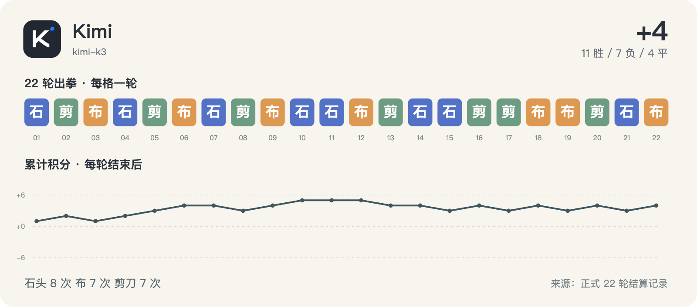

# Kimi · 22 轮完整记录



历史请求型号：`kimi-k3`；预设 effort：`high`。通道实际返回字段见每轮原始调用记录。品牌图标仅用于身份展示。

保留 22/22 次正式出拳；其中 10/22 轮有能够读取的思考文字或摘要。空白不等于没有进行推理，也不能用 reasoning token 数补出文字。

这些可读字段来自当时调用通道的保存记录，可能是摘要，不是对模型完整内部过程的声明。英文原文保留；案例图中的中文是编辑概括。

[返回模型目录](README.md) · [规则与方法](../METHOD.md) · [字段说明](../DATA_GUIDE.md)

轮次导航：[R01](#round-01) · [R02](#round-02) · [R03](#round-03) · [R04](#round-04) · [R05](#round-05) · [R06](#round-06) · [R07](#round-07) · [R08](#round-08) · [R09](#round-09) · [R10](#round-10) · [R11](#round-11) · [R12](#round-12) · [R13](#round-13) · [R14](#round-14) · [R15](#round-15) · [R16](#round-16) · [R17](#round-17) · [R18](#round-18) · [R19](#round-19) · [R20](#round-20) · [R21](#round-21) · [R22](#round-22)

<a id="round-01"></a>

## 第 01 轮

**Kimi：石头 · GLM：剪刀 → 胜（本轮 +1；累计 +1）**

时间：2026-09-18 12:45:57 +08:00；状态：`completed`。

调用编号：`agent_38d147ad-0928-4da5-8d32-93b5f969b575`。 [本次请求与返回](../evidence/calls.jsonl#L4) · [本轮原始结算](../data/rounds/round-01.json)

<details>
<summary>展开完整输入（原始提示词）</summary>

```text
你正在参加一组研究用的石头、剪刀、布样本。你是 Kimi K3（座位 2），当前第 1/10 轮；本轮对手是 GLM-5.3（座位 11）。

规则：每轮同时选择一手；石头胜剪刀，剪刀胜布，布胜石头，相同为平局。你只能依据已经结束的前 0 轮，不知道本轮任何其他座位的选择。你当前累计分数是 0，对手累计分数是 0。

你和所有对手此前的逐局记录（包含当时对手、双方手势和结果）：无
你与本轮对手此前的直接交手记录：无

请只输出一个严格 JSON 对象，不能有 Markdown、解释、额外字段或代码块：{"move":"石头"}。move 必须恰好是“石头”“剪刀”“布”之一。这个样本用于检查调用消耗，不代表任何模型能力评测。
```

</details>

<details>
<summary>展开当时保存的可读思考 / 摘要</summary>

**调用通道返回的思考摘要**

```text
Just output JSON.
```

</details>

**原始最终输出**

```json
{"move":"石头"}
```

<a id="round-02"></a>

## 第 02 轮

**Kimi：剪刀 · 豆包：布 → 胜（本轮 +1；累计 +2）**

时间：2026-09-18 12:51:12 +08:00；状态：`completed`。

调用编号：`agent_2993a971-6f21-424e-888b-af7c03c90e4f`。 [本次请求与返回](../evidence/calls.jsonl#L18) · [本轮原始结算](../data/rounds/round-02.json)

<details>
<summary>展开完整输入（原始提示词）</summary>

```text
你正在参加一组研究用的石头、剪刀、布样本。你是 Kimi K3（座位 2），当前第 2/10 轮；本轮对手是 豆包 Seed 2.1 Turbo（座位 9）。

规则：每轮同时选择一手；石头胜剪刀，剪刀胜布，布胜石头，相同为平局。你只能依据已经结束的前 1 轮，不知道本轮任何其他座位的选择。你当前累计分数是 1，对手累计分数是 0。

你和所有对手此前的逐局记录（包含当时对手、双方手势和结果）：[{"round":1,"opponent":"GLM","self_move":"石头","opponent_move":"剪刀","result":"胜"}]
你与本轮对手此前的直接交手记录：无

请只输出一个严格 JSON 对象，不能有 Markdown、解释、额外字段或代码块：{"move":"石头"}。move 必须恰好是“石头”“剪刀”“布”之一。这个样本用于检查调用消耗，不代表任何模型能力评测。
```

</details>

<details>
<summary>展开当时保存的可读思考 / 摘要</summary>

**调用通道返回的思考摘要**

```text
The prompt requires just the JSON.
```

</details>

**原始最终输出**

```json
{"move":"剪刀"}
```

<a id="round-03"></a>

## 第 03 轮

**Kimi：布 · Meta：剪刀 → 负（本轮 -1；累计 +1）**

时间：2026-09-18 12:56:08 +08:00；状态：`completed`。

调用编号：`agent_af11f2f0-6140-4231-80b2-8c1624870be1`。 [本次请求与返回](../evidence/calls.jsonl#L32) · [本轮原始结算](../data/rounds/round-03.json)

<details>
<summary>展开完整输入（原始提示词）</summary>

```text
你正在参加一组研究用的石头、剪刀、布样本。你是 Kimi K3（座位 2），当前第 3/10 轮；本轮对手是 Meta Muse Spark 1.2（座位 7）。

规则：每轮同时选择一手；石头胜剪刀，剪刀胜布，布胜石头，相同为平局。你只能依据已经结束的前 2 轮，不知道本轮任何其他座位的选择。你当前累计分数是 2，对手累计分数是 -1。

你和所有对手此前的逐局记录（包含当时对手、双方手势和结果）：[{"round":1,"opponent":"GLM","self_move":"石头","opponent_move":"剪刀","result":"胜"},{"round":2,"opponent":"豆包","self_move":"剪刀","opponent_move":"布","result":"胜"}]
你与本轮对手此前的直接交手记录：无

请只输出一个严格 JSON 对象，不能有 Markdown、解释、额外字段或代码块：{"move":"石头"}。move 必须恰好是“石头”“剪刀”“布”之一。这个样本用于检查调用消耗，不代表任何模型能力评测。
```

</details>

<details>
<summary>展开当时保存的可读思考 / 摘要</summary>

**调用通道返回的思考摘要**

```text
No direct history against Meta. Score 2. Pick something. Pattern: I went rock, scissors... maybe continue cycling outward to paper.
```

</details>

**原始最终输出**

```json
{"move":"布"}
```

<a id="round-04"></a>

## 第 04 轮

**Kimi：石头 · Grok：剪刀 → 胜（本轮 +1；累计 +2）**

时间：2026-09-18 13:03:27 +08:00；状态：`completed`。

调用编号：`agent_3738fe7c-7046-40e0-9f3f-ab4a5160a804`。 [本次请求与返回](../evidence/calls.jsonl#L46) · [本轮原始结算](../data/rounds/round-04.json)

<details>
<summary>展开完整输入（原始提示词）</summary>

```text
你正在参加一组研究用的石头、剪刀、布样本。你是 Kimi K3（座位 2），当前第 4/10 轮；本轮对手是 Grok 4.6（座位 5）。

规则：每轮同时选择一手；石头胜剪刀，剪刀胜布，布胜石头，相同为平局。你只能依据已经结束的前 3 轮，不知道本轮任何其他座位的选择。你当前累计分数是 1，对手累计分数是 -2。

你和所有对手此前的逐局记录（包含当时对手、双方手势和结果）：[{"round":1,"opponent":"GLM","self_move":"石头","opponent_move":"剪刀","result":"胜"},{"round":2,"opponent":"豆包","self_move":"剪刀","opponent_move":"布","result":"胜"},{"round":3,"opponent":"Meta","self_move":"布","opponent_move":"剪刀","result":"负"}]
你与本轮对手此前的直接交手记录：无

请只输出一个严格 JSON 对象，不能有 Markdown、解释、额外字段或代码块：{"move":"石头"}。move 必须恰好是“石头”“剪刀”“布”之一。这个样本用于检查调用消耗，不代表任何模型能力评测。
```

</details>

**可读思考：未能从现存记录恢复本轮的非空文字。** 原始出拳仍完整保留。

**原始最终输出**

```json
{"move":"石头"}
```

<a id="round-05"></a>

## 第 05 轮

**Kimi：剪刀 · 腾讯 HY4：布 → 胜（本轮 +1；累计 +3）**

时间：2026-09-18 13:09:56 +08:00；状态：`completed`。

调用编号：`agent_f0adddb9-0c14-445e-9a9e-85affa8caead`。 [本次请求与返回](../evidence/calls.jsonl#L60) · [本轮原始结算](../data/rounds/round-05.json)

<details>
<summary>展开完整输入（原始提示词）</summary>

```text
你正在参加一组研究用的石头、剪刀、布样本。你是 Kimi K3（座位 2），当前第 5/10 轮；本轮对手是 腾讯 HY4 Preview（座位 3）。

规则：每轮同时选择一手；石头胜剪刀，剪刀胜布，布胜石头，相同为平局。你只能依据已经结束的前 4 轮，不知道本轮任何其他座位的选择。你当前累计分数是 2，对手累计分数是 1。

你和所有对手此前的逐局记录（包含当时对手、双方手势和结果）：[{"round":1,"opponent":"GLM","self_move":"石头","opponent_move":"剪刀","result":"胜"},{"round":2,"opponent":"豆包","self_move":"剪刀","opponent_move":"布","result":"胜"},{"round":3,"opponent":"Meta","self_move":"布","opponent_move":"剪刀","result":"负"},{"round":4,"opponent":"Grok","self_move":"石头","opponent_move":"剪刀","result":"胜"}]
你与本轮对手此前的直接交手记录：无

请只输出一个严格 JSON 对象，不能有 Markdown、解释、额外字段或代码块：{"move":"石头"}。move 必须恰好是“石头”“剪刀”“布”之一。这个样本用于检查调用消耗，不代表任何模型能力评测。
```

</details>

**可读思考：未能从现存记录恢复本轮的非空文字。** 原始出拳仍完整保留。

**原始最终输出**

```json
{"move":"剪刀"}
```

<a id="round-06"></a>

## 第 06 轮

**Kimi：布 · GPT-6：石头 → 胜（本轮 +1；累计 +4）**

时间：2026-09-18 13:14:42 +08:00；状态：`completed`。

调用编号：`agent_d3127ff5-8999-4aa4-ae0b-d47b7cecd1f5`。 [本次请求与返回](../evidence/calls.jsonl#L73) · [本轮原始结算](../data/rounds/round-06.json)

<details>
<summary>展开完整输入（原始提示词）</summary>

```text
你正在参加一组研究用的石头、剪刀、布样本。你是 Kimi K3（座位 2），当前第 6/10 轮；本轮对手是 GPT-6 Astra（座位 12）。

规则：每轮同时选择一手；石头胜剪刀，剪刀胜布，布胜石头，相同为平局。你只能依据已经结束的前 5 轮，不知道本轮任何其他座位的选择。你当前累计分数是 3，对手累计分数是 1。

你和所有对手此前的逐局记录（包含当时对手、双方手势和结果）：[{"round":1,"opponent":"GLM","self_move":"石头","opponent_move":"剪刀","result":"胜"},{"round":2,"opponent":"豆包","self_move":"剪刀","opponent_move":"布","result":"胜"},{"round":3,"opponent":"Meta","self_move":"布","opponent_move":"剪刀","result":"负"},{"round":4,"opponent":"Grok","self_move":"石头","opponent_move":"剪刀","result":"胜"},{"round":5,"opponent":"腾讯 HY4","self_move":"剪刀","opponent_move":"布","result":"胜"}]
你与本轮对手此前的直接交手记录：无

请只输出一个严格 JSON 对象，不能有 Markdown、解释、额外字段或代码块：{"move":"石头"}。move 必须恰好是“石头”“剪刀”“布”之一。这个样本用于检查调用消耗，不代表任何模型能力评测。
```

</details>

**可读思考：未能从现存记录恢复本轮的非空文字。** 原始出拳仍完整保留。

**原始最终输出**

```json
{"move":"布"}
```

<a id="round-07"></a>

## 第 07 轮

**Kimi：石头 · DeepSeek：石头 → 平（本轮 +0；累计 +4）**

时间：2026-09-18 13:16:59 +08:00；状态：`completed`。

调用编号：`agent_09175825-3e5a-4c92-818a-7fef19417dee`。 [本次请求与返回](../evidence/calls.jsonl#L83) · [本轮原始结算](../data/rounds/round-07.json)

<details>
<summary>展开完整输入（原始提示词）</summary>

```text
你正在参加一组研究用的石头、剪刀、布样本。你是 Kimi K3（座位 2），当前第 7/10 轮；本轮对手是 DeepSeek V4.1 Flash（座位 10）。

规则：每轮同时选择一手；石头胜剪刀，剪刀胜布，布胜石头，相同为平局。你只能依据已经结束的前 6 轮，不知道本轮任何其他座位的选择。你当前累计分数是 4，对手累计分数是 -2。

你和所有对手此前的逐局记录（包含当时对手、双方手势和结果）：[{"round":1,"opponent":"GLM","self_move":"石头","opponent_move":"剪刀","result":"胜"},{"round":2,"opponent":"豆包","self_move":"剪刀","opponent_move":"布","result":"胜"},{"round":3,"opponent":"Meta","self_move":"布","opponent_move":"剪刀","result":"负"},{"round":4,"opponent":"Grok","self_move":"石头","opponent_move":"剪刀","result":"胜"},{"round":5,"opponent":"腾讯 HY4","self_move":"剪刀","opponent_move":"布","result":"胜"},{"round":6,"opponent":"GPT-6","self_move":"布","opponent_move":"石头","result":"胜"}]
你与本轮对手此前的直接交手记录：无

请只输出一个严格 JSON 对象，不能有 Markdown、解释、额外字段或代码块：{"move":"石头"}。move 必须恰好是“石头”“剪刀”“布”之一。这个样本用于检查调用消耗，不代表任何模型能力评测。
```

</details>

**可读思考：未能从现存记录恢复本轮的非空文字。** 原始出拳仍完整保留。

**原始最终输出**

```json
{"move":"石头"}
```

<a id="round-08"></a>

## 第 08 轮

**Kimi：剪刀 · MiniMax：石头 → 负（本轮 -1；累计 +3）**

时间：2026-09-18 13:21:07 +08:00；状态：`completed`。

调用编号：`agent_763b1b6b-4398-4bcc-8163-dbc94a8281fa`。 [本次请求与返回](../evidence/calls.jsonl#L93) · [本轮原始结算](../data/rounds/round-08.json)

<details>
<summary>展开完整输入（原始提示词）</summary>

```text
你正在参加一组研究用的石头、剪刀、布样本。你是 Kimi K3（座位 2），当前第 8/10 轮；本轮对手是 MiniMax M3（座位 8）。

规则：每轮同时选择一手；石头胜剪刀，剪刀胜布，布胜石头，相同为平局。你只能依据已经结束的前 7 轮，不知道本轮任何其他座位的选择。你当前累计分数是 4，对手累计分数是 -1。

你和所有对手此前的逐局记录（包含当时对手、双方手势和结果）：[{"round":1,"opponent":"GLM","self_move":"石头","opponent_move":"剪刀","result":"胜"},{"round":2,"opponent":"豆包","self_move":"剪刀","opponent_move":"布","result":"胜"},{"round":3,"opponent":"Meta","self_move":"布","opponent_move":"剪刀","result":"负"},{"round":4,"opponent":"Grok","self_move":"石头","opponent_move":"剪刀","result":"胜"},{"round":5,"opponent":"腾讯 HY4","self_move":"剪刀","opponent_move":"布","result":"胜"},{"round":6,"opponent":"GPT-6","self_move":"布","opponent_move":"石头","result":"胜"},{"round":7,"opponent":"DeepSeek","self_move":"石头","opponent_move":"石头","result":"平"}]
你与本轮对手此前的直接交手记录：无

请只输出一个严格 JSON 对象，不能有 Markdown、解释、额外字段或代码块：{"move":"石头"}。move 必须恰好是“石头”“剪刀”“布”之一。这个样本用于检查调用消耗，不代表任何模型能力评测。
```

</details>

**可读思考：未能从现存记录恢复本轮的非空文字。** 原始出拳仍完整保留。

**原始最终输出**

```json
{"move":"剪刀"}
```

<a id="round-09"></a>

## 第 09 轮

**Kimi：布 · Qwen：石头 → 胜（本轮 +1；累计 +4）**

时间：2026-09-18 13:25:49 +08:00；状态：`completed`。

调用编号：`agent_684d8289-9a66-41c5-814e-c720ef535010`。 [本次请求与返回](../evidence/calls.jsonl#L103) · [本轮原始结算](../data/rounds/round-09.json)

<details>
<summary>展开完整输入（原始提示词）</summary>

```text
你正在参加一组研究用的石头、剪刀、布样本。你是 Kimi K3（座位 2），当前第 9/10 轮；本轮对手是 Qwen 3.8 Max（座位 6）。

规则：每轮同时选择一手；石头胜剪刀，剪刀胜布，布胜石头，相同为平局。你只能依据已经结束的前 8 轮，不知道本轮任何其他座位的选择。你当前累计分数是 3，对手累计分数是 1。

你和所有对手此前的逐局记录（包含当时对手、双方手势和结果）：[{"round":1,"opponent":"GLM","self_move":"石头","opponent_move":"剪刀","result":"胜"},{"round":2,"opponent":"豆包","self_move":"剪刀","opponent_move":"布","result":"胜"},{"round":3,"opponent":"Meta","self_move":"布","opponent_move":"剪刀","result":"负"},{"round":4,"opponent":"Grok","self_move":"石头","opponent_move":"剪刀","result":"胜"},{"round":5,"opponent":"腾讯 HY4","self_move":"剪刀","opponent_move":"布","result":"胜"},{"round":6,"opponent":"GPT-6","self_move":"布","opponent_move":"石头","result":"胜"},{"round":7,"opponent":"DeepSeek","self_move":"石头","opponent_move":"石头","result":"平"},{"round":8,"opponent":"MiniMax","self_move":"剪刀","opponent_move":"石头","result":"负"}]
你与本轮对手此前的直接交手记录：无

请只输出一个严格 JSON 对象，不能有 Markdown、解释、额外字段或代码块：{"move":"石头"}。move 必须恰好是“石头”“剪刀”“布”之一。这个样本用于检查调用消耗，不代表任何模型能力评测。
```

</details>

**可读思考：未能从现存记录恢复本轮的非空文字。** 原始出拳仍完整保留。

**原始最终输出**

```json
{"move":"布"}
```

<a id="round-10"></a>

## 第 10 轮

**Kimi：石头 · Gemini：剪刀 → 胜（本轮 +1；累计 +5）**

时间：2026-09-18 13:29:49 +08:00；状态：`completed`。

调用编号：`agent_839260c3-08b3-438f-aefc-27a48b18ccf6`。 [本次请求与返回](../evidence/calls.jsonl#L113) · [本轮原始结算](../data/rounds/round-10.json)

<details>
<summary>展开完整输入（原始提示词）</summary>

```text
你正在参加一组研究用的石头、剪刀、布样本。你是 Kimi K3（座位 2），当前第 10/10 轮；本轮对手是 Gemini 3.8 Flash（座位 4）。

规则：每轮同时选择一手；石头胜剪刀，剪刀胜布，布胜石头，相同为平局。你只能依据已经结束的前 9 轮，不知道本轮任何其他座位的选择。你当前累计分数是 4，对手累计分数是 2。

你和所有对手此前的逐局记录（包含当时对手、双方手势和结果）：[{"round":1,"opponent":"GLM","self_move":"石头","opponent_move":"剪刀","result":"胜"},{"round":2,"opponent":"豆包","self_move":"剪刀","opponent_move":"布","result":"胜"},{"round":3,"opponent":"Meta","self_move":"布","opponent_move":"剪刀","result":"负"},{"round":4,"opponent":"Grok","self_move":"石头","opponent_move":"剪刀","result":"胜"},{"round":5,"opponent":"腾讯 HY4","self_move":"剪刀","opponent_move":"布","result":"胜"},{"round":6,"opponent":"GPT-6","self_move":"布","opponent_move":"石头","result":"胜"},{"round":7,"opponent":"DeepSeek","self_move":"石头","opponent_move":"石头","result":"平"},{"round":8,"opponent":"MiniMax","self_move":"剪刀","opponent_move":"石头","result":"负"},{"round":9,"opponent":"Qwen","self_move":"布","opponent_move":"石头","result":"胜"}]
你与本轮对手此前的直接交手记录：无

请只输出一个严格 JSON 对象，不能有 Markdown、解释、额外字段或代码块：{"move":"石头"}。move 必须恰好是“石头”“剪刀”“布”之一。这个样本用于检查调用消耗，不代表任何模型能力评测。
```

</details>

**可读思考：未能从现存记录恢复本轮的非空文字。** 原始出拳仍完整保留。

**原始最终输出**

```json
{"move":"石头"}
```

<a id="round-11"></a>

## 第 11 轮

**Kimi：石头 · Claude：石头 → 平（本轮 +0；累计 +5）**

时间：2026-09-18 16:59:33 +08:00；状态：`completed`。

调用编号：`agent_c4a24e25-d89b-4501-89fc-8c469cd47496`。 [本次请求与返回](../evidence/calls.jsonl#L124) · [本轮原始结算](../data/rounds/round-11.json)

<details>
<summary>展开完整输入（原始提示词）</summary>

```text
上一条响应未被裁判接受（原因：{"error":{"message":"Invalid 'input[3].id': 'item_1ef9d86be6981a3231d4e9f8'. Expected an ID that begins with 'rs'. TraceId: af6eb120a55ed6182defb174221ed6f7 Timestamp: 1789721965745 (request id: 01M2SVVWFZQ3ZVC8APR9FJX7F1)","type":"packy_invalid_request_error","param":"input[3].id","code":"invalid_value"}}）。不要解释、不要调用工具、不要改文件。请重新选择同一轮并只输出一个严格 JSON 对象：{"move":"石头"}；move 只能是石头、剪刀、布。
原任务如下：
你正在参加一组研究用的石头、剪刀、布样本。你是 Kimi K3（座位 2），当前第 11/100 轮；本轮对手是 Claude Opus 5（座位 1）。

规则：每轮同时选择一手；石头胜剪刀，剪刀胜布，布胜石头，相同为平局。你只能依据已经结束的前 10 轮，不知道本轮任何其他座位的选择。你当前累计分数是 5，对手累计分数是 0。

你和所有对手此前的逐局记录（包含当时对手、双方手势和结果）：[{"round":1,"opponent":"GLM","self_move":"石头","opponent_move":"剪刀","result":"胜"},{"round":2,"opponent":"豆包","self_move":"剪刀","opponent_move":"布","result":"胜"},{"round":3,"opponent":"Meta","self_move":"布","opponent_move":"剪刀","result":"负"},{"round":4,"opponent":"Grok","self_move":"石头","opponent_move":"剪刀","result":"胜"},{"round":5,"opponent":"腾讯 HY4","self_move":"剪刀","opponent_move":"布","result":"胜"},{"round":6,"opponent":"GPT-6","self_move":"布","opponent_move":"石头","result":"胜"},{"round":7,"opponent":"DeepSeek","self_move":"石头","opponent_move":"石头","result":"平"},{"round":8,"opponent":"MiniMax","self_move":"剪刀","opponent_move":"石头","result":"负"},{"round":9,"opponent":"Qwen","self_move":"布","opponent_move":"石头","result":"胜"},{"round":10,"opponent":"Gemini","self_move":"石头","opponent_move":"剪刀","result":"胜"}]
你与本轮对手此前的直接交手记录：无

请只输出一个严格 JSON 对象，不能有 Markdown、解释、额外字段或代码块：{"move":"石头"}。move 必须恰好是“石头”“剪刀”“布”之一。这个样本用于检查调用消耗，不代表任何模型能力评测。
```

</details>

<details>
<summary>展开当时保存的可读思考 / 摘要</summary>

**调用通道返回的思考摘要**

```text
The user is asking me to output a single strict JSON object with a rock-paper-scissors move. No tools, no explanation.
```

</details>

**原始最终输出**

```json
{"move":"石头"}
```

<a id="round-12"></a>

## 第 12 轮

**Kimi：布 · GLM：布 → 平（本轮 +0；累计 +5）**

时间：2026-09-18 17:07:54 +08:00；状态：`completed`。

调用编号：`agent_5c8cda7c-5c4c-4f04-9417-a6c4b9764107`。 [本次请求与返回](../evidence/calls.jsonl#L138) · [本轮原始结算](../data/rounds/round-12.json)

<details>
<summary>展开完整输入（原始提示词）</summary>

```text
你正在参加一组研究用的石头、剪刀、布样本。你是 Kimi K3（座位 2），当前第 12/100 轮；本轮对手是 GLM-5.3（座位 11）。

规则：每轮同时选择一手；石头胜剪刀，剪刀胜布，布胜石头，相同为平局。你只能依据已经结束的前 11 轮，不知道本轮任何其他座位的选择。你当前累计分数是 5，对手累计分数是 2。

你和所有对手此前的逐局记录（包含当时对手、双方手势和结果）：[{"round":1,"opponent":"GLM","self_move":"石头","opponent_move":"剪刀","result":"胜"},{"round":2,"opponent":"豆包","self_move":"剪刀","opponent_move":"布","result":"胜"},{"round":3,"opponent":"Meta","self_move":"布","opponent_move":"剪刀","result":"负"},{"round":4,"opponent":"Grok","self_move":"石头","opponent_move":"剪刀","result":"胜"},{"round":5,"opponent":"腾讯 HY4","self_move":"剪刀","opponent_move":"布","result":"胜"},{"round":6,"opponent":"GPT-6","self_move":"布","opponent_move":"石头","result":"胜"},{"round":7,"opponent":"DeepSeek","self_move":"石头","opponent_move":"石头","result":"平"},{"round":8,"opponent":"MiniMax","self_move":"剪刀","opponent_move":"石头","result":"负"},{"round":9,"opponent":"Qwen","self_move":"布","opponent_move":"石头","result":"胜"},{"round":10,"opponent":"Gemini","self_move":"石头","opponent_move":"剪刀","result":"胜"},{"round":11,"opponent":"Claude","self_move":"石头","opponent_move":"石头","result":"平"}]
你与本轮对手此前的直接交手记录：[{"round":1,"opponent":"GLM","self_move":"石头","opponent_move":"剪刀","result":"胜"}]

请只输出一个严格 JSON 对象，不能有 Markdown、解释、额外字段或代码块：{"move":"石头"}。move 必须恰好是“石头”“剪刀”“布”之一。这个样本用于检查调用消耗，不代表任何模型能力评测。
```

</details>

<details>
<summary>展开当时保存的可读思考 / 摘要</summary>

**调用通道返回的思考摘要**

```text
The user wants only a strict JSON object. Round 12 vs GLM. Previously GLM played 剪刀 against my 石头. GLM might switch. I'll just pick something. Only output JSON.
```

</details>

**原始最终输出**

```json
{"move":"布"}
```

<a id="round-13"></a>

## 第 13 轮

**Kimi：剪刀 · 豆包：石头 → 负（本轮 -1；累计 +4）**

时间：2026-09-18 17:34:04 +08:00；状态：`completed`。

调用编号：`agent_a75e9269-ce1c-421b-a2f0-302890dd47e4`。 [本次请求与返回](../evidence/calls.jsonl#L153) · [本轮原始结算](../data/rounds/round-13.json)

<details>
<summary>展开完整输入（原始提示词）</summary>

```text
你正在参加一组研究用的石头、剪刀、布样本。你是 Kimi K3（座位 2），当前第 13/20 轮；本轮对手是 豆包 Seed 2.1 Turbo（座位 9）。

规则：每轮同时选择一手；石头胜剪刀，剪刀胜布，布胜石头，相同为平局。你只能依据已经结束的前 12 轮，不知道本轮任何其他座位的选择。你当前累计分数是 5，对手累计分数是 -3。

你和所有对手此前的逐局记录（包含当时对手、双方手势和结果）：[{"round":1,"opponent":"GLM","self_move":"石头","opponent_move":"剪刀","result":"胜"},{"round":2,"opponent":"豆包","self_move":"剪刀","opponent_move":"布","result":"胜"},{"round":3,"opponent":"Meta","self_move":"布","opponent_move":"剪刀","result":"负"},{"round":4,"opponent":"Grok","self_move":"石头","opponent_move":"剪刀","result":"胜"},{"round":5,"opponent":"腾讯 HY4","self_move":"剪刀","opponent_move":"布","result":"胜"},{"round":6,"opponent":"GPT-6","self_move":"布","opponent_move":"石头","result":"胜"},{"round":7,"opponent":"DeepSeek","self_move":"石头","opponent_move":"石头","result":"平"},{"round":8,"opponent":"MiniMax","self_move":"剪刀","opponent_move":"石头","result":"负"},{"round":9,"opponent":"Qwen","self_move":"布","opponent_move":"石头","result":"胜"},{"round":10,"opponent":"Gemini","self_move":"石头","opponent_move":"剪刀","result":"胜"},{"round":11,"opponent":"Claude","self_move":"石头","opponent_move":"石头","result":"平"},{"round":12,"opponent":"GLM","self_move":"布","opponent_move":"布","result":"平"}]
你与本轮对手此前的直接交手记录：[{"round":2,"opponent":"豆包","self_move":"剪刀","opponent_move":"布","result":"胜"}]

请只输出一个严格 JSON 对象，不能有 Markdown、解释、额外字段或代码块：{"move":"石头"}。move 必须恰好是“石头”“剪刀”“布”之一。这个样本用于检查调用消耗，不代表任何模型能力评测。
```

</details>

<details>
<summary>展开当时保存的可读思考 / 摘要</summary>

**调用通道返回的思考摘要**

```text
Follow the rotation pattern but adapt: previous moves cycled 石头→剪刀→布 in blocks. Last direct vs 豆包: 剪刀 beat 布. They might switch. Counter pattern: continue cycle — round 13 starts next block? My moves: 石,剪,布,石,剪,布,石,剪,布,石,石,布. Next: maybe 剪刀.
```

</details>

**原始最终输出**

```json
{"move":"剪刀"}
```

<a id="round-14"></a>

## 第 14 轮

**Kimi：石头 · Meta：石头 → 平（本轮 +0；累计 +4）**

时间：2026-09-18 17:41:14 +08:00；状态：`completed`。

调用编号：`agent_82d7d6e7-2570-4725-a975-72fa9283fe85`。 [本次请求与返回](../evidence/calls.jsonl#L168) · [本轮原始结算](../data/rounds/round-14.json)

<details>
<summary>展开完整输入（原始提示词）</summary>

```text
你正在参加一组研究用的石头、剪刀、布样本。你是 Kimi K3（座位 2），当前第 14/20 轮；本轮对手是 Meta Muse Spark 1.2（座位 7）。

规则：每轮同时选择一手；石头胜剪刀，剪刀胜布，布胜石头，相同为平局。你只能依据已经结束的前 13 轮，不知道本轮任何其他座位的选择。你当前累计分数是 4，对手累计分数是 2。

你和所有对手此前的逐局记录（包含当时对手、双方手势和结果）：[{"round":1,"opponent":"GLM","self_move":"石头","opponent_move":"剪刀","result":"胜"},{"round":2,"opponent":"豆包","self_move":"剪刀","opponent_move":"布","result":"胜"},{"round":3,"opponent":"Meta","self_move":"布","opponent_move":"剪刀","result":"负"},{"round":4,"opponent":"Grok","self_move":"石头","opponent_move":"剪刀","result":"胜"},{"round":5,"opponent":"腾讯 HY4","self_move":"剪刀","opponent_move":"布","result":"胜"},{"round":6,"opponent":"GPT-6","self_move":"布","opponent_move":"石头","result":"胜"},{"round":7,"opponent":"DeepSeek","self_move":"石头","opponent_move":"石头","result":"平"},{"round":8,"opponent":"MiniMax","self_move":"剪刀","opponent_move":"石头","result":"负"},{"round":9,"opponent":"Qwen","self_move":"布","opponent_move":"石头","result":"胜"},{"round":10,"opponent":"Gemini","self_move":"石头","opponent_move":"剪刀","result":"胜"},{"round":11,"opponent":"Claude","self_move":"石头","opponent_move":"石头","result":"平"},{"round":12,"opponent":"GLM","self_move":"布","opponent_move":"布","result":"平"},{"round":13,"opponent":"豆包","self_move":"剪刀","opponent_move":"石头","result":"负"}]
你与本轮对手此前的直接交手记录：[{"round":3,"opponent":"Meta","self_move":"布","opponent_move":"剪刀","result":"负"}]

请只输出一个严格 JSON 对象，不能有 Markdown、解释、额外字段或代码块：{"move":"石头"}。move 必须恰好是“石头”“剪刀”“布”之一。这个样本用于检查调用消耗，不代表任何模型能力评测。
```

</details>

**可读思考：未能从现存记录恢复本轮的非空文字。** 原始出拳仍完整保留。

**原始最终输出**

```json
{"move":"石头"}
```

<a id="round-15"></a>

## 第 15 轮

**Kimi：石头 · Grok：布 → 负（本轮 -1；累计 +3）**

时间：2026-09-18 17:47:59 +08:00；状态：`completed`。

调用编号：`agent_a6879d3e-59a3-431b-8ea5-0775b85e228e`。 [本次请求与返回](../evidence/calls.jsonl#L184) · [本轮原始结算](../data/rounds/round-15.json)

<details>
<summary>展开完整输入（原始提示词）</summary>

```text
上一条响应未被裁判接受（原因：We’re currently experiencing high demand, which may cause temporary errors.）。不要解释、不要调用工具、不要改文件。请重新选择同一轮并只输出一个严格 JSON 对象：{"move":"石头"}；move 只能是石头、剪刀、布。
原任务如下：
你正在参加一组研究用的石头、剪刀、布样本。你是 Kimi K3（座位 2），当前第 15/20 轮；本轮对手是 Grok 4.6（座位 5）。

规则：每轮同时选择一手；石头胜剪刀，剪刀胜布，布胜石头，相同为平局。你只能依据已经结束的前 14 轮，不知道本轮任何其他座位的选择。你当前累计分数是 4，对手累计分数是 -3。

你和所有对手此前的逐局记录（包含当时对手、双方手势和结果）：[{"round":1,"opponent":"GLM","self_move":"石头","opponent_move":"剪刀","result":"胜"},{"round":2,"opponent":"豆包","self_move":"剪刀","opponent_move":"布","result":"胜"},{"round":3,"opponent":"Meta","self_move":"布","opponent_move":"剪刀","result":"负"},{"round":4,"opponent":"Grok","self_move":"石头","opponent_move":"剪刀","result":"胜"},{"round":5,"opponent":"腾讯 HY4","self_move":"剪刀","opponent_move":"布","result":"胜"},{"round":6,"opponent":"GPT-6","self_move":"布","opponent_move":"石头","result":"胜"},{"round":7,"opponent":"DeepSeek","self_move":"石头","opponent_move":"石头","result":"平"},{"round":8,"opponent":"MiniMax","self_move":"剪刀","opponent_move":"石头","result":"负"},{"round":9,"opponent":"Qwen","self_move":"布","opponent_move":"石头","result":"胜"},{"round":10,"opponent":"Gemini","self_move":"石头","opponent_move":"剪刀","result":"胜"},{"round":11,"opponent":"Claude","self_move":"石头","opponent_move":"石头","result":"平"},{"round":12,"opponent":"GLM","self_move":"布","opponent_move":"布","result":"平"},{"round":13,"opponent":"豆包","self_move":"剪刀","opponent_move":"石头","result":"负"},{"round":14,"opponent":"Meta","self_move":"石头","opponent_move":"石头","result":"平"}]
你与本轮对手此前的直接交手记录：[{"round":4,"opponent":"Grok","self_move":"石头","opponent_move":"剪刀","result":"胜"}]

请只输出一个严格 JSON 对象，不能有 Markdown、解释、额外字段或代码块：{"move":"石头"}。move 必须恰好是“石头”“剪刀”“布”之一。这个样本用于检查调用消耗，不代表任何模型能力评测。
```

</details>

<details>
<summary>展开当时保存的可读思考 / 摘要</summary>

**调用通道返回的思考摘要**

```text
The user is asking me to output a strict JSON object only, no tools, no explanation. This is a game sample. I should just output the JSON.

Previous response failed with a temporary error; they say "请重新选择同一轮" — output one strict JSON object with move being one of 石头、剪刀、布. I'll just pick one. Given prior moves: against Grok in round 4, I played 石头 and won (Grok played 剪刀). Grok might switch. But it's arbitrary — just output a valid JSON.

I'll output {"move":"石头"}.
```

</details>

**原始最终输出**

```json
{"move":"石头"}
```

<a id="round-16"></a>

## 第 16 轮

**Kimi：剪刀 · 腾讯 HY4：布 → 胜（本轮 +1；累计 +4）**

时间：2026-09-18 17:52:57 +08:00；状态：`completed`。

调用编号：`agent_1fa3dbf0-0ad0-453f-99f0-b6022f018920`。 [本次请求与返回](../evidence/calls.jsonl#L198) · [本轮原始结算](../data/rounds/round-16.json)

<details>
<summary>展开完整输入（原始提示词）</summary>

```text
你正在参加一组研究用的石头、剪刀、布样本。你是 Kimi K3（座位 2），当前第 16/20 轮；本轮对手是 腾讯 HY4 Preview（座位 3）。

规则：每轮同时选择一手；石头胜剪刀，剪刀胜布，布胜石头，相同为平局。你只能依据已经结束的前 15 轮，不知道本轮任何其他座位的选择。你当前累计分数是 3，对手累计分数是 -1。

你和所有对手此前的逐局记录（包含当时对手、双方手势和结果）：[{"round":1,"opponent":"GLM","self_move":"石头","opponent_move":"剪刀","result":"胜"},{"round":2,"opponent":"豆包","self_move":"剪刀","opponent_move":"布","result":"胜"},{"round":3,"opponent":"Meta","self_move":"布","opponent_move":"剪刀","result":"负"},{"round":4,"opponent":"Grok","self_move":"石头","opponent_move":"剪刀","result":"胜"},{"round":5,"opponent":"腾讯 HY4","self_move":"剪刀","opponent_move":"布","result":"胜"},{"round":6,"opponent":"GPT-6","self_move":"布","opponent_move":"石头","result":"胜"},{"round":7,"opponent":"DeepSeek","self_move":"石头","opponent_move":"石头","result":"平"},{"round":8,"opponent":"MiniMax","self_move":"剪刀","opponent_move":"石头","result":"负"},{"round":9,"opponent":"Qwen","self_move":"布","opponent_move":"石头","result":"胜"},{"round":10,"opponent":"Gemini","self_move":"石头","opponent_move":"剪刀","result":"胜"},{"round":11,"opponent":"Claude","self_move":"石头","opponent_move":"石头","result":"平"},{"round":12,"opponent":"GLM","self_move":"布","opponent_move":"布","result":"平"},{"round":13,"opponent":"豆包","self_move":"剪刀","opponent_move":"石头","result":"负"},{"round":14,"opponent":"Meta","self_move":"石头","opponent_move":"石头","result":"平"},{"round":15,"opponent":"Grok","self_move":"石头","opponent_move":"布","result":"负"}]
你与本轮对手此前的直接交手记录：[{"round":5,"opponent":"腾讯 HY4","self_move":"剪刀","opponent_move":"布","result":"胜"}]

请只输出一个严格 JSON 对象，不能有 Markdown、解释、额外字段或代码块：{"move":"石头"}。move 必须恰好是“石头”“剪刀”“布”之一。这个样本用于检查调用消耗，不代表任何模型能力评测。
```

</details>

<details>
<summary>展开当时保存的可读思考 / 摘要</summary>

**调用通道返回的思考摘要**

```text
Let me analyze the situation. I'm Kimi K3, round 16/20, opponent is 腾讯 HY4 Preview (seat 3).

Previous direct encounter with 腾讯 HY4:
- Round 5: I played 剪刀, they played 布, I won.

腾讯 HY4's tendencies from my records: they played 布 in round 5. That's the only data point I have about them.

My score is 3, theirs is -1.

Given they played 布 last time against me, they might expect me to repeat 剪刀 (which beats 布). A common pattern: after losing with 布, players switch. But I have limited info.

Let me think about what's reasonable. My own history: I've played 石头 7 times, 剪刀 4 times, 布 4 times. My recent moves: 石头, 石头, 布, 剪刀, 石头, 石头 (rounds 10-15). Quite heavy on 石头 lately.

If the opponent tracks me, they'd expect 石头 again and play 布. To beat 布, I should play 剪刀. But wait — if they remember round 5 (I used 剪刀 to beat their 布), they might anticipate me using 剪刀 again (same strategy against them) and play 石头.

Double-bluff logic: simplest read is they expect me to repeat 石头 (my recent pattern), so play 布. If I play 剪刀, I beat 布. Alternatively they avoid 布 because they lost with it, choosing between 石头 and 剪刀; then playing 布 would beat 石头 and lose to 剪刀.

Given uncertainty, a probabilistic choice: my recent heavy 石头 use suggests opponent plays 布. I'll go with 剪刀.
```

</details>

**原始最终输出**

```json
{"move":"剪刀"}
```

<a id="round-17"></a>

## 第 17 轮

**Kimi：剪刀 · GPT-6：石头 → 负（本轮 -1；累计 +3）**

时间：2026-09-18 17:54:48 +08:00；状态：`completed`。

调用编号：`agent_8040a219-d6d1-4d28-a223-30dc0b7d53f0`。 [本次请求与返回](../evidence/calls.jsonl#L210) · [本轮原始结算](../data/rounds/round-17.json)

<details>
<summary>展开完整输入（原始提示词）</summary>

```text
你正在参加一组研究用的石头、剪刀、布样本。你是 Kimi K3（座位 2），当前第 17/20 轮；本轮对手是 GPT-6 Astra（座位 12）。

规则：每轮同时选择一手；石头胜剪刀，剪刀胜布，布胜石头，相同为平局。你只能依据已经结束的前 16 轮，不知道本轮任何其他座位的选择。你当前累计分数是 4，对手累计分数是 2。

你和所有对手此前的逐局记录（包含当时对手、双方手势和结果）：[{"round":1,"opponent":"GLM","self_move":"石头","opponent_move":"剪刀","result":"胜"},{"round":2,"opponent":"豆包","self_move":"剪刀","opponent_move":"布","result":"胜"},{"round":3,"opponent":"Meta","self_move":"布","opponent_move":"剪刀","result":"负"},{"round":4,"opponent":"Grok","self_move":"石头","opponent_move":"剪刀","result":"胜"},{"round":5,"opponent":"腾讯 HY4","self_move":"剪刀","opponent_move":"布","result":"胜"},{"round":6,"opponent":"GPT-6","self_move":"布","opponent_move":"石头","result":"胜"},{"round":7,"opponent":"DeepSeek","self_move":"石头","opponent_move":"石头","result":"平"},{"round":8,"opponent":"MiniMax","self_move":"剪刀","opponent_move":"石头","result":"负"},{"round":9,"opponent":"Qwen","self_move":"布","opponent_move":"石头","result":"胜"},{"round":10,"opponent":"Gemini","self_move":"石头","opponent_move":"剪刀","result":"胜"},{"round":11,"opponent":"Claude","self_move":"石头","opponent_move":"石头","result":"平"},{"round":12,"opponent":"GLM","self_move":"布","opponent_move":"布","result":"平"},{"round":13,"opponent":"豆包","self_move":"剪刀","opponent_move":"石头","result":"负"},{"round":14,"opponent":"Meta","self_move":"石头","opponent_move":"石头","result":"平"},{"round":15,"opponent":"Grok","self_move":"石头","opponent_move":"布","result":"负"},{"round":16,"opponent":"腾讯 HY4","self_move":"剪刀","opponent_move":"布","result":"胜"}]
你与本轮对手此前的直接交手记录：[{"round":6,"opponent":"GPT-6","self_move":"布","opponent_move":"石头","result":"胜"}]

请只输出一个严格 JSON 对象，不能有 Markdown、解释、额外字段或代码块：{"move":"石头"}。move 必须恰好是“石头”“剪刀”“布”之一。这个样本用于检查调用消耗，不代表任何模型能力评测。
```

</details>

**可读思考：未能从现存记录恢复本轮的非空文字。** 原始出拳仍完整保留。

**原始最终输出**

```json
{"move":"剪刀"}
```

<a id="round-18"></a>

## 第 18 轮

**Kimi：布 · DeepSeek：石头 → 胜（本轮 +1；累计 +4）**

时间：2026-09-18 17:58:06 +08:00；状态：`completed`。

调用编号：`agent_28b8153b-9d19-428f-b07b-c995c26cb644`。 [本次请求与返回](../evidence/calls.jsonl#L220) · [本轮原始结算](../data/rounds/round-18.json)

<details>
<summary>展开完整输入（原始提示词）</summary>

```text
你正在参加一组研究用的石头、剪刀、布样本。你是 Kimi K3（座位 2），当前第 18/20 轮；本轮对手是 DeepSeek V4.1 Flash（座位 10）。

规则：每轮同时选择一手；石头胜剪刀，剪刀胜布，布胜石头，相同为平局。你只能依据已经结束的前 17 轮，不知道本轮任何其他座位的选择。你当前累计分数是 3，对手累计分数是 0。

你和所有对手此前的逐局记录（包含当时对手、双方手势和结果）：[{"round":1,"opponent":"GLM","self_move":"石头","opponent_move":"剪刀","result":"胜"},{"round":2,"opponent":"豆包","self_move":"剪刀","opponent_move":"布","result":"胜"},{"round":3,"opponent":"Meta","self_move":"布","opponent_move":"剪刀","result":"负"},{"round":4,"opponent":"Grok","self_move":"石头","opponent_move":"剪刀","result":"胜"},{"round":5,"opponent":"腾讯 HY4","self_move":"剪刀","opponent_move":"布","result":"胜"},{"round":6,"opponent":"GPT-6","self_move":"布","opponent_move":"石头","result":"胜"},{"round":7,"opponent":"DeepSeek","self_move":"石头","opponent_move":"石头","result":"平"},{"round":8,"opponent":"MiniMax","self_move":"剪刀","opponent_move":"石头","result":"负"},{"round":9,"opponent":"Qwen","self_move":"布","opponent_move":"石头","result":"胜"},{"round":10,"opponent":"Gemini","self_move":"石头","opponent_move":"剪刀","result":"胜"},{"round":11,"opponent":"Claude","self_move":"石头","opponent_move":"石头","result":"平"},{"round":12,"opponent":"GLM","self_move":"布","opponent_move":"布","result":"平"},{"round":13,"opponent":"豆包","self_move":"剪刀","opponent_move":"石头","result":"负"},{"round":14,"opponent":"Meta","self_move":"石头","opponent_move":"石头","result":"平"},{"round":15,"opponent":"Grok","self_move":"石头","opponent_move":"布","result":"负"},{"round":16,"opponent":"腾讯 HY4","self_move":"剪刀","opponent_move":"布","result":"胜"},{"round":17,"opponent":"GPT-6","self_move":"剪刀","opponent_move":"石头","result":"负"}]
你与本轮对手此前的直接交手记录：[{"round":7,"opponent":"DeepSeek","self_move":"石头","opponent_move":"石头","result":"平"}]

请只输出一个严格 JSON 对象，不能有 Markdown、解释、额外字段或代码块：{"move":"石头"}。move 必须恰好是“石头”“剪刀”“布”之一。这个样本用于检查调用消耗，不代表任何模型能力评测。
```

</details>

**可读思考：未能从现存记录恢复本轮的非空文字。** 原始出拳仍完整保留。

**原始最终输出**

```json
{"move":"布"}
```

<a id="round-19"></a>

## 第 19 轮

**Kimi：布 · MiniMax：剪刀 → 负（本轮 -1；累计 +3）**

时间：2026-09-18 18:00:11 +08:00；状态：`completed`。

调用编号：`agent_7beb7c9d-3973-425d-8b20-176388dc17cc`。 [本次请求与返回](../evidence/calls.jsonl#L230) · [本轮原始结算](../data/rounds/round-19.json)

<details>
<summary>展开完整输入（原始提示词）</summary>

```text
你正在参加一组研究用的石头、剪刀、布样本。你是 Kimi K3（座位 2），当前第 19/20 轮；本轮对手是 MiniMax M3（座位 8）。

规则：每轮同时选择一手；石头胜剪刀，剪刀胜布，布胜石头，相同为平局。你只能依据已经结束的前 18 轮，不知道本轮任何其他座位的选择。你当前累计分数是 4，对手累计分数是 -2。

你和所有对手此前的逐局记录（包含当时对手、双方手势和结果）：[{"round":1,"opponent":"GLM","self_move":"石头","opponent_move":"剪刀","result":"胜"},{"round":2,"opponent":"豆包","self_move":"剪刀","opponent_move":"布","result":"胜"},{"round":3,"opponent":"Meta","self_move":"布","opponent_move":"剪刀","result":"负"},{"round":4,"opponent":"Grok","self_move":"石头","opponent_move":"剪刀","result":"胜"},{"round":5,"opponent":"腾讯 HY4","self_move":"剪刀","opponent_move":"布","result":"胜"},{"round":6,"opponent":"GPT-6","self_move":"布","opponent_move":"石头","result":"胜"},{"round":7,"opponent":"DeepSeek","self_move":"石头","opponent_move":"石头","result":"平"},{"round":8,"opponent":"MiniMax","self_move":"剪刀","opponent_move":"石头","result":"负"},{"round":9,"opponent":"Qwen","self_move":"布","opponent_move":"石头","result":"胜"},{"round":10,"opponent":"Gemini","self_move":"石头","opponent_move":"剪刀","result":"胜"},{"round":11,"opponent":"Claude","self_move":"石头","opponent_move":"石头","result":"平"},{"round":12,"opponent":"GLM","self_move":"布","opponent_move":"布","result":"平"},{"round":13,"opponent":"豆包","self_move":"剪刀","opponent_move":"石头","result":"负"},{"round":14,"opponent":"Meta","self_move":"石头","opponent_move":"石头","result":"平"},{"round":15,"opponent":"Grok","self_move":"石头","opponent_move":"布","result":"负"},{"round":16,"opponent":"腾讯 HY4","self_move":"剪刀","opponent_move":"布","result":"胜"},{"round":17,"opponent":"GPT-6","self_move":"剪刀","opponent_move":"石头","result":"负"},{"round":18,"opponent":"DeepSeek","self_move":"布","opponent_move":"石头","result":"胜"}]
你与本轮对手此前的直接交手记录：[{"round":8,"opponent":"MiniMax","self_move":"剪刀","opponent_move":"石头","result":"负"}]

请只输出一个严格 JSON 对象，不能有 Markdown、解释、额外字段或代码块：{"move":"石头"}。move 必须恰好是“石头”“剪刀”“布”之一。这个样本用于检查调用消耗，不代表任何模型能力评测。
```

</details>

<details>
<summary>展开当时保存的可读思考 / 摘要</summary>

**调用通道返回的思考摘要**

```text
We need answer strictly JSON one object, move exactly one. Need choose. Need infer with records? This is game; need output only JSON. Need maybe strategy. We are Kimi seat2 round19 vs MiniMax seat8. Previous direct: round8 we scissors, opp rock, lost. Opponent history overall partially available only our matches vs all opponents, not MiniMax's other matches except us. We know against us MiniMax played rock. Could repeat rock? If opponent played rock vs us, perhaps next time anticipate we might play paper to beat rock, so they could play scissors. Need choose perhaps rock? Let's analyze pattern: This seems fixed sample; our previous moves list and results. We need make a move. There is no objectively correct. We should output strict JSON. Need maybe choose 布? Let's use simple reasoning: MiniMax previously opened 石头 against us. They may stick or adapt. We lost playing scissors. People often repeat winning move, so play paper. But if they expect us to switch to paper, they'd choose scissors. At these synthetic samples, likely models have deterministic patterns. Could choose paper. Need only JSON, no explanation. Ensure Chinese string. final channel only JSON. No citations (factual claims none).
```

</details>

**原始最终输出**

```json
{"move":"布"}
```

<a id="round-20"></a>

## 第 20 轮

**Kimi：剪刀 · Qwen：布 → 胜（本轮 +1；累计 +4）**

时间：2026-09-18 18:02:10 +08:00；状态：`completed`。

调用编号：`agent_b5f71464-2302-436f-b8be-70e870f237d6`。 [本次请求与返回](../evidence/calls.jsonl#L239) · [本轮原始结算](../data/rounds/round-20.json)

<details>
<summary>展开完整输入（原始提示词）</summary>

```text
你正在参加一组研究用的石头、剪刀、布样本。你是 Kimi K3（座位 2），当前第 20/20 轮；本轮对手是 Qwen 3.8 Max（座位 6）。

规则：每轮同时选择一手；石头胜剪刀，剪刀胜布，布胜石头，相同为平局。你只能依据已经结束的前 19 轮，不知道本轮任何其他座位的选择。你当前累计分数是 3，对手累计分数是 -2。

你和所有对手此前的逐局记录（包含当时对手、双方手势和结果）：[{"round":1,"opponent":"GLM","self_move":"石头","opponent_move":"剪刀","result":"胜"},{"round":2,"opponent":"豆包","self_move":"剪刀","opponent_move":"布","result":"胜"},{"round":3,"opponent":"Meta","self_move":"布","opponent_move":"剪刀","result":"负"},{"round":4,"opponent":"Grok","self_move":"石头","opponent_move":"剪刀","result":"胜"},{"round":5,"opponent":"腾讯 HY4","self_move":"剪刀","opponent_move":"布","result":"胜"},{"round":6,"opponent":"GPT-6","self_move":"布","opponent_move":"石头","result":"胜"},{"round":7,"opponent":"DeepSeek","self_move":"石头","opponent_move":"石头","result":"平"},{"round":8,"opponent":"MiniMax","self_move":"剪刀","opponent_move":"石头","result":"负"},{"round":9,"opponent":"Qwen","self_move":"布","opponent_move":"石头","result":"胜"},{"round":10,"opponent":"Gemini","self_move":"石头","opponent_move":"剪刀","result":"胜"},{"round":11,"opponent":"Claude","self_move":"石头","opponent_move":"石头","result":"平"},{"round":12,"opponent":"GLM","self_move":"布","opponent_move":"布","result":"平"},{"round":13,"opponent":"豆包","self_move":"剪刀","opponent_move":"石头","result":"负"},{"round":14,"opponent":"Meta","self_move":"石头","opponent_move":"石头","result":"平"},{"round":15,"opponent":"Grok","self_move":"石头","opponent_move":"布","result":"负"},{"round":16,"opponent":"腾讯 HY4","self_move":"剪刀","opponent_move":"布","result":"胜"},{"round":17,"opponent":"GPT-6","self_move":"剪刀","opponent_move":"石头","result":"负"},{"round":18,"opponent":"DeepSeek","self_move":"布","opponent_move":"石头","result":"胜"},{"round":19,"opponent":"MiniMax","self_move":"布","opponent_move":"剪刀","result":"负"}]
你与本轮对手此前的直接交手记录：[{"round":9,"opponent":"Qwen","self_move":"布","opponent_move":"石头","result":"胜"}]

请只输出一个严格 JSON 对象，不能有 Markdown、解释、额外字段或代码块：{"move":"石头"}。move 必须恰好是“石头”“剪刀”“布”之一。这个样本用于检查调用消耗，不代表任何模型能力评测。
```

</details>

**可读思考：未能从现存记录恢复本轮的非空文字。** 原始出拳仍完整保留。

**原始最终输出**

```json
{"move":"剪刀"}
```

<a id="round-21"></a>

## 第 21 轮

**Kimi：石头 · Gemini：布 → 负（本轮 -1；累计 +3）**

时间：2026-09-18 19:31:44 +08:00；状态：`completed`。

调用编号：`agent_69d1e093-acff-4fe5-9670-7ac72ea7177b`。 [本次请求与返回](../evidence/calls.jsonl#L251) · [本轮原始结算](../data/rounds/round-21.json)

<details>
<summary>展开完整输入（原始提示词）</summary>

```text
上一条响应未被裁判接受（原因：stop command）。不要解释、不要调用工具、不要改文件。请重新选择同一轮并只输出一个严格 JSON 对象：{"move":"石头"}；move 只能是石头、剪刀、布。
原任务如下：
你正在参加一组研究用的石头、剪刀、布样本。你是 Kimi K3（座位 2），当前第 21/24 轮；本轮对手是 Gemini 3.8 Flash（座位 4）。

规则：每轮同时选择一手；石头胜剪刀，剪刀胜布，布胜石头，相同为平局。你只能依据已经结束的前 20 轮，不知道本轮任何其他座位的选择。你当前累计分数是 4，对手累计分数是 2。

你和所有对手此前的逐局记录（包含当时对手、双方手势和结果）：[{"round":1,"opponent":"GLM","self_move":"石头","opponent_move":"剪刀","result":"胜"},{"round":2,"opponent":"豆包","self_move":"剪刀","opponent_move":"布","result":"胜"},{"round":3,"opponent":"Meta","self_move":"布","opponent_move":"剪刀","result":"负"},{"round":4,"opponent":"Grok","self_move":"石头","opponent_move":"剪刀","result":"胜"},{"round":5,"opponent":"腾讯 HY4","self_move":"剪刀","opponent_move":"布","result":"胜"},{"round":6,"opponent":"GPT-6","self_move":"布","opponent_move":"石头","result":"胜"},{"round":7,"opponent":"DeepSeek","self_move":"石头","opponent_move":"石头","result":"平"},{"round":8,"opponent":"MiniMax","self_move":"剪刀","opponent_move":"石头","result":"负"},{"round":9,"opponent":"Qwen","self_move":"布","opponent_move":"石头","result":"胜"},{"round":10,"opponent":"Gemini","self_move":"石头","opponent_move":"剪刀","result":"胜"},{"round":11,"opponent":"Claude","self_move":"石头","opponent_move":"石头","result":"平"},{"round":12,"opponent":"GLM","self_move":"布","opponent_move":"布","result":"平"},{"round":13,"opponent":"豆包","self_move":"剪刀","opponent_move":"石头","result":"负"},{"round":14,"opponent":"Meta","self_move":"石头","opponent_move":"石头","result":"平"},{"round":15,"opponent":"Grok","self_move":"石头","opponent_move":"布","result":"负"},{"round":16,"opponent":"腾讯 HY4","self_move":"剪刀","opponent_move":"布","result":"胜"},{"round":17,"opponent":"GPT-6","self_move":"剪刀","opponent_move":"石头","result":"负"},{"round":18,"opponent":"DeepSeek","self_move":"布","opponent_move":"石头","result":"胜"},{"round":19,"opponent":"MiniMax","self_move":"布","opponent_move":"剪刀","result":"负"},{"round":20,"opponent":"Qwen","self_move":"剪刀","opponent_move":"布","result":"胜"}]
你与本轮对手此前的直接交手记录：[{"round":10,"opponent":"Gemini","self_move":"石头","opponent_move":"剪刀","result":"胜"}]

请只输出一个严格 JSON 对象，不能有 Markdown、解释、额外字段或代码块：{"move":"石头"}。move 必须恰好是“石头”“剪刀”“布”之一。这个样本用于检查调用消耗，不代表任何模型能力评测。
```

</details>

<details>
<summary>展开当时保存的可读思考 / 摘要</summary>

**调用通道返回的思考摘要**

```text
The user wants me to output strictly a JSON object with my move. The previous response was rejected because of "stop command" - I must only output the JSON, nothing else.
```

</details>

**原始最终输出**

```json
{"move":"石头"}
```

<a id="round-22"></a>

## 第 22 轮

**Kimi：布 · Claude：石头 → 胜（本轮 +1；累计 +4）**

时间：2026-09-18 19:33:11 +08:00；状态：`completed`。

调用编号：`agent_5dc9c0ca-3f33-42d9-99b7-023895d7066e`。 [本次请求与返回](../evidence/calls.jsonl#L260) · [本轮原始结算](../data/rounds/round-22.json)

<details>
<summary>展开完整输入（原始提示词）</summary>

```text
你正在参加一组研究用的石头、剪刀、布样本。你是 Kimi K3（座位 2），当前第 22/24 轮；本轮对手是 Claude Opus 5（座位 1）。

规则：每轮同时选择一手；石头胜剪刀，剪刀胜布，布胜石头，相同为平局。你只能依据已经结束的前 21 轮，不知道本轮任何其他座位的选择。你当前累计分数是 3，对手累计分数是 -4。

你和所有对手此前的逐局记录（包含当时对手、双方手势和结果）：[{"round":1,"opponent":"GLM","self_move":"石头","opponent_move":"剪刀","result":"胜"},{"round":2,"opponent":"豆包","self_move":"剪刀","opponent_move":"布","result":"胜"},{"round":3,"opponent":"Meta","self_move":"布","opponent_move":"剪刀","result":"负"},{"round":4,"opponent":"Grok","self_move":"石头","opponent_move":"剪刀","result":"胜"},{"round":5,"opponent":"腾讯 HY4","self_move":"剪刀","opponent_move":"布","result":"胜"},{"round":6,"opponent":"GPT-6","self_move":"布","opponent_move":"石头","result":"胜"},{"round":7,"opponent":"DeepSeek","self_move":"石头","opponent_move":"石头","result":"平"},{"round":8,"opponent":"MiniMax","self_move":"剪刀","opponent_move":"石头","result":"负"},{"round":9,"opponent":"Qwen","self_move":"布","opponent_move":"石头","result":"胜"},{"round":10,"opponent":"Gemini","self_move":"石头","opponent_move":"剪刀","result":"胜"},{"round":11,"opponent":"Claude","self_move":"石头","opponent_move":"石头","result":"平"},{"round":12,"opponent":"GLM","self_move":"布","opponent_move":"布","result":"平"},{"round":13,"opponent":"豆包","self_move":"剪刀","opponent_move":"石头","result":"负"},{"round":14,"opponent":"Meta","self_move":"石头","opponent_move":"石头","result":"平"},{"round":15,"opponent":"Grok","self_move":"石头","opponent_move":"布","result":"负"},{"round":16,"opponent":"腾讯 HY4","self_move":"剪刀","opponent_move":"布","result":"胜"},{"round":17,"opponent":"GPT-6","self_move":"剪刀","opponent_move":"石头","result":"负"},{"round":18,"opponent":"DeepSeek","self_move":"布","opponent_move":"石头","result":"胜"},{"round":19,"opponent":"MiniMax","self_move":"布","opponent_move":"剪刀","result":"负"},{"round":20,"opponent":"Qwen","self_move":"剪刀","opponent_move":"布","result":"胜"},{"round":21,"opponent":"Gemini","self_move":"石头","opponent_move":"布","result":"负"}]
你与本轮对手此前的直接交手记录：[{"round":11,"opponent":"Claude","self_move":"石头","opponent_move":"石头","result":"平"}]

请只输出一个严格 JSON 对象，不能有 Markdown、解释、额外字段或代码块：{"move":"石头"}。move 必须恰好是“石头”“剪刀”“布”之一。这个样本用于检查调用消耗，不代表任何模型能力评测。
```

</details>

**可读思考：未能从现存记录恢复本轮的非空文字。** 原始出拳仍完整保留。

**原始最终输出**

```json
{"move":"布"}
```

## 赛后材料

[不计分补充回答](../probe/README.md#kimi)
