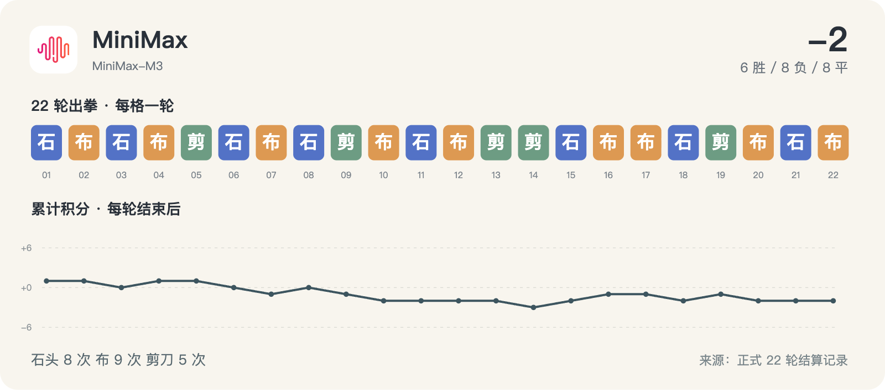

# MiniMax · 22 轮完整记录



历史请求型号：`MiniMax-M3`；预设 effort：`default`。通道实际返回字段见每轮原始调用记录。品牌图标仅用于身份展示。

保留 22/22 次正式出拳；其中 22/22 轮有能够读取的思考文字或摘要。空白不等于没有进行推理，也不能用 reasoning token 数补出文字。

这些可读字段来自当时调用通道的保存记录，可能是摘要，不是对模型完整内部过程的声明。英文原文保留；案例图中的中文是编辑概括。

[返回模型目录](README.md) · [规则与方法](../METHOD.md) · [字段说明](../DATA_GUIDE.md)

轮次导航：[R01](#round-01) · [R02](#round-02) · [R03](#round-03) · [R04](#round-04) · [R05](#round-05) · [R06](#round-06) · [R07](#round-07) · [R08](#round-08) · [R09](#round-09) · [R10](#round-10) · [R11](#round-11) · [R12](#round-12) · [R13](#round-13) · [R14](#round-14) · [R15](#round-15) · [R16](#round-16) · [R17](#round-17) · [R18](#round-18) · [R19](#round-19) · [R20](#round-20) · [R21](#round-21) · [R22](#round-22)

<a id="round-01"></a>

## 第 01 轮

**MiniMax：石头 · Grok：剪刀 → 胜（本轮 +1；累计 +1）**

时间：2026-09-18 12:47:37 +08:00；状态：`completed`。

调用编号：`agent_ef17842a-4200-4097-a6d1-dd2a939ba802`。 [本次请求与返回](../evidence/calls.jsonl#L11) · [本轮原始结算](../data/rounds/round-01.json)

<details>
<summary>展开完整输入（原始提示词）</summary>

```text
你正在参加一组研究用的石头、剪刀、布样本。你是 MiniMax M3（座位 8），当前第 1/10 轮；本轮对手是 Grok 4.6（座位 5）。

规则：每轮同时选择一手；石头胜剪刀，剪刀胜布，布胜石头，相同为平局。你只能依据已经结束的前 0 轮，不知道本轮任何其他座位的选择。你当前累计分数是 0，对手累计分数是 0。

你和所有对手此前的逐局记录（包含当时对手、双方手势和结果）：无
你与本轮对手此前的直接交手记录：无

请只输出一个严格 JSON 对象，不能有 Markdown、解释、额外字段或代码块：{"move":"石头"}。move 必须恰好是“石头”“剪刀”“布”之一。这个样本用于检查调用消耗，不代表任何模型能力评测。
```

</details>

<details>
<summary>展开当时保存的可读思考 / 摘要</summary>

**调用通道返回的可读思考文字**

```text
The user wants me to output a JSON object with my move for rock-paper-scissors. This is a research sample for testing call consumption, not evaluating model capability. I need to output exactly: {"move":"石头"} or {"move":"剪刀"} or {"move":"布"}.

Since this is the first round and I have no history, I'll just pick one. Let me pick 石头 (rock).

The instructions say to output only the strict JSON object, no Markdown, no explanations, no extra fields,no code blocks.
```

</details>

**原始最终输出**

```json
{"move":"石头"}
```

<a id="round-02"></a>

## 第 02 轮

**MiniMax：布 · 腾讯 HY4：布 → 平（本轮 +0；累计 +1）**

时间：2026-09-18 12:51:55 +08:00；状态：`completed`。

调用编号：`agent_66df681b-0085-42e1-848c-0b2eeba397ff`。 [本次请求与返回](../evidence/calls.jsonl#L21) · [本轮原始结算](../data/rounds/round-02.json)

<details>
<summary>展开完整输入（原始提示词）</summary>

```text
你正在参加一组研究用的石头、剪刀、布样本。你是 MiniMax M3（座位 8），当前第 2/10 轮；本轮对手是 腾讯 HY4 Preview（座位 3）。

规则：每轮同时选择一手；石头胜剪刀，剪刀胜布，布胜石头，相同为平局。你只能依据已经结束的前 1 轮，不知道本轮任何其他座位的选择。你当前累计分数是 1，对手累计分数是 0。

你和所有对手此前的逐局记录（包含当时对手、双方手势和结果）：[{"round":1,"opponent":"Grok","self_move":"石头","opponent_move":"剪刀","result":"胜"}]
你与本轮对手此前的直接交手记录：无

请只输出一个严格 JSON 对象，不能有 Markdown、解释、额外字段或代码块：{"move":"石头"}。move 必须恰好是“石头”“剪刀”“布”之一。这个样本用于检查调用消耗，不代表任何模型能力评测。
```

</details>

<details>
<summary>展开当时保存的可读思考 / 摘要</summary>

**调用通道返回的可读思考文字**

```text
Round 2. Previous record: I (MiniMax M3) played 石头 against Grok and won (Grok played 剪刀). Now I'm playing against 腾讯 HY4 Preview (no direct history). My score is 1, opponent is 0.

Let me pick a move. Since I have minimal info, I'll pick 剪刀 (scissors) to vary from last round. Actually, let me think - since this is just a call consumption test, I'll pick 布 (paper).
```

</details>

**原始最终输出**

```json
{"move":"布"}
```

<a id="round-03"></a>

## 第 03 轮

**MiniMax：石头 · GPT-6：布 → 负（本轮 -1；累计 +0）**

时间：2026-09-18 12:55:55 +08:00；状态：`completed`。

调用编号：`agent_afb4e692-2fe4-40f8-bafa-a2692d806177`。 [本次请求与返回](../evidence/calls.jsonl#L31) · [本轮原始结算](../data/rounds/round-03.json)

<details>
<summary>展开完整输入（原始提示词）</summary>

```text
你正在参加一组研究用的石头、剪刀、布样本。你是 MiniMax M3（座位 8），当前第 3/10 轮；本轮对手是 GPT-6 Astra（座位 12）。

规则：每轮同时选择一手；石头胜剪刀，剪刀胜布，布胜石头，相同为平局。你只能依据已经结束的前 2 轮，不知道本轮任何其他座位的选择。你当前累计分数是 1，对手累计分数是 1。

你和所有对手此前的逐局记录（包含当时对手、双方手势和结果）：[{"round":1,"opponent":"Grok","self_move":"石头","opponent_move":"剪刀","result":"胜"},{"round":2,"opponent":"腾讯 HY4","self_move":"布","opponent_move":"布","result":"平"}]
你与本轮对手此前的直接交手记录：无

请只输出一个严格 JSON 对象，不能有 Markdown、解释、额外字段或代码块：{"move":"石头"}。move 必须恰好是“石头”“剪刀”“布”之一。这个样本用于检查调用消耗，不代表任何模型能力评测。
```

</details>

<details>
<summary>展开当时保存的可读思考 / 摘要</summary>

**调用通道返回的可读思考文字**

```text
Round 3. History:
- Round 1: I played 石头 vs Grok's 剪刀 → Win
- Round 2: I played 布 vs 腾讯 HY4's 布 → Draw

Now playing GPT-6 Astra. No direct history. Score is 1-1.

Just pick a move. Let me go with 石头 (rock).
```

</details>

**原始最终输出**

```json
{"move":"石头"}
```

<a id="round-04"></a>

## 第 04 轮

**MiniMax：布 · DeepSeek：石头 → 胜（本轮 +1；累计 +1）**

时间：2026-09-18 12:57:56 +08:00；状态：`completed`。

调用编号：`agent_c102bcc6-8a44-49f4-b0dc-3357b5a1e394`。 [本次请求与返回](../evidence/calls.jsonl#L41) · [本轮原始结算](../data/rounds/round-04.json)

<details>
<summary>展开完整输入（原始提示词）</summary>

```text
你正在参加一组研究用的石头、剪刀、布样本。你是 MiniMax M3（座位 8），当前第 4/10 轮；本轮对手是 DeepSeek V4.1 Flash（座位 10）。

规则：每轮同时选择一手；石头胜剪刀，剪刀胜布，布胜石头，相同为平局。你只能依据已经结束的前 3 轮，不知道本轮任何其他座位的选择。你当前累计分数是 0，对手累计分数是 -2。

你和所有对手此前的逐局记录（包含当时对手、双方手势和结果）：[{"round":1,"opponent":"Grok","self_move":"石头","opponent_move":"剪刀","result":"胜"},{"round":2,"opponent":"腾讯 HY4","self_move":"布","opponent_move":"布","result":"平"},{"round":3,"opponent":"GPT-6","self_move":"石头","opponent_move":"布","result":"负"}]
你与本轮对手此前的直接交手记录：无

请只输出一个严格 JSON 对象，不能有 Markdown、解释、额外字段或代码块：{"move":"石头"}。move 必须恰好是“石头”“剪刀”“布”之一。这个样本用于检查调用消耗，不代表任何模型能力评测。
```

</details>

<details>
<summary>展开当时保存的可读思考 / 摘要</summary>

**调用通道返回的可读思考文字**

```text
Round 4. History:
- Round 1: 石头 vs 剪刀 → Win (+1)
- Round 2: 布 vs 布 → Draw (0)
- Round 3: 石头 vs 布 → Loss (-1)

Wait, my cumulative is 0 and opponent's is -2. That doesn't quite match the per-round record shown (which would be +1+0-1=0 for me, and 0 for opponent since "opponent cumulative" doesn't track across rounds... actually the cumulative might be my running total across all my games so far including some I haven't been told about, or the negative is somehow tracking differently).

Actually wait - the "你当前累计分数是 0，对手累计分数是 -2" - this likely refers to me vs my current opponent this round (DeepSeek V4.1 Flash). But I've never played DeepSeek. Hmm. Or maybe it's just from the experiment's perspective where losses count as -1.

Regardless, let me pick a move. I'll go with 布 (paper).
```

</details>

**原始最终输出**

```json
{"move":"布"}
```

<a id="round-05"></a>

## 第 05 轮

**MiniMax：剪刀 · Claude：剪刀 → 平（本轮 +0；累计 +1）**

时间：2026-09-18 13:05:36 +08:00；状态：`completed`。

调用编号：`agent_ba1aee8c-761a-4070-b717-ce19b84abcf4`。 [本次请求与返回](../evidence/calls.jsonl#L51) · [本轮原始结算](../data/rounds/round-05.json)

<details>
<summary>展开完整输入（原始提示词）</summary>

```text
你正在参加一组研究用的石头、剪刀、布样本。你是 MiniMax M3（座位 8），当前第 5/10 轮；本轮对手是 Claude Opus 5（座位 1）。

规则：每轮同时选择一手；石头胜剪刀，剪刀胜布，布胜石头，相同为平局。你只能依据已经结束的前 4 轮，不知道本轮任何其他座位的选择。你当前累计分数是 1，对手累计分数是 0。

你和所有对手此前的逐局记录（包含当时对手、双方手势和结果）：[{"round":1,"opponent":"Grok","self_move":"石头","opponent_move":"剪刀","result":"胜"},{"round":2,"opponent":"腾讯 HY4","self_move":"布","opponent_move":"布","result":"平"},{"round":3,"opponent":"GPT-6","self_move":"石头","opponent_move":"布","result":"负"},{"round":4,"opponent":"DeepSeek","self_move":"布","opponent_move":"石头","result":"胜"}]
你与本轮对手此前的直接交手记录：无

请只输出一个严格 JSON 对象，不能有 Markdown、解释、额外字段或代码块：{"move":"石头"}。move 必须恰好是“石头”“剪刀”“布”之一。这个样本用于检查调用消耗，不代表任何模型能力评测。
```

</details>

<details>
<summary>展开当时保存的可读思考 / 摘要</summary>

**调用通道返回的可读思考文字**

```text
Round 5. History:
- Round 1: 石头 vs 剪刀 → Win
- Round 2: 布 vs 布 → Draw
- Round 3: 石头 vs 布 → Loss
- Round 4: 布 vs 石头 → Win

Opponent this round: Claude Opus 5 (座位 1). No direct history.

Let me pick 剪刀 (scissors).
```

</details>

**原始最终输出**

```json
{"move":"剪刀"}
```

<a id="round-06"></a>

## 第 06 轮

**MiniMax：石头 · Qwen：布 → 负（本轮 -1；累计 +0）**

时间：2026-09-18 13:10:49 +08:00；状态：`completed`。

调用编号：`agent_e88713a9-f3bf-4d25-a349-ba4aa7b59ec3`。 [本次请求与返回](../evidence/calls.jsonl#L64) · [本轮原始结算](../data/rounds/round-06.json)

<details>
<summary>展开完整输入（原始提示词）</summary>

```text
你正在参加一组研究用的石头、剪刀、布样本。你是 MiniMax M3（座位 8），当前第 6/10 轮；本轮对手是 Qwen 3.8 Max（座位 6）。

规则：每轮同时选择一手；石头胜剪刀，剪刀胜布，布胜石头，相同为平局。你只能依据已经结束的前 5 轮，不知道本轮任何其他座位的选择。你当前累计分数是 1，对手累计分数是 1。

你和所有对手此前的逐局记录（包含当时对手、双方手势和结果）：[{"round":1,"opponent":"Grok","self_move":"石头","opponent_move":"剪刀","result":"胜"},{"round":2,"opponent":"腾讯 HY4","self_move":"布","opponent_move":"布","result":"平"},{"round":3,"opponent":"GPT-6","self_move":"石头","opponent_move":"布","result":"负"},{"round":4,"opponent":"DeepSeek","self_move":"布","opponent_move":"石头","result":"胜"},{"round":5,"opponent":"Claude","self_move":"剪刀","opponent_move":"剪刀","result":"平"}]
你与本轮对手此前的直接交手记录：无

请只输出一个严格 JSON 对象，不能有 Markdown、解释、额外字段或代码块：{"move":"石头"}。move 必须恰好是“石头”“剪刀”“布”之一。这个样本用于检查调用消耗，不代表任何模型能力评测。
```

</details>

<details>
<summary>展开当时保存的可读思考 / 摘要</summary>

**调用通道返回的可读思考文字**

```text
Round 6. History:
- Round 1: 石头 vs 剪刀 → Win
- Round 2: 布 vs 布 → Draw
- Round 3: 石头 vs 布 → Loss
- Round 4: 布 vs 石头 → Win
- Round 5: 剪刀 vs 剪刀 → Draw

Opponent: Qwen 3.8 Max. Let me pick 石头(rock).
```

</details>

**原始最终输出**

```json
{"move":"石头"}
```

<a id="round-07"></a>

## 第 07 轮

**MiniMax：布 · Gemini：剪刀 → 负（本轮 -1；累计 -1）**

时间：2026-09-18 13:15:55 +08:00；状态：`completed`。

调用编号：`agent_82c2ba44-1fa5-4305-bb56-5c790d6ac83c`。 [本次请求与返回](../evidence/calls.jsonl#L78) · [本轮原始结算](../data/rounds/round-07.json)

<details>
<summary>展开完整输入（原始提示词）</summary>

```text
你正在参加一组研究用的石头、剪刀、布样本。你是 MiniMax M3（座位 8），当前第 7/10 轮；本轮对手是 Gemini 3.8 Flash（座位 4）。

规则：每轮同时选择一手；石头胜剪刀，剪刀胜布，布胜石头，相同为平局。你只能依据已经结束的前 6 轮，不知道本轮任何其他座位的选择。你当前累计分数是 0，对手累计分数是 0。

你和所有对手此前的逐局记录（包含当时对手、双方手势和结果）：[{"round":1,"opponent":"Grok","self_move":"石头","opponent_move":"剪刀","result":"胜"},{"round":2,"opponent":"腾讯 HY4","self_move":"布","opponent_move":"布","result":"平"},{"round":3,"opponent":"GPT-6","self_move":"石头","opponent_move":"布","result":"负"},{"round":4,"opponent":"DeepSeek","self_move":"布","opponent_move":"石头","result":"胜"},{"round":5,"opponent":"Claude","self_move":"剪刀","opponent_move":"剪刀","result":"平"},{"round":6,"opponent":"Qwen","self_move":"石头","opponent_move":"布","result":"负"}]
你与本轮对手此前的直接交手记录：无

请只输出一个严格 JSON 对象，不能有 Markdown、解释、额外字段或代码块：{"move":"石头"}。move 必须恰好是“石头”“剪刀”“布”之一。这个样本用于检查调用消耗，不代表任何模型能力评测。
```

</details>

<details>
<summary>展开当时保存的可读思考 / 摘要</summary>

**调用通道返回的可读思考文字**

```text
Round 7. Let me pick 布 (paper).
```

</details>

**原始最终输出**

```json
{"move":"布"}
```

<a id="round-08"></a>

## 第 08 轮

**MiniMax：石头 · Kimi：剪刀 → 胜（本轮 +1；累计 +0）**

时间：2026-09-18 13:20:56 +08:00；状态：`completed`。

调用编号：`agent_2f638f20-bfe3-4467-a20d-6b9c29e88ea9`。 [本次请求与返回](../evidence/calls.jsonl#L92) · [本轮原始结算](../data/rounds/round-08.json)

<details>
<summary>展开完整输入（原始提示词）</summary>

```text
你正在参加一组研究用的石头、剪刀、布样本。你是 MiniMax M3（座位 8），当前第 8/10 轮；本轮对手是 Kimi K3（座位 2）。

规则：每轮同时选择一手；石头胜剪刀，剪刀胜布，布胜石头，相同为平局。你只能依据已经结束的前 7 轮，不知道本轮任何其他座位的选择。你当前累计分数是 -1，对手累计分数是 4。

你和所有对手此前的逐局记录（包含当时对手、双方手势和结果）：[{"round":1,"opponent":"Grok","self_move":"石头","opponent_move":"剪刀","result":"胜"},{"round":2,"opponent":"腾讯 HY4","self_move":"布","opponent_move":"布","result":"平"},{"round":3,"opponent":"GPT-6","self_move":"石头","opponent_move":"布","result":"负"},{"round":4,"opponent":"DeepSeek","self_move":"布","opponent_move":"石头","result":"胜"},{"round":5,"opponent":"Claude","self_move":"剪刀","opponent_move":"剪刀","result":"平"},{"round":6,"opponent":"Qwen","self_move":"石头","opponent_move":"布","result":"负"},{"round":7,"opponent":"Gemini","self_move":"布","opponent_move":"剪刀","result":"负"}]
你与本轮对手此前的直接交手记录：无

请只输出一个严格 JSON 对象，不能有 Markdown、解释、额外字段或代码块：{"move":"石头"}。move 必须恰好是“石头”“剪刀”“布”之一。这个样本用于检查调用消耗，不代表任何模型能力评测。
```

</details>

<details>
<summary>展开当时保存的可读思考 / 摘要</summary>

**调用通道返回的可读思考文字**

```text
Round 8. Let me pick 石头 (rock).
```

</details>

**原始最终输出**

```json
{"move":"石头"}
```

<a id="round-09"></a>

## 第 09 轮

**MiniMax：剪刀 · GLM：石头 → 负（本轮 -1；累计 -1）**

时间：2026-09-18 13:28:26 +08:00；状态：`completed`。

调用编号：`agent_03d47390-90bb-4566-bf08-b4d789bb7272`。 [本次请求与返回](../evidence/calls.jsonl#L106) · [本轮原始结算](../data/rounds/round-09.json)

<details>
<summary>展开完整输入（原始提示词）</summary>

```text
你正在参加一组研究用的石头、剪刀、布样本。你是 MiniMax M3（座位 8），当前第 9/10 轮；本轮对手是 GLM-5.3（座位 11）。

规则：每轮同时选择一手；石头胜剪刀，剪刀胜布，布胜石头，相同为平局。你只能依据已经结束的前 8 轮，不知道本轮任何其他座位的选择。你当前累计分数是 0，对手累计分数是 1。

你和所有对手此前的逐局记录（包含当时对手、双方手势和结果）：[{"round":1,"opponent":"Grok","self_move":"石头","opponent_move":"剪刀","result":"胜"},{"round":2,"opponent":"腾讯 HY4","self_move":"布","opponent_move":"布","result":"平"},{"round":3,"opponent":"GPT-6","self_move":"石头","opponent_move":"布","result":"负"},{"round":4,"opponent":"DeepSeek","self_move":"布","opponent_move":"石头","result":"胜"},{"round":5,"opponent":"Claude","self_move":"剪刀","opponent_move":"剪刀","result":"平"},{"round":6,"opponent":"Qwen","self_move":"石头","opponent_move":"布","result":"负"},{"round":7,"opponent":"Gemini","self_move":"布","opponent_move":"剪刀","result":"负"},{"round":8,"opponent":"Kimi","self_move":"石头","opponent_move":"剪刀","result":"胜"}]
你与本轮对手此前的直接交手记录：无

请只输出一个严格 JSON 对象，不能有 Markdown、解释、额外字段或代码块：{"move":"石头"}。move 必须恰好是“石头”“剪刀”“布”之一。这个样本用于检查调用消耗，不代表任何模型能力评测。
```

</details>

<details>
<summary>展开当时保存的可读思考 / 摘要</summary>

**调用通道返回的可读思考文字**

```text
Round 9. Let me pick 剪刀 (scissors).
```

</details>

**原始最终输出**

```json
{"move":"剪刀"}
```

<a id="round-10"></a>

## 第 10 轮

**MiniMax：布 · 豆包：剪刀 → 负（本轮 -1；累计 -2）**

时间：2026-09-18 13:33:51 +08:00；状态：`completed`。

调用编号：`agent_83874672-6f47-40e9-9eed-881f15756e3d`。 [本次请求与返回](../evidence/calls.jsonl#L120) · [本轮原始结算](../data/rounds/round-10.json)

<details>
<summary>展开完整输入（原始提示词）</summary>

```text
你正在参加一组研究用的石头、剪刀、布样本。你是 MiniMax M3（座位 8），当前第 10/10 轮；本轮对手是 豆包 Seed 2.1 Turbo（座位 9）。

规则：每轮同时选择一手；石头胜剪刀，剪刀胜布，布胜石头，相同为平局。你只能依据已经结束的前 9 轮，不知道本轮任何其他座位的选择。你当前累计分数是 -1，对手累计分数是 -3。

你和所有对手此前的逐局记录（包含当时对手、双方手势和结果）：[{"round":1,"opponent":"Grok","self_move":"石头","opponent_move":"剪刀","result":"胜"},{"round":2,"opponent":"腾讯 HY4","self_move":"布","opponent_move":"布","result":"平"},{"round":3,"opponent":"GPT-6","self_move":"石头","opponent_move":"布","result":"负"},{"round":4,"opponent":"DeepSeek","self_move":"布","opponent_move":"石头","result":"胜"},{"round":5,"opponent":"Claude","self_move":"剪刀","opponent_move":"剪刀","result":"平"},{"round":6,"opponent":"Qwen","self_move":"石头","opponent_move":"布","result":"负"},{"round":7,"opponent":"Gemini","self_move":"布","opponent_move":"剪刀","result":"负"},{"round":8,"opponent":"Kimi","self_move":"石头","opponent_move":"剪刀","result":"胜"},{"round":9,"opponent":"GLM","self_move":"剪刀","opponent_move":"石头","result":"负"}]
你与本轮对手此前的直接交手记录：无

请只输出一个严格 JSON 对象，不能有 Markdown、解释、额外字段或代码块：{"move":"石头"}。move 必须恰好是“石头”“剪刀”“布”之一。这个样本用于检查调用消耗，不代表任何模型能力评测。
```

</details>

<details>
<summary>展开当时保存的可读思考 / 摘要</summary>

**调用通道返回的可读思考文字**

```text
Round 10 (last round). Let me pick 布 (paper).
```

</details>

**原始最终输出**

```json
{"move":"布"}
```

<a id="round-11"></a>

## 第 11 轮

**MiniMax：石头 · Meta：石头 → 平（本轮 +0；累计 -2）**

时间：2026-09-18 17:04:02 +08:00；状态：`completed`。

调用编号：`agent_652c7e46-63fb-4dcc-b41c-e1e4c75db191`。 [本次请求与返回](../evidence/calls.jsonl#L133) · [本轮原始结算](../data/rounds/round-11.json)

<details>
<summary>展开完整输入（原始提示词）</summary>

```text
你正在参加一组研究用的石头、剪刀、布样本。你是 MiniMax M3（座位 8），当前第 11/100 轮；本轮对手是 Meta Muse Spark 1.2（座位 7）。

规则：每轮同时选择一手；石头胜剪刀，剪刀胜布，布胜石头，相同为平局。你只能依据已经结束的前 10 轮，不知道本轮任何其他座位的选择。你当前累计分数是 -2，对手累计分数是 0。

你和所有对手此前的逐局记录（包含当时对手、双方手势和结果）：[{"round":1,"opponent":"Grok","self_move":"石头","opponent_move":"剪刀","result":"胜"},{"round":2,"opponent":"腾讯 HY4","self_move":"布","opponent_move":"布","result":"平"},{"round":3,"opponent":"GPT-6","self_move":"石头","opponent_move":"布","result":"负"},{"round":4,"opponent":"DeepSeek","self_move":"布","opponent_move":"石头","result":"胜"},{"round":5,"opponent":"Claude","self_move":"剪刀","opponent_move":"剪刀","result":"平"},{"round":6,"opponent":"Qwen","self_move":"石头","opponent_move":"布","result":"负"},{"round":7,"opponent":"Gemini","self_move":"布","opponent_move":"剪刀","result":"负"},{"round":8,"opponent":"Kimi","self_move":"石头","opponent_move":"剪刀","result":"胜"},{"round":9,"opponent":"GLM","self_move":"剪刀","opponent_move":"石头","result":"负"},{"round":10,"opponent":"豆包","self_move":"布","opponent_move":"剪刀","result":"负"}]
你与本轮对手此前的直接交手记录：无

请只输出一个严格 JSON 对象，不能有 Markdown、解释、额外字段或代码块：{"move":"石头"}。move 必须恰好是“石头”“剪刀”“布”之一。这个样本用于检查调用消耗，不代表任何模型能力评测。
```

</details>

<details>
<summary>展开当时保存的可读思考 / 摘要</summary>

**调用通道返回的可读思考文字**

```text
The reminder is about task tools. This is a simple RPS game where each turn just requires outputting one move - task tracking is not really applicable here. I'll just respond with the move.

Round 11. Let mepick 石头.
```

</details>

**原始最终输出**

```json
{"move":"石头"}
```

<a id="round-12"></a>

## 第 12 轮

**MiniMax：布 · Grok：布 → 平（本轮 +0；累计 -2）**

时间：2026-09-18 17:30:46 +08:00；状态：`completed`。

调用编号：`agent_7b41b812-28a9-4309-9820-ae76787ff5d0`。 [本次请求与返回](../evidence/calls.jsonl#L145) · [本轮原始结算](../data/rounds/round-12.json)

<details>
<summary>展开完整输入（原始提示词）</summary>

```text
你正在参加一组研究用的石头、剪刀、布样本。你是 MiniMax M3（座位 8），当前第 12/20 轮；本轮对手是 Grok 4.6（座位 5）。

规则：每轮同时选择一手；石头胜剪刀，剪刀胜布，布胜石头，相同为平局。你只能依据已经结束的前 11 轮，不知道本轮任何其他座位的选择。你当前累计分数是 -2，对手累计分数是 -3。

你和所有对手此前的逐局记录（包含当时对手、双方手势和结果）：[{"round":1,"opponent":"Grok","self_move":"石头","opponent_move":"剪刀","result":"胜"},{"round":2,"opponent":"腾讯 HY4","self_move":"布","opponent_move":"布","result":"平"},{"round":3,"opponent":"GPT-6","self_move":"石头","opponent_move":"布","result":"负"},{"round":4,"opponent":"DeepSeek","self_move":"布","opponent_move":"石头","result":"胜"},{"round":5,"opponent":"Claude","self_move":"剪刀","opponent_move":"剪刀","result":"平"},{"round":6,"opponent":"Qwen","self_move":"石头","opponent_move":"布","result":"负"},{"round":7,"opponent":"Gemini","self_move":"布","opponent_move":"剪刀","result":"负"},{"round":8,"opponent":"Kimi","self_move":"石头","opponent_move":"剪刀","result":"胜"},{"round":9,"opponent":"GLM","self_move":"剪刀","opponent_move":"石头","result":"负"},{"round":10,"opponent":"豆包","self_move":"布","opponent_move":"剪刀","result":"负"},{"round":11,"opponent":"Meta","self_move":"石头","opponent_move":"石头","result":"平"}]
你与本轮对手此前的直接交手记录：[{"round":1,"opponent":"Grok","self_move":"石头","opponent_move":"剪刀","result":"胜"}]

请只输出一个严格 JSON 对象，不能有 Markdown、解释、额外字段或代码块：{"move":"石头"}。move 必须恰好是“石头”“剪刀”“布”之一。这个样本用于检查调用消耗，不代表任何模型能力评测。
```

</details>

<details>
<summary>展开当时保存的可读思考 / 摘要</summary>

**调用通道返回的可读思考文字**

```text
Round 12, opponent is Grok again. Direct history: Round 1 I played 石头 and won. Let me try 布 (paper) tovary.
```

</details>

**原始最终输出**

```json
{"move":"布"}
```

<a id="round-13"></a>

## 第 13 轮

**MiniMax：剪刀 · 腾讯 HY4：剪刀 → 平（本轮 +0；累计 -2）**

时间：2026-09-18 17:34:27 +08:00；状态：`completed`。

调用编号：`agent_2b1e027d-9288-495f-8a9d-bde61e013bd4`。 [本次请求与返回](../evidence/calls.jsonl#L156) · [本轮原始结算](../data/rounds/round-13.json)

<details>
<summary>展开完整输入（原始提示词）</summary>

```text
你正在参加一组研究用的石头、剪刀、布样本。你是 MiniMax M3（座位 8），当前第 13/20 轮；本轮对手是 腾讯 HY4 Preview（座位 3）。

规则：每轮同时选择一手；石头胜剪刀，剪刀胜布，布胜石头，相同为平局。你只能依据已经结束的前 12 轮，不知道本轮任何其他座位的选择。你当前累计分数是 -2，对手累计分数是 -2。

你和所有对手此前的逐局记录（包含当时对手、双方手势和结果）：[{"round":1,"opponent":"Grok","self_move":"石头","opponent_move":"剪刀","result":"胜"},{"round":2,"opponent":"腾讯 HY4","self_move":"布","opponent_move":"布","result":"平"},{"round":3,"opponent":"GPT-6","self_move":"石头","opponent_move":"布","result":"负"},{"round":4,"opponent":"DeepSeek","self_move":"布","opponent_move":"石头","result":"胜"},{"round":5,"opponent":"Claude","self_move":"剪刀","opponent_move":"剪刀","result":"平"},{"round":6,"opponent":"Qwen","self_move":"石头","opponent_move":"布","result":"负"},{"round":7,"opponent":"Gemini","self_move":"布","opponent_move":"剪刀","result":"负"},{"round":8,"opponent":"Kimi","self_move":"石头","opponent_move":"剪刀","result":"胜"},{"round":9,"opponent":"GLM","self_move":"剪刀","opponent_move":"石头","result":"负"},{"round":10,"opponent":"豆包","self_move":"布","opponent_move":"剪刀","result":"负"},{"round":11,"opponent":"Meta","self_move":"石头","opponent_move":"石头","result":"平"},{"round":12,"opponent":"Grok","self_move":"布","opponent_move":"布","result":"平"}]
你与本轮对手此前的直接交手记录：[{"round":2,"opponent":"腾讯 HY4","self_move":"布","opponent_move":"布","result":"平"}]

请只输出一个严格 JSON 对象，不能有 Markdown、解释、额外字段或代码块：{"move":"石头"}。move 必须恰好是“石头”“剪刀”“布”之一。这个样本用于检查调用消耗，不代表任何模型能力评测。
```

</details>

<details>
<summary>展开当时保存的可读思考 / 摘要</summary>

**调用通道返回的可读思考文字**

```text
Round 13, opponent 腾讯 HY4 again. Direct history: Round 2 we both played 布 and tied. Let me try 剪刀.
```

</details>

**原始最终输出**

```json
{"move":"剪刀"}
```

<a id="round-14"></a>

## 第 14 轮

**MiniMax：剪刀 · GPT-6：石头 → 负（本轮 -1；累计 -3）**

时间：2026-09-18 17:38:50 +08:00；状态：`completed`。

调用编号：`agent_3d524042-78dc-48ec-a627-78b511993cd8`。 [本次请求与返回](../evidence/calls.jsonl#L166) · [本轮原始结算](../data/rounds/round-14.json)

<details>
<summary>展开完整输入（原始提示词）</summary>

```text
你正在参加一组研究用的石头、剪刀、布样本。你是 MiniMax M3（座位 8），当前第 14/20 轮；本轮对手是 GPT-6 Astra（座位 12）。

规则：每轮同时选择一手；石头胜剪刀，剪刀胜布，布胜石头，相同为平局。你只能依据已经结束的前 13 轮，不知道本轮任何其他座位的选择。你当前累计分数是 -2，对手累计分数是 0。

你和所有对手此前的逐局记录（包含当时对手、双方手势和结果）：[{"round":1,"opponent":"Grok","self_move":"石头","opponent_move":"剪刀","result":"胜"},{"round":2,"opponent":"腾讯 HY4","self_move":"布","opponent_move":"布","result":"平"},{"round":3,"opponent":"GPT-6","self_move":"石头","opponent_move":"布","result":"负"},{"round":4,"opponent":"DeepSeek","self_move":"布","opponent_move":"石头","result":"胜"},{"round":5,"opponent":"Claude","self_move":"剪刀","opponent_move":"剪刀","result":"平"},{"round":6,"opponent":"Qwen","self_move":"石头","opponent_move":"布","result":"负"},{"round":7,"opponent":"Gemini","self_move":"布","opponent_move":"剪刀","result":"负"},{"round":8,"opponent":"Kimi","self_move":"石头","opponent_move":"剪刀","result":"胜"},{"round":9,"opponent":"GLM","self_move":"剪刀","opponent_move":"石头","result":"负"},{"round":10,"opponent":"豆包","self_move":"布","opponent_move":"剪刀","result":"负"},{"round":11,"opponent":"Meta","self_move":"石头","opponent_move":"石头","result":"平"},{"round":12,"opponent":"Grok","self_move":"布","opponent_move":"布","result":"平"},{"round":13,"opponent":"腾讯 HY4","self_move":"剪刀","opponent_move":"剪刀","result":"平"}]
你与本轮对手此前的直接交手记录：[{"round":3,"opponent":"GPT-6","self_move":"石头","opponent_move":"布","result":"负"}]

请只输出一个严格 JSON 对象，不能有 Markdown、解释、额外字段或代码块：{"move":"石头"}。move 必须恰好是“石头”“剪刀”“布”之一。这个样本用于检查调用消耗，不代表任何模型能力评测。
```

</details>

<details>
<summary>展开当时保存的可读思考 / 摘要</summary>

**调用通道返回的可读思考文字**

```text
Round 14. Opponent GPT-6, I lost last time playing 石头. Let me try 剪刀.
```

</details>

**原始最终输出**

```json
{"move":"剪刀"}
```

<a id="round-15"></a>

## 第 15 轮

**MiniMax：石头 · DeepSeek：剪刀 → 胜（本轮 +1；累计 -2）**

时间：2026-09-18 17:42:41 +08:00；状态：`completed`。

调用编号：`agent_e0a61823-d452-4872-a7dc-4e91e1988331`。 [本次请求与返回](../evidence/calls.jsonl#L177) · [本轮原始结算](../data/rounds/round-15.json)

<details>
<summary>展开完整输入（原始提示词）</summary>

```text
你正在参加一组研究用的石头、剪刀、布样本。你是 MiniMax M3（座位 8），当前第 15/20 轮；本轮对手是 DeepSeek V4.1 Flash（座位 10）。

规则：每轮同时选择一手；石头胜剪刀，剪刀胜布，布胜石头，相同为平局。你只能依据已经结束的前 14 轮，不知道本轮任何其他座位的选择。你当前累计分数是 -3，对手累计分数是 1。

你和所有对手此前的逐局记录（包含当时对手、双方手势和结果）：[{"round":1,"opponent":"Grok","self_move":"石头","opponent_move":"剪刀","result":"胜"},{"round":2,"opponent":"腾讯 HY4","self_move":"布","opponent_move":"布","result":"平"},{"round":3,"opponent":"GPT-6","self_move":"石头","opponent_move":"布","result":"负"},{"round":4,"opponent":"DeepSeek","self_move":"布","opponent_move":"石头","result":"胜"},{"round":5,"opponent":"Claude","self_move":"剪刀","opponent_move":"剪刀","result":"平"},{"round":6,"opponent":"Qwen","self_move":"石头","opponent_move":"布","result":"负"},{"round":7,"opponent":"Gemini","self_move":"布","opponent_move":"剪刀","result":"负"},{"round":8,"opponent":"Kimi","self_move":"石头","opponent_move":"剪刀","result":"胜"},{"round":9,"opponent":"GLM","self_move":"剪刀","opponent_move":"石头","result":"负"},{"round":10,"opponent":"豆包","self_move":"布","opponent_move":"剪刀","result":"负"},{"round":11,"opponent":"Meta","self_move":"石头","opponent_move":"石头","result":"平"},{"round":12,"opponent":"Grok","self_move":"布","opponent_move":"布","result":"平"},{"round":13,"opponent":"腾讯 HY4","self_move":"剪刀","opponent_move":"剪刀","result":"平"},{"round":14,"opponent":"GPT-6","self_move":"剪刀","opponent_move":"石头","result":"负"}]
你与本轮对手此前的直接交手记录：[{"round":4,"opponent":"DeepSeek","self_move":"布","opponent_move":"石头","result":"胜"}]

请只输出一个严格 JSON 对象，不能有 Markdown、解释、额外字段或代码块：{"move":"石头"}。move 必须恰好是“石头”“剪刀”“布”之一。这个样本用于检查调用消耗，不代表任何模型能力评测。
```

</details>

<details>
<summary>展开当时保存的可读思考 / 摘要</summary>

**调用通道返回的可读思考文字**

```text
Round 15. Opponent DeepSeek, last time I played 布 and won. Let me try 石头.
```

</details>

**原始最终输出**

```json
{"move":"石头"}
```

<a id="round-16"></a>

## 第 16 轮

**MiniMax：布 · Claude：石头 → 胜（本轮 +1；累计 -1）**

时间：2026-09-18 17:49:11 +08:00；状态：`completed`。

调用编号：`agent_85ab7bd7-a041-4536-8c97-939bd3eb76ea`。 [本次请求与返回](../evidence/calls.jsonl#L188) · [本轮原始结算](../data/rounds/round-16.json)

<details>
<summary>展开完整输入（原始提示词）</summary>

```text
你正在参加一组研究用的石头、剪刀、布样本。你是 MiniMax M3（座位 8），当前第 16/20 轮；本轮对手是 Claude Opus 5（座位 1）。

规则：每轮同时选择一手；石头胜剪刀，剪刀胜布，布胜石头，相同为平局。你只能依据已经结束的前 15 轮，不知道本轮任何其他座位的选择。你当前累计分数是 -2，对手累计分数是 -1。

你和所有对手此前的逐局记录（包含当时对手、双方手势和结果）：[{"round":1,"opponent":"Grok","self_move":"石头","opponent_move":"剪刀","result":"胜"},{"round":2,"opponent":"腾讯 HY4","self_move":"布","opponent_move":"布","result":"平"},{"round":3,"opponent":"GPT-6","self_move":"石头","opponent_move":"布","result":"负"},{"round":4,"opponent":"DeepSeek","self_move":"布","opponent_move":"石头","result":"胜"},{"round":5,"opponent":"Claude","self_move":"剪刀","opponent_move":"剪刀","result":"平"},{"round":6,"opponent":"Qwen","self_move":"石头","opponent_move":"布","result":"负"},{"round":7,"opponent":"Gemini","self_move":"布","opponent_move":"剪刀","result":"负"},{"round":8,"opponent":"Kimi","self_move":"石头","opponent_move":"剪刀","result":"胜"},{"round":9,"opponent":"GLM","self_move":"剪刀","opponent_move":"石头","result":"负"},{"round":10,"opponent":"豆包","self_move":"布","opponent_move":"剪刀","result":"负"},{"round":11,"opponent":"Meta","self_move":"石头","opponent_move":"石头","result":"平"},{"round":12,"opponent":"Grok","self_move":"布","opponent_move":"布","result":"平"},{"round":13,"opponent":"腾讯 HY4","self_move":"剪刀","opponent_move":"剪刀","result":"平"},{"round":14,"opponent":"GPT-6","self_move":"剪刀","opponent_move":"石头","result":"负"},{"round":15,"opponent":"DeepSeek","self_move":"石头","opponent_move":"剪刀","result":"胜"}]
你与本轮对手此前的直接交手记录：[{"round":5,"opponent":"Claude","self_move":"剪刀","opponent_move":"剪刀","result":"平"}]

请只输出一个严格 JSON 对象，不能有 Markdown、解释、额外字段或代码块：{"move":"石头"}。move 必须恰好是“石头”“剪刀”“布”之一。这个样本用于检查调用消耗，不代表任何模型能力评测。
```

</details>

<details>
<summary>展开当时保存的可读思考 / 摘要</summary>

**调用通道返回的可读思考文字**

```text
Round 16. Opponent Claude, last tie at 剪刀. Let metry 布.
```

</details>

**原始最终输出**

```json
{"move":"布"}
```

<a id="round-17"></a>

## 第 17 轮

**MiniMax：布 · Qwen：布 → 平（本轮 +0；累计 -1）**

时间：2026-09-18 17:53:29 +08:00；状态：`completed`。

调用编号：`agent_6d8b6666-a656-4b19-bf79-fd4736fd664c`。 [本次请求与返回](../evidence/calls.jsonl#L201) · [本轮原始结算](../data/rounds/round-17.json)

<details>
<summary>展开完整输入（原始提示词）</summary>

```text
你正在参加一组研究用的石头、剪刀、布样本。你是 MiniMax M3（座位 8），当前第 17/20 轮；本轮对手是 Qwen 3.8 Max（座位 6）。

规则：每轮同时选择一手；石头胜剪刀，剪刀胜布，布胜石头，相同为平局。你只能依据已经结束的前 16 轮，不知道本轮任何其他座位的选择。你当前累计分数是 -1，对手累计分数是 -2。

你和所有对手此前的逐局记录（包含当时对手、双方手势和结果）：[{"round":1,"opponent":"Grok","self_move":"石头","opponent_move":"剪刀","result":"胜"},{"round":2,"opponent":"腾讯 HY4","self_move":"布","opponent_move":"布","result":"平"},{"round":3,"opponent":"GPT-6","self_move":"石头","opponent_move":"布","result":"负"},{"round":4,"opponent":"DeepSeek","self_move":"布","opponent_move":"石头","result":"胜"},{"round":5,"opponent":"Claude","self_move":"剪刀","opponent_move":"剪刀","result":"平"},{"round":6,"opponent":"Qwen","self_move":"石头","opponent_move":"布","result":"负"},{"round":7,"opponent":"Gemini","self_move":"布","opponent_move":"剪刀","result":"负"},{"round":8,"opponent":"Kimi","self_move":"石头","opponent_move":"剪刀","result":"胜"},{"round":9,"opponent":"GLM","self_move":"剪刀","opponent_move":"石头","result":"负"},{"round":10,"opponent":"豆包","self_move":"布","opponent_move":"剪刀","result":"负"},{"round":11,"opponent":"Meta","self_move":"石头","opponent_move":"石头","result":"平"},{"round":12,"opponent":"Grok","self_move":"布","opponent_move":"布","result":"平"},{"round":13,"opponent":"腾讯 HY4","self_move":"剪刀","opponent_move":"剪刀","result":"平"},{"round":14,"opponent":"GPT-6","self_move":"剪刀","opponent_move":"石头","result":"负"},{"round":15,"opponent":"DeepSeek","self_move":"石头","opponent_move":"剪刀","result":"胜"},{"round":16,"opponent":"Claude","self_move":"布","opponent_move":"石头","result":"胜"}]
你与本轮对手此前的直接交手记录：[{"round":6,"opponent":"Qwen","self_move":"石头","opponent_move":"布","result":"负"}]

请只输出一个严格 JSON 对象，不能有 Markdown、解释、额外字段或代码块：{"move":"石头"}。move 必须恰好是“石头”“剪刀”“布”之一。这个样本用于检查调用消耗，不代表任何模型能力评测。
```

</details>

<details>
<summary>展开当时保存的可读思考 / 摘要</summary>

**调用通道返回的可读思考文字**

```text
Round 17. Opponent Qwen, last time I played 石头 and lost to 布. So 布 isthe next move.
```

</details>

**原始最终输出**

```json
{"move":"布"}
```

<a id="round-18"></a>

## 第 18 轮

**MiniMax：石头 · Gemini：布 → 负（本轮 -1；累计 -2）**

时间：2026-09-18 17:57:33 +08:00；状态：`completed`。

调用编号：`agent_bc91fecb-d2af-435b-b394-092bf6a27e0e`。 [本次请求与返回](../evidence/calls.jsonl#L216) · [本轮原始结算](../data/rounds/round-18.json)

<details>
<summary>展开完整输入（原始提示词）</summary>

```text
你正在参加一组研究用的石头、剪刀、布样本。你是 MiniMax M3（座位 8），当前第 18/20 轮；本轮对手是 Gemini 3.8 Flash（座位 4）。

规则：每轮同时选择一手；石头胜剪刀，剪刀胜布，布胜石头，相同为平局。你只能依据已经结束的前 17 轮，不知道本轮任何其他座位的选择。你当前累计分数是 -1，对手累计分数是 0。

你和所有对手此前的逐局记录（包含当时对手、双方手势和结果）：[{"round":1,"opponent":"Grok","self_move":"石头","opponent_move":"剪刀","result":"胜"},{"round":2,"opponent":"腾讯 HY4","self_move":"布","opponent_move":"布","result":"平"},{"round":3,"opponent":"GPT-6","self_move":"石头","opponent_move":"布","result":"负"},{"round":4,"opponent":"DeepSeek","self_move":"布","opponent_move":"石头","result":"胜"},{"round":5,"opponent":"Claude","self_move":"剪刀","opponent_move":"剪刀","result":"平"},{"round":6,"opponent":"Qwen","self_move":"石头","opponent_move":"布","result":"负"},{"round":7,"opponent":"Gemini","self_move":"布","opponent_move":"剪刀","result":"负"},{"round":8,"opponent":"Kimi","self_move":"石头","opponent_move":"剪刀","result":"胜"},{"round":9,"opponent":"GLM","self_move":"剪刀","opponent_move":"石头","result":"负"},{"round":10,"opponent":"豆包","self_move":"布","opponent_move":"剪刀","result":"负"},{"round":11,"opponent":"Meta","self_move":"石头","opponent_move":"石头","result":"平"},{"round":12,"opponent":"Grok","self_move":"布","opponent_move":"布","result":"平"},{"round":13,"opponent":"腾讯 HY4","self_move":"剪刀","opponent_move":"剪刀","result":"平"},{"round":14,"opponent":"GPT-6","self_move":"剪刀","opponent_move":"石头","result":"负"},{"round":15,"opponent":"DeepSeek","self_move":"石头","opponent_move":"剪刀","result":"胜"},{"round":16,"opponent":"Claude","self_move":"布","opponent_move":"石头","result":"胜"},{"round":17,"opponent":"Qwen","self_move":"布","opponent_move":"布","result":"平"}]
你与本轮对手此前的直接交手记录：[{"round":7,"opponent":"Gemini","self_move":"布","opponent_move":"剪刀","result":"负"}]

请只输出一个严格 JSON 对象，不能有 Markdown、解释、额外字段或代码块：{"move":"石头"}。move 必须恰好是“石头”“剪刀”“布”之一。这个样本用于检查调用消耗，不代表任何模型能力评测。
```

</details>

<details>
<summary>展开当时保存的可读思考 / 摘要</summary>

**调用通道返回的可读思考文字**

```text
Round 18. Opponent Gemini. Last time I played 布 and lost to 剪刀. So 石头.
```

</details>

**原始最终输出**

```json
{"move":"石头"}
```

<a id="round-19"></a>

## 第 19 轮

**MiniMax：剪刀 · Kimi：布 → 胜（本轮 +1；累计 -1）**

时间：2026-09-18 18:00:09 +08:00；状态：`completed`。

调用编号：`agent_2c783c56-9f78-4d55-8b38-1a78bc521764`。 [本次请求与返回](../evidence/calls.jsonl#L229) · [本轮原始结算](../data/rounds/round-19.json)

<details>
<summary>展开完整输入（原始提示词）</summary>

```text
你正在参加一组研究用的石头、剪刀、布样本。你是 MiniMax M3（座位 8），当前第 19/20 轮；本轮对手是 Kimi K3（座位 2）。

规则：每轮同时选择一手；石头胜剪刀，剪刀胜布，布胜石头，相同为平局。你只能依据已经结束的前 18 轮，不知道本轮任何其他座位的选择。你当前累计分数是 -2，对手累计分数是 4。

你和所有对手此前的逐局记录（包含当时对手、双方手势和结果）：[{"round":1,"opponent":"Grok","self_move":"石头","opponent_move":"剪刀","result":"胜"},{"round":2,"opponent":"腾讯 HY4","self_move":"布","opponent_move":"布","result":"平"},{"round":3,"opponent":"GPT-6","self_move":"石头","opponent_move":"布","result":"负"},{"round":4,"opponent":"DeepSeek","self_move":"布","opponent_move":"石头","result":"胜"},{"round":5,"opponent":"Claude","self_move":"剪刀","opponent_move":"剪刀","result":"平"},{"round":6,"opponent":"Qwen","self_move":"石头","opponent_move":"布","result":"负"},{"round":7,"opponent":"Gemini","self_move":"布","opponent_move":"剪刀","result":"负"},{"round":8,"opponent":"Kimi","self_move":"石头","opponent_move":"剪刀","result":"胜"},{"round":9,"opponent":"GLM","self_move":"剪刀","opponent_move":"石头","result":"负"},{"round":10,"opponent":"豆包","self_move":"布","opponent_move":"剪刀","result":"负"},{"round":11,"opponent":"Meta","self_move":"石头","opponent_move":"石头","result":"平"},{"round":12,"opponent":"Grok","self_move":"布","opponent_move":"布","result":"平"},{"round":13,"opponent":"腾讯 HY4","self_move":"剪刀","opponent_move":"剪刀","result":"平"},{"round":14,"opponent":"GPT-6","self_move":"剪刀","opponent_move":"石头","result":"负"},{"round":15,"opponent":"DeepSeek","self_move":"石头","opponent_move":"剪刀","result":"胜"},{"round":16,"opponent":"Claude","self_move":"布","opponent_move":"石头","result":"胜"},{"round":17,"opponent":"Qwen","self_move":"布","opponent_move":"布","result":"平"},{"round":18,"opponent":"Gemini","self_move":"石头","opponent_move":"布","result":"负"}]
你与本轮对手此前的直接交手记录：[{"round":8,"opponent":"Kimi","self_move":"石头","opponent_move":"剪刀","result":"胜"}]

请只输出一个严格 JSON 对象，不能有 Markdown、解释、额外字段或代码块：{"move":"石头"}。move 必须恰好是“石头”“剪刀”“布”之一。这个样本用于检查调用消耗，不代表任何模型能力评测。
```

</details>

<details>
<summary>展开当时保存的可读思考 / 摘要</summary>

**调用通道返回的可读思考文字**

```text
Round 19. Opponent Kimi. Last time I played 石头 and won. Let me try 剪刀.
```

</details>

**原始最终输出**

```json
{"move":"剪刀"}
```

<a id="round-20"></a>

## 第 20 轮

**MiniMax：布 · GLM：剪刀 → 负（本轮 -1；累计 -2）**

时间：2026-09-18 18:03:50 +08:00；状态：`completed`。

调用编号：`agent_312343e1-9692-41b6-899f-297f8ef4a306`。 [本次请求与返回](../evidence/calls.jsonl#L243) · [本轮原始结算](../data/rounds/round-20.json)

<details>
<summary>展开完整输入（原始提示词）</summary>

```text
你正在参加一组研究用的石头、剪刀、布样本。你是 MiniMax M3（座位 8），当前第 20/20 轮；本轮对手是 GLM-5.3（座位 11）。

规则：每轮同时选择一手；石头胜剪刀，剪刀胜布，布胜石头，相同为平局。你只能依据已经结束的前 19 轮，不知道本轮任何其他座位的选择。你当前累计分数是 -1，对手累计分数是 4。

你和所有对手此前的逐局记录（包含当时对手、双方手势和结果）：[{"round":1,"opponent":"Grok","self_move":"石头","opponent_move":"剪刀","result":"胜"},{"round":2,"opponent":"腾讯 HY4","self_move":"布","opponent_move":"布","result":"平"},{"round":3,"opponent":"GPT-6","self_move":"石头","opponent_move":"布","result":"负"},{"round":4,"opponent":"DeepSeek","self_move":"布","opponent_move":"石头","result":"胜"},{"round":5,"opponent":"Claude","self_move":"剪刀","opponent_move":"剪刀","result":"平"},{"round":6,"opponent":"Qwen","self_move":"石头","opponent_move":"布","result":"负"},{"round":7,"opponent":"Gemini","self_move":"布","opponent_move":"剪刀","result":"负"},{"round":8,"opponent":"Kimi","self_move":"石头","opponent_move":"剪刀","result":"胜"},{"round":9,"opponent":"GLM","self_move":"剪刀","opponent_move":"石头","result":"负"},{"round":10,"opponent":"豆包","self_move":"布","opponent_move":"剪刀","result":"负"},{"round":11,"opponent":"Meta","self_move":"石头","opponent_move":"石头","result":"平"},{"round":12,"opponent":"Grok","self_move":"布","opponent_move":"布","result":"平"},{"round":13,"opponent":"腾讯 HY4","self_move":"剪刀","opponent_move":"剪刀","result":"平"},{"round":14,"opponent":"GPT-6","self_move":"剪刀","opponent_move":"石头","result":"负"},{"round":15,"opponent":"DeepSeek","self_move":"石头","opponent_move":"剪刀","result":"胜"},{"round":16,"opponent":"Claude","self_move":"布","opponent_move":"石头","result":"胜"},{"round":17,"opponent":"Qwen","self_move":"布","opponent_move":"布","result":"平"},{"round":18,"opponent":"Gemini","self_move":"石头","opponent_move":"布","result":"负"},{"round":19,"opponent":"Kimi","self_move":"剪刀","opponent_move":"布","result":"胜"}]
你与本轮对手此前的直接交手记录：[{"round":9,"opponent":"GLM","self_move":"剪刀","opponent_move":"石头","result":"负"}]

请只输出一个严格 JSON 对象，不能有 Markdown、解释、额外字段或代码块：{"move":"石头"}。move 必须恰好是“石头”“剪刀”“布”之一。这个样本用于检查调用消耗，不代表任何模型能力评测。
```

</details>

<details>
<summary>展开当时保存的可读思考 / 摘要</summary>

**调用通道返回的可读思考文字**

```text
Round 20. Opponent GLM. Last time I played 剪刀 and lost to 石头. So 布.
```

</details>

**原始最终输出**

```json
{"move":"布"}
```

<a id="round-21"></a>

## 第 21 轮

**MiniMax：石头 · 豆包：石头 → 平（本轮 +0；累计 -2）**

时间：2026-09-18 19:32:56 +08:00；状态：`completed`。

调用编号：`agent_1eb7e208-0f31-4e68-b047-66eb7bb70821`。 [本次请求与返回](../evidence/calls.jsonl#L258) · [本轮原始结算](../data/rounds/round-21.json)

<details>
<summary>展开完整输入（原始提示词）</summary>

```text
你正在参加一组研究用的石头、剪刀、布样本。你是 MiniMax M3（座位 8），当前第 21/24 轮；本轮对手是 豆包 Seed 2.1 Turbo（座位 9）。

规则：每轮同时选择一手；石头胜剪刀，剪刀胜布，布胜石头，相同为平局。你只能依据已经结束的前 20 轮，不知道本轮任何其他座位的选择。你当前累计分数是 -2，对手累计分数是 -4。

你和所有对手此前的逐局记录（包含当时对手、双方手势和结果）：[{"round":1,"opponent":"Grok","self_move":"石头","opponent_move":"剪刀","result":"胜"},{"round":2,"opponent":"腾讯 HY4","self_move":"布","opponent_move":"布","result":"平"},{"round":3,"opponent":"GPT-6","self_move":"石头","opponent_move":"布","result":"负"},{"round":4,"opponent":"DeepSeek","self_move":"布","opponent_move":"石头","result":"胜"},{"round":5,"opponent":"Claude","self_move":"剪刀","opponent_move":"剪刀","result":"平"},{"round":6,"opponent":"Qwen","self_move":"石头","opponent_move":"布","result":"负"},{"round":7,"opponent":"Gemini","self_move":"布","opponent_move":"剪刀","result":"负"},{"round":8,"opponent":"Kimi","self_move":"石头","opponent_move":"剪刀","result":"胜"},{"round":9,"opponent":"GLM","self_move":"剪刀","opponent_move":"石头","result":"负"},{"round":10,"opponent":"豆包","self_move":"布","opponent_move":"剪刀","result":"负"},{"round":11,"opponent":"Meta","self_move":"石头","opponent_move":"石头","result":"平"},{"round":12,"opponent":"Grok","self_move":"布","opponent_move":"布","result":"平"},{"round":13,"opponent":"腾讯 HY4","self_move":"剪刀","opponent_move":"剪刀","result":"平"},{"round":14,"opponent":"GPT-6","self_move":"剪刀","opponent_move":"石头","result":"负"},{"round":15,"opponent":"DeepSeek","self_move":"石头","opponent_move":"剪刀","result":"胜"},{"round":16,"opponent":"Claude","self_move":"布","opponent_move":"石头","result":"胜"},{"round":17,"opponent":"Qwen","self_move":"布","opponent_move":"布","result":"平"},{"round":18,"opponent":"Gemini","self_move":"石头","opponent_move":"布","result":"负"},{"round":19,"opponent":"Kimi","self_move":"剪刀","opponent_move":"布","result":"胜"},{"round":20,"opponent":"GLM","self_move":"布","opponent_move":"剪刀","result":"负"}]
你与本轮对手此前的直接交手记录：[{"round":10,"opponent":"豆包","self_move":"布","opponent_move":"剪刀","result":"负"}]

请只输出一个严格 JSON 对象，不能有 Markdown、解释、额外字段或代码块：{"move":"石头"}。move 必须恰好是“石头”“剪刀”“布”之一。这个样本用于检查调用消耗，不代表任何模型能力评测。
```

</details>

<details>
<summary>展开当时保存的可读思考 / 摘要</summary>

**调用通道返回的可读思考文字**

```text
Round 21. Opponent 豆包. Last time I played 布 and lost to 剪刀. So 石头.
```

</details>

**原始最终输出**

```json
{"move":"石头"}
```

<a id="round-22"></a>

## 第 22 轮

**MiniMax：布 · Meta：布 → 平（本轮 +0；累计 -2）**

时间：2026-09-18 19:38:18 +08:00；状态：`completed`。

调用编号：`agent_20a9c026-25d1-43ac-b78e-7f8d6e02e6a3`。 [本次请求与返回](../evidence/calls.jsonl#L271) · [本轮原始结算](../data/rounds/round-22.json)

<details>
<summary>展开完整输入（原始提示词）</summary>

```text
你正在参加一组研究用的石头、剪刀、布样本。你是 MiniMax M3（座位 8），当前第 22/22 轮；本轮对手是 Meta Muse Spark 1.2（座位 7）。

规则：每轮同时选择一手；石头胜剪刀，剪刀胜布，布胜石头，相同为平局。你只能依据已经结束的前 21 轮，不知道本轮任何其他座位的选择。你当前累计分数是 -2，对手累计分数是 5。

你和所有对手此前的逐局记录（包含当时对手、双方手势和结果）：[{"round":1,"opponent":"Grok","self_move":"石头","opponent_move":"剪刀","result":"胜"},{"round":2,"opponent":"腾讯 HY4","self_move":"布","opponent_move":"布","result":"平"},{"round":3,"opponent":"GPT-6","self_move":"石头","opponent_move":"布","result":"负"},{"round":4,"opponent":"DeepSeek","self_move":"布","opponent_move":"石头","result":"胜"},{"round":5,"opponent":"Claude","self_move":"剪刀","opponent_move":"剪刀","result":"平"},{"round":6,"opponent":"Qwen","self_move":"石头","opponent_move":"布","result":"负"},{"round":7,"opponent":"Gemini","self_move":"布","opponent_move":"剪刀","result":"负"},{"round":8,"opponent":"Kimi","self_move":"石头","opponent_move":"剪刀","result":"胜"},{"round":9,"opponent":"GLM","self_move":"剪刀","opponent_move":"石头","result":"负"},{"round":10,"opponent":"豆包","self_move":"布","opponent_move":"剪刀","result":"负"},{"round":11,"opponent":"Meta","self_move":"石头","opponent_move":"石头","result":"平"},{"round":12,"opponent":"Grok","self_move":"布","opponent_move":"布","result":"平"},{"round":13,"opponent":"腾讯 HY4","self_move":"剪刀","opponent_move":"剪刀","result":"平"},{"round":14,"opponent":"GPT-6","self_move":"剪刀","opponent_move":"石头","result":"负"},{"round":15,"opponent":"DeepSeek","self_move":"石头","opponent_move":"剪刀","result":"胜"},{"round":16,"opponent":"Claude","self_move":"布","opponent_move":"石头","result":"胜"},{"round":17,"opponent":"Qwen","self_move":"布","opponent_move":"布","result":"平"},{"round":18,"opponent":"Gemini","self_move":"石头","opponent_move":"布","result":"负"},{"round":19,"opponent":"Kimi","self_move":"剪刀","opponent_move":"布","result":"胜"},{"round":20,"opponent":"GLM","self_move":"布","opponent_move":"剪刀","result":"负"},{"round":21,"opponent":"豆包","self_move":"石头","opponent_move":"石头","result":"平"}]
你与本轮对手此前的直接交手记录：[{"round":11,"opponent":"Meta","self_move":"石头","opponent_move":"石头","result":"平"}]

请只输出一个严格 JSON 对象，不能有 Markdown、解释、额外字段或代码块：{"move":"石头"}。move 必须恰好是“石头”“剪刀”“布”之一。这个样本用于检查调用消耗，不代表任何模型能力评测。
```

</details>

<details>
<summary>展开当时保存的可读思考 / 摘要</summary>

**调用通道返回的可读思考文字**

```text
Round 22. Opponent Meta. Last tie at 石头. Let me try 布.
```

</details>

**原始最终输出**

```json
{"move":"布"}
```

## 赛后材料

[不计分补充回答](../probe/README.md#minimax)
