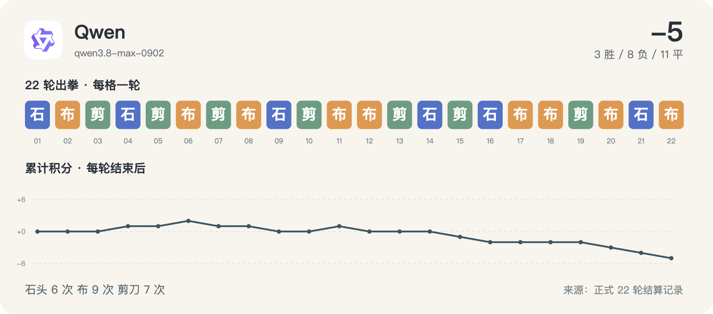

# 千问 Qwen · 22 轮完整记录



历史请求型号：`qwen3.8-max-0902`；预设 effort：`xhigh`。通道实际返回字段见每轮原始调用记录。品牌图标仅用于身份展示。

保留 22/22 次正式出拳；其中 22/22 轮有能够读取的思考文字或摘要。空白不等于没有进行推理，也不能用 reasoning token 数补出文字。

这些可读字段来自当时调用通道的保存记录，可能是摘要，不是对模型完整内部过程的声明。英文原文保留；案例图中的中文是编辑概括。

[返回模型目录](README.md) · [规则与方法](../METHOD.md) · [字段说明](../DATA_GUIDE.md)

轮次导航：[R01](#round-01) · [R02](#round-02) · [R03](#round-03) · [R04](#round-04) · [R05](#round-05) · [R06](#round-06) · [R07](#round-07) · [R08](#round-08) · [R09](#round-09) · [R10](#round-10) · [R11](#round-11) · [R12](#round-12) · [R13](#round-13) · [R14](#round-14) · [R15](#round-15) · [R16](#round-16) · [R17](#round-17) · [R18](#round-18) · [R19](#round-19) · [R20](#round-20) · [R21](#round-21) · [R22](#round-22)

<a id="round-01"></a>

## 第 01 轮

**千问 Qwen：石头 · Meta：石头 → 平（本轮 +0；累计 +0）**

时间：2026-09-18 12:47:51 +08:00；状态：`completed`。

调用编号：`agent_2a89d19c-3408-42cc-81da-bfa76f0f72ff`。 [本次请求与返回](../evidence/calls.jsonl#L12) · [本轮原始结算](../data/rounds/round-01.json)

<details>
<summary>展开完整输入（原始提示词）</summary>

```text
你正在参加一组研究用的石头、剪刀、布样本。你是 Qwen 3.8 Max（座位 6），当前第 1/10 轮；本轮对手是 Meta Muse Spark 1.2（座位 7）。

规则：每轮同时选择一手；石头胜剪刀，剪刀胜布，布胜石头，相同为平局。你只能依据已经结束的前 0 轮，不知道本轮任何其他座位的选择。你当前累计分数是 0，对手累计分数是 0。

你和所有对手此前的逐局记录（包含当时对手、双方手势和结果）：无
你与本轮对手此前的直接交手记录：无

请只输出一个严格 JSON 对象，不能有 Markdown、解释、额外字段或代码块：{"move":"石头"}。move 必须恰好是“石头”“剪刀”“布”之一。这个样本用于检查调用消耗，不代表任何模型能力评测。
```

</details>

<details>
<summary>展开当时保存的可读思考 / 摘要</summary>

**调用通道返回的可读思考文字**

```text
The user is asking for a strict JSON output for a single hand in rock-paper-scissors. There's no history, it's round 1. I should just output {"move":"石头"} or one of the three options. Let me pick one — there's no information, so any is fine. Common choices: rock. Output strictly JSON only, no markdown.

The instructions say to output only a strict JSON object. Let's do it.
```

</details>

**原始最终输出**

```json
{"move":"石头"}
```

<a id="round-02"></a>

## 第 02 轮

**千问 Qwen：布 · Grok：布 → 平（本轮 +0；累计 +0）**

时间：2026-09-18 12:52:50 +08:00；状态：`completed`。

调用编号：`agent_6d0f5aa9-a5a4-454c-96dc-bba9d9ac907f`。 [本次请求与返回](../evidence/calls.jsonl#L25) · [本轮原始结算](../data/rounds/round-02.json)

<details>
<summary>展开完整输入（原始提示词）</summary>

```text
你正在参加一组研究用的石头、剪刀、布样本。你是 Qwen 3.8 Max（座位 6），当前第 2/10 轮；本轮对手是 Grok 4.6（座位 5）。

规则：每轮同时选择一手；石头胜剪刀，剪刀胜布，布胜石头，相同为平局。你只能依据已经结束的前 1 轮，不知道本轮任何其他座位的选择。你当前累计分数是 0，对手累计分数是 -1。

你和所有对手此前的逐局记录（包含当时对手、双方手势和结果）：[{"round":1,"opponent":"Meta","self_move":"石头","opponent_move":"石头","result":"平"}]
你与本轮对手此前的直接交手记录：无

请只输出一个严格 JSON 对象，不能有 Markdown、解释、额外字段或代码块：{"move":"石头"}。move 必须恰好是“石头”“剪刀”“布”之一。这个样本用于检查调用消耗，不代表任何模型能力评测。
```

</details>

<details>
<summary>展开当时保存的可读思考 / 摘要</summary>

**调用通道返回的可读思考文字**

```text
Round 2, opponent is Grok 4.6. History: I threw rock (石头) against Meta and it was a tie. Opponent's score is -1 (did Grok lose in round 1? Actually, the opponent's cumulative score being -1 means Grok lost in round 1). No direct history with Grok.

Grok lost in round 1 — meaning they probably threw scissors (剪刀) and lost to rock, or threw rock and lost to paper. A common heuristic: an opponent who just lost is likely to switch; a model that lost with scissors might throw rock, or stay predictable.

There's no way to know Grok's hand in round 1. Simple reasoning: after a loss, many players/models switch to the hand that beats the hand that beat them, or repeat. I'll pick paper (布) — paper beats rock, and rock is a common default; also, if Grok threw scissors in round 1 and lost to rock, they might switch to rock (imitating the winner). Paper beats rock. I'll go with paper (布).
```

</details>

**原始最终输出**

```json
{"move":"布"}
```

<a id="round-03"></a>

## 第 03 轮

**千问 Qwen：剪刀 · 腾讯 HY4：剪刀 → 平（本轮 +0；累计 +0）**

时间：2026-09-18 12:56:48 +08:00；状态：`completed`。

调用编号：`agent_6bd6caa8-4a70-42f8-a934-973f37302f86`。 [本次请求与返回](../evidence/calls.jsonl#L35) · [本轮原始结算](../data/rounds/round-03.json)

<details>
<summary>展开完整输入（原始提示词）</summary>

```text
你正在参加一组研究用的石头、剪刀、布样本。你是 Qwen 3.8 Max（座位 6），当前第 3/10 轮；本轮对手是 腾讯 HY4 Preview（座位 3）。

规则：每轮同时选择一手；石头胜剪刀，剪刀胜布，布胜石头，相同为平局。你只能依据已经结束的前 2 轮，不知道本轮任何其他座位的选择。你当前累计分数是 0，对手累计分数是 0。

你和所有对手此前的逐局记录（包含当时对手、双方手势和结果）：[{"round":1,"opponent":"Meta","self_move":"石头","opponent_move":"石头","result":"平"},{"round":2,"opponent":"Grok","self_move":"布","opponent_move":"布","result":"平"}]
你与本轮对手此前的直接交手记录：无

请只输出一个严格 JSON 对象，不能有 Markdown、解释、额外字段或代码块：{"move":"石头"}。move 必须恰好是“石头”“剪刀”“布”之一。这个样本用于检查调用消耗，不代表任何模型能力评测。
```

</details>

<details>
<summary>展开当时保存的可读思考 / 摘要</summary>

**调用通道返回的可读思考文字**

```text
Round 3, opponent is Tencent HY4 Preview. My record: Rock vs Meta (draw), Paper vs Grok (draw). Both were draws — interestingly, the opponents matched my moves. Opponent's score is 0.

Pattern: I threw Rock, then threw Paper. If the opponent tends to mirror... the next natural move would be Scissors (completing the cycle) or the same move. The common cycle is Rock → Paper → Scissors. The opponent might be throwing randomly. There's no direct information about HY4.

I'll throw Scissors.
```

</details>

**原始最终输出**

```json
{"move":"剪刀"}
```

<a id="round-04"></a>

## 第 04 轮

**千问 Qwen：石头 · GPT-6：剪刀 → 胜（本轮 +1；累计 +1）**

时间：2026-09-18 13:02:37 +08:00；状态：`completed`。

调用编号：`agent_b6767a1e-747b-4228-9f55-208c7d258c05`。 [本次请求与返回](../evidence/calls.jsonl#L45) · [本轮原始结算](../data/rounds/round-04.json)

<details>
<summary>展开完整输入（原始提示词）</summary>

```text
你正在参加一组研究用的石头、剪刀、布样本。你是 Qwen 3.8 Max（座位 6），当前第 4/10 轮；本轮对手是 GPT-6 Astra（座位 12）。

规则：每轮同时选择一手；石头胜剪刀，剪刀胜布，布胜石头，相同为平局。你只能依据已经结束的前 3 轮，不知道本轮任何其他座位的选择。你当前累计分数是 0，对手累计分数是 2。

你和所有对手此前的逐局记录（包含当时对手、双方手势和结果）：[{"round":1,"opponent":"Meta","self_move":"石头","opponent_move":"石头","result":"平"},{"round":2,"opponent":"Grok","self_move":"布","opponent_move":"布","result":"平"},{"round":3,"opponent":"腾讯 HY4","self_move":"剪刀","opponent_move":"剪刀","result":"平"}]
你与本轮对手此前的直接交手记录：无

请只输出一个严格 JSON 对象，不能有 Markdown、解释、额外字段或代码块：{"move":"石头"}。move 必须恰好是“石头”“剪刀”“布”之一。这个样本用于检查调用消耗，不代表任何模型能力评测。
```

</details>

<details>
<summary>展开当时保存的可读思考 / 摘要</summary>

**调用通道返回的可读思考文字**

```text
Interesting pattern: In all 3 rounds, the opponent threw the same hand as me——all draws. In this simulation, it seems the opponent is mirroring my moves. The opponent for round 4 is GPT-6 Astra, cumulative score 2 (won 2 elsewhere? Probably against other seats).

If the opponent is literally mirroring my moves, then whatever I throw will be a draw. My score remains at 0. But that mirroring pattern might be a coincidence, or it might be how this sample is generated (the harness is echoing my moves). There's no point in exploiting it——it'll be a draw either way.

Actually, wait——maybe the generation works like this: I throw a hand, then the opponent's hand is generated. The fact that all three matched suggests the harness is copying. There's no strategy to beat the mirroring. Any hand will be a draw. I'll continue with a predictable cycle: I did rock, paper, scissors, so next would be rock again. Or switch it up. Anyway, I'll pick rock.
```

</details>

**原始最终输出**

```json
{"move":"石头"}
```

<a id="round-05"></a>

## 第 05 轮

**千问 Qwen：剪刀 · DeepSeek：剪刀 → 平（本轮 +0；累计 +1）**

时间：2026-09-18 13:06:25 +08:00；状态：`completed`。

调用编号：`agent_d40c0492-dffe-470b-8118-a835680e2e10`。 [本次请求与返回](../evidence/calls.jsonl#L55) · [本轮原始结算](../data/rounds/round-05.json)

<details>
<summary>展开完整输入（原始提示词）</summary>

```text
你正在参加一组研究用的石头、剪刀、布样本。你是 Qwen 3.8 Max（座位 6），当前第 5/10 轮；本轮对手是 DeepSeek V4.1 Flash（座位 10）。

规则：每轮同时选择一手；石头胜剪刀，剪刀胜布，布胜石头，相同为平局。你只能依据已经结束的前 4 轮，不知道本轮任何其他座位的选择。你当前累计分数是 1，对手累计分数是 -3。

你和所有对手此前的逐局记录（包含当时对手、双方手势和结果）：[{"round":1,"opponent":"Meta","self_move":"石头","opponent_move":"石头","result":"平"},{"round":2,"opponent":"Grok","self_move":"布","opponent_move":"布","result":"平"},{"round":3,"opponent":"腾讯 HY4","self_move":"剪刀","opponent_move":"剪刀","result":"平"},{"round":4,"opponent":"GPT-6","self_move":"石头","opponent_move":"剪刀","result":"胜"}]
你与本轮对手此前的直接交手记录：无

请只输出一个严格 JSON 对象，不能有 Markdown、解释、额外字段或代码块：{"move":"石头"}。move 必须恰好是“石头”“剪刀”“布”之一。这个样本用于检查调用消耗，不代表任何模型能力评测。
```

</details>

<details>
<summary>展开当时保存的可读思考 / 摘要</summary>

**调用通道返回的可读思考文字**

```text
Round 5. Opponent: DeepSeek V4.1 Flash, score -3 (has been losing consistently). My history: draw, draw, draw, win (rock beat scissors).

My score is 1. Pattern of my moves: rock, paper, scissors, rock. This time, against a struggling opponent with -3. The opponent might keep throwing the same move, or might switch. No direct information.

The common approach: after beating scissors with rock, the opponent might throw paper (to beat my rock) or continue with scissors. If the opponent throws paper, then I should throw scissors. If the opponent stays with the move they just lost with (scissors), then I should throw rock.

A losing-streak opponent often switches to the move that beats the winner's move — meaning they'd predict that I'll repeat rock, so they'd throw paper. Scissors beats paper. I'll go with throwing scissors.
```

</details>

**原始最终输出**

```json
{"move":"剪刀"}
```

<a id="round-06"></a>

## 第 06 轮

**千问 Qwen：布 · MiniMax：石头 → 胜（本轮 +1；累计 +2）**

时间：2026-09-18 13:11:00 +08:00；状态：`completed`。

调用编号：`agent_fcca13ab-1f1c-49ea-af92-3df28d1e2c88`。 [本次请求与返回](../evidence/calls.jsonl#L65) · [本轮原始结算](../data/rounds/round-06.json)

<details>
<summary>展开完整输入（原始提示词）</summary>

```text
你正在参加一组研究用的石头、剪刀、布样本。你是 Qwen 3.8 Max（座位 6），当前第 6/10 轮；本轮对手是 MiniMax M3（座位 8）。

规则：每轮同时选择一手；石头胜剪刀，剪刀胜布，布胜石头，相同为平局。你只能依据已经结束的前 5 轮，不知道本轮任何其他座位的选择。你当前累计分数是 1，对手累计分数是 1。

你和所有对手此前的逐局记录（包含当时对手、双方手势和结果）：[{"round":1,"opponent":"Meta","self_move":"石头","opponent_move":"石头","result":"平"},{"round":2,"opponent":"Grok","self_move":"布","opponent_move":"布","result":"平"},{"round":3,"opponent":"腾讯 HY4","self_move":"剪刀","opponent_move":"剪刀","result":"平"},{"round":4,"opponent":"GPT-6","self_move":"石头","opponent_move":"剪刀","result":"胜"},{"round":5,"opponent":"DeepSeek","self_move":"剪刀","opponent_move":"剪刀","result":"平"}]
你与本轮对手此前的直接交手记录：无

请只输出一个严格 JSON 对象，不能有 Markdown、解释、额外字段或代码块：{"move":"石头"}。move 必须恰好是“石头”“剪刀”“布”之一。这个样本用于检查调用消耗，不代表任何模型能力评测。
```

</details>

<details>
<summary>展开当时保存的可读思考 / 摘要</summary>

**调用通道返回的可读思考文字**

```text
Round 6, opponent is MiniMax M3, score is 1. My record: rock (draw), paper (draw), scissors (draw), rock (win), scissors (draw).

Note: The opponent has a strong tendency to mirror my hands — draws keep happening over and over. My moves: rock, paper, scissors, rock, scissors. The opponent seems to often throw the same hand as me. If MiniMax mirrors my hand, it'll be a draw regardless.

But the opponent might follow my previous move: the opponent's hand often matches mine exactly. If the harness/opponent tends to copy, then whatever hand I choose will end up in a draw. There's no way to exploit that. I'll pick paper — it's the least frequently used among my recent moves, and if the opponent mirrors, it's a draw; if the opponent throws rock (as a common default), paper wins.
```

</details>

**原始最终输出**

```json
{"move":"布"}
```

<a id="round-07"></a>

## 第 07 轮

**千问 Qwen：剪刀 · Claude：石头 → 负（本轮 -1；累计 +1）**

时间：2026-09-18 13:15:06 +08:00；状态：`completed`。

调用编号：`agent_6b7d9dc1-8eae-4804-81f5-5a5c65facad3`。 [本次请求与返回](../evidence/calls.jsonl#L75) · [本轮原始结算](../data/rounds/round-07.json)

<details>
<summary>展开完整输入（原始提示词）</summary>

```text
你正在参加一组研究用的石头、剪刀、布样本。你是 Qwen 3.8 Max（座位 6），当前第 7/10 轮；本轮对手是 Claude Opus 5（座位 1）。

规则：每轮同时选择一手；石头胜剪刀，剪刀胜布，布胜石头，相同为平局。你只能依据已经结束的前 6 轮，不知道本轮任何其他座位的选择。你当前累计分数是 2，对手累计分数是 -1。

你和所有对手此前的逐局记录（包含当时对手、双方手势和结果）：[{"round":1,"opponent":"Meta","self_move":"石头","opponent_move":"石头","result":"平"},{"round":2,"opponent":"Grok","self_move":"布","opponent_move":"布","result":"平"},{"round":3,"opponent":"腾讯 HY4","self_move":"剪刀","opponent_move":"剪刀","result":"平"},{"round":4,"opponent":"GPT-6","self_move":"石头","opponent_move":"剪刀","result":"胜"},{"round":5,"opponent":"DeepSeek","self_move":"剪刀","opponent_move":"剪刀","result":"平"},{"round":6,"opponent":"MiniMax","self_move":"布","opponent_move":"石头","result":"胜"}]
你与本轮对手此前的直接交手记录：无

请只输出一个严格 JSON 对象，不能有 Markdown、解释、额外字段或代码块：{"move":"石头"}。move 必须恰好是“石头”“剪刀”“布”之一。这个样本用于检查调用消耗，不代表任何模型能力评测。
```

</details>

<details>
<summary>展开当时保存的可读思考 / 摘要</summary>

**调用通道返回的可读思考文字**

```text
Round 7, the opponent is Claude Opus 5, with a score of -1 (lost 1 in another match). My score is 2 after two wins (Rock beat Scissors, Paper beat Rock).

My moves so far: Rock, Paper, Scissors, Rock, Scissors, Paper. Lots of draws — the opponents kept copying my moves.

Claude Opus 5 is a sophisticated model that can see my history (my moves are known: Rock, Paper, Scissors, Rock, Scissors, Paper). Opus might predict my next move. My pattern: R,P,S,R,S,P — could it continue the cycle? Opus might think that I'm alternating or cycling through R,P,S. My cycle looks like this: R,P,S, then R,S,P… It's hard to pin down.

Against a meta-level thinker like Opus, a good approach is: anticipate that the opponent will predict my "expected" move. If the opponent thinks I'm cycling through, then my next move would be Rock (starting the cycle over) or Scissors. Opus might throw Paper to beat my Rock, or throw Rock to beat my Scissors.

If Opus throws Paper, I should throw Scissors. If Opus throws Rock, I should throw Paper.

In general RPS meta against LLMs: after my pattern of R,P,S,R,S,P, the most "human-like unpredictable" move is… Let's keep it simple: throw Scissors — it beats the Paper that Opus might throw anticipating my Rock (my most frequent move, used twice, and the 4th round Rock was a win). Actually, my winning moves were Rock and Paper. Rock appears twice, Paper appears twice, Scissors appears twice. All even.

Opus with a score of -1 is in a losing position; a losing model often switches strategies. I'll pick Scissors to beat the Paper that the opponent might throw against my predicted Rock.
```

</details>

**原始最终输出**

```json
{"move":"剪刀"}
```

<a id="round-08"></a>

## 第 08 轮

**千问 Qwen：布 · Gemini：布 → 平（本轮 +0；累计 +1）**

时间：2026-09-18 13:19:59 +08:00；状态：`completed`。

调用编号：`agent_9c9127d7-1d4b-4a66-8bbb-e25d9babc33a`。 [本次请求与返回](../evidence/calls.jsonl#L88) · [本轮原始结算](../data/rounds/round-08.json)

<details>
<summary>展开完整输入（原始提示词）</summary>

```text
你正在参加一组研究用的石头、剪刀、布样本。你是 Qwen 3.8 Max（座位 6），当前第 8/10 轮；本轮对手是 Gemini 3.8 Flash（座位 4）。

规则：每轮同时选择一手；石头胜剪刀，剪刀胜布，布胜石头，相同为平局。你只能依据已经结束的前 7 轮，不知道本轮任何其他座位的选择。你当前累计分数是 1，对手累计分数是 1。

你和所有对手此前的逐局记录（包含当时对手、双方手势和结果）：[{"round":1,"opponent":"Meta","self_move":"石头","opponent_move":"石头","result":"平"},{"round":2,"opponent":"Grok","self_move":"布","opponent_move":"布","result":"平"},{"round":3,"opponent":"腾讯 HY4","self_move":"剪刀","opponent_move":"剪刀","result":"平"},{"round":4,"opponent":"GPT-6","self_move":"石头","opponent_move":"剪刀","result":"胜"},{"round":5,"opponent":"DeepSeek","self_move":"剪刀","opponent_move":"剪刀","result":"平"},{"round":6,"opponent":"MiniMax","self_move":"布","opponent_move":"石头","result":"胜"},{"round":7,"opponent":"Claude","self_move":"剪刀","opponent_move":"石头","result":"负"}]
你与本轮对手此前的直接交手记录：无

请只输出一个严格 JSON 对象，不能有 Markdown、解释、额外字段或代码块：{"move":"石头"}。move 必须恰好是“石头”“剪刀”“布”之一。这个样本用于检查调用消耗，不代表任何模型能力评测。
```

</details>

<details>
<summary>展开当时保存的可读思考 / 摘要</summary>

**调用通道返回的可读思考文字**

```text
Round 8, opponent is Gemini 3.8 Flash, both sides' score is 1. My previous round: Scissors lost to Claude's Rock.

My move history: Rock, Paper, Scissors, Rock, Scissors, Paper, Scissors. The opponents mirrored me many times.

After my Scissors lost, the opponent (Gemini) can see my history. Gemini might predict that I'd throw Rock (to beat an expected Scissors) or a continuation of the pattern. My pattern: R, P, S, R, S, P, S — Scissors at rounds 3, 5, 7 (odd rounds), Paper at rounds 2, 6, Rock at rounds 1, 4. Rounds 3, 5, 7 are Scissors. Round 8 might be expected to follow some kind of cycle: R, P, S, R, S, P, S, ?

If Gemini thinks my Scissors streak will continue, they'd throw Rock, and I should throw Paper. If Gemini predicts Paper, they'd throw Scissors, and I should throw Rock.

General heuristic: after losing with Scissors (because the opponent threw Rock), the opponent might keep throwing Rock or switch. To counter an opponent who might stay with Rock: Paper. Gemini's own score is 1. I'll go with Paper.
```

</details>

**原始最终输出**

```json
{"move":"布"}
```

<a id="round-09"></a>

## 第 09 轮

**千问 Qwen：石头 · Kimi：布 → 负（本轮 -1；累计 +0）**

时间：2026-09-18 13:25:34 +08:00；状态：`completed`。

调用编号：`agent_bee3de10-c2dd-4aa4-99af-9ea9bab81645`。 [本次请求与返回](../evidence/calls.jsonl#L102) · [本轮原始结算](../data/rounds/round-09.json)

<details>
<summary>展开完整输入（原始提示词）</summary>

```text
你正在参加一组研究用的石头、剪刀、布样本。你是 Qwen 3.8 Max（座位 6），当前第 9/10 轮；本轮对手是 Kimi K3（座位 2）。

规则：每轮同时选择一手；石头胜剪刀，剪刀胜布，布胜石头，相同为平局。你只能依据已经结束的前 8 轮，不知道本轮任何其他座位的选择。你当前累计分数是 1，对手累计分数是 3。

你和所有对手此前的逐局记录（包含当时对手、双方手势和结果）：[{"round":1,"opponent":"Meta","self_move":"石头","opponent_move":"石头","result":"平"},{"round":2,"opponent":"Grok","self_move":"布","opponent_move":"布","result":"平"},{"round":3,"opponent":"腾讯 HY4","self_move":"剪刀","opponent_move":"剪刀","result":"平"},{"round":4,"opponent":"GPT-6","self_move":"石头","opponent_move":"剪刀","result":"胜"},{"round":5,"opponent":"DeepSeek","self_move":"剪刀","opponent_move":"剪刀","result":"平"},{"round":6,"opponent":"MiniMax","self_move":"布","opponent_move":"石头","result":"胜"},{"round":7,"opponent":"Claude","self_move":"剪刀","opponent_move":"石头","result":"负"},{"round":8,"opponent":"Gemini","self_move":"布","opponent_move":"布","result":"平"}]
你与本轮对手此前的直接交手记录：无

请只输出一个严格 JSON 对象，不能有 Markdown、解释、额外字段或代码块：{"move":"石头"}。move 必须恰好是“石头”“剪刀”“布”之一。这个样本用于检查调用消耗，不代表任何模型能力评测。
```

</details>

<details>
<summary>展开当时保存的可读思考 / 摘要</summary>

**调用通道返回的可读思考文字**

```text
Round 9, opponent is Kimi K3 with a score of 3 (the leading scorer). My score is 1. My moves: R, P, S, R, S, P, S, P.

Kimi is winning a lot. The opponent tends to mirror my moves (there have been many draws throughout). Kimi's score is 3 — a strong player.

My recent moves: P, S, P (rounds 6, 7, 8). The pattern has been alternating recently. Kimi might predict P or S. If Kimi predicts my Paper, they'll throw Scissors → I should throw Rock. If Kimi predicts Rock, they'll throw Paper → I should throw Scissors.

Against a strong opponent with a score of 3, they might be exploiting patterns. My Paper has come up twice recently. I'll go with throwing Rock — it beats the Scissors that Kimi might throw anticipating my Paper.
```

</details>

**原始最终输出**

```json
{"move":"石头"}
```

<a id="round-10"></a>

## 第 10 轮

**千问 Qwen：剪刀 · GLM：剪刀 → 平（本轮 +0；累计 +0）**

时间：2026-09-18 13:33:01 +08:00；状态：`completed`。

调用编号：`agent_2f4ab0a3-4ebd-4ffd-ae22-635e5e5a93ac`。 [本次请求与返回](../evidence/calls.jsonl#L116) · [本轮原始结算](../data/rounds/round-10.json)

<details>
<summary>展开完整输入（原始提示词）</summary>

```text
你正在参加一组研究用的石头、剪刀、布样本。你是 Qwen 3.8 Max（座位 6），当前第 10/10 轮；本轮对手是 GLM-5.3（座位 11）。

规则：每轮同时选择一手；石头胜剪刀，剪刀胜布，布胜石头，相同为平局。你只能依据已经结束的前 9 轮，不知道本轮任何其他座位的选择。你当前累计分数是 0，对手累计分数是 2。

你和所有对手此前的逐局记录（包含当时对手、双方手势和结果）：[{"round":1,"opponent":"Meta","self_move":"石头","opponent_move":"石头","result":"平"},{"round":2,"opponent":"Grok","self_move":"布","opponent_move":"布","result":"平"},{"round":3,"opponent":"腾讯 HY4","self_move":"剪刀","opponent_move":"剪刀","result":"平"},{"round":4,"opponent":"GPT-6","self_move":"石头","opponent_move":"剪刀","result":"胜"},{"round":5,"opponent":"DeepSeek","self_move":"剪刀","opponent_move":"剪刀","result":"平"},{"round":6,"opponent":"MiniMax","self_move":"布","opponent_move":"石头","result":"胜"},{"round":7,"opponent":"Claude","self_move":"剪刀","opponent_move":"石头","result":"负"},{"round":8,"opponent":"Gemini","self_move":"布","opponent_move":"布","result":"平"},{"round":9,"opponent":"Kimi","self_move":"石头","opponent_move":"布","result":"负"}]
你与本轮对手此前的直接交手记录：无

请只输出一个严格 JSON 对象，不能有 Markdown、解释、额外字段或代码块：{"move":"石头"}。move 必须恰好是“石头”“剪刀”“布”之一。这个样本用于检查调用消耗，不代表任何模型能力评测。
```

</details>

<details>
<summary>展开当时保存的可读思考 / 摘要</summary>

**调用通道返回的可读思考文字**

```text
Final round, the opponent is GLM-5.3, score is 2, my score is 0 (lost to Kimi's paper in the previous round).

My moves: R, P, S, R, S, P, S, P, R.

The last time I threw rock, I lost (because the opponent threw paper). GLM might predict that I'd switch to the move that beats paper = scissors, or that I'd continue the pattern. My sequence: R, P, S, R, S, P, S, P, R. The opponent mirrored frequently.

After losing with rock, the common response is: throw scissors (to beat the paper the opponent might repeat), or throw paper. GLM won with paper in the previous round, but... wait, GLM isn't Kimi. Kimi threw paper. GLM's own moves are unknown, score is 2.

If GLM predicts that I'd throw scissors (to counter the paper trend), then GLM would throw rock → I should throw paper. If GLM predicts rock (repeating after a loss? no), hmm.

My recent moves: P, S, P, R. There's a somewhat alternating pattern: P, S, P, ?, R. It's hard to read. In the final round, a lot of models tend to fall back on... anyway, let's pick scissors — it beats paper, and paper has appeared 3 times against me recently (round 8, round 9). The opponent is trending toward throwing paper against me.
```

</details>

**原始最终输出**

```json
{"move":"剪刀"}
```

<a id="round-11"></a>

## 第 11 轮

**千问 Qwen：布 · 豆包：石头 → 胜（本轮 +1；累计 +1）**

时间：2026-09-18 17:02:56 +08:00；状态：`completed`。

调用编号：`agent_0c02bdb1-9bb9-4d7b-9e9c-c8e4247dbec7`。 [本次请求与返回](../evidence/calls.jsonl#L131) · [本轮原始结算](../data/rounds/round-11.json)

<details>
<summary>展开完整输入（原始提示词）</summary>

```text
你正在参加一组研究用的石头、剪刀、布样本。你是 Qwen 3.8 Max（座位 6），当前第 11/100 轮；本轮对手是 豆包 Seed 2.1 Turbo（座位 9）。

规则：每轮同时选择一手；石头胜剪刀，剪刀胜布，布胜石头，相同为平局。你只能依据已经结束的前 10 轮，不知道本轮任何其他座位的选择。你当前累计分数是 0，对手累计分数是 -2。

你和所有对手此前的逐局记录（包含当时对手、双方手势和结果）：[{"round":1,"opponent":"Meta","self_move":"石头","opponent_move":"石头","result":"平"},{"round":2,"opponent":"Grok","self_move":"布","opponent_move":"布","result":"平"},{"round":3,"opponent":"腾讯 HY4","self_move":"剪刀","opponent_move":"剪刀","result":"平"},{"round":4,"opponent":"GPT-6","self_move":"石头","opponent_move":"剪刀","result":"胜"},{"round":5,"opponent":"DeepSeek","self_move":"剪刀","opponent_move":"剪刀","result":"平"},{"round":6,"opponent":"MiniMax","self_move":"布","opponent_move":"石头","result":"胜"},{"round":7,"opponent":"Claude","self_move":"剪刀","opponent_move":"石头","result":"负"},{"round":8,"opponent":"Gemini","self_move":"布","opponent_move":"布","result":"平"},{"round":9,"opponent":"Kimi","self_move":"石头","opponent_move":"布","result":"负"},{"round":10,"opponent":"GLM","self_move":"剪刀","opponent_move":"剪刀","result":"平"}]
你与本轮对手此前的直接交手记录：无

请只输出一个严格 JSON 对象，不能有 Markdown、解释、额外字段或代码块：{"move":"石头"}。move 必须恰好是“石头”“剪刀”“布”之一。这个样本用于检查调用消耗，不代表任何模型能力评测。
```

</details>

<details>
<summary>展开当时保存的可读思考 / 摘要</summary>

**调用通道返回的可读思考文字**

```text
Currently it's Round 11/100 (the sample has been extended). The opponent is Doubao Seed 2.1 Turbo, score is -2. My score is 0.

My moves: R, P, S, R, S, P, S, P, R, S. The opponent heavily mirrored my moves — 7 draws in 10 rounds.

Against a struggling opponent (-2). There's no direct history with Doubao. The mirroring tendency of the opponent suggests that my hands have often been copied. If Doubao mirrors me, it'll be a draw no matter what.

Anyway, let's pick a hand. My recent pattern: P, R, S (rounds 8, 9, 10). Continuing the cycle, next is R… My full sequence: R, P, S, R, S, P, S, P, R, S. Scissors came up a lot recently (rounds 5, 7, 10). If the opponent predicts Scissors, they'd throw Rock → I should throw Paper. If it's a mirror, whatever I throw will be a draw.

I'll go with throwing Paper.
```

</details>

**原始最终输出**

```json
{"move":"布"}
```

<a id="round-12"></a>

## 第 12 轮

**千问 Qwen：布 · Meta：剪刀 → 负（本轮 -1；累计 +0）**

时间：2026-09-18 17:31:04 +08:00；状态：`completed`。

调用编号：`agent_f7e83581-d048-4e39-9fb0-5a254165182a`。 [本次请求与返回](../evidence/calls.jsonl#L148) · [本轮原始结算](../data/rounds/round-12.json)

<details>
<summary>展开完整输入（原始提示词）</summary>

```text
你正在参加一组研究用的石头、剪刀、布样本。你是 Qwen 3.8 Max（座位 6），当前第 12/20 轮；本轮对手是 Meta Muse Spark 1.2（座位 7）。

规则：每轮同时选择一手；石头胜剪刀，剪刀胜布，布胜石头，相同为平局。你只能依据已经结束的前 11 轮，不知道本轮任何其他座位的选择。你当前累计分数是 1，对手累计分数是 0。

你和所有对手此前的逐局记录（包含当时对手、双方手势和结果）：[{"round":1,"opponent":"Meta","self_move":"石头","opponent_move":"石头","result":"平"},{"round":2,"opponent":"Grok","self_move":"布","opponent_move":"布","result":"平"},{"round":3,"opponent":"腾讯 HY4","self_move":"剪刀","opponent_move":"剪刀","result":"平"},{"round":4,"opponent":"GPT-6","self_move":"石头","opponent_move":"剪刀","result":"胜"},{"round":5,"opponent":"DeepSeek","self_move":"剪刀","opponent_move":"剪刀","result":"平"},{"round":6,"opponent":"MiniMax","self_move":"布","opponent_move":"石头","result":"胜"},{"round":7,"opponent":"Claude","self_move":"剪刀","opponent_move":"石头","result":"负"},{"round":8,"opponent":"Gemini","self_move":"布","opponent_move":"布","result":"平"},{"round":9,"opponent":"Kimi","self_move":"石头","opponent_move":"布","result":"负"},{"round":10,"opponent":"GLM","self_move":"剪刀","opponent_move":"剪刀","result":"平"},{"round":11,"opponent":"豆包","self_move":"布","opponent_move":"石头","result":"胜"}]
你与本轮对手此前的直接交手记录：[{"round":1,"opponent":"Meta","self_move":"石头","opponent_move":"石头","result":"平"}]

请只输出一个严格 JSON 对象，不能有 Markdown、解释、额外字段或代码块：{"move":"石头"}。move 必须恰好是“石头”“剪刀”“布”之一。这个样本用于检查调用消耗，不代表任何模型能力评测。
```

</details>

<details>
<summary>展开当时保存的可读思考 / 摘要</summary>

**调用通道返回的可读思考文字**

```text
Round 12, facing off against Meta Muse Spark again (fought in Round 1: Rock vs. Rock, a draw). Meta's score is 0, mine is 1.

My moves: R, P, S, R, S, P, S, P, R, S, P. In Round 11, I threw Paper and won (against Doubao's Rock).

Meta's history against me: In Round 1, they matched my Rock. Meta might be a mirror-type player. If Meta mirrors again, it'll be a draw. If Meta throws Rock again (the only move I've seen from them), then Paper wins. The only data point I have on Meta is Rock.

I won with Paper in the previous round. Meta might predict that I'll repeat Paper and throw Scissors… but Meta's only known move is Rock. Betting on Paper against a possible Rock repeat. I'll throw Paper.
```

</details>

**原始最终输出**

```json
{"move":"布"}
```

<a id="round-13"></a>

## 第 13 轮

**千问 Qwen：剪刀 · Grok：剪刀 → 平（本轮 +0；累计 +0）**

时间：2026-09-18 17:35:04 +08:00；状态：`completed`。

调用编号：`agent_4cb2a5c0-2aba-465c-88ed-852c2af6f0d2`。 [本次请求与返回](../evidence/calls.jsonl#L160) · [本轮原始结算](../data/rounds/round-13.json)

<details>
<summary>展开完整输入（原始提示词）</summary>

```text
你正在参加一组研究用的石头、剪刀、布样本。你是 Qwen 3.8 Max（座位 6），当前第 13/20 轮；本轮对手是 Grok 4.6（座位 5）。

规则：每轮同时选择一手；石头胜剪刀，剪刀胜布，布胜石头，相同为平局。你只能依据已经结束的前 12 轮，不知道本轮任何其他座位的选择。你当前累计分数是 0，对手累计分数是 -3。

你和所有对手此前的逐局记录（包含当时对手、双方手势和结果）：[{"round":1,"opponent":"Meta","self_move":"石头","opponent_move":"石头","result":"平"},{"round":2,"opponent":"Grok","self_move":"布","opponent_move":"布","result":"平"},{"round":3,"opponent":"腾讯 HY4","self_move":"剪刀","opponent_move":"剪刀","result":"平"},{"round":4,"opponent":"GPT-6","self_move":"石头","opponent_move":"剪刀","result":"胜"},{"round":5,"opponent":"DeepSeek","self_move":"剪刀","opponent_move":"剪刀","result":"平"},{"round":6,"opponent":"MiniMax","self_move":"布","opponent_move":"石头","result":"胜"},{"round":7,"opponent":"Claude","self_move":"剪刀","opponent_move":"石头","result":"负"},{"round":8,"opponent":"Gemini","self_move":"布","opponent_move":"布","result":"平"},{"round":9,"opponent":"Kimi","self_move":"石头","opponent_move":"布","result":"负"},{"round":10,"opponent":"GLM","self_move":"剪刀","opponent_move":"剪刀","result":"平"},{"round":11,"opponent":"豆包","self_move":"布","opponent_move":"石头","result":"胜"},{"round":12,"opponent":"Meta","self_move":"布","opponent_move":"剪刀","result":"负"}]
你与本轮对手此前的直接交手记录：[{"round":2,"opponent":"Grok","self_move":"布","opponent_move":"布","result":"平"}]

请只输出一个严格 JSON 对象，不能有 Markdown、解释、额外字段或代码块：{"move":"石头"}。move 必须恰好是“石头”“剪刀”“布”之一。这个样本用于检查调用消耗，不代表任何模型能力评测。
```

</details>

<details>
<summary>展开当时保存的可读思考 / 摘要</summary>

**调用通道返回的可读思考文字**

```text
Round 13, opponent is Grok 4.6 again, score -3 (bad). My score is 0 (lost against Meta's Scissors in the previous round).

Grok's history against me: Round 2, Paper vs Paper (draw). Grok's score -3 — always losing. Grok might stick to simple patterns or mirror the opponent.

My moves: R, P, S, R, S, P, S, P, R, S, P, P. Lost with the most recent Paper (because the opponent threw Scissors).

Against the weak Grok (-3): if Grok mirrors my previous move (Paper), I should throw Scissors. If Grok throws the move that beat me... Grok doesn't know anything about the Meta match, does it? Grok can see my complete history including my Paper loss.

A weak opponent might just keep throwing the same hand, or might throw randomly. Grok's only observed move: Paper (Round 2). If Grok tends to throw Paper, then Scissors wins. I'll go with throwing Scissors.
```

</details>

**原始最终输出**

```json
{"move":"剪刀"}
```

<a id="round-14"></a>

## 第 14 轮

**千问 Qwen：石头 · 腾讯 HY4：石头 → 平（本轮 +0；累计 +0）**

时间：2026-09-18 17:41:31 +08:00；状态：`completed`。

调用编号：`agent_0ab13f69-8904-4a51-b50c-c98b5ca9534a`。 [本次请求与返回](../evidence/calls.jsonl#L170) · [本轮原始结算](../data/rounds/round-14.json)

<details>
<summary>展开完整输入（原始提示词）</summary>

```text
你正在参加一组研究用的石头、剪刀、布样本。你是 Qwen 3.8 Max（座位 6），当前第 14/20 轮；本轮对手是 腾讯 HY4 Preview（座位 3）。

规则：每轮同时选择一手；石头胜剪刀，剪刀胜布，布胜石头，相同为平局。你只能依据已经结束的前 13 轮，不知道本轮任何其他座位的选择。你当前累计分数是 0，对手累计分数是 -2。

你和所有对手此前的逐局记录（包含当时对手、双方手势和结果）：[{"round":1,"opponent":"Meta","self_move":"石头","opponent_move":"石头","result":"平"},{"round":2,"opponent":"Grok","self_move":"布","opponent_move":"布","result":"平"},{"round":3,"opponent":"腾讯 HY4","self_move":"剪刀","opponent_move":"剪刀","result":"平"},{"round":4,"opponent":"GPT-6","self_move":"石头","opponent_move":"剪刀","result":"胜"},{"round":5,"opponent":"DeepSeek","self_move":"剪刀","opponent_move":"剪刀","result":"平"},{"round":6,"opponent":"MiniMax","self_move":"布","opponent_move":"石头","result":"胜"},{"round":7,"opponent":"Claude","self_move":"剪刀","opponent_move":"石头","result":"负"},{"round":8,"opponent":"Gemini","self_move":"布","opponent_move":"布","result":"平"},{"round":9,"opponent":"Kimi","self_move":"石头","opponent_move":"布","result":"负"},{"round":10,"opponent":"GLM","self_move":"剪刀","opponent_move":"剪刀","result":"平"},{"round":11,"opponent":"豆包","self_move":"布","opponent_move":"石头","result":"胜"},{"round":12,"opponent":"Meta","self_move":"布","opponent_move":"剪刀","result":"负"},{"round":13,"opponent":"Grok","self_move":"剪刀","opponent_move":"剪刀","result":"平"}]
你与本轮对手此前的直接交手记录：[{"round":3,"opponent":"腾讯 HY4","self_move":"剪刀","opponent_move":"剪刀","result":"平"}]

请只输出一个严格 JSON 对象，不能有 Markdown、解释、额外字段或代码块：{"move":"石头"}。move 必须恰好是“石头”“剪刀”“布”之一。这个样本用于检查调用消耗，不代表任何模型能力评测。
```

</details>

<details>
<summary>展开当时保存的可读思考 / 摘要</summary>

**调用通道返回的可读思考文字**

```text
Round 14, facing off against Tencent HY4 again (Round 3: Scissors vs. Scissors, a draw). HY4's score is -2, mine is 0.

HY4's observed moves against me: Scissors (Round 3). Both of my recent two rounds ended with both sides throwing Scissors (Rounds 12–13: my Scissors, draw with Grok's Scissors).

HY4 might be mirroring me. In Round 3, HY4 threw the same thing I did (Scissors). If HY4 mirrors again, whatever I throw will be a draw. If HY4 repeats Scissors, Rock wins.

My most recent move was Scissors. If HY4 copies my most recent move, they'll throw Scissors → I should throw Rock. Betting on Rock.
```

</details>

**原始最终输出**

```json
{"move":"石头"}
```

<a id="round-15"></a>

## 第 15 轮

**千问 Qwen：剪刀 · GPT-6：石头 → 负（本轮 -1；累计 -1）**

时间：2026-09-18 17:43:22 +08:00；状态：`completed`。

调用编号：`agent_db37f7d1-c74b-4012-ba11-ca93a219f014`。 [本次请求与返回](../evidence/calls.jsonl#L180) · [本轮原始结算](../data/rounds/round-15.json)

<details>
<summary>展开完整输入（原始提示词）</summary>

```text
你正在参加一组研究用的石头、剪刀、布样本。你是 Qwen 3.8 Max（座位 6），当前第 15/20 轮；本轮对手是 GPT-6 Astra（座位 12）。

规则：每轮同时选择一手；石头胜剪刀，剪刀胜布，布胜石头，相同为平局。你只能依据已经结束的前 14 轮，不知道本轮任何其他座位的选择。你当前累计分数是 0，对手累计分数是 1。

你和所有对手此前的逐局记录（包含当时对手、双方手势和结果）：[{"round":1,"opponent":"Meta","self_move":"石头","opponent_move":"石头","result":"平"},{"round":2,"opponent":"Grok","self_move":"布","opponent_move":"布","result":"平"},{"round":3,"opponent":"腾讯 HY4","self_move":"剪刀","opponent_move":"剪刀","result":"平"},{"round":4,"opponent":"GPT-6","self_move":"石头","opponent_move":"剪刀","result":"胜"},{"round":5,"opponent":"DeepSeek","self_move":"剪刀","opponent_move":"剪刀","result":"平"},{"round":6,"opponent":"MiniMax","self_move":"布","opponent_move":"石头","result":"胜"},{"round":7,"opponent":"Claude","self_move":"剪刀","opponent_move":"石头","result":"负"},{"round":8,"opponent":"Gemini","self_move":"布","opponent_move":"布","result":"平"},{"round":9,"opponent":"Kimi","self_move":"石头","opponent_move":"布","result":"负"},{"round":10,"opponent":"GLM","self_move":"剪刀","opponent_move":"剪刀","result":"平"},{"round":11,"opponent":"豆包","self_move":"布","opponent_move":"石头","result":"胜"},{"round":12,"opponent":"Meta","self_move":"布","opponent_move":"剪刀","result":"负"},{"round":13,"opponent":"Grok","self_move":"剪刀","opponent_move":"剪刀","result":"平"},{"round":14,"opponent":"腾讯 HY4","self_move":"石头","opponent_move":"石头","result":"平"}]
你与本轮对手此前的直接交手记录：[{"round":4,"opponent":"GPT-6","self_move":"石头","opponent_move":"剪刀","result":"胜"}]

请只输出一个严格 JSON 对象，不能有 Markdown、解释、额外字段或代码块：{"move":"石头"}。move 必须恰好是“石头”“剪刀”“布”之一。这个样本用于检查调用消耗，不代表任何模型能力评测。
```

</details>

<details>
<summary>展开当时保存的可读思考 / 摘要</summary>

**调用通道返回的可读思考文字**

```text
Round 15, facing GPT-6 Astra again. Direct history: Round 4, my Rock beat GPT-6's Scissors. GPT-6's score is 1, mine is 0.

GPT-6's known moves: Scissors (lost to my Rock). If GPT-6 is the type to keep throwing the same hand, then Rock wins again. But GPT-6 can also see my history; my moves: R, P, S, R, S, P, S, P, R, S, P, P, S, R. Most recently: S, R.

GPT-6 might anticipate that I'll continue throwing Rock (it worked in round 14) and throw Paper → I should throw Scissors. Or GPT-6 might predict based on my pattern.

Meta-reasoning: my Rock in round 14 was a draw. Against a GPT-6 that previously threw Scissors: a simple exploitative strategy would say repeat Rock. GPT-6 knows that I beat them with Rock, and might also know that I know they'll switch. GPT-6 probably switches to Paper (beats Rock) or Scissors (beats the Paper they expect from me).

If GPT-6 throws Paper, Scissors wins. If GPT-6 throws Scissors, Rock wins. GPT-6 previously threw Scissors and lost to Rock — models often avoid the hand they lost with and go for the hand that beats the winner's hand: beat Rock → Paper. I'll go with throwing Scissors.
```

</details>

**原始最终输出**

```json
{"move":"剪刀"}
```

<a id="round-16"></a>

## 第 16 轮

**千问 Qwen：石头 · DeepSeek：布 → 负（本轮 -1；累计 -2）**

时间：2026-09-18 17:49:51 +08:00；状态：`completed`。

调用编号：`agent_f13334a3-db1c-470f-9858-a2266b2079bb`。 [本次请求与返回](../evidence/calls.jsonl#L192) · [本轮原始结算](../data/rounds/round-16.json)

<details>
<summary>展开完整输入（原始提示词）</summary>

```text
你正在参加一组研究用的石头、剪刀、布样本。你是 Qwen 3.8 Max（座位 6），当前第 16/20 轮；本轮对手是 DeepSeek V4.1 Flash（座位 10）。

规则：每轮同时选择一手；石头胜剪刀，剪刀胜布，布胜石头，相同为平局。你只能依据已经结束的前 15 轮，不知道本轮任何其他座位的选择。你当前累计分数是 -1，对手累计分数是 0。

你和所有对手此前的逐局记录（包含当时对手、双方手势和结果）：[{"round":1,"opponent":"Meta","self_move":"石头","opponent_move":"石头","result":"平"},{"round":2,"opponent":"Grok","self_move":"布","opponent_move":"布","result":"平"},{"round":3,"opponent":"腾讯 HY4","self_move":"剪刀","opponent_move":"剪刀","result":"平"},{"round":4,"opponent":"GPT-6","self_move":"石头","opponent_move":"剪刀","result":"胜"},{"round":5,"opponent":"DeepSeek","self_move":"剪刀","opponent_move":"剪刀","result":"平"},{"round":6,"opponent":"MiniMax","self_move":"布","opponent_move":"石头","result":"胜"},{"round":7,"opponent":"Claude","self_move":"剪刀","opponent_move":"石头","result":"负"},{"round":8,"opponent":"Gemini","self_move":"布","opponent_move":"布","result":"平"},{"round":9,"opponent":"Kimi","self_move":"石头","opponent_move":"布","result":"负"},{"round":10,"opponent":"GLM","self_move":"剪刀","opponent_move":"剪刀","result":"平"},{"round":11,"opponent":"豆包","self_move":"布","opponent_move":"石头","result":"胜"},{"round":12,"opponent":"Meta","self_move":"布","opponent_move":"剪刀","result":"负"},{"round":13,"opponent":"Grok","self_move":"剪刀","opponent_move":"剪刀","result":"平"},{"round":14,"opponent":"腾讯 HY4","self_move":"石头","opponent_move":"石头","result":"平"},{"round":15,"opponent":"GPT-6","self_move":"剪刀","opponent_move":"石头","result":"负"}]
你与本轮对手此前的直接交手记录：[{"round":5,"opponent":"DeepSeek","self_move":"剪刀","opponent_move":"剪刀","result":"平"}]

请只输出一个严格 JSON 对象，不能有 Markdown、解释、额外字段或代码块：{"move":"石头"}。move 必须恰好是“石头”“剪刀”“布”之一。这个样本用于检查调用消耗，不代表任何模型能力评测。
```

</details>

<details>
<summary>展开当时保存的可读思考 / 摘要</summary>

**调用通道返回的可读思考文字**

```text
Round 16, facing DeepSeek V4.1 Flash again. Direct history: Round 5, Scissors vs Scissors, draw. DeepSeek's score is 0, my score is -1 (lost to GPT-6's Rock in the previous round).

DeepSeek's known moves: Scissors (Round 5). If DeepSeek keeps throwing Scissors, I win with Rock. My most recent move was Scissors (lost to Rock). DeepSeek might predict that I'll continue throwing Scissors or switch to Rock.

My moves: R, P, S, R, S, P, S, P, R, S, P, P, S, R, S. Scissors appears frequently (6 times). DeepSeek might throw Rock to crush my Scissors tendency → in that case I should throw Paper. But the observed DeepSeek is a mirror/simple type (Scissors in Round 5, score 0 = lots of draws).

Against a mirror-type player: my previous move was Scissors; the mirror would throw Scissors; I win with Rock. Rock also wins if DeepSeek stubbornly keeps throwing Scissors. Risk: DeepSeek throws Paper. Paper only makes sense if DeepSeek predicts my Rock.

Throw Rock.
```

</details>

**原始最终输出**

```json
{"move":"石头"}
```

<a id="round-17"></a>

## 第 17 轮

**千问 Qwen：布 · MiniMax：布 → 平（本轮 +0；累计 -2）**

时间：2026-09-18 17:53:31 +08:00；状态：`completed`。

调用编号：`agent_c31ebfcc-b073-49c8-be01-aaad567ce685`。 [本次请求与返回](../evidence/calls.jsonl#L202) · [本轮原始结算](../data/rounds/round-17.json)

<details>
<summary>展开完整输入（原始提示词）</summary>

```text
你正在参加一组研究用的石头、剪刀、布样本。你是 Qwen 3.8 Max（座位 6），当前第 17/20 轮；本轮对手是 MiniMax M3（座位 8）。

规则：每轮同时选择一手；石头胜剪刀，剪刀胜布，布胜石头，相同为平局。你只能依据已经结束的前 16 轮，不知道本轮任何其他座位的选择。你当前累计分数是 -2，对手累计分数是 -1。

你和所有对手此前的逐局记录（包含当时对手、双方手势和结果）：[{"round":1,"opponent":"Meta","self_move":"石头","opponent_move":"石头","result":"平"},{"round":2,"opponent":"Grok","self_move":"布","opponent_move":"布","result":"平"},{"round":3,"opponent":"腾讯 HY4","self_move":"剪刀","opponent_move":"剪刀","result":"平"},{"round":4,"opponent":"GPT-6","self_move":"石头","opponent_move":"剪刀","result":"胜"},{"round":5,"opponent":"DeepSeek","self_move":"剪刀","opponent_move":"剪刀","result":"平"},{"round":6,"opponent":"MiniMax","self_move":"布","opponent_move":"石头","result":"胜"},{"round":7,"opponent":"Claude","self_move":"剪刀","opponent_move":"石头","result":"负"},{"round":8,"opponent":"Gemini","self_move":"布","opponent_move":"布","result":"平"},{"round":9,"opponent":"Kimi","self_move":"石头","opponent_move":"布","result":"负"},{"round":10,"opponent":"GLM","self_move":"剪刀","opponent_move":"剪刀","result":"平"},{"round":11,"opponent":"豆包","self_move":"布","opponent_move":"石头","result":"胜"},{"round":12,"opponent":"Meta","self_move":"布","opponent_move":"剪刀","result":"负"},{"round":13,"opponent":"Grok","self_move":"剪刀","opponent_move":"剪刀","result":"平"},{"round":14,"opponent":"腾讯 HY4","self_move":"石头","opponent_move":"石头","result":"平"},{"round":15,"opponent":"GPT-6","self_move":"剪刀","opponent_move":"石头","result":"负"},{"round":16,"opponent":"DeepSeek","self_move":"石头","opponent_move":"布","result":"负"}]
你与本轮对手此前的直接交手记录：[{"round":6,"opponent":"MiniMax","self_move":"布","opponent_move":"石头","result":"胜"}]

请只输出一个严格 JSON 对象，不能有 Markdown、解释、额外字段或代码块：{"move":"石头"}。move 必须恰好是“石头”“剪刀”“布”之一。这个样本用于检查调用消耗，不代表任何模型能力评测。
```

</details>

<details>
<summary>展开当时保存的可读思考 / 摘要</summary>

**调用通道返回的可读思考文字**

```text
Round 17, facing MiniMax M3 again. Direct history: Round 6, my Paper beat MiniMax's Rock. My score -2, MiniMax is -1. I lost last round (Rock vs DeepSeek's Paper).

MiniMax's known move: Rock (Round 6). Score -1, not doing well. MiniMax might repeat Rock or mirror me. My last move was Rock (lost).

If MiniMax mirrors my last move (Rock), I should throw Paper. If MiniMax repeats Rock, Paper also wins. Paper covers both hypotheses! Risk: if MiniMax throws Scissors (to beat my predicted Paper).

Observation: In Round 6, MiniMax threw Rock and lost to my Paper. If MiniMax is adaptive, it might throw Scissors now (anticipating I'll repeat Paper) or Rock (as stubbornness). Hmm.

But note the broader pattern: opponents in this simulation very frequently throw the exact same hand as me in the same round (Rounds 1, 2, 3, 5, 8, 10, 13, 14 were all mirror draws). If MiniMax mirrors my hand, it's a draw regardless of what I throw. If MiniMax repeats Rock, Paper wins. If MiniMax is adaptive: after losing with Rock against my Paper, the classic adjustment is to throw the hand that beats the opponent's last hand → beats Paper → Scissors. In that case, Rock wins for me.

Between Paper and Rock: Paper wins against mirror-Rock or stubborn Rock; Rock wins against adaptive Scissors. Given the strong mirroring tendency in this pool, whatever I throw has a high chance of being a draw anyway. I'll go with Paper — it covers the stubborn Rock case that has direct evidence.
```

</details>

**原始最终输出**

```json
{"move":"布"}
```

<a id="round-18"></a>

## 第 18 轮

**千问 Qwen：布 · Claude：布 → 平（本轮 +0；累计 -2）**

时间：2026-09-18 17:56:34 +08:00；状态：`completed`。

调用编号：`agent_096d370a-02cc-40c3-9a14-8eea0b7f32bf`。 [本次请求与返回](../evidence/calls.jsonl#L211) · [本轮原始结算](../data/rounds/round-18.json)

<details>
<summary>展开完整输入（原始提示词）</summary>

```text
你正在参加一组研究用的石头、剪刀、布样本。你是 Qwen 3.8 Max（座位 6），当前第 18/20 轮；本轮对手是 Claude Opus 5（座位 1）。

规则：每轮同时选择一手；石头胜剪刀，剪刀胜布，布胜石头，相同为平局。你只能依据已经结束的前 17 轮，不知道本轮任何其他座位的选择。你当前累计分数是 -2，对手累计分数是 -2。

你和所有对手此前的逐局记录（包含当时对手、双方手势和结果）：[{"round":1,"opponent":"Meta","self_move":"石头","opponent_move":"石头","result":"平"},{"round":2,"opponent":"Grok","self_move":"布","opponent_move":"布","result":"平"},{"round":3,"opponent":"腾讯 HY4","self_move":"剪刀","opponent_move":"剪刀","result":"平"},{"round":4,"opponent":"GPT-6","self_move":"石头","opponent_move":"剪刀","result":"胜"},{"round":5,"opponent":"DeepSeek","self_move":"剪刀","opponent_move":"剪刀","result":"平"},{"round":6,"opponent":"MiniMax","self_move":"布","opponent_move":"石头","result":"胜"},{"round":7,"opponent":"Claude","self_move":"剪刀","opponent_move":"石头","result":"负"},{"round":8,"opponent":"Gemini","self_move":"布","opponent_move":"布","result":"平"},{"round":9,"opponent":"Kimi","self_move":"石头","opponent_move":"布","result":"负"},{"round":10,"opponent":"GLM","self_move":"剪刀","opponent_move":"剪刀","result":"平"},{"round":11,"opponent":"豆包","self_move":"布","opponent_move":"石头","result":"胜"},{"round":12,"opponent":"Meta","self_move":"布","opponent_move":"剪刀","result":"负"},{"round":13,"opponent":"Grok","self_move":"剪刀","opponent_move":"剪刀","result":"平"},{"round":14,"opponent":"腾讯 HY4","self_move":"石头","opponent_move":"石头","result":"平"},{"round":15,"opponent":"GPT-6","self_move":"剪刀","opponent_move":"石头","result":"负"},{"round":16,"opponent":"DeepSeek","self_move":"石头","opponent_move":"布","result":"负"},{"round":17,"opponent":"MiniMax","self_move":"布","opponent_move":"布","result":"平"}]
你与本轮对手此前的直接交手记录：[{"round":7,"opponent":"Claude","self_move":"剪刀","opponent_move":"石头","result":"负"}]

请只输出一个严格 JSON 对象，不能有 Markdown、解释、额外字段或代码块：{"move":"石头"}。move 必须恰好是“石头”“剪刀”“布”之一。这个样本用于检查调用消耗，不代表任何模型能力评测。
```

</details>

<details>
<summary>展开当时保存的可读思考 / 摘要</summary>

**调用通道返回的可读思考文字**

```text
Round 18, facing Claude Opus 5 again. Direct history: Round 7, my scissors lost to Claude's rock. Both scores are -2.

Claude's known hand: rock (Round 7). Claude is a sophisticated model——it beat me with rock when I threw scissors. Claude has seen my entire history: R, P, S, R, S, P, S, P, R, S, P, P, S, R, S, R, P. My most recent: S, R, P (Rounds 15–17).

Claude might predict my next hand. My recent sequence is R(14), S(15), R(16), P(17). Claude might expect a pattern. Also, Claude won against me with rock; it might repeat the winning hand (rock), or switch to the hand that beats my most frequent recent hand.

If Claude repeats rock (its only observed hand, one that beat me), I should throw paper. If Claude predicts my paper (the winning hand against rock) and throws scissors, I should throw rock.

Meta-gaming with Opus: Opus knows the hand it showed me is rock, and knows that I'll want to throw paper against rock. So Opus might throw scissors. Then I should throw rock. But Opus might go one level further...

Level-k reasoning: k=1: paper beats rock. k=2: scissors beats my paper → rock beats scissors. Against a strong model that knows I'll adapt, rock (the k=2 counter) seems reasonable. But the simplest exploit: Claude has only ever shown rock; in this pool there's strong mirroring; my paper in Round 17 was a mirror-draw.

Going with paper——the direct evidence is that Claude throws rock, and even if Claude switches, it'll probably be to the hand that beats my most recent paper (scissors)... hmm, that's a bad matchup.

Let me weigh this: Claude's adaptive choice would probably be the hand that beats my recent hands. My recent hands: S(15), R(16), P(17). If Claude anticipates a continuation of paper or a cycle, it would throw scissors. Paper loses to scissors, but beats rock.

Alternative: throw rock——beats scissors (the adaptive counter), ties with rock, loses to paper. If Claude repeats rock, rock ties.

Distribution: Claude repeats rock → paper wins. Claude counters with scissors → rock wins. Claude counters my most frequent hand (scissors, used 6 times) → rock? Hmm.

Going with paper as an exploitative play against the observed rock.
```

</details>

**原始最终输出**

```json
{"move":"布"}
```

<a id="round-19"></a>

## 第 19 轮

**千问 Qwen：剪刀 · Gemini：剪刀 → 平（本轮 +0；累计 -2）**

时间：2026-09-18 17:59:18 +08:00；状态：`completed`。

调用编号：`agent_106e233b-95ed-4f10-b7bd-d9d714eccf7f`。 [本次请求与返回](../evidence/calls.jsonl#L226) · [本轮原始结算](../data/rounds/round-19.json)

<details>
<summary>展开完整输入（原始提示词）</summary>

```text
你正在参加一组研究用的石头、剪刀、布样本。你是 Qwen 3.8 Max（座位 6），当前第 19/20 轮；本轮对手是 Gemini 3.8 Flash（座位 4）。

规则：每轮同时选择一手；石头胜剪刀，剪刀胜布，布胜石头，相同为平局。你只能依据已经结束的前 18 轮，不知道本轮任何其他座位的选择。你当前累计分数是 -2，对手累计分数是 1。

你和所有对手此前的逐局记录（包含当时对手、双方手势和结果）：[{"round":1,"opponent":"Meta","self_move":"石头","opponent_move":"石头","result":"平"},{"round":2,"opponent":"Grok","self_move":"布","opponent_move":"布","result":"平"},{"round":3,"opponent":"腾讯 HY4","self_move":"剪刀","opponent_move":"剪刀","result":"平"},{"round":4,"opponent":"GPT-6","self_move":"石头","opponent_move":"剪刀","result":"胜"},{"round":5,"opponent":"DeepSeek","self_move":"剪刀","opponent_move":"剪刀","result":"平"},{"round":6,"opponent":"MiniMax","self_move":"布","opponent_move":"石头","result":"胜"},{"round":7,"opponent":"Claude","self_move":"剪刀","opponent_move":"石头","result":"负"},{"round":8,"opponent":"Gemini","self_move":"布","opponent_move":"布","result":"平"},{"round":9,"opponent":"Kimi","self_move":"石头","opponent_move":"布","result":"负"},{"round":10,"opponent":"GLM","self_move":"剪刀","opponent_move":"剪刀","result":"平"},{"round":11,"opponent":"豆包","self_move":"布","opponent_move":"石头","result":"胜"},{"round":12,"opponent":"Meta","self_move":"布","opponent_move":"剪刀","result":"负"},{"round":13,"opponent":"Grok","self_move":"剪刀","opponent_move":"剪刀","result":"平"},{"round":14,"opponent":"腾讯 HY4","self_move":"石头","opponent_move":"石头","result":"平"},{"round":15,"opponent":"GPT-6","self_move":"剪刀","opponent_move":"石头","result":"负"},{"round":16,"opponent":"DeepSeek","self_move":"石头","opponent_move":"布","result":"负"},{"round":17,"opponent":"MiniMax","self_move":"布","opponent_move":"布","result":"平"},{"round":18,"opponent":"Claude","self_move":"布","opponent_move":"布","result":"平"}]
你与本轮对手此前的直接交手记录：[{"round":8,"opponent":"Gemini","self_move":"布","opponent_move":"布","result":"平"}]

请只输出一个严格 JSON 对象，不能有 Markdown、解释、额外字段或代码块：{"move":"石头"}。move 必须恰好是“石头”“剪刀”“布”之一。这个样本用于检查调用消耗，不代表任何模型能力评测。
```

</details>

<details>
<summary>展开当时保存的可读思考 / 摘要</summary>

**调用通道返回的可读思考文字**

```text
Round 19, facing Gemini 3.8 Flash again. Direct history: Round 8, Paper vs Paper, a draw. Gemini's score is 1, mine is -2.

Gemini's observed moves: Paper (Round 8). Gemini is doing well (+1). My recent moves: R(16), P(17), P(18). Two Papers in a row.

If Gemini mirrors my last move (Paper), it'll be a draw, or if Gemini repeats Paper, Scissors wins. Gemini might anticipate that I'll throw Scissors against Paper and throw Rock → in that case, Paper wins for me.

Evidence: Gemini has only thrown Paper against me. If Gemini repeats Paper, Scissors wins. If Gemini counters the Scissors I'm likely to throw, then Rock. My consecutive Papers suggest I might continue with Paper, and in that case Gemini would throw Scissors → in that case, Rock wins for me.

The simplest exploit against the observed Paper: Scissors. Going with Scissors.
```

</details>

**原始最终输出**

```json
{"move":"剪刀"}
```

<a id="round-20"></a>

## 第 20 轮

**千问 Qwen：布 · Kimi：剪刀 → 负（本轮 -1；累计 -3）**

时间：2026-09-18 18:02:12 +08:00；状态：`completed`。

调用编号：`agent_21e332cb-e4d1-46ba-965e-f1ed89537daa`。 [本次请求与返回](../evidence/calls.jsonl#L240) · [本轮原始结算](../data/rounds/round-20.json)

<details>
<summary>展开完整输入（原始提示词）</summary>

```text
你正在参加一组研究用的石头、剪刀、布样本。你是 Qwen 3.8 Max（座位 6），当前第 20/20 轮；本轮对手是 Kimi K3（座位 2）。

规则：每轮同时选择一手；石头胜剪刀，剪刀胜布，布胜石头，相同为平局。你只能依据已经结束的前 19 轮，不知道本轮任何其他座位的选择。你当前累计分数是 -2，对手累计分数是 3。

你和所有对手此前的逐局记录（包含当时对手、双方手势和结果）：[{"round":1,"opponent":"Meta","self_move":"石头","opponent_move":"石头","result":"平"},{"round":2,"opponent":"Grok","self_move":"布","opponent_move":"布","result":"平"},{"round":3,"opponent":"腾讯 HY4","self_move":"剪刀","opponent_move":"剪刀","result":"平"},{"round":4,"opponent":"GPT-6","self_move":"石头","opponent_move":"剪刀","result":"胜"},{"round":5,"opponent":"DeepSeek","self_move":"剪刀","opponent_move":"剪刀","result":"平"},{"round":6,"opponent":"MiniMax","self_move":"布","opponent_move":"石头","result":"胜"},{"round":7,"opponent":"Claude","self_move":"剪刀","opponent_move":"石头","result":"负"},{"round":8,"opponent":"Gemini","self_move":"布","opponent_move":"布","result":"平"},{"round":9,"opponent":"Kimi","self_move":"石头","opponent_move":"布","result":"负"},{"round":10,"opponent":"GLM","self_move":"剪刀","opponent_move":"剪刀","result":"平"},{"round":11,"opponent":"豆包","self_move":"布","opponent_move":"石头","result":"胜"},{"round":12,"opponent":"Meta","self_move":"布","opponent_move":"剪刀","result":"负"},{"round":13,"opponent":"Grok","self_move":"剪刀","opponent_move":"剪刀","result":"平"},{"round":14,"opponent":"腾讯 HY4","self_move":"石头","opponent_move":"石头","result":"平"},{"round":15,"opponent":"GPT-6","self_move":"剪刀","opponent_move":"石头","result":"负"},{"round":16,"opponent":"DeepSeek","self_move":"石头","opponent_move":"布","result":"负"},{"round":17,"opponent":"MiniMax","self_move":"布","opponent_move":"布","result":"平"},{"round":18,"opponent":"Claude","self_move":"布","opponent_move":"布","result":"平"},{"round":19,"opponent":"Gemini","self_move":"剪刀","opponent_move":"剪刀","result":"平"}]
你与本轮对手此前的直接交手记录：[{"round":9,"opponent":"Kimi","self_move":"石头","opponent_move":"布","result":"负"}]

请只输出一个严格 JSON 对象，不能有 Markdown、解释、额外字段或代码块：{"move":"石头"}。move 必须恰好是“石头”“剪刀”“布”之一。这个样本用于检查调用消耗，不代表任何模型能力评测。
```

</details>

<details>
<summary>展开当时保存的可读思考 / 摘要</summary>

**调用通道返回的可读思考文字**

```text
Final Round 20, the opponent is Kimi K3, score 3 (the leading scorer). My score is -2. Direct history: Round 9, my Rock lost to Kimi's Paper.

Kimi's known moves: Paper (won with it in Round 9). Kimi is strong (+3). My most recent moves: P(17), P(18), S(19).

If Kimi repeats Paper, Scissors wins. If Kimi predicts my Scissors (as a counter to Paper), they'll throw Rock → in that case Paper wins. If Kimi mirrors my last move (Scissors), Rock wins.

Kimi beat me with Paper in Round 9. Kimi might think that I'll go for Scissors as a counter to Paper and throw Rock. In that case, my Paper wins. However, Kimi might also just stubbornly keep throwing Paper as-is.

Strong player meta: Kimi will probably reason that I'll adjust against Paper → I'll throw Scissors → Kimi throws Rock. Rock is countered by my Paper. Also, if Kimi mirrors my Scissors(19), Rock wins again. Paper covers Kimi's Rock in both scenarios. If Kimi repeats Paper, it's a draw.

Throw Paper.
```

</details>

**原始最终输出**

```json
{"move":"布"}
```

<a id="round-21"></a>

## 第 21 轮

**千问 Qwen：石头 · GLM：布 → 负（本轮 -1；累计 -4）**

时间：2026-09-18 19:32:26 +08:00；状态：`completed`。

调用编号：`agent_10d33061-b1dc-43f9-a89f-8b36a0879cd5`。 [本次请求与返回](../evidence/calls.jsonl#L255) · [本轮原始结算](../data/rounds/round-21.json)

<details>
<summary>展开完整输入（原始提示词）</summary>

```text
你正在参加一组研究用的石头、剪刀、布样本。你是 Qwen 3.8 Max（座位 6），当前第 21/24 轮；本轮对手是 GLM-5.3（座位 11）。

规则：每轮同时选择一手；石头胜剪刀，剪刀胜布，布胜石头，相同为平局。你只能依据已经结束的前 20 轮，不知道本轮任何其他座位的选择。你当前累计分数是 -3，对手累计分数是 5。

你和所有对手此前的逐局记录（包含当时对手、双方手势和结果）：[{"round":1,"opponent":"Meta","self_move":"石头","opponent_move":"石头","result":"平"},{"round":2,"opponent":"Grok","self_move":"布","opponent_move":"布","result":"平"},{"round":3,"opponent":"腾讯 HY4","self_move":"剪刀","opponent_move":"剪刀","result":"平"},{"round":4,"opponent":"GPT-6","self_move":"石头","opponent_move":"剪刀","result":"胜"},{"round":5,"opponent":"DeepSeek","self_move":"剪刀","opponent_move":"剪刀","result":"平"},{"round":6,"opponent":"MiniMax","self_move":"布","opponent_move":"石头","result":"胜"},{"round":7,"opponent":"Claude","self_move":"剪刀","opponent_move":"石头","result":"负"},{"round":8,"opponent":"Gemini","self_move":"布","opponent_move":"布","result":"平"},{"round":9,"opponent":"Kimi","self_move":"石头","opponent_move":"布","result":"负"},{"round":10,"opponent":"GLM","self_move":"剪刀","opponent_move":"剪刀","result":"平"},{"round":11,"opponent":"豆包","self_move":"布","opponent_move":"石头","result":"胜"},{"round":12,"opponent":"Meta","self_move":"布","opponent_move":"剪刀","result":"负"},{"round":13,"opponent":"Grok","self_move":"剪刀","opponent_move":"剪刀","result":"平"},{"round":14,"opponent":"腾讯 HY4","self_move":"石头","opponent_move":"石头","result":"平"},{"round":15,"opponent":"GPT-6","self_move":"剪刀","opponent_move":"石头","result":"负"},{"round":16,"opponent":"DeepSeek","self_move":"石头","opponent_move":"布","result":"负"},{"round":17,"opponent":"MiniMax","self_move":"布","opponent_move":"布","result":"平"},{"round":18,"opponent":"Claude","self_move":"布","opponent_move":"布","result":"平"},{"round":19,"opponent":"Gemini","self_move":"剪刀","opponent_move":"剪刀","result":"平"},{"round":20,"opponent":"Kimi","self_move":"布","opponent_move":"剪刀","result":"负"}]
你与本轮对手此前的直接交手记录：[{"round":10,"opponent":"GLM","self_move":"剪刀","opponent_move":"剪刀","result":"平"}]

请只输出一个严格 JSON 对象，不能有 Markdown、解释、额外字段或代码块：{"move":"石头"}。move 必须恰好是“石头”“剪刀”“布”之一。这个样本用于检查调用消耗，不代表任何模型能力评测。
```

</details>

<details>
<summary>展开当时保存的可读思考 / 摘要</summary>

**调用通道返回的可读思考文字**

```text
Round 21, facing off against GLM-5.3. GLM is at 5 points — the strongest player. I'm at -3 (lost to Kimi's scissors in the previous round).

GLM's known moves: Scissors (Round 10, mirrored my scissors). GLM is winning big. My recent moves: P(17), P(18), S(19), P(20). Paper-heavy (3 out of the last 4).

GLM, as a strong player, is probably exploiting my paper tendency — Kimi just beat my paper with scissors. GLM might throw scissors to beat my paper, or might throw rock anticipating my switch.

If GLM throws scissors (counter to my paper, and GLM's observed move), I should throw rock. If GLM anticipates my counter-rock and throws paper, I should throw scissors. Hmm.

GLM's only observed move against me: Scissors. Kimi just beat my paper with scissors — the table has recognized my paper-heavy tendency. GLM at 5 points is likely reading this too and will throw scissors again. Rock beats scissors.

Going with rock.
```

</details>

**原始最终输出**

```json
{"move":"石头"}
```

<a id="round-22"></a>

## 第 22 轮

**千问 Qwen：布 · 豆包：剪刀 → 负（本轮 -1；累计 -5）**

时间：2026-09-18 19:37:57 +08:00；状态：`completed`。

调用编号：`agent_74e283fa-88f7-4500-a9e0-ee519499d34e`。 [本次请求与返回](../evidence/calls.jsonl#L268) · [本轮原始结算](../data/rounds/round-22.json)

<details>
<summary>展开完整输入（原始提示词）</summary>

```text
你正在参加一组研究用的石头、剪刀、布样本。你是 Qwen 3.8 Max（座位 6），当前第 22/22 轮；本轮对手是 豆包 Seed 2.1 Turbo（座位 9）。

规则：每轮同时选择一手；石头胜剪刀，剪刀胜布，布胜石头，相同为平局。你只能依据已经结束的前 21 轮，不知道本轮任何其他座位的选择。你当前累计分数是 -4，对手累计分数是 -4。

你和所有对手此前的逐局记录（包含当时对手、双方手势和结果）：[{"round":1,"opponent":"Meta","self_move":"石头","opponent_move":"石头","result":"平"},{"round":2,"opponent":"Grok","self_move":"布","opponent_move":"布","result":"平"},{"round":3,"opponent":"腾讯 HY4","self_move":"剪刀","opponent_move":"剪刀","result":"平"},{"round":4,"opponent":"GPT-6","self_move":"石头","opponent_move":"剪刀","result":"胜"},{"round":5,"opponent":"DeepSeek","self_move":"剪刀","opponent_move":"剪刀","result":"平"},{"round":6,"opponent":"MiniMax","self_move":"布","opponent_move":"石头","result":"胜"},{"round":7,"opponent":"Claude","self_move":"剪刀","opponent_move":"石头","result":"负"},{"round":8,"opponent":"Gemini","self_move":"布","opponent_move":"布","result":"平"},{"round":9,"opponent":"Kimi","self_move":"石头","opponent_move":"布","result":"负"},{"round":10,"opponent":"GLM","self_move":"剪刀","opponent_move":"剪刀","result":"平"},{"round":11,"opponent":"豆包","self_move":"布","opponent_move":"石头","result":"胜"},{"round":12,"opponent":"Meta","self_move":"布","opponent_move":"剪刀","result":"负"},{"round":13,"opponent":"Grok","self_move":"剪刀","opponent_move":"剪刀","result":"平"},{"round":14,"opponent":"腾讯 HY4","self_move":"石头","opponent_move":"石头","result":"平"},{"round":15,"opponent":"GPT-6","self_move":"剪刀","opponent_move":"石头","result":"负"},{"round":16,"opponent":"DeepSeek","self_move":"石头","opponent_move":"布","result":"负"},{"round":17,"opponent":"MiniMax","self_move":"布","opponent_move":"布","result":"平"},{"round":18,"opponent":"Claude","self_move":"布","opponent_move":"布","result":"平"},{"round":19,"opponent":"Gemini","self_move":"剪刀","opponent_move":"剪刀","result":"平"},{"round":20,"opponent":"Kimi","self_move":"布","opponent_move":"剪刀","result":"负"},{"round":21,"opponent":"GLM","self_move":"石头","opponent_move":"布","result":"负"}]
你与本轮对手此前的直接交手记录：[{"round":11,"opponent":"豆包","self_move":"布","opponent_move":"石头","result":"胜"}]

请只输出一个严格 JSON 对象，不能有 Markdown、解释、额外字段或代码块：{"move":"石头"}。move 必须恰好是“石头”“剪刀”“布”之一。这个样本用于检查调用消耗，不代表任何模型能力评测。
```

</details>

<details>
<summary>展开当时保存的可读思考 / 摘要</summary>

**调用通道返回的可读思考文字**

```text
Round 22, facing off against Doubao Seed 2.1 Turbo. Direct history: Round 11, my Paper beat Doubao's Rock. Both scores are -4.

Doubao's known move: Rock (lost with it in Round 11). My last move: Rock (lost to GLM's Paper in Round 21).

Doubao is at -4, in a slump. If Doubao stubbornly repeats Rock, Paper wins again. Doubao might try to adapt: since it lost to Paper, it might throw Scissors anticipating my Paper repetition, or it might throw Paper to counter my Rock.

The simplest exploitative strategy: Doubao only threw Rock against me; my Paper beat that. If Doubao is a mirror type (which it appeared to be in the Round 11 result — actually in Round 11 Doubao threw Rock and I threw Paper — not a mirror), hmm.

If Doubao predicts my Paper (the move I won with before), it'll throw Scissors → in that case Rock wins. If Doubao repeats Rock → Paper wins. If Doubao mirrors my last move (Rock) → Paper wins.

Paper covers two out of three scenarios (Rock repetition, mirror Rock). Going with Paper.
```

</details>

**原始最终输出**

```json
{"move":"布"}
```

## 赛后材料

[模型自我复盘](../reviews/qwen.md) · [不计分补充回答](../probe/README.md#qwen)
